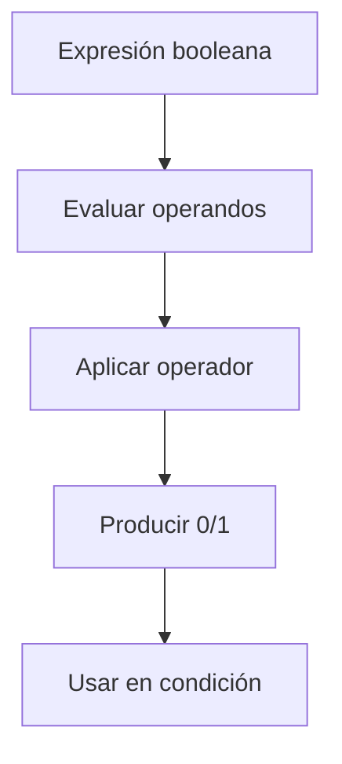
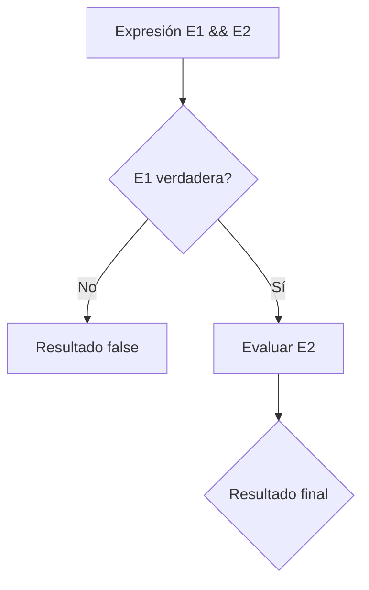
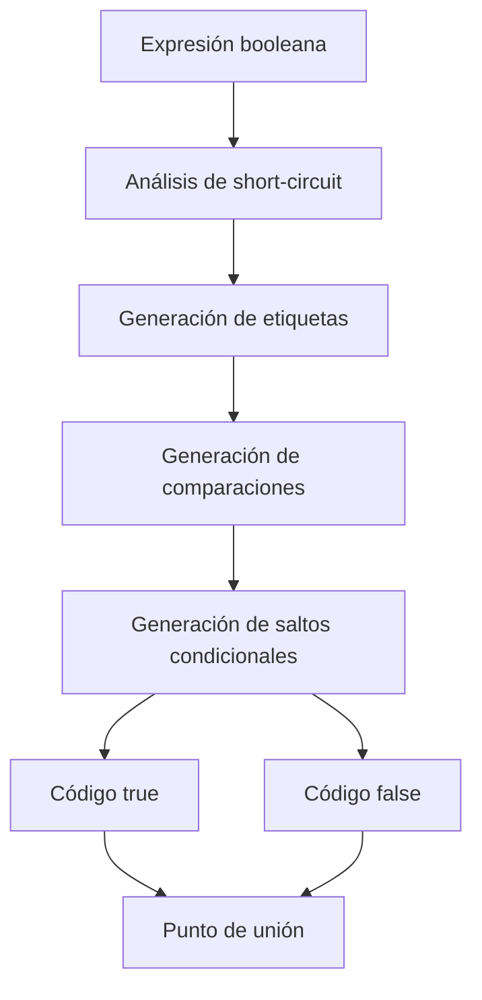

# Compiladores - Estructura del código generado

## 7.4 Operadores booleanos y relacionales.

---

Los operadores booleanos y relacionales son fundamentales en la generación de código para expresiones lógicas y estructuras de control. Según Aho et al. (2007), "la evaluación eficiente de expresiones booleanas es crucial para el rendimiento de las estructuras de control en los programas".

### Definición

Los **operadores booleanos** manipulan valores de verdad (true/false) y los **operadores relacionales** comparan valores para producir resultados booleanos. Su implementación en el código generado debe considerar evaluación perezosa (short-circuit) y optimizaciones.

### Clasificación de Operadores

#### Operadores Relacionales

- **Igualdad**: $==$ o $=$
- **Desigualdad**: $!=$ o $\neq$
- **Menor que**: $<$
- **Mayor que**: $>$
- **Menor o igual**: $\leq$ o $<=$
- **Mayor o igual**: $\geq$ o $>=$

#### Operadores Booleanos

- **AND lógico**: $\land$ o $\&\&$
- **OR lógico**: $\lor$ o $||$
- **NOT lógico**: $\lnot$ o $!$
- **XOR lógico**: $\oplus$

### Representación de Valores Booleanos

#### Esquemas de Representación

- **Esquema numérico**: $false = 0$, $true = 1$ ( o $true = -1$ )
- **Esquema de posiciones**: Usa flags del procesador directamente

#### Fórmulas de Evaluación

Para una expresión booleana $E$:

$$ value(E) = \begin{cases} 1 & \text{si } E \text{ es verdadera} \\\ 0 & \text{si } E \text{ es falsa} \end{cases} $$

### Generación de Código para Expresiones Booleanas

#### Enfoques de Implementación

##### 1. Evaluación por Valor Numérico


##### 2. Evaluación por Saltos (Short-circuit)


### Código de Tres Direcciones para Expresiones Booleanas

#### Ejemplo Básico
**Expresión fuente:**
```c
if (a > b && c != d || e == f)
```

**Código de tres direcciones:**
```
L1: if a > b goto L2
    goto L5
L2: if c != d goto L3
    goto L5
L3: goto L4
L5: if e == f goto L4
    goto L6
L4: // Código if verdadero
L6: // Código if falso
```

### Instrucciones de Máquina para Operaciones Booleanas

#### Arquitectura x86
```assembly
; Comparaciones
CMP op1, op2      ; Set flags based on op1 - op2

; Saltos condicionales
JE label          ; Jump if equal (==)
JNE label         ; Jump if not equal (!=)
JG label          ; Jump if greater (signed >)
JL label          ; Jump if less (signed <)
JA label          ; Jump if above (unsigned >)
JB label          ; Jump if below (unsigned <)

; Operaciones booleanas
AND dest, src     ; Logical AND
OR dest, src      ; Logical OR
XOR dest, src     ; Logical XOR
NOT dest          ; Logical NOT
```

#### Arquitectura ARM
```assembly
; Comparaciones y condiciones
CMP Rn, Operand2  ; Compare and set flags
TST Rn, Operand2  ; Test bits (AND without storing)

; Ejecución condicional
MOVGT Rd, Rn      ; Move if greater than
ANDNE Rd, Rn, Rm  ; AND if not equal
```

### Evaluación Short-Circuit

#### Implementación de AND Lógico (&&)
```assembly
; Código para: if (a && b)
    cmp [a], 0
    je false_label    ; Short-circuit si a es false
    cmp [b], 0
    je false_label
    ; Código para true
false_label:
    ; Código para false
```

#### Implementación de OR Lógico $(||)$
```assembly
; Código para: if (a || b)
    cmp [a], 0
    jne true_label    ; Short-circuit si a es true
    cmp [b], 0
    jne true_label
    jmp false_label
true_label:
    ; Código para true
false_label:
    ; Código para false
```

### Optimizaciones

#### Constant Folding para Expresiones Booleanas

$$ true \&\& false \rightarrow false $$

$$ (a > 5) \&\& (a < 3) \rightarrow false $$ (si se puede determinar estáticamente)

#### Common Subexpression Elimination
```c
if (x > 0 && y > 0 && x > 0)  // Segunda condición x > 0 redundante
```

#### Strength Reduction para Comparaciones
```assembly
; En lugar de:
cmp eax, 0
je label
; Se puede usar:
test eax, eax
jz label
```

### Ejemplos Prácticos

#### Ejemplo 1: Expresión Relacional Simple
**Código C:**
```c
int result = (a > b);
```

**Código x86:**
```assembly
mov eax, [a]
cmp eax, [b]
setg al          ; Set byte to 1 if greater
movzx eax, al    ; Zero-extend to 32 bits
mov [result], eax
```

#### Ejemplo 2: Expresión Booleana Compleja
**Código C:**
```c
if (x >= y && (z != w || flag == true))
```

**Código ARM:**
```assembly
    ldr r0, [x]
    ldr r1, [y]
    cmp r0, r1
    blt false_label    ; x < y, short-circuit AND

    ldr r2, [z]
    ldr r3, [w]
    cmp r2, r3
    bne true_label     ; z != w, short-circuit OR

    ldr r4, [flag]
    cmp r4, #1
    beq true_label     ; flag == true

    b false_label
true_label:
    ; Código if verdadero
false_label:
    ; Código if falso
```

### Manejo de Tipos y Conversiones

#### Conversión a Booleano
Cualquier valor distinto de cero se considera $true$:

$$ bool(x) = \begin{cases} false & \text{si } x = 0 \\ true & \text{si } x \neq 0 \end{cases} $$

#### Promoción de Tipos en Comparaciones

$$int < float \rightarrow float < float$$

$$char == int \rightarrow int == int$$

### Ejercicios Propuestos

1. **Generación de código para expresión:**
   Dada la expresión: `if (a <= b || c > d && e != f)`
   Genere el código de tres direcciones con evaluación short-circuit.

2. **Optimización de expresión:**
   Optimice la siguiente expresión aplicando las técnicas aprendidas:
   ```c
   if ((x > 5) && (y < 10) && (x > 5) && (z == 0))
   ```

3. **Conversión de tipos:**
   Para la expresión: `if (char_var && int_var > float_var)`
   Genere el código considerando las conversiones de tipos necesarias.

4. **Análisis de evaluación:**
   Dada la expresión: `a() && b() || c() && d()`
   Determine el orden de evaluación y los casos de short-circuit.

### Diagrama de Flujo de Evaluación Booleana



### Fórmulas de Evaluación Booleana

#### Álgebra Booleana Básica
- **Conmutatividad**: $A \land B \equiv B \land A$
- **Asociatividad**: $(A \land B) \land C \equiv A \land (B \land C)$
- **Distributividad**: $A \land (B \lor C) \equiv (A \land B) \lor (A \land C)$
- **Leyes de De Morgan**: $\lnot(A \land B) \equiv \lnot A \lor \lnot B$

#### Evaluación de Expresiones Complejas
Para $E = E_1 \land E_2 \lor E_3$:

$$value(E) = value(E_1) \times value(E_2) + value(E_3) - value(E_1) \times value(E_2) \times value(E_3)$$

### Referencias

#### Bibliografía Básica
1. Aho, A. V., Lam, M. S., Sethi, R., & Ullman, J. D. (2007). *Compilers: Principles, Techniques, and Tools* (Capítulo 6: Intermediate-Code Generation)
2. Cooper, K. D., & Torczon, L. (2004). *Engineering a Compiler* (Capítulo 7: Code Shape for Control Flow)
3. Scott, M. L. (2009). *Programming Language Pragmatics* (Capítulo 6: Control Flow)

#### Bibliografía Complementaria
4. Grune, D., et al. (2000). *Modern Compiler Design* (Capítulo 4: Processing Expressions)
5. Wilhelm, R., & Maurer, D. (1995). *Compiler Design* (Capítulo 6: Code Generation for Control Structures)

### Conclusión

La generación de código para operadores booleanos y relacionales es esencial para implementar eficientemente las estructuras de control en los lenguajes de programación. La evaluación short-circuit, las optimizaciones de expresiones booleanas y el manejo adecuado de los flags del procesador son aspectos críticos que impactan directamente en el rendimiento del código generado. El compilador debe generar código que aproveche las características de la arquitectura objetivo mientras mantiene la semántica correcta de las operaciones lógicas y relacionales.
