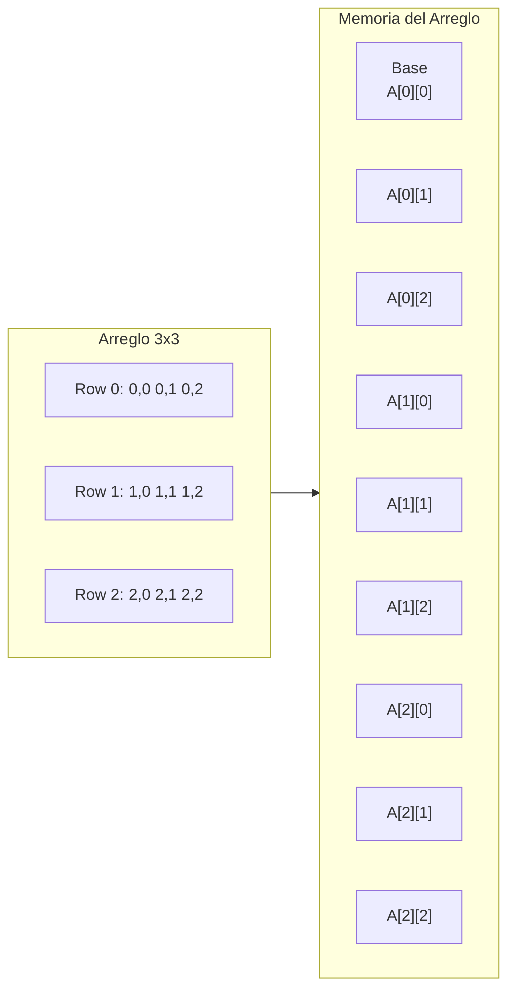
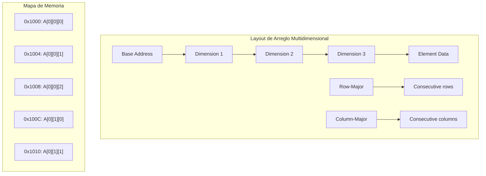

# Compiladores - Estructura del código generado

## 7.5 Almacenamiento y acceso a arreglos.

---

El almacenamiento y acceso a arreglos es un aspecto crítico en la generación de código, ya que los arreglos son estructuras de datos fundamentales en la mayoría de los lenguajes de programación. Según Aho et al. (2007), "la eficiencia en el acceso a arreglos puede determinar el rendimiento de aplicaciones científicas y de procesamiento de datos".

### Definición

Un **arreglo** es una estructura de datos que almacena una colección de elementos del mismo tipo, organizados en una o más dimensiones. El **acceso a arreglos** se refiere a las operaciones de lectura y escritura de elementos individuales mediante índices.

### Modelos de Almacenamiento

#### Almacenamiento por Filas (Row-Major)

Característico de C, C++, Java:

$$address[i][j] = base + (i \times n + j) \times size$$

#### Almacenamiento por Columnas (Column-Major)

Característico de Fortran, MATLAB:

$$address[i][j] = base + (j \times m + i) \times size$$

### Fórmulas de Direccionamiento

#### Arreglo Unidimensional

Para un arreglo `A[l..u]`:

$$address(A[i]) = base + (i - l) \times w$$

donde $w$ es el tamaño del elemento en bytes.

#### Arreglo Bidimensional

**Row-major:**

$$address(A[i][j]) = base + [(i - l_1) \times n + (j - l_2)] \times w$$

donde $n = u_2 - l_2 + 1$

**Column-major:**

$$address(A[i][j]) = base + [(j - l_2) \times m + (i - l_1)] \times w$$

donde $m = u_1 - l_1 + 1$

#### Arreglo Multidimensional

**Row-major generalizado:**

$$address(A[i_1][i_2]\cdots[i_k]) = base + \sum_{j=1}^{k} (i_j - l_j) \times \prod_{p=j+1}^{k} d_p \times w$$

donde $d_p = u_p - l_p + 1$

### Representación en Memoria



### Código de Tres Direcciones para Acceso a Arreglos

#### Ejemplo: Acceso a Arreglo Unidimensional

**Código fuente:**

```c
x = A[i] + 5;
```

**Código de tres direcciones:**

```
t1 = i * w         ; w = tamaño del elemento
t2 = base_A + t1   ; dirección de A[i]
t3 = *t2           ; carga A[i]
t4 = t3 + 5
x = t4
```

#### Ejemplo: Acceso a Arreglo Bidimensional

**Código fuente:**

```c
y = B[i][j] * 2;
```

**Código de tres direcciones (row-major):**

```
t1 = i * n * w     ; n = número de columnas
t2 = j * w
t3 = t1 + t2
t4 = base_B + t3
t5 = *t4
t6 = t5 * 2
y = t6
```

### Instrucciones de Máquina para Acceso a Arreglos

#### Arquitectura x86

```assembly
; Acceso a arreglo unidimensional
mov esi, [i]          ; índice
mov eax, [base + esi*4] ; carga A[i] (w=4 bytes)
add eax, 5
mov [x], eax

; Acceso a arreglo bidimensional
mov esi, [i]
mov edi, [j]
mov eax, esi
imul eax, [n]        ; i * n
add eax, edi         ; i*n + j
mov ebx, [base + eax*4] ; carga B[i][j]
shl ebx, 1           ; multiplica por 2
mov [y], ebx
```

#### Arquitectura ARM

```assembly
; Acceso con direccionamiento indexado
ldr r0, [base, r1, lsl #2]  ; base + r1*4

; Acceso a arreglo bidimensional
ldr r1, [i]
ldr r2, [j]
ldr r3, [n]
mul r4, r1, r3       ; i * n
add r4, r4, r2       ; i*n + j
ldr r5, [base, r4, lsl #2] ; carga elemento
```

### Optimizaciones

#### Cálculo de Direcciones en Tiempo de Compilación

Para arreglos con índices constantes:

$$address(A[5][3]) = base + (5 \times n + 3) \times w$$

#### Strength Reduction para Bucles

**Antes:**

```c
for (int i = 0; i < n; i++) {
    sum += A[i];
}
```

**Optimizado:**

```c
int *ptr = A;
for (int i = 0; i < n; i++) {
    sum += *ptr++;
}
```

#### Eliminación de Cálculos Redundantes

```assembly
; En lugar de calcular dirección en cada iteración:
mov esi, offset
add esi, base
; Mantener registro apuntador
```

### Manejo de Límites (Bounds Checking)

#### Verificación de Límites

```assembly
; Verificar 0 ≤ i < n
cmp [i], 0
jl out_of_bounds
cmp [i], [n]
jge out_of_bounds
; Acceso seguro
```

#### Optimización de Verificación

Para bucles con índices conocidos:

```c
// El compilador puede eliminar verificaciones
// si puede probar que 0 ≤ i < n
for (int i = 0; i < n; i++) {
    A[i] = 0;  // No necesita bounds checking
}
```

### Ejemplos Prácticos

#### Ejemplo 1: Arreglo Unidimensional

**Código C:**

```c
int arr[100];
int value = arr[index] * 2;
```

**Código x86 optimizado:**

```assembly
mov esi, [index]
mov eax, [arr + esi*4]  ; w = 4 bytes
shl eax, 1              ; multiplicar por 2
mov [value], eax
```

#### Ejemplo 2: Arreglo Bidimensional

**Código C:**

```c
float matrix[10][20];
float element = matrix[i][j];
```

**Código de tres direcciones:**

```
t1 = i * 80         ; 20 elementos × 4 bytes = 80 bytes por fila
t2 = j * 4          ; 4 bytes por elemento
t3 = t1 + t2
t4 = base_matrix + t3
element = *t4
```

### Ejercicios Propuestos

1. **Cálculo de direcciones:**
   Dado un arreglo `int A[5][10]` con base en 0x1000 y `sizeof(int) = 4`:
   - Calcule la dirección de `A[2][7]` (row-major)
   - Calcule la dirección de `A[3][4]` (column-major)

2. **Generación de código:**
   Para el acceso: `x = arr[i][j][k]` donde `arr[5][10][15]`:
   Genere el código de tres direcciones y el código assembler x86.

3. **Optimización de bucle:**
   Optimice el siguiente bucle aplicando strength reduction:

   ```c
   for (int i = 0; i < 100; i++) {
       for (int j = 0; j < 50; j++) {
           sum += matrix[i][j];
       }
   }
   ```

4. **Verificación de límites:**
   Diseñe un esquema de verificación de límites que pueda ser optimizado
   para bucles con acceso secuencial.

### Diagrama de Layout de Memoria



### Fórmulas Avanzadas

#### Direccionamiento con Límites Arbitrarios

Para `A[l₁..u₁][l₂..u₂]`:

$$address(A[i][j]) = base + [(i - l₁) \times (u₂ - l₂ + 1) + (j - l₂)] \times w$$

#### Stride Calculation

El stride para la dimensión k:

$$stride_k = w \times \prod_{p=k+1}^{n} d_p$$

donde $d_p = u_p - l_p + 1$

### Referencias

#### Bibliografía Básica

1. Aho, A. V., Lam, M. S., Sethi, R., & Ullman, J. D. (2007). _Compilers: Principles, Techniques, and Tools_ (Capítulo 6: Intermediate-Code Generation)
2. Cooper, K. D., & Torczon, L. (2004). _Engineering a Compiler_ (Capítulo 7: Code Shape for Data Structures)
3. Scott, M. L. (2009). _Programming Language Pragmatics_ (Capítulo 7: Data Types)

#### Bibliografía Complementaria

4. Grune, D., et al. (2000). _Modern Compiler Design_ (Capítulo 5: Data Layout and Storage)
5. Wilhelm, R., & Maurer, D. (1995). _Compiler Design_ (Capítulo 9: Storage Management)

### Conclusión

El almacenamiento y acceso a arreglos es un componente esencial en la generación de código que requiere un profundo entendimiento de los esquemas de direccionamiento, las optimizaciones de acceso y las consideraciones de arquitectura. La elección entre row-major y column-major, las técnicas de strength reduction para bucles, y el manejo eficiente de la verificación de límites son aspectos críticos que impactan significativamente en el rendimiento del código generado. El compilador debe generar código que aproveche al máximo las capacidades de direccionamiento de la arquitectura objetivo mientras mantiene la semántica correcta de las operaciones con arreglos.
