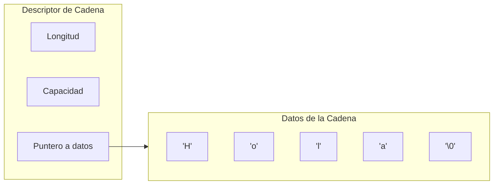
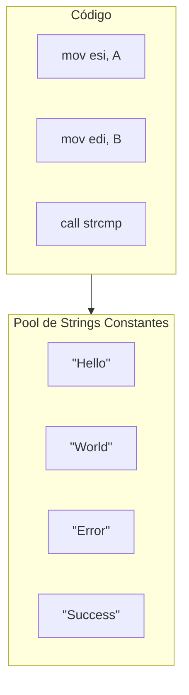
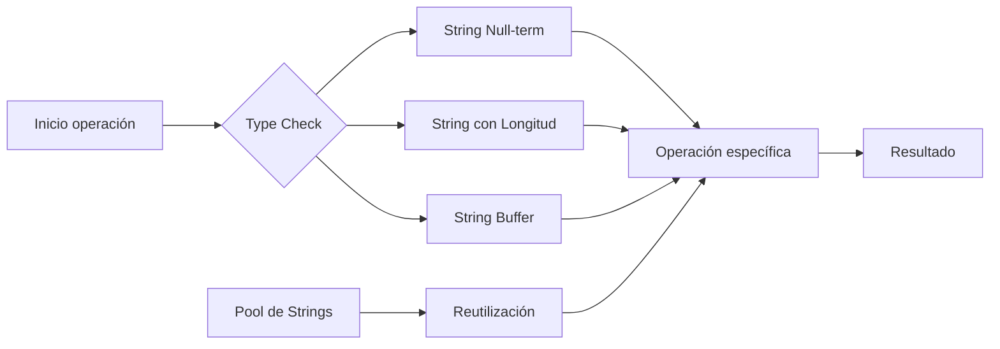

# Compiladores - Estructura del código generado

## 7.6 Cadenas de caracteres.

---

El manejo de cadenas de caracteres es fundamental en la generación de código, ya que las operaciones con strings son omnipresentes en aplicaciones modernas. Según Scott (2009), "la eficiencia en el manejo de cadenas puede impactar significativamente el rendimiento de aplicaciones de procesamiento de texto y sistemas web".

### Definición

Una **cadena de caracteres** es una secuencia de caracteres que representa texto. Las cadenas pueden implementarse de diferentes formas, cada una con implicaciones en la generación de código:

- Cadenas de longitud fija
- Cadenas de longitud variable con contador
- Cadenas terminadas en nulo (null-terminated)
- Cadenas con almacenamiento intermedio (ropes)

### Representación en Memoria

#### Esquemas de Almacenamiento

**Cadena terminada en nulo (C-style):**

$$S = c_1 c_2 c_3 \ldots c_n \backslash 0$$

**Cadena con longitud explícita (Pascal-style):**

$$S = [n] c_1 c_2 c_3 \ldots c_n$$

**Cadena con descriptor:**



### Operaciones Básicas con Cadenas

#### Longitud de Cadena

**Para cadenas null-terminated:**

$$length(s) = n \quad \text{donde } s[n] = \backslash 0 \text{ y } s[i] \neq \backslash 0 \text{ para } i < n$$

**Código x86 para strlen:**

```assembly
strlen:
    mov esi, [str]     ; puntero al string
    xor eax, eax       ; contador = 0
.loop:
    cmp byte [esi], 0
    je .done
    inc esi
    inc eax
    jmp .loop
.done:
    ret
```

#### Concatenación de Cadenas

$$s_1 + s_2 = c_1 c_2 \ldots c_n d_1 d_2 \ldots d_m$$

**Costo de concatenación:**

$$C_{concat} = length(s_1) + length(s_2) + overhead$$

### Fórmulas y Cálculos

#### Cálculo de Direcciones

Para acceso a carácter específico:

$$address(s[i]) = base + i \times char\_size$$

#### Overhead de Almacenamiento

**Null-terminated:**

$$overhead = 1 \text{ byte}$$

**Con longitud explícita:**

$$overhead = sizeof(length\_field)$$

### Implementación de Operaciones

#### Comparación de Cadenas

**Algoritmo strcmp:**

```c
int strcmp(const char *s1, const char *s2) {
    while (*s1 && (*s1 == *s2)) {
        s1++;
        s2++;
    }
    return *(unsigned char*)s1 - *(unsigned char*)s2;
}
```

**Código x86 optimizado:**

```assembly
strcmp:
    mov esi, [s1]
    mov edi, [s2]
.loop:
    mov al, [esi]
    mov bl, [edi]
    cmp al, bl
    jne .diff
    test al, al
    jz .equal
    inc esi
    inc edi
    jmp .loop
.diff:
    sub al, bl
    movsx eax, al
    ret
.equal:
    xor eax, eax
    ret
```

#### Copia de Cadenas

**Función strcpy:**

```assembly
strcpy:
    mov esi, [src]
    mov edi, [dest]
    mov ecx, -1
.loop:
    inc ecx
    mov al, [esi + ecx]
    mov [edi + ecx], al
    test al, al
    jnz .loop
    ret
```

### Optimizaciones

#### Inline de Operaciones Comunes

```c
// En lugar de llamar a strlen
int len = 0;
while (str[len] != '\0') len++;

// El compilador puede generar código inline optimizado
```

#### Pool de Strings Constantes



#### Interning de Strings

Almacenamiento único de strings idénticos:

$$ intern(s) = \begin{cases} s & \text{si } s \notin pool \\\ existing & \text{si } s \in pool \end{cases} $$

### Manejo de Memoria

#### Asignación Dinámica

**Para operaciones que modifican longitud:**

```c
char *concat(const char *s1, const char *s2) {
    size_t len1 = strlen(s1);
    size_t len2 = strlen(s2);
    char *result = malloc(len1 + len2 + 1);
    strcpy(result, s1);
    strcat(result, s2);
    return result;
}
```

#### Gestión de Buffer

**Estructura para strings mutables:**

```c
struct string_buffer {
    char *data;
    size_t length;
    size_t capacity;
};
```

### Ejemplos Prácticos

#### Ejemplo 1: Literales de String

**Código C:**

```c
char *message = "Hello, World!";
int len = strlen(message);
```

**Código generado:**

```assembly
section .data
message: db "Hello, World!", 0

section .text
mov esi, message
call strlen
mov [len], eax
```

#### Ejemplo 2: Concatenación Eficiente

**Código optimizado:**

```c
void smart_concat(char *dest, const char *src1, const char *src2) {
    while (*src1) *dest++ = *src1++;
    while (*src2) *dest++ = *src2++;
    *dest = '\0';
}
```

### Ejercicios Propuestos

1. **Implementación de funciones:**
   Implemente la función `strncpy` en assembly x86 con verificación de límites.

2. **Análisis de eficiencia:**
   Compare el costo de concatenar n strings usando:
   - Concatenación simple (O(n²))
   - Buffer con crecimiento exponencial (O(n))

3. **Optimización de literales:**
   Dado el código:

   ```c
   printf("Error: %s", "File not found");
   printf("Warning: %s", "File not found");
   ```

   Proponga una optimización para evitar duplicación.

4. **Gestión de memoria:**
   Diseñe un sistema de manejo de strings que minimice las operaciones de
   asignación de memoria para operaciones concatenativas frecuentes.

### Operaciones Avanzadas

#### Búsqueda de Patrones

**Algoritmo de Boyer-Moore:**

$$T = \text{texto}, P = \text{patrón}$$

$$skip = max(1, j - last\_occurrence[T[i+j]])$$

#### Expresiones Regulares

Compilación de regex a autómatas finitos:

$$ regex \rightarrow NFA \rightarrow DFA \rightarrow \text{Código} $$

### Diagrama de Estados para Operaciones



### Referencias

#### Bibliografía Básica

1. Aho, A. V., Lam, M. S., Sethi, R., & Ullman, J. D. (2007). _Compilers: Principles, Techniques, and Tools_ (Capítulo 6: Intermediate-Code Generation)
2. Cooper, K. D., & Torczon, L. (2004). _Engineering a Compiler_ (Capítulo 7: Code Shape for Strings)
3. Scott, M. L. (2009). _Programming Language Pragmatics_ (Capítulo 7: Data Types)

#### Bibliografía Complementaria

4. Grune, D., et al. (2000). _Modern Compiler Design_ (Capítulo 5: String Handling)
5. Wilhelm, R., & Maurer, D. (1995). _Compiler Design_ (Capítulo 9: String Operations)

### Conclusión

El manejo eficiente de cadenas de caracteres es crucial en la generación de código moderno. La elección del esquema de almacenamiento (null-terminated vs. length-prefixed), las optimizaciones como string interning y pooling, y la implementación eficiente de operaciones básicas determinan el rendimiento de aplicaciones que manipulan texto. El compilador debe generar código que balancee la eficiencia espacial y temporal, considerando las características específicas del lenguaje fuente y la arquitectura objetivo. Las técnicas avanzadas como crecimiento exponencial de buffers y compilación de expresiones regulares a autómatas demuestran la sofisticación requerida en el manejo moderno de strings.
