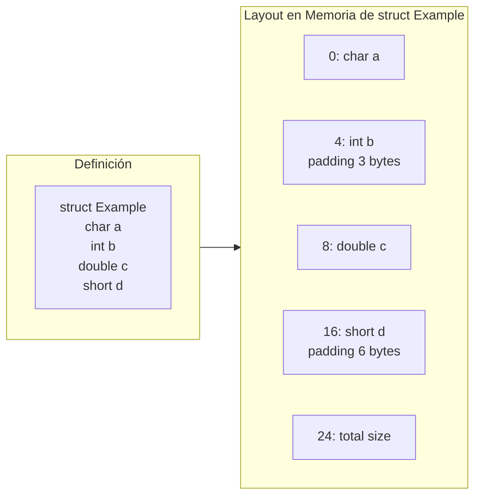
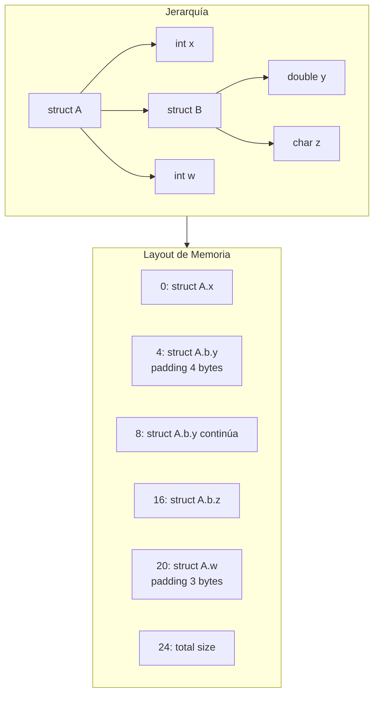

# Compiladores - Estructura del código generado

## 7.7 Referencias a estructuras.

---

Las referencias a estructuras son un componente fundamental en la generación de código para lenguajes que soportan tipos de datos estructurados. Según Cooper y Torczon (2004), "el acceso eficiente a los campos de una estructura es crucial para el rendimiento de aplicaciones que manipulan datos complejos".

### Definición

Una **estructura** (o registro) es un tipo de datos compuesto que agrupa variables relacionadas bajo un mismo nombre. Una **referencia a estructura** es una operación que accede a los miembros individuales de una estructura mediante operadores de acceso (`.` o `->`).

### Representación en Memoria

#### Layout de Estructuras

**Alineamiento de campos:**

$$offset(field_i) = \lceil \frac{offset(field_{i-1}) + size(field_{i-1})}{alignment(field_i)} \rceil \times alignment(field_i)$$

**Tamaño total:**

$$size(struct) = \lceil \frac{offset(last\\_field) + size(last\\_field)}{struct\\_alignment} \rceil \times struct\\_alignment$$

#### Ejemplo de Layout



### Operadores de Acceso

#### Acceso Directo (.)

Para `struct_var.field`:

$$address = base\\_address + offset(field)$$

#### Acceso por Puntero (->)

Para `struct_ptr->field`:

$$address = *struct\\_ptr + offset(field)$$

### Código de Tres Direcciones

#### Ejemplo: Acceso a Campos

**Código C:**

```c
struct Point {
    int x;
    int y;
    double weight;
};

struct Point p;
int sum = p.x + p.y;
```

**Código de tres direcciones:**

```
t1 = &p           ; dirección base
t2 = t1 + 0       ; offset x = 0
t3 = *t2          ; carga p.x
t4 = t1 + 4       ; offset y = 4
t5 = *t4          ; carga p.y
t6 = t3 + t5
sum = t6
```

### Instrucciones de Máquina

#### Arquitectura x86

```assembly
; Acceso directo
mov eax, [ebp - 8]      ; p.x (offset 0)
mov ebx, [ebp - 4]      ; p.y (offset 4)
add eax, ebx
mov [sum], eax

; Acceso por puntero
mov esi, [struct_ptr]   ; carga puntero
mov eax, [esi + 0]      ; acceso a field1
mov ebx, [esi + 4]      ; acceso a field2
```

#### Arquitectura ARM

```assembly
; Acceso con offset
ldr r0, [r1, #0]    ; field1
ldr r2, [r1, #4]    ; field2

; Acceso con registro base + offset
add r3, r1, #8
ldr r4, [r3]        ; field3
```

### Optimizaciones

#### Cálculo de Offsets en Tiempo de Compilación

$$offset(field) = constant$$

#### Common Subexpression Elimination

```c
// Antes
int a = p->x + p->y;
int b = p->x * p->z;

// Optimizado
int temp_x = p->x;
int a = temp_x + p->y;
int b = temp_x * p->z;
```

#### Alineamiento y Padding

**Cálculo de padding:**

$$ padding = (alignment - (offset \% alignment)) \% alignment $$

### Estructuras Anidadas

#### Acceso a Campos Anidados

Para `outer.inner.field`:

$$offset = offset(outer) + offset(inner) + offset(field)$$

**Ejemplo:**

```c
struct Outer {
    int a;
    struct Inner {
        double b;
        char c;
    } inner;
    int d;
};
```

$$offset(inner.b) = offset(outer) + offset(inner) + offset(b)$$

### Ejemplos Prácticos

#### Ejemplo 1: Estructura Simple

**Código C:**

```c
struct Employee {
    int id;
    float salary;
    char department;
};

struct Employee emp;
emp.salary = 50000.0;
```

**Código x86:**

```assembly
; Cálculo de offset: id=0, salary=4, department=8
mov eax, [ebp - 12]     ; dirección de emp
fld dword [eax + 4]     ; carga emp.salary
; ... operaciones
fstp dword [eax + 4]    ; almacena emp.salary
```

#### Ejemplo 2: Estructura con Puntero

**Código C:**

```c
struct Node {
    int value;
    struct Node* next;
};

struct Node* node = malloc(sizeof(struct Node));
node->value = 42;
node->next = NULL;
```

**Código de tres direcciones:**

```
t1 = malloc(8)        ; sizeof(Node) = 8
t2 = t1 + 0           ; offset value = 0
*t2 = 42
t3 = t1 + 4           ; offset next = 4
*t3 = NULL
node = t1
```

### Manejo de Herencia (OOP)

#### Estructuras con Herencia

```c
// Base class
struct Animal {
    int age;
    float weight;
};

// Derived class
struct Dog {
    struct Animal base;
    char breed[20];
};
```

$$offset(Dog.breed) = size(Animal)$$

### Ejercicios Propuestos

1. **Cálculo de offsets:**
   Dada la estructura:

   ```c
   struct Example {
       char a;
       double b;
       int c;
       short d;
   };
   ```

   Calcule los offsets y tamaño total con alineamiento de 8 bytes.

2. **Generación de código:**
   Para el acceso: `struct_ptr->field1.field2`
   Genere el código de tres direcciones y assembly x86.

3. **Optimización:**
   Optimice el siguiente código:

   ```c
   void process(struct Data* d) {
       int a = d->value + d->count;
       int b = d->value * d->scale;
       int c = d->count / d->value;
   }
   ```

4. **Estructuras anidadas:**
   Diseñe el layout de memoria para:
   ```c
   struct A {
       int x;
       struct B {
           double y;
           char z;
       } b;
       int w;
   };
   ```

### Diagrama de Layout Complejo



### Fórmulas Avanzadas

#### Cálculo de Offset Generalizado

Para estructura con n campos:

$$offset(field_k) = \sum\_{i=1}^{k-1} aligned\\_size(field\_i) $$

#### Alineamiento Estricto

$$ aligned\\_offset = offset + (alignment - (offset \% alignment)) \% alignment$$

### Referencias

#### Bibliografía Básica

1. Aho, A. V., Lam, M. S., Sethi, R., & Ullman, J. D. (2007). _Compilers: Principles, Techniques, and Tools_ (Capítulo 6: Intermediate-Code Generation)
2. Cooper, K. D., & Torczon, L. (2004). _Engineering a Compiler_ (Capítulo 7: Code Shape for Data Structures)
3. Scott, M. L. (2009). _Programming Language Pragmatics_ (Capítulo 7: Data Types)

#### Bibliografía Complementaria

4. Grune, D., et al. (2000). _Modern Compiler Design_ (Capítulo 5: Data Layout)
5. Wilhelm, R., & Maurer, D. (1995). _Compiler Design_ (Capítulo 9: Structure Access)

### Conclusión

Las referencias a estructuras son esenciales en la generación de código para lenguajes que soportan tipos de datos estructurados. El cálculo eficiente de offsets, el manejo de alineamiento y padding, y las optimizaciones de acceso a campos son críticos para el rendimiento. El compilador debe generar código que aproveche las capacidades de direccionamiento de la arquitectura objetivo, minimice los accesos a memoria y optimice el layout de las estructuras para reducir el padding y mejorar la localidad espacial. Las técnicas avanzadas para estructuras anidadas y herencia demuestran la complejidad y sofisticación requerida en el manejo moderno de datos estructurados.
