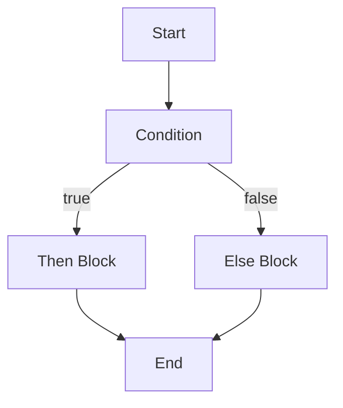
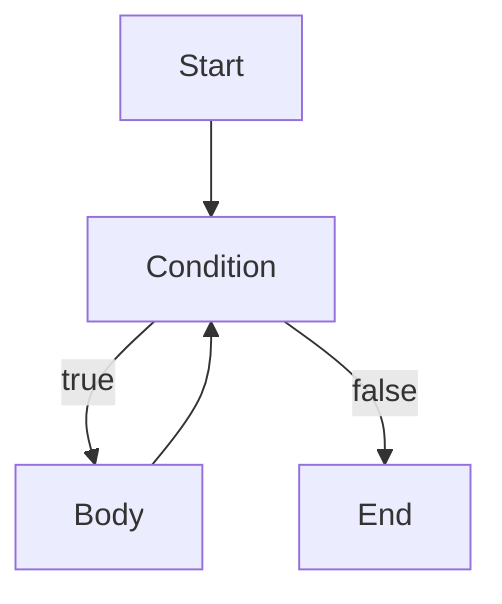
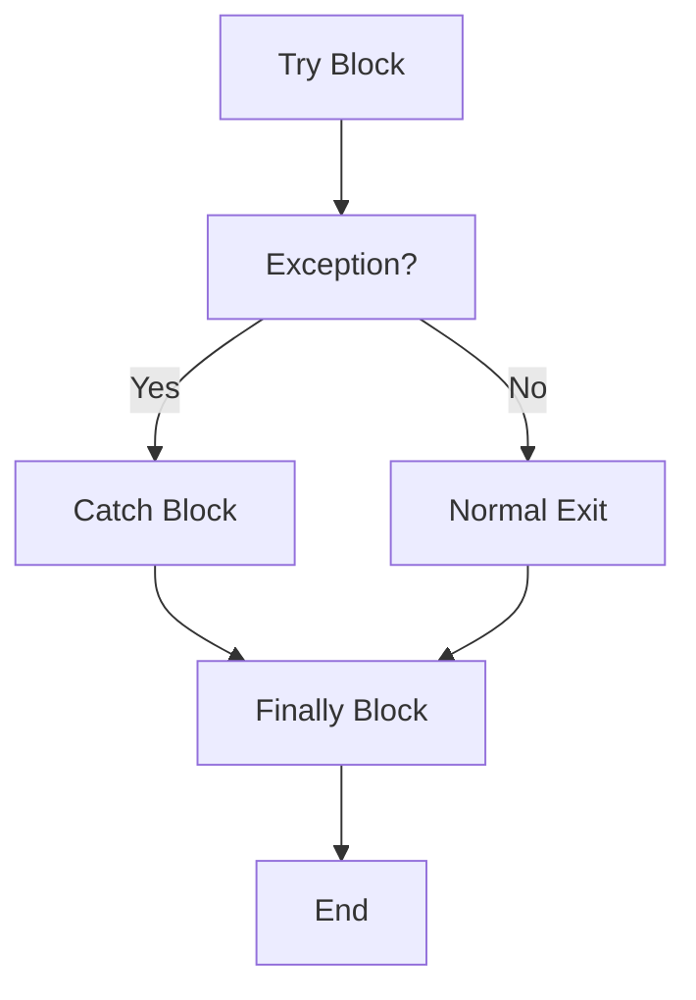

# Compiladores - Estructura del código generado

## 7.8 Construcciones para el control del flujo.

---

Las construcciones para el control del flujo son fundamentales en la generación de código, ya que determinan la secuencia de ejecución de las instrucciones. Según Aho et al. (2007), "la traducción eficiente de estructuras de control es crucial para el rendimiento y corrección de los programas compilados".

### Definición

El **control de flujo** se refiere a las construcciones del lenguaje que alteran la secuencia normal de ejecución de instrucciones. Incluye estructuras condicionales, bucles, saltos y llamadas a funciones.

### Clasificación de Construcciones de Control

#### Estructuras Condicionales

- **If-then-else**
- **Switch-case**
- **Expresiones condicionales ternarias**

#### Estructuras Iterativas

- **Bucles while**
- **Bucles for**
- **Bucles do-while**
- **Bucles foreach**

#### Estructuras de Salto

- **break**
- **continue**
- **return**
- **goto**

#### Llamadas a Funciones

- **Call/return**
- **Recursión**
- **Tail calls**

### Representación en Código Intermedio

#### Grafo de Flujo de Control (CFG)



#### Etiquetas y Saltos

**Estructura básica:**

```
L1: if condition goto L2
    goto L3
L2: // then block
    goto L4
L3: // else block
L4: // continue
```

### Generación de Código para Estructuras Condicionales

#### If-Then-Else

**Código C:**

```c
if (x > y) {
    max = x;
} else {
    max = y;
}
```

**Código de tres direcciones:**

```
L1: if x > y goto L2
    goto L3
L2: max = x
    goto L4
L3: max = y
L4:
```

**Código x86:**

```assembly
    mov eax, [x]
    cmp eax, [y]
    jg .then
    mov eax, [y]
    jmp .end
.then:
    mov eax, [x]
.end:
    mov [max], eax
```

#### Switch-Case

**Implementación mediante:**

- **Tabla de saltos** (para casos densos)
- **Cascada de if-else** (para casos dispersos)

$$address = base + (value - min) \times jump\\_size$$

### Generación de Código para Estructuras Iterativas

#### Bucle While

**Código C:**

```c
while (condition) {
    // body
}
```

**Código de tres direcciones:**

```
L1: if not condition goto L2
    // body
    goto L1
L2:
```

**Diagrama de flujo:**



#### Bucle For

**Código C:**

```c
for (init; condition; increment) {
    // body
}
```

**Código de tres direcciones:**

```
    init
L1: if not condition goto L2
    // body
    increment
    goto L1
L2:
```

### Optimizaciones de Control de Flujo

#### Loop Invariant Code Motion

$$cost = iterations \times moved\\_instructions$$

#### Dead Code Elimination

Eliminación de código inalcanzable:

$$ reachable(b) = \begin{cases}  true & \text{si } b = entry \\\ \bigvee_{p \in predecessors(b)} reachable(p) & \text{otherwise} \end{cases} $$

#### Branch Prediction Optimization

Reordenamiento de branches según perfiles de ejecución.

### Manejo de Excepciones

#### Try-Catch-Finally

**Estructura de manejo:**



#### Tabla de Excepciones

Estructura que mapea ranges de IP a handlers:

$$exception\\_table = \\{range: [start, end], handler: address \\}$$

### Llamadas a Funciones

#### Protocolo de Llamada

**Calling convention:**

- Paso de parámetros
- Salvado de registros
- Manejo de valor de retorno

**Código x86:**

```assembly
; Caller
push arg2
push arg1
call function
add esp, 8    ; cleanup stack

; Callee
function:
    push ebp
    mov ebp, esp
    ; function body
    pop ebp
    ret
```

#### Recursión

**Stack frame management:**

$$ stack\\_depth = recursion\\_depth \times frame\\_size $$

### Ejemplos Prácticos

#### Ejemplo 1: Bucle Anidado

**Código C:**

```c
for (int i = 0; i < n; i++) {
    for (int j = 0; j < m; j++) {
        sum += matrix[i][j];
    }
}
```

**Código optimizado:**

```assembly
    mov ecx, 0          ; i = 0
.outer_loop:
    cmp ecx, [n]
    jge .end_outer
    mov edx, 0          ; j = 0
    mov esi, [matrix]   ; base pointer
    imul edi, ecx, [m_size] ; i * row_size
.inner_loop:
    cmp edx, [m]
    jge .end_inner
    mov eax, [esi + edi + edx*4] ; matrix[i][j]
    add [sum], eax
    inc edx
    jmp .inner_loop
.end_inner:
    inc ecx
    jmp .outer_loop
.end_outer:
```

#### Ejemplo 2: Switch con Tabla de Saltos

**Código C:**

```c
switch (value) {
    case 1: result = 10; break;
    case 2: result = 20; break;
    case 3: result = 30; break;
    default: result = 0;
}
```

**Código x86 con jump table:**

```assembly
    mov eax, [value]
    dec eax             ; adjust for base 0
    cmp eax, 2
    ja .default
    jmp [jump_table + eax*4]

jump_table:
    dd .case1, .case2, .case3

.case1:
    mov dword [result], 10
    jmp .end
.case2:
    mov dword [result], 20
    jmp .end
.case3:
    mov dword [result], 30
    jmp .end
.default:
    mov dword [result], 0
.end:
```

### Ejercicios Propuestos

1. **Generación de código para if-else:**
   Convierta el siguiente código a código de tres direcciones y assembly x86:

   ```c
   if (a > b && c < d || e == f) {
       result = 1;
   } else {
       result = 0;
   }
   ```

2. **Optimización de bucle:**
   Optimice el siguiente bucle aplicando loop invariant code motion:

   ```c
   for (int i = 0; i < n; i++) {
       int temp = x * y * z;
       array[i] = temp + i;
   }
   ```

3. **Implementación de switch:**
   Para un switch con casos 1, 5, 10, 100, diseñe:
   - Cascada de if-else
   - Tabla de saltos con búsqueda binaria
     Compare el costo de cada enfoque.

4. **Manejo de excepciones:**
   Diseñe el mecanismo de generación de código para:
   ```c
   try {
       risky_operation();
   } catch (Exception e) {
       handle_error(e);
   } finally {
       cleanup();
   }
   ```

### Fórmulas y Métricas

#### Complejidad de Control de Flujo

**Cyclomatic complexity:**

$$V(G) = E - N + 2P$$

donde:

- $E$ = número de aristas
- $N$ = número de nodos
- $P$ = número de componentes conexos

#### Predecibilidad de Branches

$$ prediction\\_accuracy = \frac{correct\\_predictions}{total\\_branches}$$

#### Costo de Mispreduction

$$ cost = penalty \times misprediction\\_rate $$

### Referencias

#### Bibliografía Básica

1. Aho, A. V., Lam, M. S., Sethi, R., & Ullman, J. D. (2007). _Compilers: Principles, Techniques, and Tools_ (Capítulo 6: Intermediate-Code Generation)
2. Cooper, K. D., & Torczon, L. (2004). _Engineering a Compiler_ (Capítulo 7: Code Shape for Control Flow)
3. Scott, M. L. (2009). _Programming Language Pragmatics_ (Capítulo 6: Control Flow)

#### Bibliografía Complementaria

4. Grune, D., et al. (2000). _Modern Compiler Design_ (Capítulo 6: Control Flow)
5. Wilhelm, R., & Maurer, D. (1995). _Compiler Design_ (Capítulo 8: Code Generation for Control Structures)

### Conclusión

Las construcciones para el control del flujo son esenciales en la generación de código, determinando la estructura lógica y el rendimiento del programa compilado. La traducción eficiente de estructuras condicionales, bucles y mecanismos de excepción requiere un profundo entendimiento de la arquitectura objetivo y las técnicas de optimización. El compilador debe balancear entre generación de código directa y optimizaciones complejas como movimiento de código invariante, eliminación de código muerto y optimización de predicción de branches. El manejo eficiente del control de flujo impacta directamente en el rendimiento, especialmente en aplicaciones con patrones de ejecución complejos y bucles anidados.
