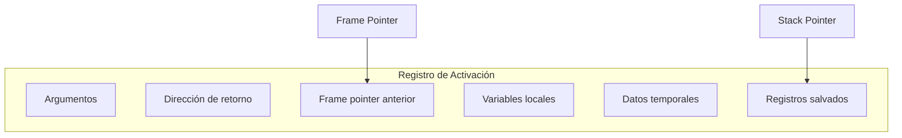
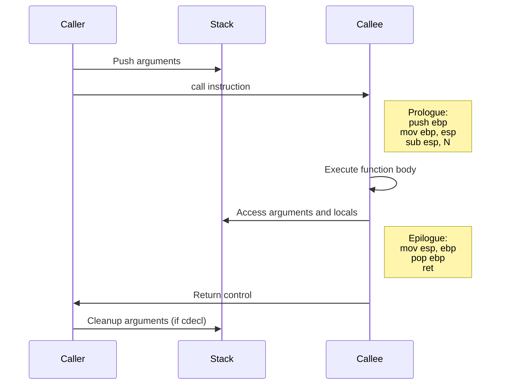

# Compiladores - Estructura del código generado

## 7.9 Llamadas a procedimientos.

---

Las llamadas a procedimientos (o funciones) son una parte fundamental de los lenguajes de programación y su implementación eficiente es crucial para el rendimiento. Según Cooper y Torczon (2004), "el mecanismo de llamada a procedimientos debe balancear flexibilidad, eficiencia y seguridad".

### Definición

Una **llamada a procedimiento** es una construcción del lenguaje que transfiere el control de ejecución a un bloque de código independiente (el procedimiento), con la posibilidad de pasar argumentos y retornar un valor.

### Componentes de una Llamada

#### Estructura Básica

- **Caller**: Procedimiento que realiza la llamada
- **Callee**: Procedimiento llamado
- **Argumentos**: Datos pasados al callee
- **Valor de retorno**: Resultado devuelto por el callee
- **Registro de activación**: Contexto de ejecución del procedimiento

### Registro de Activación (Stack Frame)

#### Estructura Típica



#### Cálculo de Tamaño

$$frame\\_size = args\\_size + local\\_vars\\_size + temp\\_size + saved\\_regs\\_size + overhead$$

### Convenciones de Llamada (Calling Conventions)

#### Paso de Parámetros

- **Por registro**: Fastest but limited
- **Por pila**: Flexible but slower
- **Mixto**: Combinación de ambos

#### Convenciones Comunes

- **cdecl**: Caller cleans stack
- **stdcall**: Callee cleans stack
- **fastcall**: Parameters in registers
- **System V AMD64 ABI**: Modern standard

### Código de Tres Direcciones para Llamadas

#### Ejemplo Básico

**Llamada:** `result = func(a, b, c);`

**Código de tres direcciones:**

```
param a
param b
param c
call func, 3
result = RV   ; RV = Return Value
```

### Generación de Código Assembly

#### Protocolo de Llamada x86 (cdecl)

**Caller:**

```assembly
; Push arguments in reverse order
push dword [c]
push dword [b]
push dword [a]
call func
add esp, 12    ; Cleanup stack (3 args * 4 bytes)
mov [result], eax  ; Return value in EAX
```

**Callee:**

```assembly
func:
    push ebp
    mov ebp, esp
    sub esp, 16     ; Space for local variables

    ; Function body
    mov eax, [ebp+8]  ; Access argument a
    mov ebx, [ebp+12] ; Access argument b
    add eax, ebx

    ; Epilogue
    mov esp, ebp
    pop ebp
    ret
```

#### Protocolo System V AMD64 ABI

**Primeros 6 parámetros en registros:**

- RDI, RSI, RDX, RCX, R8, R9
- **Return value**: RAX

### Manejo de Variables Locales

#### Acceso a Variables

$$address(local\\_var) = frame\\_pointer - offset$$

#### Cálculo de Offsets

```c
void example(int a, int b) {
    int local1;     // offset: -4
    double local2;  // offset: -12 (with 4 bytes padding)
    char local3;    // offset: -13
}
```

### Optimizaciones

#### Inline Expansion

Sustitución de llamada por el cuerpo del procedimiento:

$$benefit = call\\_overhead - code\\_size\\_increase$$

#### Tail Call Optimization

Reutilización del stack frame para llamadas finales:

```c
int factorial(int n, int acc = 1) {
    if (n == 0) return acc;
    return factorial(n - 1, n * acc);  // Tail call
}
```

#### Register Allocation for Parameters

Asignación de parámetros a registros para evitar acceso a memoria.

### Ejemplos Prácticos

#### Ejemplo 1: Función Simple

**Código C:**

```c
int add(int a, int b) {
    return a + b;
}

int result = add(5, 3);
```

**Código x86-64 (System V):**

```assembly
; Caller
mov edi, 5      ; first argument
mov esi, 3      ; second argument
call add
mov [result], eax

; Callee
add:
    lea eax, [edi + esi]
    ret
```

#### Ejemplo 2: Función con Variables Locales

**Código C:**

```c
int compute(int x, int y) {
    int temp = x * y;
    int result = temp + 10;
    return result;
}
```

**Código x86:**

```assembly
compute:
    push ebp
    mov ebp, esp
    sub esp, 8      ; Space for 2 integers

    mov eax, [ebp+8]  ; x
    imul eax, [ebp+12] ; x * y
    mov [ebp-4], eax   ; temp

    mov eax, [ebp-4]
    add eax, 10
    mov [ebp-8], eax   ; result

    mov eax, [ebp-8]   ; return value
    mov esp, ebp
    pop ebp
    ret
```

### Ejercicios Propuestos

1. **Generación de código:**
   Para la función:

   ```c
   float calculate(float a, float b, int c) {
       return (a + b) * c;
   }
   ```

   Genere el código assembly para x86-64 System V ABI.

2. **Cálculo de stack frame:**
   Dada la función:

   ```c
   void example(int a, double b, char c) {
       int x;
       double y;
       int z[3];
   }
   ```

   Calcule el tamaño del stack frame y los offsets de cada variable.

3. **Optimización de tail call:**
   Convierta la siguiente función a forma tail-recursive:

   ```c
   int sum(int n) {
       if (n == 0) return 0;
       return n + sum(n - 1);
   }
   ```

4. **Análisis de convenciones:**
   Compare las convenciones cdecl y stdcall en términos de:
   - Tamaño de código
   - Velocidad de ejecución
   - Compatibilidad

### Manejo de Recursión

#### Stack Depth Management

$$maximum\\_stack\\_depth = recursion\\_depth \times frame\\_size$$

#### Tail Recursion Elimination

```c
// Before optimization
int factorial(int n) {
    if (n == 0) return 1;
    return n * factorial(n - 1);
}

// After optimization
int factorial(int n, int acc = 1) {
    if (n == 0) return acc;
    return factorial(n - 1, n * acc);
}
```

### Diagrama de Secuencia de Llamada



### Fórmulas y Métricas

#### Costo de Llamada a Procedimiento

$$call\\_cost = push\\_args + call\\_instruction + prologue + epilogue + ret\\_instruction$$

#### Overhead de Inline

$$inline\\_overhead = code\\_size\\_increase - call\\_cost\\_savings$$

#### Eficiencia de Registros

$$register\\_efficiency = \frac{register\\_parameters}{total\\_parameters}$$

### Referencias

#### Bibliografía Básica

1. Aho, A. V., Lam, M. S., Sethi, R., & Ullman, J. D. (2007). _Compilers: Principles, Techniques, and Tools_ (Capítulo 6: Intermediate-Code Generation)
2. Cooper, K. D., & Torczon, L. (2004). _Engineering a Compiler_ (Capítulo 6: Procedure Calls)
3. Scott, M. L. (2009). _Programming Language Pragmatics_ (Capítulo 8: Subroutines and Control Abstraction)

#### Bibliografía Complementaria

4. Grune, D., et al. (2000). _Modern Compiler Design_ (Capítulo 7: Procedure Handling)
5. Wilhelm, R., & Maurer, D. (1995). _Compiler Design_ (Capítulo 10: Code Generation for Procedures)

### Conclusión

Las llamadas a procedimientos son un mecanismo fundamental cuya implementación eficiente impacta significativamente en el rendimiento del código generado. El compilador debe manejar múltiples aspectos: convenciones de llamada, gestión del stack frame, paso de parámetros, y optimizaciones como inline expansion y tail call optimization. La elección entre diferentes estrategias depende del lenguaje, la arquitectura objetivo y los requisitos de rendimiento. Un buen generador de código debe balancear la eficiencia de ejecución con el uso de recursos, especialmente en el manejo de la pila y registros. Las optimizaciones modernas permiten reducir sustancialmente el overhead de las llamadas a procedimiento, haciendo posible escribir código modular sin penalizaciones significativas de rendimiento.
