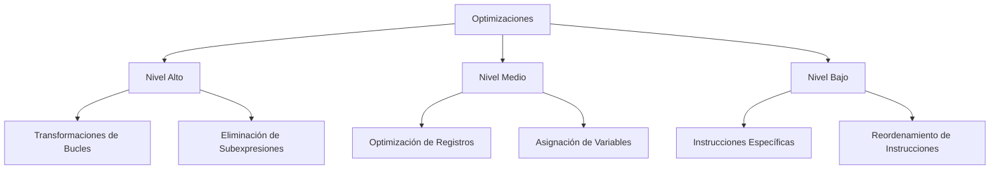

# Compiladores - Introducción a optimización de código

## 8.1 Aspectos generales.

---

La optimización de código es una fase crucial en el proceso de compilación que busca mejorar el código intermedio o final de un programa para lograr un mejor rendimiento, menor consumo de recursos o ambas. Según Aho et al. (2007), la optimización "busca mejorar el código transformándolo de manera que se ejecute más rápido o utilice menos recursos, manteniendo su funcionalidad".

#### Objetivos de la Optimización

Los principales objetivos son:

- Mejorar el tiempo de ejecución
- Reducir el consumo de memoria
- Minimizar el uso de energía
- Mejorar la localidad de los datos
- Optimizar el paralelismo

### Conceptos Fundamentales

#### Criterios de Optimización

Para evaluar la calidad de una optimización, consideramos:

1. **Corrección**: La optimización debe preservar la semántica del programa
2. **Rendimiento**: Debe mejorar el tiempo de ejecución
3. **Compilación**: No debe aumentar excesivamente el tiempo de compilación
4. **Portabilidad**: Debe ser aplicable en diferentes arquitecturas

#### Métricas de Rendimiento

El speedup (aceleración) se calcula como:

$$S = \frac{T_{\text{sin optimización}}}{T_{\text{con optimización}}}$$

Donde $T$ representa el tiempo de ejecución.

### Clasificación de las Optimizaciones

#### Por Nivel de Aplicación



#### Por Alcance

- **Intraprocedural**: Dentro de un mismo procedimiento
- **Interprocedural**: Entre diferentes procedimientos
- **Local**: Dentro de un bloque básico
- **Global**: A través de bloques básicos

### Análisis de Flujo de Datos

El análisis de flujo de datos es fundamental para las optimizaciones. Se basa en ecuaciones de flujo de datos:

$$IN[B] = \bigcup_{P \in pred(B)} OUT[P]$$

$$OUT[B] = GEN[B] \cup (IN[B] - KILL[B])$$

Donde:

- $IN[B]$: Conjunto de definiciones que llegan al inicio del bloque B
- $OUT[B]$: Conjunto de definiciones que salen del bloque B
- $GEN[B]$: Definiciones generadas en B
- $KILL[B]$: Definiciones eliminadas en B

### Ejemplo de Optimización

Consideremos un ejemplo simple de eliminación de subexpresiones comunes:

**Código original:**

```c
a = b + c;
d = b + c;
e = a * 2;
```

**Código optimizado:**

```c
a = b + c;
d = a;      // Eliminación de subexpresión común
e = a << 1; // Sustitución de multiplicación por desplazamiento
```

### Técnicas de Optimización Básicas

#### 1. Eliminación de Código Muerto

```python
# Antes de la optimización
x = 10
y = 20
z = x + y  # Esta asignación nunca se usa
print(x)

# Después de la optimización
x = 10
print(x)
```

#### 2. Propagación de Constantes

$$x = 5$$
$$y = x + 3 \quad \Rightarrow \quad y = 8$$

#### 3. Simplificación Algebraica

$$a = b + 0 \quad \Rightarrow \quad a = b$$
$$c = d * 1 \quad \Rightarrow \quad c = d$$

### Ejercicios Propuestos

#### Ejercicio 1: Identificación de Optimizaciones

Analice el siguiente código e identifique al menos tres oportunidades de optimización:

```c
int calcular(int a, int b) {
    int x = a * 2;
    int y = b * 2;
    int z = x + y;
    if (z > 100) {
        return z * 2;
    } else {
        return z * 2;
    }
}
```

#### Ejercicio 2: Análisis de Flujo de Datos

Dado el siguiente bloque básico:

```
1: a = b + c
2: d = a * 2
3: e = b + c
4: f = d + e
```

Calcule:

- $GEN[B]$ y $KILL[B]$
- Las definiciones que llegan a cada instrucción

#### Ejercicio 3: Optimización de Bucles

Optimice el siguiente bucle:

```c
for (int i = 0; i < 100; i++) {
    resultado = resultado + array[i] * 2;
}
```

### Consideraciones Prácticas

#### Coste-Beneficio

La relación coste-beneficio de una optimización se puede expresar como:

$$R = \frac{B}{C}$$

Donde:

- $R$: Relación coste-beneficio
- $B$: Beneficio esperado (reducción de tiempo)
- $C$: Coste de implementación (tiempo de compilación)

#### Perfilado de Código

El perfilado ayuda a identificar los puntos críticos (hotspots) donde las optimizaciones tendrán mayor impacto:

$$I = \frac{T_{\text{sección}}}{T_{\text{total}}} \times F_{\text{ejecución}}$$

Donde $I$ es el índice de importancia para optimizar.

### Referencias

#### Bibliografía Básica

1. Keith D. Cooper y Linda Torczon, Engineering a Compiler, Morgan Kaufmann, 2004. (Capítulos 8-10)
2. Michael Lee Scott, Programming Language Pragmatics, Morgan Kauffman Publishers, 2009. (Capítulo 16)
3. Aho, Lam, Sethi y Ullman, Compilers, Principles, Techniques and Tools, Second Edition, Pearson Education Inc., 2007. (Capítulo 9)

#### Bibliografía Complementaria

1. Aho y Ullman, The Theory of Parsing, Translation and Compiling, Vol. 2, Prentice-Hall, 1973
2. Duck Grune, Henri E. Bal, Ceriel J. H. Jacobs y Koen G. Langendoen, Modern Compiler Design, John Wiley y Sons, Ltd., 2000.

### Consejos para el Estudio

1. Comprenda primero los conceptos de análisis de flujo de datos
2. Practique con ejemplos pequeños antes de abordar casos complejos
3. Utilice herramientas de visualización para entender las transformaciones
4. Experimente con compiladores reales y observe los efectos de diferentes niveles de optimización
