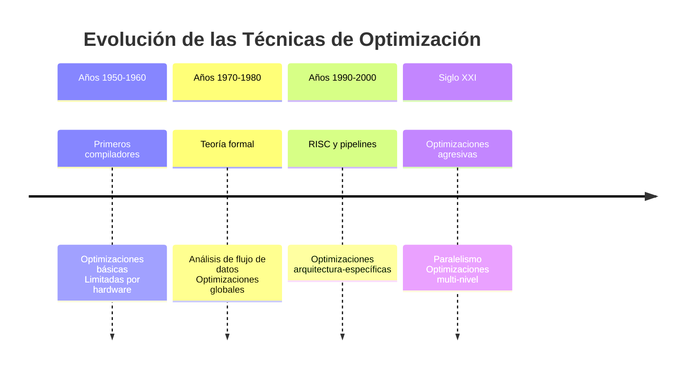
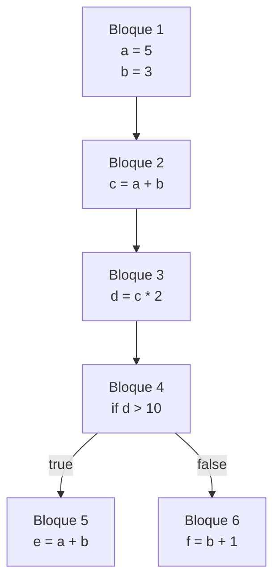
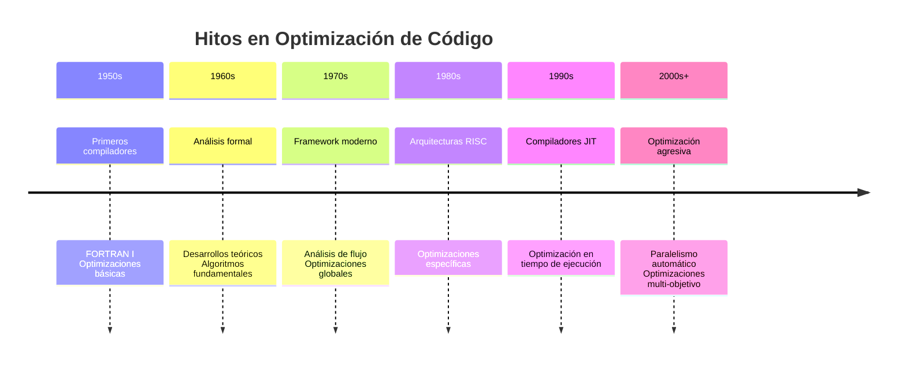

# Compiladores - Introducción a optimización de código

## 8.2 Antecedentes.

---

### Evolución Histórica de la Optimización de Código

#### Orígenes y Contexto Histórico

La optimización de código tiene sus raíces en los primeros días de la computación, cuando los recursos eran extremadamente limitados. Según Aho et al. (2007), "las técnicas de optimización surgieron como respuesta a la necesidad de maximizar el rendimiento en sistemas con memoria y capacidad de procesamiento muy restringidas".



#### Marco Teórico Fundamental

El trabajo seminal de Aho y Ullman (1972-1973) estableció las bases teóricas para el análisis y transformación de programas. La teoría de compilación se fundamenta en:

1. **Teoría de autómatas y lenguajes formales**
2. **Teoría de grafos para análisis de flujo de datos**
3. **Álgebra para transformaciones de código**

### Fundamentos Matemáticos

#### Teoría de Retículos (Lattices)

El análisis de flujo de datos se basa en la teoría de retículos. Un retículo es un conjunto parcialmente ordenado $(L, \sqsubseteq)$ donde:

- Para cada par de elementos existe un supremo (menor cota superior)
- Para cada par de elementos existe un ínfimo (mayor cota inferior)

El elemento máximo se denota como $\top$ y el mínimo como $\bot$.

#### Puntos Fijos

Las ecuaciones de flujo de datos se resuelven encontrando puntos fijos. Para una función $f: L \rightarrow L$, un punto fijo es un elemento $x$ tal que:

$$f(x) = x$$

El teorema de Knaster-Tarski garantiza la existencia de puntos fijos en retículos completos.

### Primeras Técnicas de Optimización

#### Optimizaciones de los Primeros Compiladores

**FORTRAN I (1957)** incluía optimizaciones básicas:

```fortran
C Código original
X = A + B
Y = A + B
Z = X * Y

C Optimización temprana
TEMP = A + B
X = TEMP
Y = TEMP
Z = X * Y
```

#### Análisis de Alcance (Scoping)

El concepto de alcance fue fundamental para optimizaciones tempranas:

$$alcance(x) = \{ puntos \ del \ programa \ donde \ x \ es \ visible \}$$

### Desarrollo de Técnicas Avanzadas

#### Algoritmo de Allen-Cocke (1972)

Desarrollaron el concepto de **grafos de flujo de control** y introdujeron:

1. **Eliminación de subexpresiones comunes**
2. **Propagación de constantes**
3. **Optimización de bucles**

#### Algoritmo de Kildall (1973)

Introdujo el marco teórico para **análisis de flujo de datos** mediante:

$$IN[B] = \bigcap_{P \in pred(B)} OUT[P]$$

$$OUT[B] = GEN[B] \cup (IN[B] - KILL[B])$$

### Ejemplos Históricos

#### Optimización en Compiladores Tempranos

**Código original:**

```pascal
var i, j: integer;
begin
    i := 1;
    j := 2;
    while i < 100 do
    begin
        j := j + i;
        i := i + 1;
    end;
end.
```

**Optimización aplicada (strength reduction):**

```pascal
var i, j, temp: integer;
begin
    i := 1;
    j := 2;
    temp := 0;
    while i < 100 do
    begin
        temp := temp + i;
        i := i + 1;
    end;
    j := j + temp;
end.
```

### Ejercicios Propuestos

#### Ejercicio 1: Análisis Histórico

Analice cómo las limitaciones de hardware en los años 1960 influyeron en el desarrollo de las primeras técnicas de optimización. Mencione al menos tres limitaciones específicas y cómo se abordaron.

#### Ejercicio 2: Teoría de Retículos

Dado el retículo de signos: $\{\bot, -, 0, +, \top\}$ con el orden parcial $\sqsubseteq$ definido como:

- $\bot \sqsubseteq x$ para todo x
- $x \sqsubseteq \top$ para todo x
- Los elementos -, 0, + son incomparables entre sí

Calcule:

1. $- \sqcup +$ (supremo)
2. $- \sqcap +$ (ínfimo)
3. $\bot \sqcup \top$

#### Ejercicio 3: Implementación de Algoritmos Tempranos

Implemente el algoritmo de propagación de constantes para el siguiente bloque básico:

```
1: a = 5
2: b = 3
3: c = a + b
4: d = c * 2
5: if d > 10 goto 7
6: e = a + b
```

#### Ejercicio 4: Análisis de Flujo de Datos

Para el siguiente grafo de flujo de control:



Calcule las definiciones que llegan a cada bloque usando las ecuaciones de flujo de datos.

### Impacto en Compiladores Modernos

#### Legado de las Técnicas Tempranas

Las contribuciones históricas se mantienen relevantes:

1. **Algoritmos de análisis estático** (Aho-Ullman)
2. **Framework de optimización** (Allen-Cocke)
3. **Teoría de análisis de flujo** (Kildall)

#### Medida del Impacto Histórico

El progreso se puede cuantificar mediante:

$$ \text{Evolución} = \frac{Optimizaciones\_{modernas}}{Optimizaciones\_{\text{históricas}}} \times \frac{Complejidad\_{problemas}}{Recursos\_{hardware}} $$

### Referencias Críticas

#### Bibliografía Básica

1. Aho, Lam, Sethi y Ullman, Compilers, Principles, Techniques and Tools, Second Edition, Pearson Education Inc., 2007. (Capítulo 1 - Introducción histórica)
2. Aho y Ullman, The Theory of Parsing, Translation and Compiling, Vol. 1, Parsing, Prentice Hall, 1972. (Capítulos 1-3)

#### Bibliografía Complementaria

3. Aho y Ullman, The Theory of Parsing, Translation and Compiling, Vol. 2, Prentice-Hall, 1973 (Parte III - Optimización)
4. Michael Lee Scott, Programming Language Pragmatics, Morgan-Kauffman Publishers, 2009. (Capítulo 16 - Contexto histórico)

### Línea de Tiempo de Contribuciones Clave



### Conclusiones

El estudio de los antecedentes históricos proporciona:

1. **Comprensión profunda** de los fundamentos teóricos
2. **Perspectiva histórica** sobre la evolución de técnicas
3. **Base sólida** para entender optimizaciones modernas
4. **Apreciación** de las contribuciones fundamentales

Los conceptos desarrollados en las décadas de 1960 y 1970 continúan siendo la base de los compiladores optimizadores modernos, demostrando la solidez de los fundamentos teóricos establecidos por los pioneros del campo.
