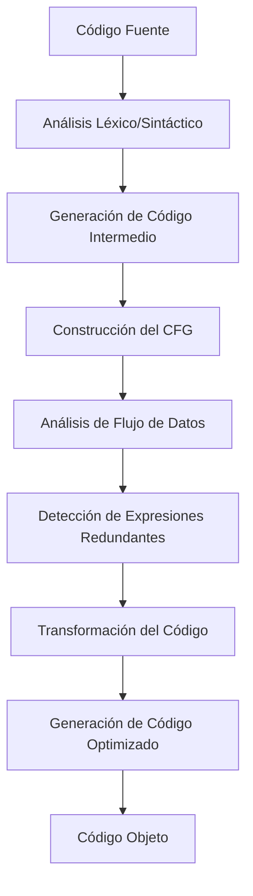

# Compiladores - Introducción a optimización de código

## 8.3 Expresiones redundantes.

---

Una expresión redundante es aquella que calcula un valor idéntico a una expresión previamente computada en el mismo contexto de ejecución, sin que las variables involucradas hayan sido modificadas entre ambos cálculos. Según Aho et al. (2007), "una expresión es redundante si su valor ya ha sido computado y ninguno de sus operandos ha sido modificado desde el cálculo anterior".

#### Clasificación de Redundancias

1. **Redundancia total**: La expresión aparece múltiples veces en el código
2. **Redundancia parcial**: Parte de la expresión ha sido previamente calculada
3. **Redundancia en bucles**: Expresiones invariantes dentro de bucles

### Detección de Expresiones Redundantes

#### Análisis de Flujo de Datos

La detección se basa en el concepto de **expresiones disponibles** (available expressions). Una expresión `x + y` está disponible en un punto p si:

- Todo camino desde el inicio al punto p evalúa `x + y`
- Ninguna variable en `x` o `y` es redefinida después de la evaluación

#### Ecuaciones de Flujo de Datos

Para el análisis de expresiones disponibles:

$$IN[B] = \bigcap_{P \in pred(B)} OUT[P]$$

$$OUT[B] = GEN[B] \cup (IN[B] - KILL[B])$$

Donde:

- $IN[B]$: Conjunto de expresiones disponibles al inicio del bloque B
- $OUT[B]$: Conjunto de expresiones disponibles al final del bloque B
- $GEN[B]$: Expresiones generadas en B que quedan disponibles
- $KILL[B]$: Expresiones eliminadas por redefinición de variables

### Algoritmo de Eliminación de Subexpresiones Comunes

#### Algoritmo Clásico

```python
def eliminar_subexpresiones_comunes(bloques):
    # Calcular conjuntos GEN y KILL para cada bloque
    calcular_gen_kill(bloques)

    # Iterar hasta convergencia
    while hay_cambios:
        for bloque in bloques:
            IN[bloque] = interseccion_predecesores(OUT[p] for p in predecesores(bloque))
            OUT[bloque] = GEN[bloque] ∪ (IN[bloque] - KILL[bloque])

    # Aplicar transformaciones
    for bloque in bloques:
        for instruccion in bloque:
            if es_redundante(instruccion, IN[bloque]):
                reemplazar_con_variable_temporal(instruccion)
```

### Ejemplos de Expresiones Redundantes

#### Ejemplo 1: Redundancia Simple

**Código original:**

```c
a = b + c;
d = b + c;  // Expresión redundante
e = a * 2;
```

**Código optimizado:**

```c
a = b + c;
d = a;      // Eliminación de redundancia
e = a << 1; // Fortaleza de reducción
```

#### Ejemplo 2: Redundancia en Estructuras de Control

**Código original:**

```c
if (x > 0) {
    y = a * b + c;
} else {
    z = a * b + c;  // Expresión redundante en otro camino
}
```

**Código optimizado:**

```c
temp = a * b + c;
if (x > 0) {
    y = temp;
} else {
    z = temp;
}
```

### Diagrama de Flujo del Proceso de Optimización



### Ejercicios Propuestos

#### Ejercicio 1: Identificación de Redundancias

Analice el siguiente código e identifique todas las expresiones redundantes:

```c
int funcion(int a, int b, int c) {
    int x = a + b;
    int y = a + b;      // Redundante
    int z = x * c;
    int w = (a + b) * c; // Redundante
    a = z + 1;
    int v = (a + b) * c; // ¿Redundante?
    return x + y + z + w + v;
}
```

#### Ejercicio 2: Análisis de Expresiones Disponibles

Para el siguiente bloque de código, calcule los conjuntos GEN, KILL, IN y OUT:

```
B1:
1: a = b + c
2: d = a - d
3: e = b + c  // ¿Redundante?

B2:
4: b = a + d
5: f = b + c  // ¿Redundante?
```

#### Ejercicio 3: Optimización de Bucles

Optimice el siguiente bucle eliminando expresiones redundantes:

```c
for (int i = 0; i < n; i++) {
    array[i] = (x * y) + (x * y) * i;  // x*y redundante
    total += (x * y);                   // x*y redundante
}
```

#### Ejercicio 4: Implementación de Algoritmo

Implemente en pseudocódigo el algoritmo para detectar y eliminar expresiones redundantes en un bloque básico, considerando:

- Detección de expresiones idénticas
- Análisis de dependencias de datos
- Sustitución por variables temporales

### Técnicas Avanzadas

#### Eliminación de Redundancia Parcial

Algunas expresiones pueden ser parcialmente redundantes:

$$expr = (a + b) * (c + d)$$

Si `a + b` ya fue calculado pero `c + d` no, podemos optimizar:

```c
temp1 = a + b;  // Previamente calculado
temp2 = c + d;  // Nuevo cálculo
result = temp1 * temp2;
```

#### Análisis de Punto Fijo

La solución de las ecuaciones de flujo de datos requiere iteración hasta punto fijo:

$$OUT[B]^{(i)} = GEN[B] \cup (IN[B]^{(i)} - KILL[B])$$

El algoritmo converge cuando $OUT[B]^{(i)} = OUT[B]^{(i-1)}$ para todos los bloques B.

### Limitaciones y Consideraciones

#### Precisión del Análisis

El análisis conservador puede no detectar todas las redundancias:

- **Falsos positivos**: Expresiones marcadas como redundantes que no lo son
- **Falsos negativos**: Redundancias no detectadas

#### Coste Computacional

La complejidad del algoritmo es $O(n^2)$ o $O(n^3)$ en el peor caso, donde n es el número de nodos en el CFG.

### Referencias

#### Bibliografía Básica

1. Aho, Lam, Sethi y Ullman, Compilers, Principles, Techniques and Tools, Second Edition, Pearson Education Inc., 2007. (Capítulo 9.1 - Análisis de expresiones disponibles)
2. Keith D. Cooper y Linda Torczon, Engineering a Compiler, Morgan Kaufmann, 2004. (Capítulo 8.4 - Eliminación de subexpresiones comunes)

#### Bibliografía Complementaria

3. Michael Lee Scott, Programming Language Pragmatics, Morgan Kauffman Publishers, 2009. (Capítulo 17.3 - Optimizaciones basadas en flujo de datos)
4. Reinhard Wilhelm y Dieter Maurer, Compiler Design, Addison-Wesley, 1995. (Capítulo 10 - Análisis y transformación de programas)

### Casos de Estudio

#### Ejemplo Completo: Análisis de un Fragmento de Código

**Código original:**

```c
int calcular(int x, int y, int z) {
    int a = x * y + z;
    int b = x * y + z;  // Redundante
    if (a > 0) {
        int c = x * y;   // Parcialmente redundante
        return a + c;
    } else {
        int d = x * y + z;  // Redundante
        return d * 2;
    }
}
```

**Código optimizado:**

```c
int calcular(int x, int y, int z) {
    int temp1 = x * y;
    int a = temp1 + z;
    int b = a;           // Eliminada redundancia
    if (a > 0) {
        int c = temp1;   // Eliminada redundancia parcial
        return a + c;
    } else {
        int d = a;       // Eliminada redundancia
        return d * 2;
    }
}
```
