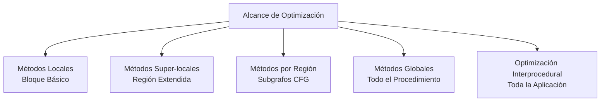
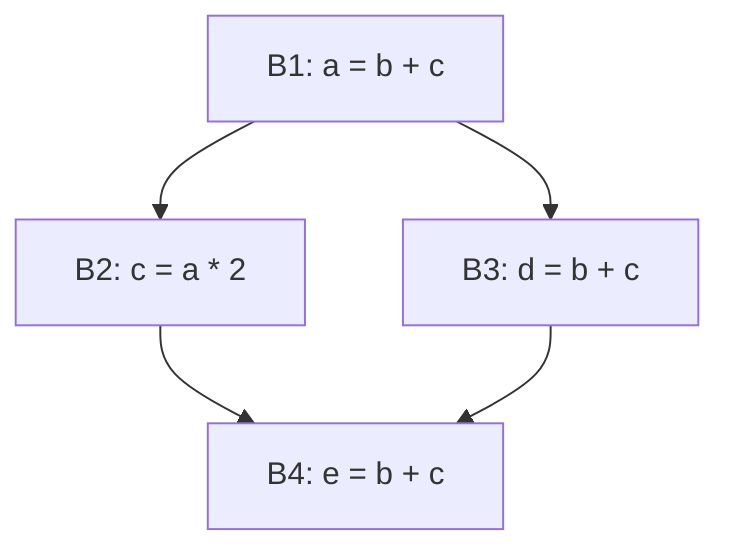

# Compiladores - Introducción a optimización de código

## 8.4 Alcance de la optimización: métodos locales, super-locales, por región, globales y de toda la aplicación.

---

El alcance de optimización se refiere a la extensión del código que un compilador analiza y transforma para mejorar el rendimiento. Según Cooper y Torczon (2004), "el alcance determina la cantidad de contexto disponible para el compilador al tomar decisiones de optimización".

#### Clasificación por Alcance



### Métodos Locales (Bloque Básico)

#### Definición y Características

Un **bloque básico** es una secuencia máxima de instrucciones que tiene:

- Una única entrada (ninguna instrucción es destino de salto)
- Una única salida (solo la última instrucción puede transferir control)

**Alcance**: Limitado a un único bloque básico.

#### Técnicas Típicas

- Eliminación de subexpresiones comunes locales
- Propagación de constantes dentro del bloque
- Eliminación de código muerto local

#### Ejemplo

**Código original:**

```c
// Bloque básico
a = b + c;
d = a * 2;
e = b + c;    // Expresión redundante
f = d + e;
```

**Código optimizado:**

```c
a = b + c;
d = a * 2;
e = a;        // Eliminación de redundancia local
f = d + e;
```

### Métodos Super-locales (Región Extendida)

#### Definición y Características

Extienden el análisis más allá de un bloque básico pero sin alcanzar el nivel de procedimiento completo. Incluyen:

- Secuencias de bloques básicos sin bifurcaciones
- Pequeños grupos de bloques relacionados

**Alcance**: Múltiples bloques básicos sin ciclos.

#### Ejemplo

**Código original:**

```c
// Múltiples bloques en secuencia
a = b + c;
if (cond) {
    d = a * 2;
} else {
    e = b + c;    // Expresión redundante en camino alternativo
}
```

**Código optimizado:**

```c
temp = b + c;    // Cálculo super-local
a = temp;
if (cond) {
    d = a * 2;
} else {
    e = temp;    // Reutilización del cálculo
}
```

### Métodos por Región

#### Definición y Características

Analizan y optimizan subgrafos del Grafo de Flujo de Control (CFG). Una región es un subconjunto de nodos del CFG que forma un subgrafo conexo con un único punto de entrada.

**Alcance**: Subgrafos del CFG, típicamente bucles o estructuras anidadas.

#### Análisis de Regiones

Para una región R, el análisis se realiza mediante:

$$IN[R] = \bigcap_{P \in pred(entry(R))} OUT[P]$$

$$OUT[R] = GEN[R] \cup (IN[R] - KILL[R])$$

#### Ejemplo: Optimización de Bucles

```c
// Región: bucle for
for (int i = 0; i < n; i++) {
    result += array[i] * factor;  // factor es invariante
}
```

**Optimizado:**

```c
// Elevación de invariante de bucle
temp = factor;
for (int i = 0; i < n; i++) {
    result += array[i] * temp;
}
```

### Métodos Globales (Todo el Procedimiento)

#### Definición y Características

Analizan y optimizan un procedimiento o función completa, considerando todos sus bloques básicos y caminos de ejecución.

**Alcance**: Todo el procedimiento/función.

#### Técnicas Globales

- Eliminación global de subexpresiones comunes
- Propagación global de constantes
- Asignación de registros global
- Optimización de bucles global

#### Análisis de Flujo de Datos Global

Las ecuaciones globales consideran todos los caminos:

$$IN[B] = \bigcap_{P \in pred(B)} OUT[P]$$

$$OUT[B] = GEN[B] \cup (IN[B] - KILL[B])$$

#### Ejemplo

**Código original:**

```c
int global_func(int x, int y) {
    int a = x * y;
    if (x > 0) {
        int b = x * y;  // Redundancia global
        return a + b;
    } else {
        int c = x * y;  // Redundancia global
        return c * 2;
    }
}
```

**Código optimizado:**

```c
int global_func(int x, int y) {
    int temp = x * y;   // Cálculo global
    int a = temp;
    if (x > 0) {
        int b = temp;   // Reutilización global
        return a + b;
    } else {
        int c = temp;   // Reutilización global
        return c * 2;
    }
}
```

### Optimización de Toda la Aplicación (Interprocedural)

#### Definición y Características

Analiza y optimiza múltiples procedimientos y módulos, considerando las interacciones entre ellos.

**Alcance**: Toda la aplicación o sistema.

#### Técnicas Interprocedurales

- Inline expansion de funciones
- Optimización entre procedimientos
- Análisis y optimización de módulos completos
- Optimización de programas orientados a objetos

#### Ejemplo: Inline Expansion

**Código original:**

```c
int square(int x) {
    return x * x;
}

int main() {
    for (int i = 0; i < 100; i++) {
        result += square(i);  // Llamada a función
    }
}
```

**Código optimizado:**

```c
int main() {
    for (int i = 0; i < 100; i++) {
        result += i * i;  // Función incorporada
    }
}
```

### Comparación de Alcances

#### Complejidad vs. Beneficio


| Alcance         | Complejidad         | Precisión | Beneficio Potencial |
| --------------- | ------------------- | --------- | ------------------- |
| Local           | $O(n)$              | Baja      | Limitado            |
| Super-local     | $O(n^2)$            | Moderada  | Moderado            |
| Por región      | $O(n^2)$ a $O(n^3)$ | Buena     | Bueno               |
| Global          | $O(n^3)$            | Alta      | Alto                |
| Interprocedural | $O(n^k)$            | Muy Alta  | Muy Alto            |

### Ejercicios Propuestos

#### Ejercicio 1: Identificación de Alcance

Para cada fragmento de código, identifique el alcance mínimo necesario para optimizarlo:

```c
// Fragmento 1
a = b * c;
d = a + 5;
e = b * c;

// Fragmento 2
for (int i = 0; i < n; i++) {
    result += data[i] * factor;
}

// Fragmento 3
int helper(int x) { return x * x; }
int main() {
    for (int i = 0; i < 100; i++) {
        total += helper(i);
    }
}
```

#### Ejercicio 2: Análisis de Flujo de Datos

Dado el siguiente CFG:



Calcule los conjuntos de expresiones disponibles para cada bloque usando análisis global.

#### Ejercicio 3: Optimización Multi-nivel

Optimice el siguiente código aplicando técnicas de diferentes alcances:

```c
int complex_calculation(int x, int y) {
    int temp1 = x * y;

    if (x > 0) {
        int temp2 = x * y;
        return temp1 + temp2;
    } else {
        for (int i = 0; i < 10; i++) {
            result += x * y;
        }
        return result;
    }
}
```

#### Ejercicio 4: Diseño de Algoritmo

Diseñe un algoritmo en pseudocódigo para determinar el alcance óptimo de optimización basado en:

- Complejidad del código
- Frecuencia de ejecución
- Potencial de mejora

### Consideraciones de Implementación

#### Trade-offs en la Elección de Alcance

La selección del alcance implica balancear:

$$ Beneficio = Mejora\_{rendimiento} - Coste\_{\text{análisis}}$$

#### Heurísticas para Selección de Alcance

1. **Código crítico**: Alcance global/interprocedural
2. **Código no crítico**: Alcance local/super-local
3. **Bucles intensivos**: Alcance por región
4. **Funciones pequeñas**: Alcance global

### Referencias

#### Bibliografía Básica

1. Aho, Lam, Sethi y Ullman, Compilers, Principles, Techniques and Tools, Second Edition, Pearson Education Inc., 2007. (Capítulo 9 - Optimización de máquinas)
2. Keith D. Cooper y Linda Torczon, Engineering a Compiler, Morgan Kaufmann, 2004. (Capítulo 8 - Análisis de flujo de datos)

#### Bibliografía Complementaria

3. Michael Lee Scott, Programming Language Pragmatics, Morgan Kauffman Publishers, 2009. (Capítulo 17 - Compilación y optimización)
4. Reinhard Wilhelm y Dieter Maurer, Compiler Design, Addison-Wesley, 1995. (Capítulo 10 - Técnicas de optimización)

### Caso de Estudio Integrador

#### Optimización Multi-alcance

**Código original:**

```c
int process_data(int* arr, int n, int factor) {
    int total = 0;

    for (int i = 0; i < n; i++) {
        int val = arr[i] * factor;  // Invariante de bucle
        total += val;
    }

    if (total > THRESHOLD) {
        return total * factor;  // Expresión redundante
    } else {
        return total;
    }
}
```

**Código optimizado (múltiples alcances):**

```c
int process_data(int* arr, int n, int factor) {
    int total = 0;
    int temp = factor;  // Optimización local + elevación de invariante

    for (int i = 0; i < n; i++) {
        total += arr[i] * temp;  // Optimización de bucle
    }

    if (total > THRESHOLD) {
        return total * temp;  // Reutilización global
    } else {
        return total;
    }
}
```
