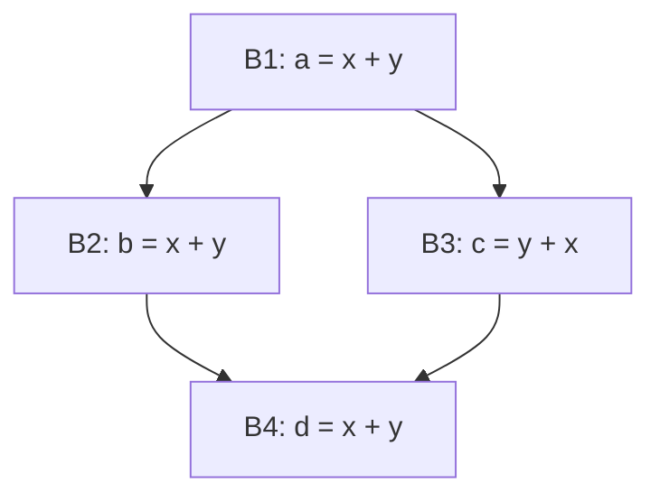
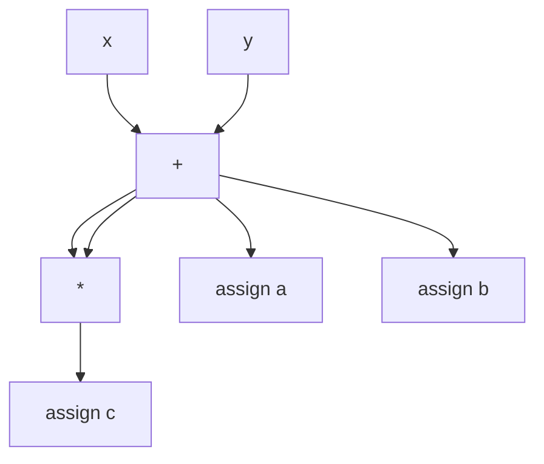
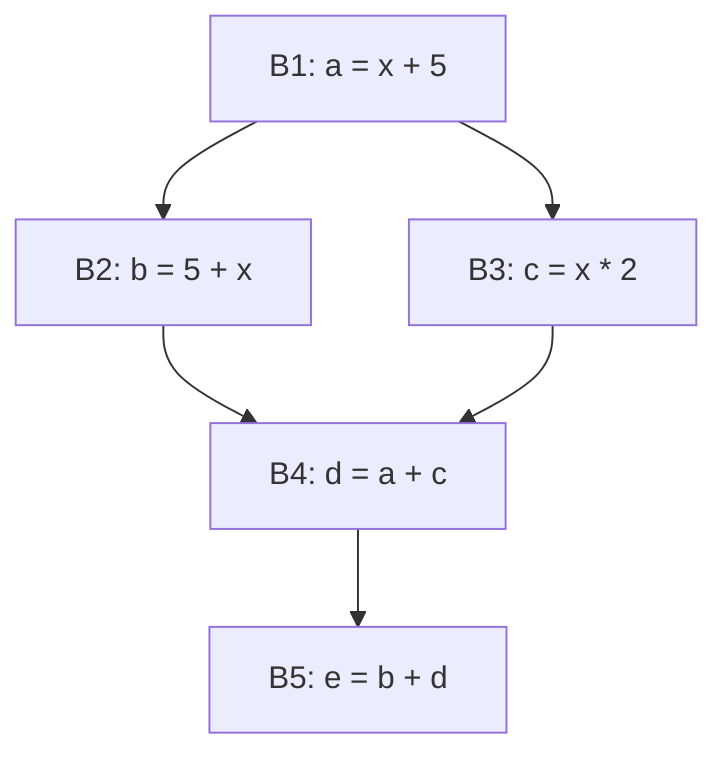

# Compiladores - Introducción a optimización de código

## 8.5 Numeración de valores sobre regiones mayores al bloque básico.

---

La numeración de valores es una técnica de optimización que asigna identificadores únicos a expresiones o valores computados, permitiendo identificar expresiones redundantes incluso a través de múltiples bloques básicos. Según Cooper y Torczon (2004), "la numeración de valores extiende el concepto de eliminación de subexpresiones comunes más allá de los límites de bloques básicos individuales".

#### Concepto Fundamental

Cada expresión única recibe un número único (valor número) que permite:

- Identificar expresiones idénticas en diferentes puntos del programa
- Detectar redundancias a través de flujos de control complejos
- Optimizar expresiones en regiones extendidas del código

### Algoritmos de Numeración de Valores

#### Numeración de Valores Global (GVN)

El algoritmo de numeración de valores global asigna números únicos a expresiones basándose en su semántica, no en su forma sintáctica.

**Ecuación fundamental:**
$$VN(e) = h(op, VN(e_1), VN(e_2), ..., VN(e_n))$$

Donde:

- $VN(e)$ es el número de valor para la expresión e
- $h$ es una función hash que mapea la operación y operandos a un único identificador
- $op$ es el operador de la expresión
- $e_1, e_2, ..., e_n$ son los operandos

#### Algoritmo Básico de GVN

```python
def global_value_numbering(cfg):
    value_table = {}  # Tabla de números de valor
    value_map = {}    # Mapa de variables a números de valor

    for block in topological_order(cfg):
        for instruction in block.instructions:
            if is_assignment(instruction):
                expr = get_expression(instruction)
                operands = get_operands(expr)

                # Obtener números de valor para operandos
                vn_operands = [value_map.get(op, assign_new_vn(op)) for op in operands]

                # Calcular hash para la expresión
                expr_hash = hash((instruction.op, tuple(vn_operands)))

                if expr_hash in value_table:
                    # Expresión redundante encontrada
                    redundant_vn = value_table[expr_hash]
                    value_map[instruction.lhs] = redundant_vn
                    mark_for_optimization(instruction, redundant_vn)
                else:
                    # Nueva expresión
                    new_vn = generate_new_vn()
                    value_table[expr_hash] = new_vn
                    value_map[instruction.lhs] = new_vn
```

### Aplicación en Regiones Extendidas

#### Numeración de Valores en Regiones

Para regiones mayores a bloques básicos, se utilizan técnicas más avanzadas:

**Ecuación para regiones:**
$$VN_R(e) = h_R(op, VN_R(e_1), VN_R(e_2), ..., VN_R(e_n), context_R)$$

Donde $context_R$ representa el contexto específico de la región R.

#### Ejemplo de Numeración en una Región



En esta región, las expresiones `x + y` y `y + x` pueden recibir el mismo número de valor si la operación es conmutativa.

### Algoritmo de Numeración para Grafos Acíclicos Dirigidos (DAG)

#### Construcción del DAG de Valores

La numeración de valores se puede representar mediante un DAG donde:

- Nodos hoja representan variables o constantes
- Nodos internos representan operaciones
- Cada nodo tiene un número de valor único

**Ejemplo de construcción:**
Para las expresiones:

1. `a = x + y`
2. `b = x + y`
3. `c = a * b`

El DAG resultante sería:



#### Algoritmo de Construcción de DAG

```python
class DAGNode:
    def __init__(self, op, left=None, right=None, value=None):
        self.op = op
        self.left = left
        self.right = right
        self.value = value
        self.vn = None  # Número de valor

def build_dag(instructions):
    node_table = {}  # Tabla hash de nodos existentes
    var_map = {}     # Mapa de variables a nodos

    for instr in instructions:
        if is_binary_operation(instr):
            # Buscar o crear nodos para operandos
            left_node = get_node(instr.left, node_table, var_map)
            right_node = get_node(instr.right, node_table, var_map)

            # Buscar nodo existente para esta operación
            key = (instr.op, left_node.vn, right_node.vn)
            if key in node_table:
                new_node = node_table[key]
            else:
                new_node = DAGNode(instr.op, left_node, right_node)
                new_node.vn = generate_vn()
                node_table[key] = new_node

            var_map[instr.result] = new_node
```

### Técnicas Avanzadas

#### Numeración de Valores con Conmutatividad

Para manejar operaciones conmutativas como `+` y `*`:

$$VN(x + y) = VN(y + x)$$

Implementación:

```python
def commutative_hash(op, vn1, vn2):
    if op in ['+', '*']:
        # Ordenar los números de valor para conmutatividad
        return hash((op, min(vn1, vn2), max(vn1, vn2)))
    else:
        return hash((op, vn1, vn2))
```

#### Numeración de Valores con Identidades Algebraicas

Reconocimiento de identidades:

- $x + 0 = x$
- $x * 1 = x$
- $x * 0 = 0$

```python
def apply_algebraic_identities(op, vn1, vn2):
    if op == '+' and vn2 == ZERO_VN:
        return vn1  # x + 0 = x
    elif op == '*' and vn2 == ONE_VN:
        return vn1  # x * 1 = x
    elif op == '*' and vn2 == ZERO_VN:
        return ZERO_VN  # x * 0 = 0
    else:
        return None  # No se aplica identidad
```

### Ejemplos y Aplicaciones

#### Ejemplo 1: Numeración Básica

**Código original:**

```c
// Bloque B1
a = x + y;
b = x + y;

// Bloque B2
c = y + x;
d = a + b;
```

**Numeración de valores:**

- `VN(x + y)` = `VN(y + x)` = VN₁
- `VN(a)` = VN₁, `VN(b)` = VN₁, `VN(c)` = VN₁
- `VN(a + b)` = `VN(VN₁ + VN₁)` = VN₂

#### Ejemplo 2: Optimización con Numeración

**Antes de optimización:**

```c
a = x * 2;     // VN: h(*, VN(x), VN(2))
b = 2 * x;     // VN: h(*, VN(2), VN(x)) = mismo que anterior
c = x + x;     // VN: h(+, VN(x), VN(x))
d = a + b;     // VN: h(+, VN(a), VN(b))
```

**Después de optimización:**

```c
a = x * 2;
b = a;         // b = a (mismo valor)
c = x * 2;     // c = a (mismo valor)
d = a * 2;     // d = a * 2
```

### Ejercicios Propuestos

#### Ejercicio 1: Aplicar Numeración de Valores

Para el siguiente fragmento de código, asigne números de valor a cada expresión y variable:

```c
x = a + b;
y = b + a;
z = x * y;
w = a + b;
result = z * w;
```

#### Ejercicio 2: Construcción de DAG

Construya el DAG de valores para el código del ejercicio 1 y muestre los números de valor asignados.

#### Ejercicio 3: Detección de Redundancias

Usando numeración de valores, identifique todas las expresiones redundantes en:

```c
p = x * y;
q = y * x;
r = p + q;
s = x * y;
t = r + s;
```

#### Ejercicio 4: Implementación de Algoritmo

Implemente en pseudocódigo el algoritmo de numeración de valores que maneje:

- Conmutatividad de operaciones
- Identidades algebraicas
- Propagación de constantes

#### Ejercicio 5: Análisis de Región Compleja

Para el siguiente CFG, realice numeración de valores considerando la región completa:



### Limitaciones y Desafíos

#### Complejidad Computacional

La numeración de valores global tiene complejidad:

- Temporal: $O(n \cdot d)$ donde n es el número de instrucciones y d es la profundidad de expresiones
- Espacial: $O(m)$ donde m es el número de expresiones únicas

#### Manejo de Efectos Laterales

La numeración de valores debe considerar:

- Llamadas a funciones con efectos laterales
- Accesos a memoria y punteros
- Operaciones que pueden causar excepciones

### Referencias

#### Bibliografía Básica

1. Aho, Lam, Sethi y Ullman, Compilers, Principles, Techniques and Tools, Second Edition, Pearson Education Inc., 2007. (Capítulo 9.5 - Numeración de valores)
2. Keith D. Cooper y Linda Torczon, Engineering a Compiler, Morgan Kaufmann, 2004. (Capítulo 8.4 - Numeración de valores global)

#### Bibliografía Complementaria

3. Michael Lee Scott, Programming Language Pragmatics, Morgan Kauffman Publishers, 2009. (Capítulo 17.3 - Técnicas de optimización basadas en flujo de datos)
4. Reinhard Wilhelm y Dieter Maurer, Compiler Design, Addison-Wesley, 1995. (Capítulo 11 - Métodos de optimización)

### Implementación Práctica

#### Estructuras de Datos Clave

```python
class ValueNumberingSystem:
    def __init__(self):
        self.next_vn = 1
        self.constant_map = {}      # Map: constant -> VN
        self.variable_map = {}      # Map: variable -> VN
        self.expression_table = {}  # Map: (op, vn1, vn2) -> VN

    def get_constant_vn(self, constant):
        if constant not in self.constant_map:
            self.constant_map[constant] = self.next_vn
            self.next_vn += 1
        return self.constant_map[constant]

    def get_expression_vn(self, op, vn1, vn2):
        # Aplicar conmutatividad para operaciones conmutativas
        if op in COMMUTATIVE_OPS:
            key = (op, min(vn1, vn2), max(vn1, vn2))
        else:
            key = (op, vn1, vn2)

        if key not in self.expression_table:
            self.expression_table[key] = self.next_vn
            self.next_vn += 1
        return self.expression_table[key]
```
