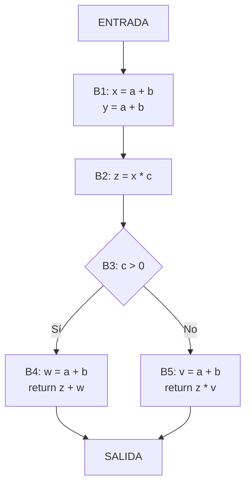
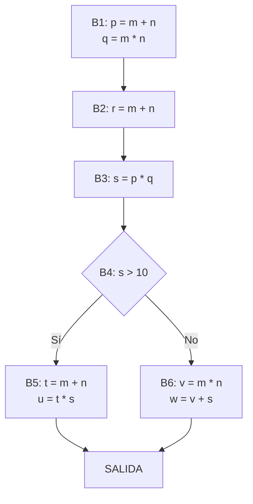

# Compiladores - Introducción a optimización de código

## 8.6 Eliminación global de redundancia.

---

La eliminación global de redundancia es una técnica de optimización que identifica y elimina expresiones redundantes a lo largo de todo un procedimiento o función. Según Aho et al. (2007), "una expresión es redundante si su valor ya ha sido computado previamente y ninguno de sus operandos ha sido modificado desde ese cálculo anterior".

#### Conceptos Fundamentales

**Expresión disponible**: Una expresión `x + y` está disponible en un punto p del programa si:

- Todo camino desde el inicio al punto p evalúa `x + y`
- Después de la última evaluación, ninguna variable en `x` o `y` ha sido redefinida

**Ecuación de disponibilidad**:

$$AVAIL_{in}(B) = \bigcap_{P \in pred(B)} AVAIL_{out}(P)$$

### Análisis de Flujo de Datos para Redundancia Global

#### Ecuaciones de Flujo de Datos

Para cada bloque básico B definimos:

$$ GEN[B] = \text{expresiones generadas en }B $$

$$ KILL[B] = \text{expresiones eliminadas por redefinición en }B $$

$$ AVAIL\_{in}(B) = \bigcap_{P \in pred(B)} AVAIL\_{out}(P) $$

$$ AVAIL\_{out}(B) = GEN[B] \cup (AVAIL\_{in}(B) - KILL[B]) $$

#### Algoritmo Iterativo

```python
def eliminacion_redundancia_global(cfg):
    # Inicialización
    for block in cfg.blocks:
        AVAIL_in[block] = set()
        AVAIL_out[block] = GEN[block]

    # Iteración hasta punto fijo
    changed = True
    while changed:
        changed = False
        for block in cfg.blocks:
            old_in = AVAIL_in[block]
            old_out = AVAIL_out[block]

            # Calcular intersección de predecesores
            if block.preds:
                AVAIL_in[block] = intersection(AVAIL_out[p] for p in block.preds)
            else:
                AVAIL_in[block] = set()

            AVAIL_out[block] = GEN[block] | (AVAIL_in[block] - KILL[block])

            if old_in != AVAIL_in[block] or old_out != AVAIL_out[block]:
                changed = True
```

### Implementación de la Eliminación Global

#### Detección y Transformación

**Algoritmo de transformación**:

1. Calcular expresiones disponibles en cada punto
2. Insertar almacenamientos en temporales
3. Reemplazar expresiones redundantes

```c
// Antes de la optimización
x = a + b;
y = a + b;  // Redundante

// Después de la optimización
t1 = a + b;
x = t1;
y = t1;     // Redundancia eliminada
```

#### Ejemplo Completo

**Código original**:

```c
int calcular(int a, int b, int c) {
    int x = a + b;
    int y = a + b;  // Redundante
    int z = x * c;

    if (c > 0) {
        int w = a + b;  // Redundante
        return z + w;
    } else {
        int v = a + b;  // Redundante
        return z * v;
    }
}
```

**Código optimizado**:

```c
int calcular(int a, int b, int c) {
    int t1 = a + b;  // Expresión calculada una vez
    int x = t1;
    int y = t1;      // Redundancia eliminada
    int z = x * c;

    if (c > 0) {
        int w = t1;  // Redundancia eliminada
        return z + w;
    } else {
        int v = t1;  // Redundancia eliminada
        return z * v;
    }
}
```

### Análisis de Ejemplo con CFG

#### Grafo de Flujo de Control



#### Análisis de Expresiones Disponibles

Para el bloque B4:

- $GEN[B4] = \emptyset$ (no genera nuevas expresiones)
- $KILL[B4] = \emptyset$ (no redefine a o b)
- $AVAIL_{in}[B4] = \{a + b, x * c\}$
- La expresión `a + b` está disponible, por lo que es redundante

### Ejercicios Propuestos

#### Ejercicio 1: Identificación de Redundancias

Para el siguiente código, identifique todas las expresiones redundantes:

```c
int procesar(int x, int y, int z) {
    int a = x * y;
    int b = x * y;
    int c = a + z;

    if (z > 0) {
        int d = x * y;
        return c + d;
    } else {
        int e = a + z;
        int f = x * y;
        return e * f;
    }
}
```

#### Ejercicio 2: Análisis de Flujo de Datos

Dado el siguiente CFG:



Calcule los conjuntos GEN, KILL, AVAIL_in y AVAIL_out para cada bloque.

#### Ejercicio 3: Aplicación de Optimización

Aplique eliminación global de redundancia al siguiente código:

```c
double calcular(double a, double b, int n) {
    double resultado = 0;

    for (int i = 0; i < n; i++) {
        double term = a * b;
        resultado += term;

        if (i % 2 == 0) {
            double otro_term = a * b;
            resultado -= otro_term;
        }
    }

    double final_term = a * b;
    return resultado * final_term;
}
```

#### Ejercicio 4: Implementación de Algoritmo

Implemente en pseudocódigo el algoritmo completo de eliminación global de redundancia, incluyendo:

- Cálculo de conjuntos GEN y KILL
- Iteración hasta punto fijo
- Inserción de variables temporales
- Reemplazo de expresiones redundantes

### Técnicas Avanzadas

#### Eliminación de Redundancia Parcial

Para expresiones que son redundantes en algunos caminos pero no en todos:

```c
// Expresión parcialmente redundante
if (cond) {
    x = a + b;
}
y = a + b;  // Redundante si cond es verdadera
```

**Solución**: Elevar la expresión a un bloque dominante común

#### Integración con Otras Optimizaciones

La eliminación global de redundancia se combina con:

- **Propagación de constantes**: $x = 3 + 5$ → $x = 8$
- **Propagación de copias**: $y = x$ → usar x directamente
- **Reducción de fuerza**: $x = y * 2$ → $x = y << 1$

### Limitaciones y Consideraciones

#### Complejidad Computacional

El análisis tiene complejidad:

- Temporal: $O(n^3)$ en el peor caso
- Espacial: $O(n^2)$ para almacenar conjuntos de expresiones

#### Precisión del Análisis

El análisis conservador puede:

- No detectar algunas redundancias (falsos negativos)
- Marcar expresiones como disponibles cuando no lo son (falsos positivos)

### Referencias

#### Bibliografía Básica

1. Aho, Lam, Sethi y Ullman, Compilers, Principles, Techniques and Tools, Second Edition, Pearson Education Inc., 2007. (Capítulo 9.1 - Análisis de flujo de datos)
2. Keith D. Cooper y Linda Torczon, Engineering a Compiler, Morgan Kaufmann, 2004. (Capítulo 8.4 - Eliminación de subexpresiones comunes globales)

#### Bibliografía Complementaria

3. Michael Lee Scott, Programming Language Pragmatics, Morgan Kauffman Publishers, 2009. (Capítulo 17.3 - Optimizaciones basadas en flujo de datos)
4. Reinhard Wilhelm y Dieter Maurer, Compiler Design, Addison-Wesley, 1995. (Capítulo 10 - Técnicas de optimización)

### Caso de Estudio: Optimización Completa

#### Código Original con Múltiples Redundancias

```c
float procesamiento(float x, float y, float z, int n) {
    float a = x * y + z;
    float b = x * y + z;

    for (int i = 0; i < n; i++) {
        float c = x * y + z;
        a += c;

        if (i % 2 == 0) {
            float d = x * y + z;
            b += d;
        }
    }

    float e = x * y + z;
    return a + b + e;
}
```

#### Código Optimizado

```c
float procesamiento(float x, float y, float z, int n) {
    float t1 = x * y + z;  // Expresión calculada una vez
    float a = t1;
    float b = t1;

    for (int i = 0; i < n; i++) {
        float c = t1;      // Redundancia eliminada
        a += c;

        if (i % 2 == 0) {
            float d = t1;  // Redundancia eliminada
            b += d;
        }
    }

    float e = t1;          // Redundancia eliminada
    return a + b + e;
}
```
