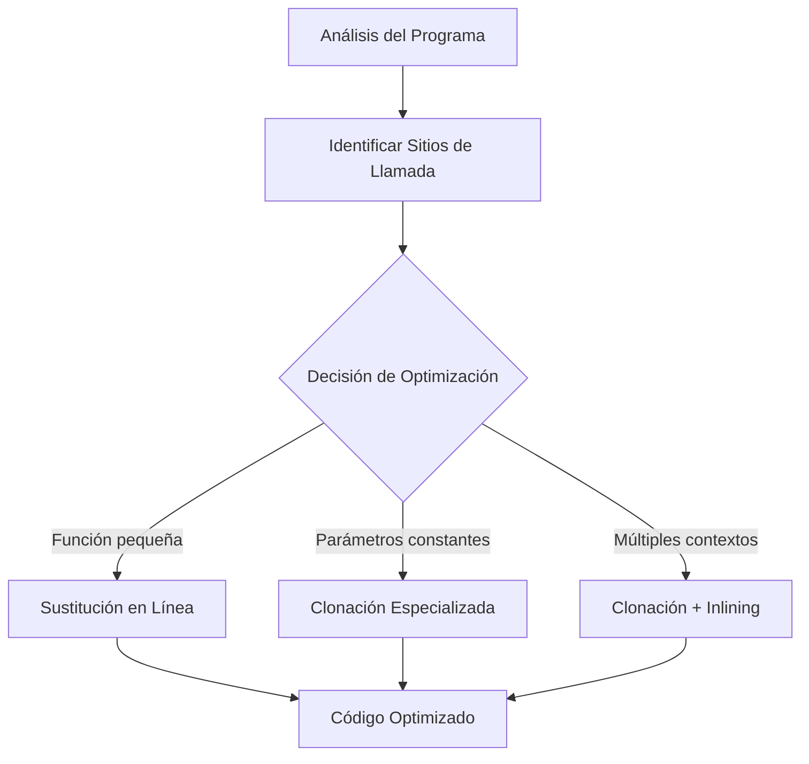
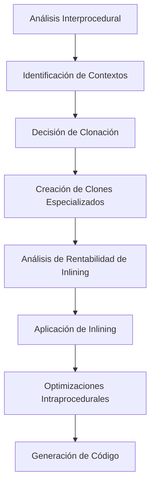

# Compiladores - Introducción a optimización de código

## 8.7 Temas avanzados: clonación y sustitución en línea.

---

### Introducción a Técnicas Avanzadas de Optimización

La clonación y sustitución en línea son técnicas avanzadas de optimización que permiten mejorar el rendimiento del código mediante la transformación de la estructura de las funciones y procedimientos. Según Cooper y Torczon (2004), "estas técnicas permiten superar limitaciones del análisis interprocedural tradicional mediante transformaciones que exponen nuevas oportunidades de optimización".

### Sustitución en Línea (Inlining)

#### Definición y Conceptos Básicos

La **sustitución en línea** es una transformación que reemplaza una llamada a función con el cuerpo de la función llamada. Formalmente, para una llamada `f(x)` con función definida como `f(a) { B }`, el inlining produce:

$$callsite(f(x)) \rightarrow B[a/x]$$

Donde $B[a/x]$ significa el cuerpo de B con el parámetro formal a sustituido por el argumento actual x.

#### Algoritmo Básico de Inlining

```python
def inline_function(call_site, function):
    # 1. Copiar el cuerpo de la función
    inline_code = copy.deepcopy(function.body)

    # 2. Sustituir parámetros formales por argumentos actuales
    for param, arg in zip(function.parameters, call_site.arguments):
        replace_occurrences(inline_code, param, arg)

    # 3. Reemplazar return con asignación si es necesario
    if call_site.has_return_value:
        replace_returns_with_assignments(inline_code, call_site.return_target)

    # 4. Reemplazar la llamada con el código inline
    replace_call_site(call_site, inline_code)
```

#### Ejemplo de Inlining

**Antes de inlining:**

```c
int square(int x) {
    return x * x;
}

int main() {
    int result = 0;
    for (int i = 0; i < 10; i++) {
        result += square(i);  // Llamada a función
    }
    return result;
}
```

**Después de inlining:**

```c
int main() {
    int result = 0;
    for (int i = 0; i < 10; i++) {
        // Cuerpo de square inlineado
        int temp = i * i;
        result += temp;
    }
    return result;
}
```

### Clonación de Funciones

#### Definición y Conceptos Básicos

La **clonación de funciones** crea múltiples versiones especializadas de una función basadas en diferentes contextos de llamada o valores de parámetros.

Para una función $f$ con parámetros formales $p_1, p_2, ..., p_n$ y contextos de llamada $C_1, C_2, ..., C_k$, la clonación produce:

$$f_{C_1}, f_{C_2}, ..., f_{C_k}$$

donde cada $f_{C_i}$ es una versión especializada para el contexto $C_i$.

#### Algoritmo de Clonación

```python
def clone_function(function, call_sites):
    clones = {}

    for call_site in call_sites:
        # Analizar contexto de llamada
        context = analyze_context(call_site)

        # Crear versión especializada
        if context not in clones:
            clone = create_specialized_version(function, context)
            clones[context] = clone

            # Actualizar llamada para usar el clon
            redirect_call_site(call_site, clone)

    return clones
```

#### Ejemplo de Clonación

**Función original:**

```c
int process(int value, int factor) {
    if (factor == 0) return 0;
    return value * factor + 10;
}
```

**Llamadas:**

```c
int a = process(x, 0);  // Contexto: factor = 0
int b = process(y, 2);  // Contexto: factor = 2
```

**Después de clonación:**

```c
int process_factor_0(int value) {
    return 0;  // Versión especializada
}

int process_factor_2(int value) {
    return value * 2 + 10;  // Versión especializada
}

// Llamadas actualizadas
int a = process_factor_0(x);
int b = process_factor_2(y);
```

### Integración de Clonación e Inlining

#### Estrategia Combinada



#### Ejemplo Combinado

**Código original:**

```c
int math_op(int a, int b, int op) {
    switch(op) {
        case 0: return a + b;
        case 1: return a - b;
        case 2: return a * b;
        default: return a / b;
    }
}

void calculate() {
    int x = math_op(5, 3, 0);  // Suma
    int y = math_op(8, 2, 2);  // Multiplicación
}
```

**Después de clonación e inlining:**

```c
// Versiones especializadas
inline int math_op_sum(int a, int b) {
    return a + b;
}

inline int math_op_mul(int a, int b) {
    return a * b;
}

void calculate() {
    int x = math_op_sum(5, 3);  // Inlineado
    int y = math_op_mul(8, 2);  // Inlineado
}
```

### Análisis de Rentabilidad

#### Fórmula de Decisión para Inlining

La decisión de inlinear considera:

$$Benefio_{inline} = Coste_{llamada} - Coste_{copiar} - (Coste_{ejecucion} \times Frecuencia)$$

Donde:

- $Coste_{llamada}$: Coste de la llamada a función
- $Coste_{copiar}$: Coste de aumentar el tamaño del código
- $Coste_{ejecucion}$: Coste de ejecutar el código inlineado
- $Frecuencia$: Frecuencia de ejecución del código

#### Heurísticas para Clonación

La clonación es beneficiosa cuando:

$$\sum_{i=1}^{k} (Beneficio_{C_i} \times Frecuencia_{C_i}) > Coste_{clonacion}$$

Donde $Beneficio_{C_i}$ es la mejora por especialización en el contexto $C_i$.

### Ejercicios Propuestos

#### Ejercicio 1: Análisis de Inlining

Para el siguiente código, analice qué llamadas son candidatas para inlining y aplique la transformación:

```c
int helper(int x, int y) {
    return x * x + y * y;
}

float process_data(float a, float b) {
    int val1 = helper(3, 4);
    int val2 = helper(a, b);
    float result = 0;

    for (int i = 0; i < val1; i++) {
        result += helper(i, i+1);
    }

    return result / val2;
}
```

#### Ejercicio 2: Clonación de Funciones

Dada la siguiente función y sus sitios de llamada, cree versiones clonadas especializadas:

```c
int transform(int value, int mode, int factor) {
    if (mode == 0) return value * factor;
    if (mode == 1) return value + factor;
    if (mode == 2) return value << factor;
    return value;
}

// Sitios de llamada
int a = transform(x, 0, 2);  // Siempre mode=0, factor=2
int b = transform(y, 1, 5);  // Siempre mode=1, factor=5
int c = transform(z, 0, 3);  // Siempre mode=0, factor=3
```

#### Ejercicio 3: Optimización Combinada

Aplique clonación e inlining al siguiente código:

```c
int complex_calc(int a, int b, int type) {
    if (type == 1) {
        return a * b + 10;
    } else {
        return (a + b) * 2;
    }
}

void processor() {
    int r1 = complex_calc(5, 3, 1);
    int r2 = complex_calc(8, 2, 1);
    int r3 = complex_calc(4, 7, 2);
}
```

#### Ejercicio 4: Análisis de Rentabilidad

Para una función con las siguientes características:

- Coste de llamada: 5 ciclos
- Coste de ejecución: 20 ciclos
- Tamaño de función: 15 instrucciones
- Frecuencia de llamada: 100 veces

Calcule si el inlining es beneficioso considerando:

- Coste de copia: 0.1 ciclos por instrucción
- Overhead de tamaño de código: 0.05 ciclos por instrucción adicional

### Consideraciones de Implementación

#### Limitaciones y Desafíos

1. **Explosión de tamaño de código**: El inlining puede aumentar significativamente el tamaño del código
2. **Complejidad de análisis**: La clonación requiere análisis interprocedural preciso
3. **Mantenimiento de debug information**: Las transformaciones deben preservar información para debugging

#### Técnicas de Mitigación

```python
def should_inline(function, call_site):
    # Heurísticas para decidir si inlinear
    if function.size > MAX_INLINE_SIZE:
        return False

    if call_site.nesting_depth > MAX_NESTING_DEPTH:
        return False

    if function.has_recursion:
        return False

    execution_frequency = get_execution_frequency(call_site)
    if execution_frequency < MIN_FREQUENCY:
        return False

    return True
```

### Referencias

#### Bibliografía Básica

1. Keith D. Cooper y Linda Torczon, Engineering a Compiler, Morgan Kaufmann, 2004. (Capítulo 8.5 - Inlining y clonación de funciones)
2. Aho, Lam, Sethi y Ullman, Compilers, Principles, Techniques and Tools, Second Edition, Pearson Education Inc., 2007. (Capítulo 9.6 - Optimización interprocedural)

#### Bibliografía Complementaria

3. Michael Lee Scott, Programming Language Pragmatics, Morgan Kauffman Publishers, 2009. (Capítulo 15.6 - Transformaciones de funciones)
4. Reinhard Wilhelm y Dieter Maurer, Compiler Design, Addison-Wesley, 1995. (Capítulo 12 - Optimizaciones avanzadas)

### Caso de Estudio: Sistema de Optimización Real

#### Arquitectura de Optimizador Avanzado



#### Ejemplo de Optimización en Compilador Moderno

**Código original:**

```c
template<typename T>
T process_value(T value, int options) {
    if (options & 0x1) value *= 2;
    if (options & 0x2) value += 10;
    if (options & 0x4) value = -value;
    return value;
}

void main_processing() {
    int a = process_value<int>(x, 1);  // Solo multiplicar
    float b = process_value<float>(y, 3);  // Multiplicar y sumar
    double c = process_value<double>(z, 5);  // Multiplicar y negar
}
```

**Después de clonación e inlining:**

```c
// Versiones especializadas del template
int process_value_int_1(int value) {
    return value * 2;  // Solo option 1
}

float process_value_float_3(float value) {
    value *= 2;   // Option 1
    value += 10;  // Option 2
    return value;
}

double process_value_double_5(double value) {
    value *= 2;  // Option 1
    value = -value;  // Option 4
    return value;
}

void main_processing() {
    int a = process_value_int_1(x);
    float b = process_value_float_3(y);
    double c = process_value_double_5(z);
}
```
