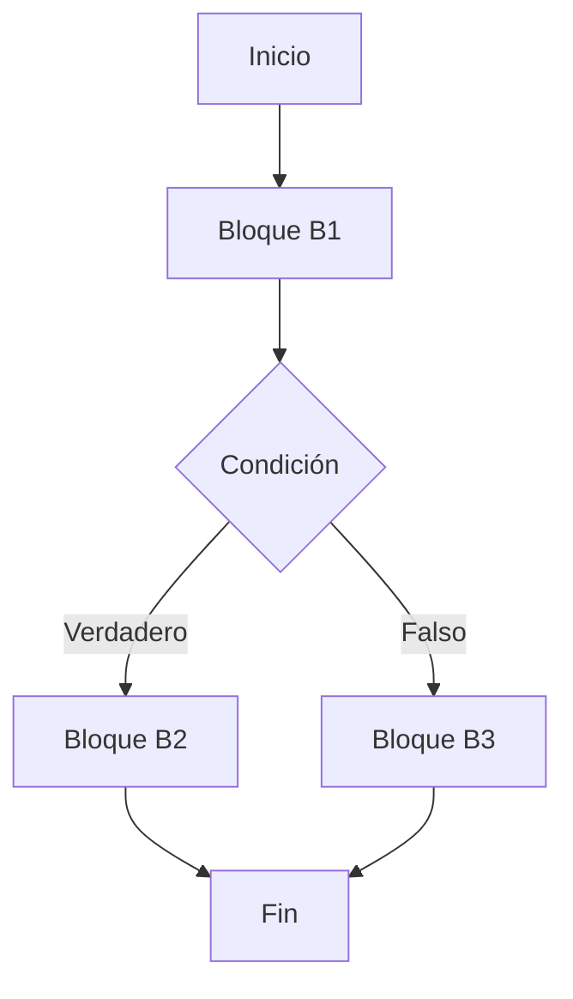

# Compiladores - Análisis de flujo de datos

## 9.1 Aspectos generales.

---

El análisis de flujo de datos es una técnica fundamental en la construcción de compiladores que permite recopilar información sobre cómo los valores son definidos y utilizados a lo largo de un programa. Este análisis es esencial para optimizaciones como la eliminación de código muerto, la propagación de constantes y la asignación de registros.

### Definición

El análisis de flujo de datos es un proceso estático que examina un programa para determinar cómo los valores de las variables fluyen a través de sus distintas partes. Según Aho et al. (2007), es "una técnica para recopilar información sobre el posible conjunto de valores calculados en varios puntos de un programa".

### Objetivos del Análisis de Flujo de Datos

- Determinar la disponibilidad de definiciones de variables
- Identificar expresiones invariantes en bucles
- Detectar variables no inicializadas
- Optimizar el uso de registros
- Facilitar la eliminación de código redundante

### Conceptos Fundamentales

#### Puntos de Programa

Un programa se representa típicamente mediante un **grafo de flujo de control (CFG)** donde:

- Los nodos representan bloques básicos
- Las aristas representan posibles flujos de control



#### Definiciones y Usos

- **Definición (def)**: Asignación de valor a una variable
- **Uso (use)**: Lectura del valor de una variable

#### Ecuaciones de Flujo de Datos

El análisis se formula mediante ecuaciones que relacionan la información en diferentes puntos del programa. Para el análisis de **alcanzabilidad de definiciones**:

$$
\begin{aligned}
&IN[B] = \bigcup_{P \in predecesores(B)} OUT[P] \\
&OUT[B] = GEN[B] \cup (IN[B] \setminus KILL[B])
\end{aligned}
$$

Donde:

- $IN[B]$: Conjunto de definiciones que alcanzan el inicio del bloque B
- $OUT[B]$: Conjunto de definiciones que alcanzan el final del bloque B
- $GEN[B]$: Definiciones generadas en el bloque B
- $KILL[B]$: Definiciones eliminadas por el bloque B

### Tipos de Análisis de Flujo de Datos

#### Análisis de Flujo hacia Adelante

La información fluye en la dirección de la ejecución del programa:

- **Definiciones alcanzables**: Qué asignaciones pueden afectar un punto dado
- **Expresiones disponibles**: Qué expresiones han sido calculadas y no modificadas

#### Análisis de Flujo hacia Atrás

La información fluye en dirección contraria a la ejecución:

- **Variables vivas**: Qué variables pueden ser usadas en el futuro
- **Uso muy activo**: Qué variables son usadas antes de ser redefinidas

### Algoritmo Básico

El análisis generalmente sigue un proceso iterativo:

```python
def analisis_flujo_datos(cfg, direccion, funcion_transferencia, operador_union):
    # Inicializar conjuntos IN y OUT para cada bloque
    for bloque in cfg.bloques:
        if direccion == 'adelante':
            IN[bloque] = conjunto_vacio
            OUT[bloque] = conjunto_vacio
        else:
            IN[bloque] = conjunto_vacio
            OUT[bloque] = conjunto_vacio

    # Iterar hasta que no haya cambios
    cambiado = True
    while cambiado:
        cambiado = False
        for bloque in orden_adecuado(cfg, direccion):
            if direccion == 'adelante':
                IN[bloque] = operador_union(OUT[p] for p in predecesores(bloque))
                nuevo_OUT = funcion_transferencia(bloque, IN[bloque])
                if nuevo_OUT != OUT[bloque]:
                    OUT[bloque] = nuevo_OUT
                    cambiado = True
            else:
                OUT[bloque] = operador_union(IN[s] for s in sucesores(bloque))
                nuevo_IN = funcion_transferencia(bloque, OUT[bloque])
                if nuevo_IN != IN[bloque]:
                    IN[bloque] = nuevo_IN
                    cambiado = True
    return IN, OUT
```

### Ejemplo: Definiciones Alcanzables

Consideremos el siguiente fragmento de código:

```
1: a = 1
2: b = 2
3: if condición then
4:   a = 3
5: else
6:   c = 4
7: endif
8: d = a + b
```

Las definiciones alcanzables en cada punto:

- Punto 1: {}
- Punto 2: {a=1}
- Punto 3: {a=1, b=2}
- Punto 4: {a=1, b=2}
- Punto 6: {a=1, b=2}
- Punto 8: {a=3 (del then), a=1 (del else), b=2}

### Aplicaciones del Análisis de Flujo de Datos

1. **Propagación de constantes**: Reemplazar variables por valores constantes conocidos
2. **Eliminación de código muerto**: Remover código cuyos resultados nunca se usan
3. **Análisis de variables vivas**: Determinar qué variables están "vivas" en cada punto
4. **Asignación de registros**: Optimizar el uso de registros del procesador

### Ejercicios Propuestos

1. Para el siguiente código, construye el grafo de flujo de control y calcula las definiciones alcanzables en cada punto:

```
x = 5
y = 1
while x > 0 do
    y = y * x
    x = x - 1
end while
z = y
```

2. Explica la diferencia entre análisis de flujo hacia adelante y hacia atrás, proporcionando un ejemplo de cada uno.

3. Implementa un algoritmo simplificado para el análisis de variables vivas en un grafo de flujo de control simple.

4. ¿Cómo se relaciona el análisis de flujo de datos con la detección de variables no inicializadas? Proporciona un ejemplo.

### Limitaciones y Consideraciones

- El análisis de flujo de datos es conservador: puede sobreestimar la información real
- La complejidad del análisis depende del tamaño del programa y la precisión requerida
- Los punteros y aliasing complican significativamente el análisis

### Referencias

1. Aho, A. V., Lam, M. S., Sethi, R., & Ullman, J. D. (2007). Compilers: Principles, Techniques, and Tools (2nd ed.). Pearson Education.
2. Cooper, K. D., & Torczon, L. (2004). Engineering a Compiler. Morgan Kaufmann.
3. Scott, M. L. (2009). Programming Language Pragmatics. Morgan Kaufmann.

### Bibliografía Complementaria

1. Grune, D., Bal, H. E., Jacobs, C. J. H., & Langendoen, K. G. (2000). Modern Compiler Design. John Wiley & Sons.
2. Wilhelm, R., & Maurer, D. (1995). Compiler Design. Addison-Wesley.
