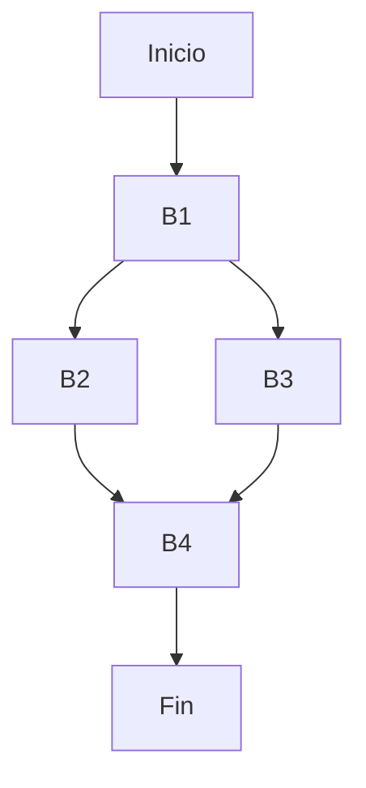
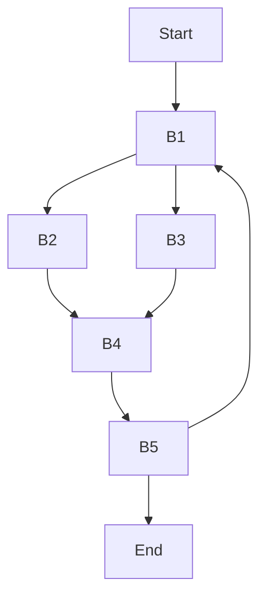

# Compiladores - Análisis de flujo de datos

## 9.2 Análisis de flujo de datos iterativo.

---

El análisis de flujo de datos iterativo es un método fundamental para resolver sistemas de ecuaciones de flujo de datos en compiladores. Este enfoque calcula sistemáticamente la información de flujo de datos mediante iteraciones sucesivas hasta alcanzar una solución estable.

### Definición

El análisis de flujo de datos iterativo es una técnica que resuelve ecuaciones de flujo de datos mediante la aplicación repetida de funciones de transferencia hasta que se alcanza un punto fijo (cuando los valores ya no cambian entre iteraciones). Según Aho et al. (2007), es "un método para resolver ecuaciones de flujo de datos mediante la aplicación iterativa de funciones de transferencia hasta converger a una solución".

### Marco Teórico

#### Ecuaciones Generales de Flujo de Datos

Para análisis hacia adelante:

$$ \begin{aligned} &IN[B] = \bigcup_{P \in pred(B)} OUT[P] \\\ &OUT[B] = f_B(IN[B]) \end{aligned} $$

Para análisis hacia atrás:

$$ \begin{aligned} &OUT[B] = \bigcup_{S \in succ(B)} IN[S] \\\ &IN[B] = f_B(OUT[B]) \end{aligned} $$

#### Algoritmo Iterativo Genérico

```python
def analisis_iterativo(cfg, direccion, funcion_transferencia, operador_union):
    # Inicialización
    bloques = cfg.obtener_bloques_orden(direccion)
    if direccion == 'adelante':
        IN = {bloque: conjunto_vacio for bloque in bloques}
        OUT = {bloque: conjunto_vacio for bloque in bloques}

        # Establecer condiciones iniciales para el bloque de entrada
        OUT[cfg.entrada] = valor_inicial
    else:
        IN = {bloque: conjunto_vacio for bloque in bloques}
        OUT = {bloque: conjunto_vacio for bloque in bloques}

        # Establecer condiciones iniciales para el bloque de salida
        IN[cfg.salida] = valor_inicial

    # Iterar hasta convergencia
    cambiado = True
    while cambiado:
        cambiado = False
        for bloque in bloques:
            if direccion == 'adelante':
                # Calcular IN[B] como unión de OUT[P] para predecesores P
                in_nuevo = operador_union(OUT[p] for p in cfg.predecesores(bloque))
                if in_nuevo != IN[bloque]:
                    IN[bloque] = in_nuevo
                    cambiado = True

                # Calcular OUT[B] aplicando función de transferencia
                out_nuevo = funcion_transferencia(bloque, IN[bloque])
                if out_nuevo != OUT[bloque]:
                    OUT[bloque] = out_nuevo
                    cambiado = True
            else:
                # Calcular OUT[B] como unión de IN[S] para sucesores S
                out_nuevo = operador_union(IN[s] for s in cfg.sucesores(bloque))
                if out_nuevo != OUT[bloque]:
                    OUT[bloque] = out_nuevo
                    cambiado = True

                # Calcular IN[B] aplicando función de transferencia
                in_nuevo = funcion_transferencia(bloque, OUT[bloque])
                if in_nuevo != IN[bloque]:
                    IN[bloque] = in_nuevo
                    cambiado = True

    return IN, OUT
```

### Orden de Procesamiento

#### Ordenamiento por Reverse Postorder

Para mejorar la eficiencia, procesamos los bloques en un orden específico:



Para este CFG:

- Postorder: B1, B3, B2, B4 (asumiendo rama izquierda primero)
- Reverse Postorder: B4, B2, B3, B1

### Ejemplo: Análisis de Definiciones Alcanzables

#### Problema

Calcular qué definiciones de variables alcanzan cada punto del programa.

#### Ecuaciones

$$ \begin{aligned} &IN[B] = \bigcup_{P \in pred(B)} OUT[P] \\\ &OUT[B] = GEN[B] \cup (IN[B] \setminus KILL[B]) \end{aligned} $$

#### Ejemplo de Código

```
B1: d1: x = 5
    d2: y = 1
    if x > 0 goto B3

B2: d3: x = x - 1
    d4: y = y * x
    goto B4

B3: d5: z = x + y

B4: if x > 0 goto B2
```

#### Solución Iterativa

| Iteración | Bloque | IN                   | OUT              |
| --------- | ------ | -------------------- | ---------------- |
| 0         | B1     | ∅                    | {d1, d2}         |
|           | B2     | ∅                    | ∅                |
|           | B3     | ∅                    | ∅                |
|           | B4     | ∅                    | ∅                |
| 1         | B1     | ∅                    | {d1, d2}         |
|           | B2     | {d1, d3, d4}         | {d3, d4}         |
|           | B3     | {d1, d2}             | {d1, d2, d5}     |
|           | B4     | {d3, d4}∪{d1,d2,d5}  | {d3, d4}         |
| 2         | B1     | ∅                    | {d1, d2}         |
|           | B2     | {d1, d3, d4}         | {d3, d4}         |
|           | B3     | {d1, d2}             | {d1, d2, d5}     |
|           | B4     | {d1, d2, d3, d4, d5} | {d1, d2, d3, d4} |

### Convergencia y Punto Fijo

#### Teorema de Tarski-Knaster

El algoritmo iterativo converge a un punto fijo porque:

1. El conjunto de valores posibles forma un retículo completo
2. Las funciones de transferencia son monótonas
3. La altura del retículo es finita

#### Condiciones de Terminación

El algoritmo termina cuando para todos los bloques B:

$$ OUT[B]\_{\text{iteración\_n}} = OUT[B]\_{\text{iteración\_n+1}} $$

### Optimizaciones del Algoritmo Iterativo

#### Uso de Worklist

```python
def analisis_iterativo_worklist(cfg, direccion, funcion_transferencia, operador_union):
    # Inicialización
    worklist = deque(cfg.obtener_todos_bloques())
    IN, OUT = inicializar_conjuntos(cfg, direccion)

    while worklist:
        bloque = worklist.popleft()

        if direccion == 'adelante':
            # Calcular nuevo IN[B]
            in_nuevo = operador_union(OUT[p] for p in cfg.predecesores(bloque))
            if in_nuevo != IN[bloque]:
                IN[bloque] = in_nuevo
                # Calcular nuevo OUT[B]
                out_nuevo = funcion_transferencia(bloque, IN[bloque])
                if out_nuevo != OUT[bloque]:
                    OUT[bloque] = out_nuevo
                    # Agregar sucesores al worklist
                    for sucesor in cfg.sucesores(bloque):
                        if sucesor not in worklist:
                            worklist.append(sucesor)
        else:
            # Análisis hacia atrás (similar pero con direcciones invertidas)
            pass

    return IN, OUT
```

### Ejercicios Propuestos

1. Aplica el algoritmo iterativo para calcular las variables vivas en el siguiente código:

```
x = 1
y = 2
while x < 10 do
    if y > 5 then
        x = x + y
    else
        y = y + 1
    endif
    z = x * y
end while
print(z)
```

2. Implementa el algoritmo iterativo con worklist para el análisis de disponibilidad de expresiones.

3. Demuestra la monotonicidad de la función de transferencia para el análisis de definiciones alcanzables.

4. Para el siguiente CFG, calcula el orden reverse postorder y aplica el análisis iterativo para definiciones alcanzables:



5. Analiza la complejidad temporal del algoritmo iterativo en términos del número de nodos (n), aristas (e) y la altura del retículo (h).

### Aplicaciones en Optimización

El análisis iterativo se utiliza en:

- Eliminación de código muerto
- Propagación de constantes
- Análisis de intervalos
- Asignación de registros
- Detección de variables no inicializadas

### Limitaciones y Consideraciones

- El algoritmo puede requerir muchas iteraciones para converger
- La elección del orden de procesamiento afecta la eficiencia
- Para programas grandes, pueden necesitarse técnicas de optimización adicionales

### Referencias

1. Aho, A. V., Lam, M. S., Sethi, R., & Ullman, J. D. (2007). Compilers: Principles, Techniques, and Tools (2nd ed.). Pearson Education. (Capítulo 9)
2. Cooper, K. D., & Torczon, L. (2004). Engineering a Compiler. Morgan Kaufmann. (Capítulo 9)
3. Muchnick, S. S. (1997). Advanced Compiler Design and Implementation. Morgan Kaufmann. (Capítulo 6)
