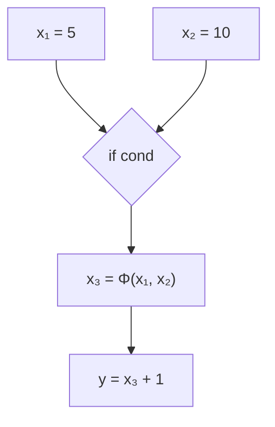
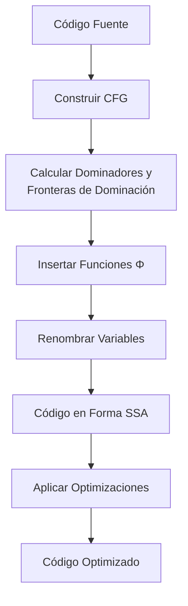

# Compiladores - Análisis de flujo de datos

## 9.3 Forma de asignación simple estática.

---

La Forma de Asignación Simple Estática (Static Single Assignment - SSA) es una representación intermedia de programas que simplifica enormemente el análisis de flujo de datos. En SSA, cada variable se asigna exactamente una vez, y se utilizan subíndices para distinguir entre diferentes versiones de la misma variable.

### Definición

SSA es una propiedad de un programa intermedio donde cada variable se define (asigna) exactamente una vez en el código, pero puede usarse múltiples veces. Según Cooper y Torczon (2004), "SSA proporciona una representación explícita de la def-use chain, haciendo que el análisis de flujo de datos sea más eficiente y preciso".

### Características Fundamentales

#### Asignación Única

Cada asignación crea una nueva versión de la variable:

```
x₁ = 5
y₁ = x₁ + 1  # usa x₁
x₂ = y₁ * 2  # crea nueva versión x₂
```

#### Funciones Φ (Phi)

En puntos de convergencia del flujo de control, se insertan funciones phi para fusionar diferentes versiones:



### Construcción de Forma SSA

#### Algoritmo Básico

1. **Insertar funciones Φ** en puntos de convergencia
2. **Renombrar variables** con subíndices
3. **Actualizar usos** de variables según sus definiciones

#### Criterio de Inserción de Funciones Φ

Se coloca una función Φ para la variable `a` en el bloque `B` si:

- `B` es punto de convergencia de al menos dos caminos
- Al menos dos de los predecesores de `B` contienen definiciones de `a`

### Algoritmo de Renombrado

```python
def renombrar_ssa(cfg):
    # Calcular información de dominadores
    dominadores = calcular_dominadores(cfg)
    fronteras_dominacion = calcular_fronteras_dominacion(cfg, dominadores)

    # Para cada variable
    for variable in obtener_variables(cfg):
        # Encontrar bloques donde se define la variable
        bloques_definicion = encontrar_definiciones(cfg, variable)

        # Encontrar puntos de inserción para funciones Φ
        puntos_phi = calcular_puntos_phi(fronteras_dominacion, bloques_definicion)

        # Insertar funciones Φ
        for bloque in puntos_phi:
            insertar_funcion_phi(bloque, variable)

        # Renombrar variables
        pila = []
        contador = 0

        def visitar_bloque(bloque):
            nonlocal contador
            # Renombrar definiciones
            for instruccion in bloque.instrucciones:
                if es_definicion(instruccion, variable):
                    contador += 1
                    nueva_version = f"{variable}_{contador}"
                    pila.append(nueva_version)
                    reemplazar_definicion(instruccion, nueva_version)

            # Renombrar usos
            for instruccion in bloque.instrucciones:
                if es_uso(instruccion, variable):
                    if pila:
                        reemplazar_uso(instruccion, pila[-1])
                    else:
                        reemplazar_uso(instruccion, f"{variable}_0")

            # Visitar hijos en el árbol de dominadores
            for hijo in obtener_hijos_dominadores(bloque, dominadores):
                visitar_bloque(hijo)

            # Desapilar definiciones
            for instruccion in bloque.instrucciones:
                if es_definicion(instruccion, variable):
                    pila.pop()

        # Iniciar desde el bloque de entrada
        visitar_bloque(cfg.entrada)
```

### Representación Matemática

#### Función Φ

La función Φ en un bloque con `k` predecesores:

$$
x_n = \Phi(x_{a_1}, x_{a_2}, \ldots, x_{a_k})
$$

Donde el valor de $x_n$ depende de qué camino de ejecución se tomó para llegar al bloque.

#### Ejemplo de Transformación

**Código original:**

```
x = 1
y = 2
if cond then
    x = x + 1
else
    x = x + 2
endif
z = x + y
```

**Código en SSA:**

```
x₁ = 1
y₁ = 2
if cond then
    x₂ = x₁ + 1
else
    x₃ = x₁ + 2
endif
x₄ = Φ(x₂, x₃)
z₁ = x₄ + y₁
```

### Ventajas de SSA

1. **Análisis más eficiente**: Las relaciones def-use son explícitas
2. **Optimizaciones simplificadas**:
   - Propagación de constantes
   - Eliminación de código muerto
   - Eliminación de subexpresiones comunes

3. **Precisión mejorada**: Elimina ambigüedades en el análisis de flujo de datos

### Aplicaciones en Optimización

#### Propagación de Constantes con SSA

```python
# Código original
x = 5
y = x + 1  # y puede ser constante 6
z = x * 2  # z puede ser constante 10

# En SSA
x₁ = 5
y₁ = x₁ + 1  # y₁ = 6 (constante)
z₁ = x₁ * 2  # z₁ = 10 (constante)
```

#### Eliminación de Código Muerto

```python
# Código original
x = 5  # Definición muerta si x no se usa después
y = 10
z = y + 1

# En SSA
x₁ = 5  # Fácil de identificar como código muerto
y₁ = 10
z₁ = y₁ + 1
```

### Ejercicios Propuestos

1. Convierte el siguiente código a forma SSA:

```
a = 1
b = 2
for i = 1 to 10 do
    if a > b then
        a = a + 1
    else
        b = b + a
    endif
end for
c = a + b
```

2. Explica dónde se necesitarían funciones Φ en este código y por qué:

```
x = 5
y = 10
if condition then
    x = x + y
else
    y = y - x
endif
z = x + y
```

3. Implementa un algoritmo simplificado para insertar funciones Φ dado un CFG.

4. Demuestra cómo la forma SSA facilita la propagación de constantes en el siguiente código:

```
a = 5
b = 3
c = a + b
if c > 0 then
    d = a * b
else
    d = a / b
endif
e = d + c
```

5. ¿Cuáles son las limitaciones de la forma SSA y en qué casos podría no ser beneficiosa?

### Optimizaciones Habilitadas por SSA

1. **Propagación constante agresiva**
2. **Eliminación de redundancias parciales**
3. **Eliminación de código muerto**
4. **Análisis de intervalos**
5. **Reducción de fuerza de operaciones**

### Referencias

1. Cooper, K. D., & Torczon, L. (2004). Engineering a Compiler. Morgan Kaufmann. (Capítulo 9)
2. Cytron, R., Ferrante, J., Rosen, B. K., Wegman, M. N., & Zadeck, F. K. (1991). Efficiently Computing Static Single Assignment Form and the Control Dependence Graph. ACM Transactions on Programming Languages and Systems.
3. Aho, A. V., Lam, M. S., Sethi, R., & Ullman, J. D. (2007). Compilers: Principles, Techniques, and Tools. Pearson Education. (Capítulo 9)

### Diagrama de Flujo de Transformación a SSA



La Forma de Asignación Simple Estática es una herramienta fundamental en compiladores modernos que permite realizar optimizaciones complejas de manera más eficiente y precisa.
