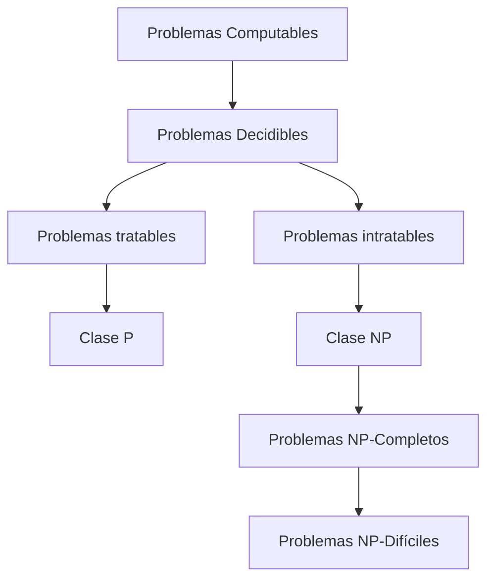

# Complejidad Computacional - Introducción y conceptos básicos

## 1.1 Motivación para estudiar complejidad computacional.

---

La Complejidad Computacional es una rama fundamental de la teoría de la computación que estudia los recursos necesarios para resolver problemas computacionales. Esta disciplina nos permite entender no solo qué problemas pueden ser resueltos por computadoras, sino también qué problemas pueden ser resueltos **eficientemente**.

### Problema Fundamental: ¿Qué Significa "Resolver Eficientemente"?

#### Definición de Eficiencia

Un algoritmo se considera **eficiente** si su tiempo de ejecución está acotado por un polinomio en el tamaño de la entrada.

**Definición formal**: Un algoritmo tiene complejidad temporal polinomial si existe un polinomio $p(n)$ tal que para toda entrada de tamaño $n$, el algoritmo termina en a lo sumo $p(n)$ pasos.

$$ T(n) = O(n^k) \quad \text{para algún } k \in \mathbb{N} $$

#### Clase de Complejidad P

La clase **P** contiene todos los problemas de decisión que pueden ser resueltos en tiempo polinomial por una máquina de Turing determinística.

### Ejemplo Ilustrativo: El Problema del Viajante

#### Definición del Problema

Dado un conjunto de ciudades y las distancias entre ellas, encontrar la ruta más corta que visite cada ciudad exactamente una vez y regrese al punto de origen.

```python
# Enfoque de fuerza bruta para TSP
import itertools

def tsp_brute_force(distances):
    n = len(distances)
    cities = list(range(n))
    min_distance = float('inf')
    best_route = None

    for permutation in itertools.permutations(cities):
        distance = 0
        for i in range(n):
            distance += distances[permutation[i]][permutation[(i+1)%n]]
        if distance < min_distance:
            min_distance = distance
            best_route = permutation

    return best_route, min_distance

# Ejemplo con 4 ciudades
distances = [
    [0, 10, 15, 20],
    [10, 0, 35, 25],
    [15, 35, 0, 30],
    [20, 25, 30, 0]
]

# Para n ciudades hay n! permutaciones
# n=4: 24 permutaciones → manejable
# n=20: 2.4×10¹⁸ permutaciones → imposible
```

#### Complejidad del Algoritmo

El algoritmo de fuerza bruta tiene complejidad $O(n!)$, que crece más rápido que cualquier función exponencial.

$$ n! \sim \sqrt{2\pi n}\left(\frac{n}{e}\right)^n \quad \text{(Fórmula de Stirling)} $$

### Diagrama de Relación entre Clases de Complejidad



### La Pregunta del Millón: P vs NP

#### Problema P vs NP

¿Es la clase P igual a la clase NP? Este es uno de los siete Problemas del Milenio del Clay Mathematics Institute, con una recompensa de $1,000,000.

**Definición NP**: La clase de problemas para los cuales una solución propuesta puede ser **verificada** en tiempo polinomial.

#### Ejemplo: SAT (Satisfacibilidad Booleana)

Dada una fórmula lógica, determinar si existe una asignación de valores que la haga verdadera.

**Fórmula ejemplo**: $(x_1 \lor \neg x_2) \land (x_2 \lor x_3) \land (\neg x_1 \lor \neg x_3)$

Verificar una solución: tiempo polinomial
Encontrar una solución: ¿tiempo polinomial?

### Importancia Práctica de la Complejidad Computacional

#### Aplicaciones en la Vida Real

1. **Criptografía**: La seguridad de RSA se basa en la dificultad de factorizar números grandes
2. **Bioinformática**: Alineamiento de secuencias de ADN
3. **Logística**: Optimización de rutas de entrega
4. **Machine Learning**: Entrenamiento de redes neuronales

#### Teorema de Cook-Levin (1971)

Todo problema en NP puede ser reducido al problema SAT en tiempo polinomial. Esto establece que SAT es **NP-completo**.

$$ \text{SAT es NP-completo} $$

### Ejercicios Propuestos

#### Ejercicio 1: Análisis de Complejidad

Analiza la complejidad temporal de los siguientes algoritmos:

```python
def algoritmo_A(n):
    total = 0
    for i in range(n):
        for j in range(n):
            total += i * j
    return total

def algoritmo_B(n):
    if n <= 1:
        return n
    return algoritmo_B(n-1) + algoritmo_B(n-2)
```

**Preguntas**:

1. ¿Cuál es la complejidad de algoritmo_A?
2. ¿Cuál es la complejidad de algoritmo_B?
3. ¿Ambos algoritmos son eficientes según la definición polinomial?

#### Ejercicio 2: Problema de la Mochila

Dados n objetos con pesos $w_i$ y valores $v_i$, y una mochila de capacidad W, maximizar el valor total sin exceder la capacidad.

**Instancia ejemplo**:

- Pesos: [2, 3, 4, 5]
- Valores: [3, 4, 5, 6]
- Capacidad: 5

**Preguntas**:

1. Propón un algoritmo de fuerza bruta
2. Analiza su complejidad computacional
3. ¿Pertenece este problema a la clase NP?

#### Ejercicio 3: Reducciones entre Problemas

Demuestra que si puedes resolver el problema del viajante (TSP) en tiempo polinomial, entonces puedes resolver el problema del ciclo Hamiltoniano en tiempo polinomial.

### Conceptos Clave para Recordar

#### Jerarquía de Complejidad

- **DTIME(f(n))**: Problemas decidibles en tiempo O(f(n)) por MT determinística
- **P** = $\bigcup_{k\geq0}$ DTIME( $n^k$ )
- **NP**: Problemas verificables en tiempo polinomial

#### Tesis de Cobham-Edmonds

La noción de "problema tratable" corresponde a los problemas en P.

### Referencias Bibliográficas

#### Bibliografía Básica

1. Garey, M. R., & Johnson, D. S. (1997). _Computers and Intractability: A Guide to the Theory of NP-Completeness_. W. H. Freeman.
   - Capítulo 1: "A Tour of NP-Completeness"

2. Sipser, M. (2005). _Introduction to the Theory of Computation_. Cengage Learning.
   - Capítulo 7: "Time Complexity"

3. Arora, S., & Barak, B. (2009). _Computational Complexity: A Modern Approach_. Cambridge University Press.
   - Capítulo 1: "The computational model - and why it doesn't matter"

#### Bibliografía Complementaria

4. Papadimitriou, C. H. (1993). _Computational Complexity_. Addison-Wesley.
   - Capítulo 1: "Problems and Algorithms"

### Puntos Clave de la Motivación

1. **Límites de la Computación**: No todos los problemas resolubles son resolubles eficientemente
2. **Clasificación de Problemas**: La teoría permite predecir la dificultad inherente de los problemas
3. **Diseño de Algoritmos**: Guía la búsqueda de soluciones prácticas para problemas difíciles
4. **Implicaciones Filosóficas**: Cuestiona los límites del conocimiento humano mediante computadoras
