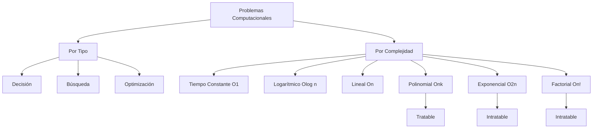

# Complejidad Computacional - Introducción y conceptos básicos

## 1.2 Problemas, algoritmos y complejidad.

---

La tríada fundamental de la complejidad computacional: problemas, algoritmos y complejidad, forma la base para entender los límites de la computación. Esta guía explora cómo se relacionan estos conceptos y por qué son esenciales para el estudio de la teoría de la computación.

### Definiciones Fundamentales

#### Problema Computacional

Un **problema computacional** es una relación entre entradas y salidas que especifica qué resultados son aceptables para cada entrada.

**Definición formal**: Un problema $\Pi$ es una tripleta $(I, S, R)$ donde:

- $I$ es el conjunto de instancias
- $S$ es el conjunto de soluciones
- $R \subseteq I \times S$ es la relación que especifica qué soluciones son válidas para cada instancia

#### Tipos de Problemas

1. **Problemas de decisión**: Respuesta sí/no
   - Ejemplo: ¿Es n un número primo?
2. **Problemas de búsqueda**: Encontrar una solución
   - Ejemplo: Encontrar una asignación que satisfaga una fórmula booleana
3. **Problemas de optimización**: Encontrar la mejor solución
   - Ejemplo: Encontrar el camino más corto entre dos puntos

#### Algoritmo

Un **algoritmo** es un procedimiento paso a paso bien definido que resuelve un problema computacional.

**Propiedades clave**:

- **Correctitud**: Siempre produce la salida correcta
- **Terminación**: Siempre termina en tiempo finito
- **Determinismo**: Mismo resultado para la misma entrada

### Medidas de Complejidad

#### Complejidad Temporal

Tiempo requerido por un algoritmo en función del tamaño de la entrada.

$$ T(n) = \text{número máximo de pasos para entradas de tamaño } n $$

#### Complejidad Espacial

Memoria requerida por un algoritmo.

$$ S(n) = \text{número máximo de celdas de memoria utilizadas} $$

#### Notación Asintótica

**Definiciones**:

- $O(g(n)) = \{f(n) : \exists c > 0, n_0 > 0 \text{ tal que } 0 \leq f(n) \leq cg(n) \ \forall n \geq n_0\}$
- $\Omega(g(n)) = \{f(n) : \exists c > 0, n_0 > 0 \text{ tal que } 0 \leq cg(n) \leq f(n) \ \forall n \geq n_0\}$
- $\Theta(g(n)) = O(g(n)) \cap \Omega(g(n))$

### Ejemplos de Algoritmos y su Complejidad

#### Búsqueda Lineal vs. Búsqueda Binaria

```python
def busqueda_lineal(arr, objetivo):
    """Complejidad: O(n)"""
    for i in range(len(arr)):
        if arr[i] == objetivo:
            return i
    return -1

def busqueda_binaria(arr, objetivo):
    """Complejidad: O(log n)"""
    izquierda, derecha = 0, len(arr) - 1
    while izquierda <= derecha:
        medio = (izquierda + derecha) // 2
        if arr[medio] == objetivo:
            return medio
        elif arr[medio] < objetivo:
            izquierda = medio + 1
        else:
            derecha = medio - 1
    return -1
```

#### Ordenamiento: Bubble Sort vs. Merge Sort

```python
def bubble_sort(arr):
    """Complejidad: O(n²)"""
    n = len(arr)
    for i in range(n):
        for j in range(0, n-i-1):
            if arr[j] > arr[j+1]:
                arr[j], arr[j+1] = arr[j+1], arr[j]

def merge_sort(arr):
    """Complejidad: O(n log n)"""
    if len(arr) > 1:
        medio = len(arr) // 2
        izquierda = arr[:medio]
        derecha = arr[medio:]

        merge_sort(izquierda)
        merge_sort(derecha)

        i = j = k = 0
        while i < len(izquierda) and j < len(derecha):
            if izquierda[i] < derecha[j]:
                arr[k] = izquierda[i]
                i += 1
            else:
                arr[k] = derecha[j]
                j += 1
            k += 1

        while i < len(izquierda):
            arr[k] = izquierda[i]
            i += 1
            k += 1

        while j < len(derecha):
            arr[k] = derecha[j]
            j += 1
            k += 1
```

### Diagrama de Clasificación de Problemas por Complejidad



### Análisis de Complejidad: Casos y Ejemplos

#### Caso Promedio vs. Peor Caso

**Definiciones**:

- **Peor caso**: $T_{worst}(n) = \max\{T(x) : |x| = n\}$
- **Mejor caso**: $T_{best}(n) = \min\{T(x) : |x| = n\}$
- **Caso promedio**: $T_{avg}(n) = \mathbb{E}[T(x) : |x| = n]$

#### Ejemplo: QuickSort

```python
def quicksort(arr):
    if len(arr) <= 1:
        return arr

    pivote = arr[len(arr) // 2]
    izquierda = [x for x in arr if x < pivote]
    medio = [x for x in arr if x == pivote]
    derecha = [x for x in arr if x > pivote]

    return quicksort(izquierda) + medio + quicksort(derecha)

# Complejidad:
# - Peor caso: O(n²) - cuando el pivote es siempre el menor/mayor
# - Caso promedio: O(n log n)
# - Mejor caso: O(n log n) - cuando el pivote divide equilibradamente
```

### Modelos de Computación y su Impacto en la Complejidad

#### Máquina de Turing (MT)

Modelo formal que define la complejidad de manera robusta.

**Teorema de Invariancia**: Los modelos de computación razonables difieren en tiempo por un factor polinomial.

$$ T_{MT}(n) = O(p(T_{modelo}(n))) \quad \text{para algún polinomio } p $$

#### Análisis de Algoritmos en MT

```python
# Simulación conceptual de una MT para suma binaria
def maquina_turing_suma(a, b):
    """
    Complejidad: O(max(len(a), len(b)))
    Donde a y b son cadenas binarias
    """
    # Configuración inicial de la cinta
    cinta = list(a + '#' + b + '#' + '0'*max(len(a), len(b)))
    cabeza = 0
    estado = 'sumar'
    acarreo = 0

    while estado != 'parar':
        if estado == 'sumar':
            # Lógica de suma bit a bit
            # Transiciones entre estados
            pass

    return ''.join(cinta).strip('0')
```

### Ejercicios Propuestos

#### Ejercicio 1: Análisis de Complejidad

Analiza la complejidad temporal de los siguientes algoritmos:

```python
def ejercicio_1a(n):
    total = 0
    for i in range(n):
        for j in range(i, n):
            for k in range(j, n):
                total += 1
    return total

def ejercicio_1b(n):
    if n <= 1:
        return 1
    return ejercicio_1b(n-1) + ejercicio_1b(n-2)

def ejercicio_1c(n):
    i = 1
    while i < n:
        print(i)
        i *= 2
```

**Preguntas**:

1. ¿Cuál es la complejidad de cada algoritmo en notación O?
2. ¿Cuáles son tratables para n grande?
3. Propón una versión más eficiente del algoritmo 1b.

#### Ejercicio 2: Problema del Subconjunto Suma

Dado un conjunto de números enteros y un objetivo, determinar si existe un subconjunto que sume exactamente el objetivo.

```python
def subset_suma(nums, objetivo):
    # Implementar algoritmo de fuerza bruta
    pass

# Ejemplo: nums = [3, 34, 4, 12, 5, 2], objetivo = 9
```

**Preguntas**:

1. Implementa un algoritmo de fuerza bruta
2. Analiza su complejidad computacional
3. ¿Pertenece este problema a la clase P? ¿Por qué?

#### Ejercicio 3: Reducción entre Problemas

Demuestra que el problema de la mochila (Knapsack) puede reducirse al problema del subconjunto suma.

**Instrucciones**:

1. Define formalmente ambos problemas
2. Propón una transformación polinomial
3. Argumenta por qué la reducción preserva la respuesta

### Fórmulas y Teoremas Importantes

#### Teorema Maestro para Recurrencias

Para recurrencias de la forma:

$$ T(n) = aT(n/b) + f(n) $$

Donde:

- $a \geq 1$, número de subproblemas
- $b > 1$, factor de división
- $f(n)$, costo de combinar soluciones

**Casos**:

1. Si $f(n) = O(n^{\log_b a - \epsilon})$ para $\epsilon > 0$, entonces $T(n) = \Theta(n^{\log_b a})$
2. Si $f(n) = \Theta(n^{\log_b a})$, entonces $T(n) = \Theta(n^{\log_b a} \log n)$
3. Si $f(n) = \Omega(n^{\log_b a + \epsilon})$ y $af(n/b) \leq cf(n)$ para $c < 1$, entonces $T(n) = \Theta(f(n))$

#### Ejemplo: Análisis de Merge Sort

$$ T(n) = 2T(n/2) + \Theta(n) $$

- $a = 2$, $b = 2$, $\log_b a = 1$
- $f(n) = \Theta(n) = \Theta(n^{\log_2 2})$ → Caso 2
- $T(n) = \Theta(n \log n)$

### Referencias Bibliográficas

#### Bibliografía Básica

1. **Sipser, M. (2005). Introduction to the Theory of Computation.**
   - Capítulo 7: "Time Complexity" - Análisis detallado de medidas de complejidad
   - Capítulo 8: "Space Complexity" - Complejidad espacial y sus relaciones

2. **Arora, S., & Barak, B. (2009). Computational Complexity: A Modern Approach.**
   - Capítulo 1: "The computational model - and why it doesn't matter"
   - Capítulo 2: "NP and NP completeness"

3. **Kozen, D. C. (2006). Theory of Computation.**
   - Capítulo 6: "Computational Complexity" - Fundamentos matemáticos

#### Bibliografía Complementaria

4. **Papadimitriou, C. H. (1993). Computational Complexity.**
   - Capítulo 1: "Problems and Algorithms" - Clasificación exhaustiva
   - Capítulo 2: "Models of Computation" - Comparación de modelos

### Puntos Clave para Recordar

1. **Separación Problema-Algoritmo**: Un problema puede tener múltiples algoritmos con diferentes complejidades
2. **Análisis Asintótico**: Importante para grandes volúmenes de datos
3. **Modelos Equivalentes**: La elección del modelo afecta la complejidad solo por factores polinomiales
4. **Clases de Complejidad**: Agrupan problemas según los recursos requeridos
