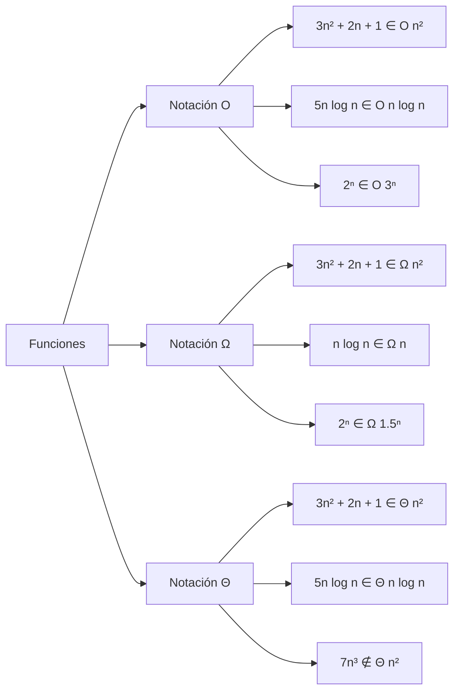
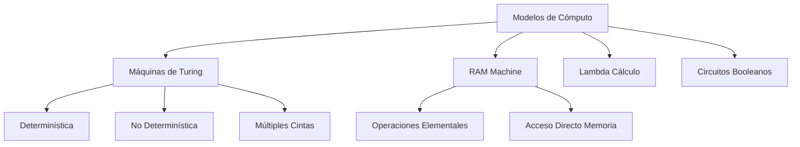

# Complejidad Computacional - Introducción y conceptos básicos

## 1.3 Notación asintótica, codificación y modelos de cómputo.

---

Estos tres conceptos fundamentales proporcionan las herramientas para analizar rigurosamente la eficiencia de los algoritmos y establecer límites teóricos para la computación.

### Notación Asintótica

#### Definiciones Formales

##### Notación O Grande (Cota Superior)

$$ O(g(n)) = \{ f(n) : \exists c > 0, n_0 > 0 \text{ tal que } 0 \leq f(n) \leq c \cdot g(n) \ \forall n \geq n_0 \} $$

**Interpretación**: $f(n)$ crece a lo sumo tan rápido como $g(n)$.

##### Notación Ω (Cota Inferior)

$$ \Omega(g(n)) = \{ f(n) : \exists c > 0, n_0 > 0 \text{ tal que } 0 \leq c \cdot g(n) \leq f(n) \ \forall n \geq n_0 \} $$

##### Notación Θ (Cota Ajustada)

$$ \Theta(g(n)) = O(g(n)) \cap \Omega(g(n)) $$

#### Ejemplos Visuales de Notación Asintótica



#### Propiedades Algebraicas

##### Reglas de la Notación O

1. **Transitividad**: Si $f(n) = O(g(n))$ y $g(n) = O(h(n))$, entonces $f(n) = O(h(n))$
2. **Reflexividad**: $f(n) = O(f(n))$
3. **Suma**: $O(f(n)) + O(g(n)) = O(\max(f(n), g(n)))$
4. **Producto**: $O(f(n)) \cdot O(g(n)) = O(f(n) \cdot g(n))$

#### Ejemplos Prácticos en Código

```python
def ejemplo_complejidades(n):
    # O(1) - Tiempo constante
    resultado = n * n  # Operación elemental

    # O(log n) - Logarítmico
    i = 1
    while i < n:
        i *= 2

    # O(n) - Lineal
    for i in range(n):
        pass

    # O(n log n) - Linealítmico
    for i in range(n):
        j = 1
        while j < n:
            j *= 2

    # O(n²) - Cuadrático
    for i in range(n):
        for j in range(n):
            pass

    # O(2ⁿ) - Exponencial
    def fibonacci(n):
        if n <= 1:
            return n
        return fibonacci(n-1) + fibonacci(n-2)
```

### Codificación de Problemas

#### Tamaño de la Entrada

El **tamaño de la entrada** $|x|$ de una instancia $x$ afecta directamente la complejidad del algoritmo.

##### Ejemplos de Codificación

- **Números enteros**: Codificación binaria vs. unaria
  - Binario: tamaño = $\lceil \log_2 (n+1) \rceil$
  - Unario: tamaño = $n$

```python
def codificacion_numeros():
    # Número 13 en diferentes codificaciones
    binario = '1101'      # Tamaño: 4 bits
    unario = '1111111111111'  # Tamaño: 13 caracteres
    decimal = '13'        # Tamaño: 2 caracteres

    return binario, unario, decimal

# Impacto en complejidad:
# Algoritmo O(n) con codificación unaria: O(2^|x|) en codificación binaria
```

#### Codificación de Grafos

```python
class Grafo:
    def __init__(self, n_vertices):
        self.n = n_vertices
        self.matriz = [[0] * n_vertices for _ in range(n_vertices)]

    def codificar_matriz_adyacencia(self):
        """Codificación: n² bits"""
        encoding = []
        for i in range(self.n):
            for j in range(self.n):
                encoding.append(str(self.matriz[i][j]))
        return ''.join(encoding)

    def codificar_lista_adyacencia(self):
        """Codificación: O(n + m) donde m es número de aristas"""
        encoding = []
        for i in range(self.n):
            vecinos = [str(j) for j in range(self.n) if self.matriz[i][j] == 1]
            encoding.append(f"{i}:{','.join(vecinos)}")
        return ';'.join(encoding)

# Ejemplo: Grafo con 3 vértices
grafo = Grafo(3)
grafo.matriz = [[0,1,1], [1,0,0], [1,0,0]]
print("Matriz:", grafo.codificar_matriz_adyacencia())  # 011100100
print("Lista:", grafo.codificar_lista_adyacencia())   # 0:1,2;1:0;2:0
```

### Modelos de Cómputo

#### Máquina de Turing (MT)

##### Definición Formal

Una MT es una 7-tupla $(Q, \Sigma, \Gamma, \delta, q_0, q_{accept}, q_{reject})$ donde:

- $Q$: conjunto finito de estados
- $\Sigma$: alfabeto de entrada
- $\Gamma$: alfabeto de la cinta $(\Sigma \subset \Gamma)$
- $\delta$: función de transición $Q \times \Gamma \to Q \times \Gamma \times \{L, R\}$
- $q_0$: estado inicial
- $q_{accept}$: estado de aceptación
- $q_{reject}$: estado de rechazo

##### Simulación de MT en Python

```python
class MaquinaTuring:
    def __init__(self, estados, alfabeto, cinta_alfabeto, transiciones, estado_inicial, aceptacion, rechazo):
        self.estados = estados
        self.alfabeto = alfabeto
        self.cinta_alfabeto = cinta_alfabeto
        self.transiciones = transiciones  # dict: (estado, simbolo) -> (nuevo_estado, nuevo_simbolo, movimiento)
        self.estado_actual = estado_inicial
        self.estado_aceptacion = aceptacion
        self.estado_rechazo = rechazo

    def ejecutar(self, entrada):
        cinta = list(entrada) + ['_']  # _ representa blanco
        posicion = 0
        self.estado_actual = self.estado_inicial

        while self.estado_actual not in [self.estado_aceptacion, self.estado_rechazo]:
            simbolo_actual = cinta[posicion]
            if (self.estado_actual, simbolo_actual) in self.transiciones:
                nuevo_estado, nuevo_simbolo, movimiento = self.transiciones[
                    (self.estado_actual, simbolo_actual)]

                cinta[posicion] = nuevo_simbolo
                self.estado_actual = nuevo_estado

                if movimiento == 'R':
                    posicion += 1
                    if posicion == len(cinta):
                        cinta.append('_')
                else:  # movimiento == 'L'
                    posicion = max(0, posicion - 1)
            else:
                self.estado_actual = self.estado_rechazo

        return self.estado_actual == self.estado_aceptacion
```

#### Modelos Equivalentes



##### Teorema de Invariancia

Todos los modelos de computación "razonables" son equivalentes dentro de un factor polinomial.

$$ T_{MT}(n) = O(p(T_{modelo}(n))) \quad \text{para algún polinomio } p $$

#### Máquina de Acceso Aleatorio (RAM)

```python
class RAMMachine:
    def __init__(self):
        self.registros = {}  # Registros de memoria
        self.puntero = 0     # Contador de programa
        self.instrucciones = []

    def cargar_programa(self, programa):
        """Programa como lista de instrucciones"""
        self.instrucciones = programa

    def ejecutar(self):
        while self.puntero < len(self.instrucciones):
            instruccion = self.instrucciones[self.puntero]
            op = instruccion[0]

            if op == 'LOAD':
                # LOAD i, j: registros[i] = memoria[j]
                pass
            elif op == 'STORE':
                # STORE i, j: memoria[j] = registros[i]
                pass
            elif op == 'ADD':
                # ADD i, j, k: registros[i] = registros[j] + registros[k]
                pass
            # ... más instrucciones

            self.puntero += 1
```

### Ejercicios Propuestos

#### Ejercicio 1: Análisis Asintótico

Para cada par de funciones, determina la relación correcta usando $O$, $\Omega$, $\Theta$:

1. $f(n) = 3n^3 + 2n^2 + 10$, $g(n) = n^3$
2. $f(n) = 2^n + n^{100}$, $g(n) = 3^n$
3. $f(n) = \log(n!)$, $g(n) = n \log n$
4. $f(n) = \sqrt{n} + \log n$, $g(n) = n^{0.5}$

**Sugerencia**: Usa límites: $\lim_{n \to \infty} \frac{f(n)}{g(n)}$

#### Ejercicio 2: Codificación y Tamaño

Considera el problema de determinar si un número $n$ es primo.

```python
def es_primo_naive(n):
    if n < 2:
        return False
    for i in range(2, n):  # O(n) iteraciones
        if n % i == 0:
            return False
    return True
```

**Preguntas**:

1. Si codificamos $n$ en unario, ¿cuál es la complejidad?
2. Si codificamos $n$ en binario, ¿cuál es la complejidad?
3. ¿Por qué la codificación afecta la complejidad aparente?

#### Ejercicio 3: Simulación de MT

Diseña una Máquina de Turing que reconozca el lenguaje $L = \{0^n1^n : n \geq 0\}$.

**Requisitos**:

1. Define formalmente la MT (estados, alfabeto, transiciones)
2. Implementa la simulación en Python
3. Analiza la complejidad temporal

#### Ejercicio 4: Reducción entre Modelos

Demuestra cómo simular una MT de múltiples cintas con una MT de una cinta con solo un overhead cuadrático.

**Fórmula clave**:

$$ T_{1-cinta}(n) = O(T_{k-cintas}(n)^2) $$

### Fórmulas y Teoremas Importantes

#### Jerarquía de Tiempo

**Teorema**: Para funciones $f$ y $g$ time-constructibles:

$$ DTIME(f(n)) \subsetneq DTIME(f(n) \cdot \log^2 f(n)) $$

#### Teorema de Linear Speedup

Para cualquier MT $M$ con complejidad $T(n)$, existe una MT $M'$ equivalente con complejidad:

$$ T'(n) = \frac{T(n)}{c} + O(n) \quad \text{para cualquier constante } c > 0 $$

#### Relación entre Modelos

$$ TIME_{RAM}(n) = \Theta(TIME_{MT}(n^k)) \quad \text{para algún } k \geq 1 $$

### Referencias Bibliográficas

#### Bibliografía Básica

1. **Sipser, M. (2005). Introduction to the Theory of Computation.**
   - Capítulo 7: "Time Complexity" - Notación asintótica y análisis
   - Capítulo 3: "The Church-Turing Thesis" - Modelos de cómputo

2. **Arora, S., & Barak, B. (2009). Computational Complexity: A Modern Approach.**
   - Capítulo 1: "The computational model - and why it doesn't matter"
   - Capítulo 3: "The polynomial time paradigm"

3. **Kozen, D. C. (2006). Theory of Computation.**
   - Capítulo 6: "Computational Complexity" - Análisis riguroso

#### Bibliografía Complementaria

4. **Papadimitriou, C. H. (1993). Computational Complexity.**
   - Capítulo 2: "Models of Computation" - Comparación detallada
   - Capítulo 1: "Problems and Algorithms" - Codificación y tamaño

### Puntos Clave para Recordar

1. **Notación Asintótica**: Herramienta fundamental para analizar crecimiento de funciones
2. **Codificación Importa**: El tamaño de la entrada afecta la complejidad medida
3. **Equivalencia de Modelos**: Todos los modelos razonables son polinomialmente equivalentes
4. **Máquina de Turing**: Modelo de referencia para definir complejidad computacional
5. **Invariancia**: Los resultados de complejidad son robustos ante cambios de modelo
