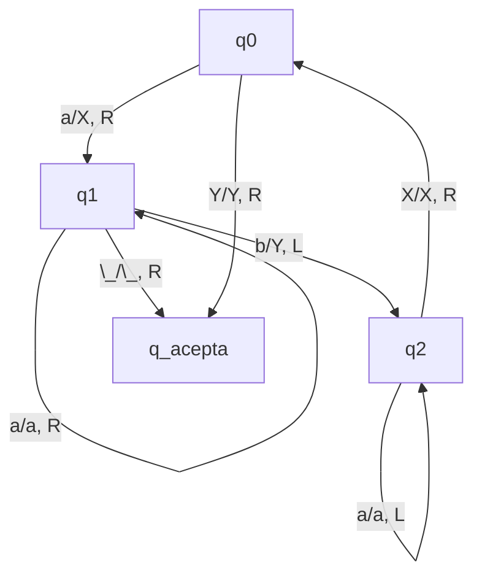
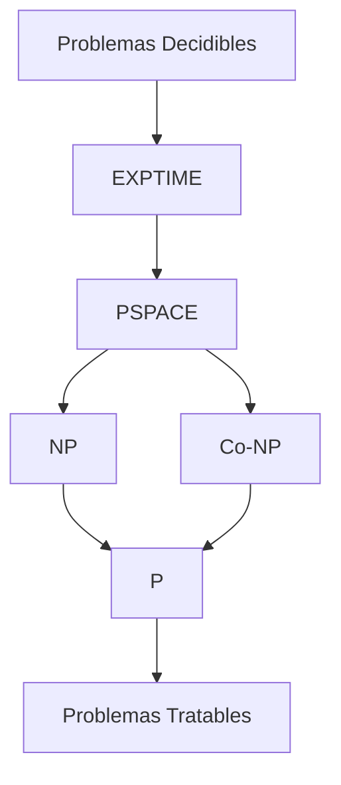

# Complejidad Computacional - La teoría de NP-Completez

## 2.1 Máquinas de Turing y la clase P.

---

La teoría de NP-completitud se fundamenta en el modelo de Máquinas de Turing y en la clasificación de problemas según su complejidad computacional. Comprender la clase P es esencial para posteriormente estudiar las clases NP y NP-completitud.

### Máquinas de Turing (MT)

#### Definición Formal

Una Máquina de Turing determinística de una cinta es una 7-tupla:

$$M = (Q, \Sigma, \Gamma, \delta, q_0, q_{acepta}, q_{rechaza})$$

Donde:

- $Q$: conjunto finito de estados
- $\Sigma$: alfabeto de entrada (sin el símbolo blanco)
- $\Gamma$: alfabeto de la cinta ( $\Sigma \subseteq \Gamma$, y $\sqcup \in \Gamma$ es el símbolo blanco )
- $\delta: Q \times \Gamma \to Q \times \Gamma \times \{L, R\}$: función de transición
- $q_0 \in Q$: estado inicial
- $q_{acepta} \in Q$: estado de aceptación
- $q_{rechaza} \in Q$: estado de rechazo ( $q_{acepta} \neq q_{rechaza}$ )

#### Funcionamiento de una MT

```python
# Pseudocódigo simplificado de una Máquina de Turing
def maquina_turing(entrada, transiciones, estado_inicial):
    cinta = list(entrada) + ['_']  # '_' representa el símbolo blanco
    cabeza = 0
    estado_actual = estado_inicial

    while estado_actual not in [q_acepta, q_rechaza]:
        simbolo_actual = cinta[cabeza]
        # Buscar transición: δ(estado_actual, simbolo_actual)
        transicion = transiciones.get((estado_actual, simbolo_actual))

        if transicion is None:
            estado_actual = q_rechaza
            break

        nuevo_estado, nuevo_simbolo, movimiento = transicion
        cinta[cabeza] = nuevo_simbolo
        estado_actual = nuevo_estado

        if movimiento == 'R':
            cabeza += 1
            if cabeza == len(cinta):
                cinta.append('_')
        else:  # movimiento == 'L'
            cabeza = max(0, cabeza - 1)

    return estado_actual == q_acepta
```

#### Diagrama de una Máquina de Turing



### Complejidad Temporal y la Clase P

#### Definición: Tiempo de Ejecución

El tiempo de ejecución de una Máquina de Turing determinística $M$ es la función $t: \mathbb{N} \to \mathbb{N}$, donde $t(n)$ es el número máximo de pasos que $M$ ejecuta sobre cualquier entrada de longitud $n$.

#### Definición: Clase P (Sipser, 2005)

La clase **P** es el conjunto de todos los lenguajes de decisión que son decidibles en tiempo polinomial por una Máquina de Turing determinística. Formalmente:

$$
P = \bigcup_{k \in \mathbb{N}} TIME(n^k)
$$

Donde $TIME(t(n))$ es la clase de lenguajes decidibles por una MT determinística en tiempo $O(t(n))$.

#### Ejemplo: El problema PATH

**Problema**: Dado un grafo dirigido $G = (V, E)$ y dos vértices $s, t \in V$, ¿existe un camino de $s$ a $t$ en $G$?

**Algoritmo en P** (BFS - Búsqueda en Amplitud):

```python
def existe_camino(grafo, s, t):
    from collections import deque

    if s == t:
        return True

    visitado = set([s])
    cola = deque([s])

    while cola:
        u = cola.popleft()
        for v in grafo[u]:
            if v == t:
                return True
            if v not in visitado:
                visitado.add(v)
                cola.append(v)

    return False
```

**Complejidad**: $O(|V| + |E|)$ - tiempo polinomial, por lo tanto PATH ∈ P.

### Relación entre P y Problemas Tratables

#### Teorema: Invariancia de P

La clase P es invariante respecto al modelo de computación razonable. Esto significa que si un problema está en P según el modelo de MT, también estará en P para cualquier otro modelo de computación razonable (máquinas de RAM, etc.).

#### Ejemplo: Verificación de Conectividad en Grafos No Dirigidos

**Problema**: Dado un grafo no dirigido $G = (V, E)$, ¿es $G$ conexo?

**Algoritmo**:

1. Elegir un vértice arbitrario $v \in V$
2. Realizar BFS desde $v$
3. Si se visitan todos los vértices, el grafo es conexo

**Complejidad**: $O(|V| + |E|)$ ∈ P

### Ejercicios Propuestos

#### Ejercicio 1: Diseño de Máquina de Turing

Diseñe una Máquina de Turing que decida el lenguaje $L = \{w \in \{0,1\}^* \mid w \text{ contiene igual número de 0s y 1s}\}$.

**Preguntas guía**:

- ¿Cuál es la complejidad temporal de su MT?
- ¿Pertenece este lenguaje a la clase P?

#### Ejercicio 2: Análisis de Complejidad

Analice la complejidad temporal del siguiente algoritmo y determine si el problema correspondiente está en P:

```python
def tiene_ciclo_hamiltoniano(grafo):
    n = len(grafo)
    # Generar todas las permutaciones de vértices
    from itertools import permutations
    for perm in permutations(range(n)):
        es_ciclo = True
        for i in range(n):
            if grafo[perm[i]][perm[(i+1)%n]] == 0:
                es_ciclo = False
                break
        if es_ciclo:
            return True
    return False
```

#### Ejercicio 3: Demostración

Demuestre que si $L_1, L_2 \in P$, entonces:

- $L_1 \cup L_2 \in P$
- $L_1 \cap L_2 \in P$
- $\overline{L_1} \in P$

### Teoremas Importantes

#### Teorema: Cerradura de P bajo Complemento

Para cualquier lenguaje $L \subseteq \Sigma^*$, si $L \in P$ entonces $\overline{L} \in P$.

**Demostración**: Si $M$ decide $L$ en tiempo polinomial, podemos construir $M'$ que intercambie los estados de aceptación y rechazo de $M$.

#### Teorema: Relación P y EXPTIME

$$ P \subseteq EXPTIME = \bigcup_{k \in \mathbb{N}} TIME(2^{n^k}) $$

Pero se desconoce si $P \subset EXPTIME$ o $P = EXPTIME$ ( se cree que $P \subset EXPTIME$ ).

### Diagrama de Relación entre Clases de Complejidad



### Referencias

#### Bibliografía Básica

1. **Garey y Johnson (1997)**: Capítulo 1 - Fundamentos de la teoría de NP-completitud
2. **Sipser (2005)**: Capítulo 7 - Complejidad temporal
3. **Arora y Barak (2009)**: Capítulo 1 - El modelo de Máquinas de Turing
4. **Kozen (2006)**: Capítulo 28 - Clases de complejidad

#### Bibliografía Complementaria

1. **Hopcroft et al. (2006)**: Capítulo 8 - Introducción a la teoría de la complejidad
2. **Papadimitriou (1993)**: Capítulo 1 - Problemas y algoritmos
3. **Goldreich (2008)**: Capítulo 1 - Introducción y fundamentos

### Puntos Clave para Recordar

1. **P** contiene problemas resolubles en tiempo polinomial
2. Las **Máquinas de Turing** son el modelo formal para definir complejidad
3. La clase **P** es cerrada bajo unión, intersección y complemento
4. Los problemas en **P** se consideran "tratables" o "eficientemente resolubles"
5. La relación entre **P** y **NP** es el problema abierto más importante en ciencias de la computación

### Evaluación de Comprensión

1. ¿Por qué se considera que los problemas en P son "tratables"?
2. Explique la importancia del teorema de invariancia de P
3. Diseñe una MT para reconocer palíndromos y analice su complejidad
4. ¿Qué implicaciones tendría demostrar que P = NP?
