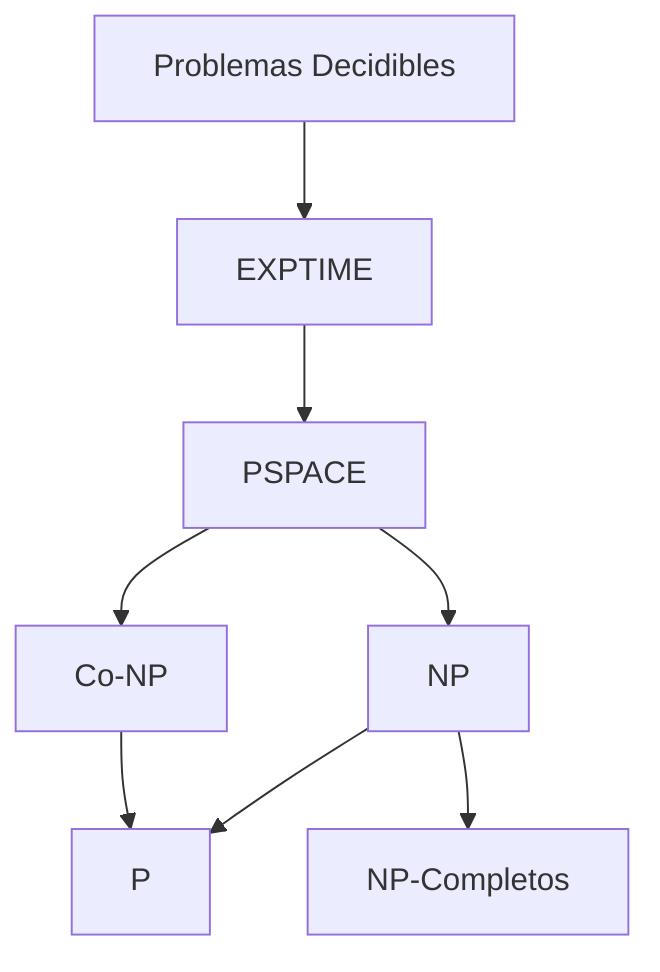
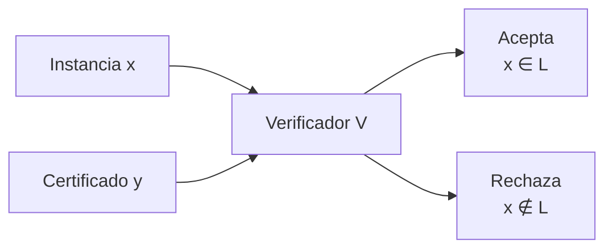

# Complejidad Computacional - La teoría de NP-Completez

## 2.2 La clase NP.

---

La clase NP es fundamental en la teoría de NP-completitud y representa problemas cuya solución puede ser verificada eficientemente, incluso si no sabemos resolverlos eficientemente.

### Definición de la Clase NP

#### Definición por Verificadores (Sipser, 2005)

Un lenguaje $L$ pertenece a **NP** si existe un verificador determinístico de tiempo polinomial $V$ y una constante $c$ tal que:

$$ L = \{x \mid \exists y \text{ con } |y| \leq |x|^c \land V(x,y) = 1\} $$

Donde:

- $x$ es la instancia del problema
- $y$ es el certificado o testigo (witness)
- $V$ es el verificador que funciona en tiempo polinomial respecto a $|x|$

#### Definición por Máquinas de Turing No Determinísticas

Un lenguaje $L$ está en **NP** si existe una Máquina de Turing no determinística (MTND) que decide $L$ en tiempo polinomial.

Formalmente:

$$ NP = \bigcup_{k \in \mathbb{N}} NTIME(n^k) $$

### Máquinas de Turing No Determinísticas (MTND)

#### Definición Formal

Una MTND es una 7-tupla:

$$M = (Q, \Sigma, \Gamma, \Delta, q_0, q_{acepta}, q_{rechaza})$$

Donde $\Delta \subseteq (Q \times \Gamma) \times (Q \times \Gamma \times \{L, R\})$ es la relación de transición (no determinística).

#### Funcionamiento de una MTND

```python
# Pseudocódigo conceptual de una MTND
def mtnd_verificadora(entrada, transiciones):
    # Las MTND pueden "adivinar" el certificado
    certificado = adivinar_certificado(entrada)

    # Luego verifican determinísticamente
    return verificar_deterministicamente(entrada, certificado)

def adivinar_certificado(entrada):
    # En cada paso no determinístico, la MTND
    # puede elegir múltiples transiciones
    # Esto se modela como "adivinar" el camino correcto
    pass
```

### Ejemplos de Problemas en NP

#### 1. Problema SAT (Satisfactibilidad Booleana)

**Instancia**: Una fórmula booleana $\phi$ en forma normal conjuntiva (CNF)
**Pregunta**: ¿Existe una asignación de valores de verdad que satisfaga $\phi$?

**Certificado**: Una asignación de valores de verdad para las variables.

**Verificador**:

```python
def verificar_sat(formula, asignacion):
    # Evaluar la fórmula con la asignación dada
    # Tiempo polinomial respecto al tamaño de la fórmula
    return evaluar_formula(formula, asignacion)
```

#### 2. Problema del Ciclo Hamiltoniano

**Instancia**: Grafo $G = (V, E)$
**Pregunta**: ¿Contiene $G$ un ciclo hamiltoniano? (ciclo que visita cada vértice exactamente una vez)

**Certificado**: Una permutación de los vértices $(v_1, v_2, ..., v_n)$.

**Verificador**:

```python
def verificar_ciclo_hamiltoniano(grafo, permutacion):
    n = len(grafo)
    # Verificar que es un ciclo
    for i in range(n):
        if not grafo[permutacion[i]][permutacion[(i+1)%n]]:
            return False
    # Verificar que todos los vértices están incluidos
    return len(set(permutacion)) == n
```

#### 3. Problema de la Mochila (Knapsack)

**Instancia**: Conjunto de items con pesos $w_i$ y valores $v_i$, capacidad $W$, valor objetivo $V$
**Pregunta**: ¿Existe un subconjunto de items con peso total $\leq W$ y valor total $\geq V$?

**Certificado**: Un subconjunto de items.

### Relación entre P y NP

#### Diagrama de Relación de Clases



#### Teorema: Relación Fundamental

$$ P \subseteq NP \subseteq PSPACE \subseteq EXPTIME $$

**Demostración**:

- $P \subseteq NP$: Cualquier máquina determinística es un caso especial de no determinística
- $NP \subseteq PSPACE$: Podemos simular todas las ramas de una MTND usando una cantidad polinomial de espacio

### Características de la Clase NP

#### Propiedad de Cerradura

NP es cerrado bajo:

- **Unión**: $L_1, L_2 \in NP \Rightarrow L_1 \cup L_2 \in NP$
- **Intersección**: $L_1, L_2 \in NP \Rightarrow L_1 \cap L_2 \in NP$
- **Concatenación**: $L_1, L_2 \in NP \Rightarrow L_1 \cdot L_2 \in NP$
- **Estrella de Kleene**: $L \in NP \Rightarrow L^* \in NP$

#### Teorema: Existencia de Problemas NP-Completos (Cook-Levin)

**Teorema (Cook, 1971)**: SAT es NP-completo.

Esto significa que:

1. SAT ∈ NP
2. Para todo L ∈ NP, L ≤ₚ SAT (SAT es NP-difícil)

### Verificadores y Certificados

#### Estructura General de un Verificador NP



#### Ejemplo: Verificador para el Problema del Clique

**Problema CLIQUE**: Dado un grafo $G$ y un entero $k$, ¿existe un clique de tamaño $k$ en $G$?

```python
def verificador_clique(grafo, k, certificado):
    # Certificado: conjunto de vértices candidatos a formar el clique
    if len(certificado) != k:
        return False

    # Verificar que todos los vértices en el certificado están conectados
    for i in range(k):
        for j in range(i+1, k):
            if not grafo[certificado[i]][certificado[j]]:
                return False

    return True
```

### Ejercicios Propuestos

#### Ejercicio 1: Diseño de Verificadores

Para cada uno de los siguientes problemas, diseñe un verificador en tiempo polinomial y especifique el certificado apropiado:

1. **Problema del Conjunto Independiente**: Dado $G$ y $k$, ¿existe un conjunto independiente de tamaño $k$?
2. **Problema de la Cubierta de Vértices**: Dado $G$ y $k$, ¿existe una cubierta de vértices de tamaño $k$?
3. **Problema 3-SAT**: Caso especial de SAT donde cada cláusula tiene exactamente 3 literales.

#### Ejercicio 2: Demostraciones

Demuestre formalmente que:

1. Si $L_1 \leq_p L_2$ y $L_2 \in NP$, entonces $L_1 \in NP$
2. La unión de dos lenguajes en NP también está en NP
3. La clase NP es cerrada bajo la operación de estrella de Kleene

#### Ejercicio 3: Análisis de Problemas

Para cada problema, determine si está en NP y justifique su respuesta:

1. **Problema del Halting**: Dado un programa y una entrada, ¿el programa termina?
2. **Problema del Isomorfismo de Grafos**: Dados dos grafos, ¿son isomorfos?
3. **Problema de la Factorización**: Dado un número natural, encontrar sus factores primos.

### Teoremas Importantes

#### Teorema: Teorema de Cook-Levin

**Enunciado**: SAT es NP-completo.

**Importancia**: Proporciona el primer problema NP-completo, permitiendo demostrar la NP-completitud de otros problemas por reducción.

#### Teorema: Teorema de Ladner

Si $P \neq NP$, entonces existen problemas en $NP$ que no están en $P$ y que no son NP-completos.

### Estrategias para Demostrar que un Problema está en NP

1. **Identificar el certificado**: ¿Qué información permitiría verificar rápidamente una solución?
2. **Diseñar el verificador**: Algoritmo determinístico polinomial que verifique el certificado
3. **Demostrar completitud**: Si es necesario, mostrar que el problema es NP-completo

### Referencias Específicas

#### Bibliografía Básica

1. **Garey y Johnson (1997)**: Sección 2.1 - "The Theory of NP-Completeness"
2. **Sipser (2005)**: Capítulo 7 - "Time Complexity", Sección 7.3 - "The Class NP"
3. **Arora y Barak (2009)**: Capítulo 2 - "NP and NP Completeness"
4. **Kozen (2006)**: Capítulo 28 - "Complexity Classes"

#### Bibliografía Complementaria

1. **Hopcroft et al. (2006)**: Capítulo 10 - "Intractable Problems"
2. **Papadimitriou (1993)**: Capítulo 2 - "Reductions and Completeness"
3. **Goldreich (2008)**: Capítulo 2 - "The P versus NP Question"

### Preguntas de Comprensión Crítica

1. ¿Por qué la definición por verificadores es equivalente a la definición por MTND?
2. Explique la diferencia fundamental entre un algoritmo que resuelve un problema y un verificador que comprueba soluciones
3. ¿Qué implicaría para la teoría de la computación si se demostrara que P = NP?
4. ¿Por qué es importante la existencia de problemas NP-completos?

### Resumen de Puntos Clave

1. **NP** contiene problemas cuyas soluciones pueden verificarse en tiempo polinomial
2. Todo problema en **P** está automáticamente en **NP**
3. La pregunta **P vs NP** es el problema abierto más importante en ciencias de la computación
4. Los **verificadores** y **certificados** son herramientas esenciales para demostrar que un problema está en NP
5. **SAT** fue el primer problema demostrado NP-completo (Cook-Levin, 1971)
