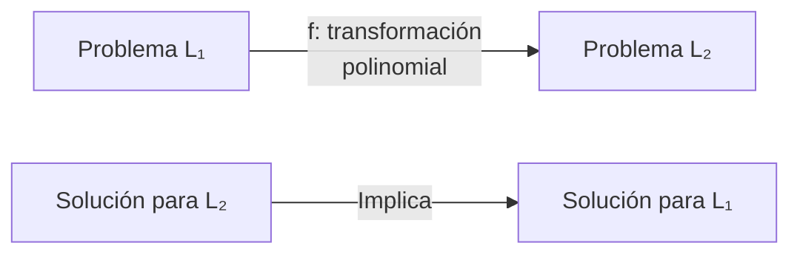
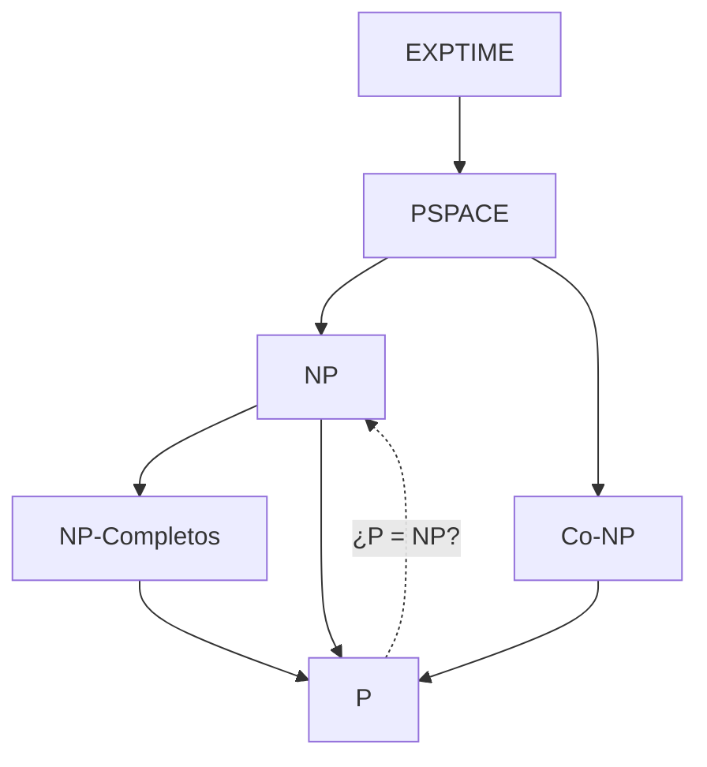

# Complejidad Computacional - La teoría de NP-Completez

## 2.3 Relación P-NP y transformaciones polinomiales.

---

La relación entre las clases P y NP, junto con el concepto de reducciones polinomiales, constituye el núcleo de la teoría de NP-completitud. Estas herramientas permiten clasificar problemas y entender su dificultad computacional inherente.

### La Pregunta P vs NP

#### Definición Formal del Problema

La pregunta fundamental es si:

$$
P = NP \quad \text{o} \quad P \subsetneq NP
$$

**P**: Problemas resolubles en tiempo polinomial por algoritmos determinísticos
**NP**: Problemas cuyas soluciones pueden verificarse en tiempo polinomial

#### Implicaciones de la Respuesta

##### Si P = NP:

- Todos los problemas verificables eficientemente serían resolubles eficientemente
- Revolución en criptografía, optimización, inteligencia artificial
- Cambio paradigmático en la comprensión de la computación

##### Si P ≠ NP (escenario más aceptado):

- Confirmación de que existen problemas inherentemente difíciles
- Límites fundamentales en lo que podemos computar eficientemente
- Validación de la jerarquía actual de complejidad

### Reducciones Polinomiales

#### Definición (Karp, 1972)

Un lenguaje $L_1$ es reducible en tiempo polinomial a $L_2$ ( denotado $L_1 \leq_p L_2$ ) si existe una función computable en tiempo polinomial $ f: \Sigma ^ * \to \Sigma ^ * $ tal que:

$$ \forall x \in \Sigma ^ * : x \in L\_1 \Leftrightarrow f(x) \in L\_2 $$

#### Propiedades de las Reducciones Polinomiales

1. **Transitividad**: Si $L_1 \leq_p L_2$ y $L_2 \leq_p L_3$, entonces $L_1 \leq_p L_3$
2. **Preservación de P**: Si $L_1 \leq_p L_2$ y $L_2 \in P$, entonces $L_1 \in P$
3. **Preservación de NP**: Si $L_1 \leq_p L_2$ y $L_2 \in NP$, entonces $L_1 \in NP$

#### Diagrama de Reducción Polinomial



### Transformaciones entre Problemas NP-Completos

#### Estructura General de una Reducción

```python
def reduccion_polinomial(instancia_L1):
    # Transformar instancia de L1 a instancia de L2 en tiempo polinomial
    instancia_L2 = transformar(instancia_L1)
    return instancia_L2

def resolver_usando_reduccion(instancia_L1):
    instancia_L2 = reduccion_polinomial(instancia_L1)
    return oraculo_L2(instancia_L2)  # Si tuvieramos un oráculo para L2
```

#### Ejemplo: Reducción de 3-SAT a Clique

**Teorema**: 3-SAT ≤ₚ CLIQUE

**Construcción**:

- Dada una fórmula 3-CNF $\phi$ con $k$ cláusulas
- Construir grafo $G$ donde:
  - Cada vértice representa un literal en $\phi$
  - Conectar vértices si:
    - Están en cláusulas diferentes
    - No son literales complementarios

```python
def reduccion_3sat_a_clique(formula_3sat):
    clausulas = obtener_clausulas(formula_3sat)
    k = len(clausulas)

    # Construir grafo
    grafo = Grafo()

    # Añadir vértices: (clausula_index, literal_index)
    for i, clausula in enumerate(clausulas):
        for literal in clausula:
            vertice = (i, literal)
            grafo.añadir_vertice(vertice)

    # Añadir aristas
    for i in range(len(grafo.vertices)):
        for j in range(i+1, len(grafo.vertices)):
            vertice_i = grafo.vertices[i]
            vertice_j = grafo.vertices[j]

            # Conectar si están en cláusulas diferentes
            # y no son literales complementarios
            if (vertice_i[0] != vertice_j[0] and
                not son_complementarios(vertice_i[1], vertice_j[1])):
                grafo.añadir_arista(vertice_i, vertice_j)

    return (grafo, k)
```

### NP-Completitud

#### Definición Formal

Un lenguaje $L$ es **NP-completo** si:

1. $L \in NP$
2. $\forall L' \in NP, L' \leq_p L$

#### Teorema de Cook-Levin (1971)

**SAT es NP-completo**

Esta demostración proporciona la piedra angular de la teoría:

- Toda MT no determinística en tiempo polinomial puede codificarse como fórmula booleana
- La satisfactibilidad de la fórmula equivale a la aceptación de la MT

### Diagrama de Relaciones entre Clases de Complejidad



### Jerarquía de Problemas mediante Reducciones

#### Cadena de Reducciones Típica

```
SAT ≤ₚ 3-SAT ≤ₚ CLIQUE ≤ₚ VERTEX-COVER ≤ₚ SET-COVER ≤ₚ ...
```

Cada reducción demuestra que el problema destino es al menos tan difícil como el problema origen.

### Ejercicios Propuestos

#### Ejercicio 1: Demostración de Propiedades

Demuestre formalmente que:

1. **Transitividad**: Si $L_1 \leq_p L_2$ y $L_2 \leq_p L_3$, entonces $L_1 \leq_p L_3$
2. **Preservación en P**: Si $L_1 \leq_p L_2$ y $L_2 \in P$, entonces $L_1 \in P$
3. Si $L$ es NP-completo y $L \in P$, entonces $P = NP$

#### Ejercicio 2: Diseño de Reducciones

Diseñe reducciones polinomiales para los siguientes pares de problemas:

1. **3-SAT ≤ₚ INDEPENDENT-SET**
2. **CLIQUE ≤ₚ VERTEX-COVER** ( demuestre que $G$ tiene clique de tamaño $k$ ⇔ $\bar{G}$ tiene vertex cover de tamaño $n-k$ )
3. **VERTEX-COVER ≤ₚ SET-COVER**

#### Ejercicio 3: Análisis de Completitud

Para cada problema, determine si es NP-completo y justifique:

1. **2-SAT** (SAT con cláusulas de 2 literales)
2. **HORN-SAT** (SAT con cláusulas Horn)
3. **PRIMES** (problema de los números primos)

### Teoremas Importantes

#### Teorema de Ladner (1975)

Si $P \neq NP$, entonces existen problemas en $NP$ que no están en $P$ y que no son NP-completos.

**Implicación**: La estructura de NP no es dicotómica si $P \neq NP$.

#### Teorema de Baker-Gill-Solovay (1975)

Existen oráculos $A$ y $B$ tales que:

- $P^A = NP^A$
- $P^B \neq NP^B$

**Implicación**: Las técnicas de diagonalización tradicionales no pueden resolver P vs NP.

### Estrategias para Demostrar NP-Completitud

#### Método General

1. **Demostrar que $L \in NP$**
   - Exhibir un verificador polinomial
   - Especificar el certificado apropiado

2. **Elegir un problema NP-completo conocido $L'$**
   - Típicamente SAT, 3-SAT, o algún problema similar

3. **Construir reducción polinomial $L' \leq_p L$**
   - Transformar instancias de $L'$ en instancias de $L$
   - Demostrar que la transformación preserva la respuesta

4. **Verificar corrección y complejidad**
   - La reducción debe ser computable en tiempo polinomial
   - $x \in L' \Leftrightarrow f(x) \in L$

### Ejemplo Completo: 3-SAT es NP-Completo

#### Paso 1: 3-SAT ∈ NP

- **Certificado**: Asignación de verdad
- **Verificador**: Evaluar fórmula en tiempo lineal

#### Paso 2: SAT ≤ₚ 3-SAT

```python
def reducir_sat_a_3sat(formula_sat):
    # Transformar cada cláusula a conjunto de cláusulas de 3 literales
    clausulas_3sat = []
    for clausula in formula_sat.clausulas:
        if len(clausula) == 1:
            # (x) → (x ∨ y ∨ z) ∧ (x ∨ ¬y ∨ z) ∧ ... (usando variables nuevas)
            pass
        elif len(clausula) == 2:
            # (x ∨ y) → (x ∨ y ∨ z) ∧ (x ∨ y ∨ ¬z)
            pass
        elif len(clausula) == 3:
            # Ya es 3-SAT
            clausulas_3sat.append(clausula)
        else:
            # Cláusula larga: usar técnica de variables auxiliares
            pass
    return Formula3SAT(clausulas_3sat)
```

### Consecuencias de la NP-Completitud

#### Implicaciones Prácticas

1. **Enfoques de solución**:
   - Algoritmos exactos para instancias pequeñas
   - Algoritmos aproximados
   - Heurísticas y métodos probabilísticos

2. **Diseño de algoritmos**:
   - Identificar si un problema es NP-completo antes de intentar resolverlo
   - Considerar relajaciones o casos especiales tratables

### Referencias Específicas

#### Bibliografía Básica

1. **Garey y Johnson (1997)**: Capítulo 2 - "NP-Completeness Proofs"
2. **Sipser (2005)**: Sección 7.4 - "NP-Completeness"
3. **Arora y Barak (2009)**: Capítulo 2 - "NP and NP Completeness"
4. **Kozen (2006)**: Capítulo 29 - "NP-Completeness"

#### Bibliografía Complementaria

1. **Hopcroft et al. (2006)**: Capítulo 10 - "Intractable Problems"
2. **Papadimitriou (1993)**: Capítulo 2 - "Reductions and Completeness"
3. **Goldreich (2008)**: Capítulo 2 - "The P versus NP Question"

### Preguntas de Comprensión Crítica

1. ¿Por qué la transitividad de las reducciones es esencial para construir la teoría de NP-completitud?
2. Explique cómo el Teorema de Cook-Levin proporciona la base para todas las demás demostraciones de NP-completitud
3. ¿Qué estrategias prácticas sugiere cuando se enfrenta a un problema NP-completo en aplicaciones reales?
4. ¿Por qué el problema P vs NP se considera tan fundamental en ciencias de la computación?

### Resumen de Puntos Clave

1. **P vs NP** es la pregunta abierta más importante en complejidad computacional
2. Las **reducciones polinomiales** permiten comparar la dificultad de problemas
3. Los problemas **NP-completos** son los más difíciles en NP
4. **SAT** fue el primer problema demostrado NP-completo (Cook-Levin)
5. Si algún problema NP-completo está en P, entonces **P = NP**
6. Las técnicas de reducción proporcionan herramientas poderosas para clasificar problemas

La comprensión de estas relaciones es fundamental para cualquier estudio serio de complejidad computacional y para el diseño eficiente de algoritmos en la práctica.
