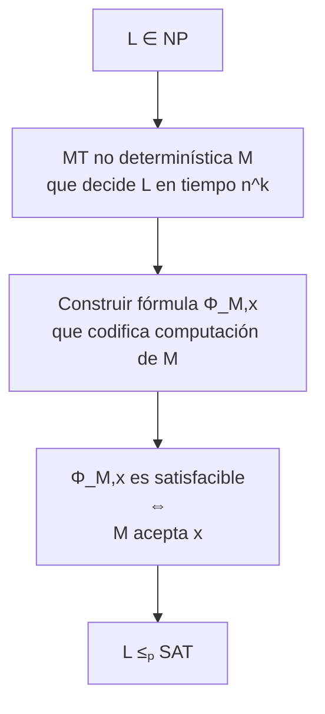
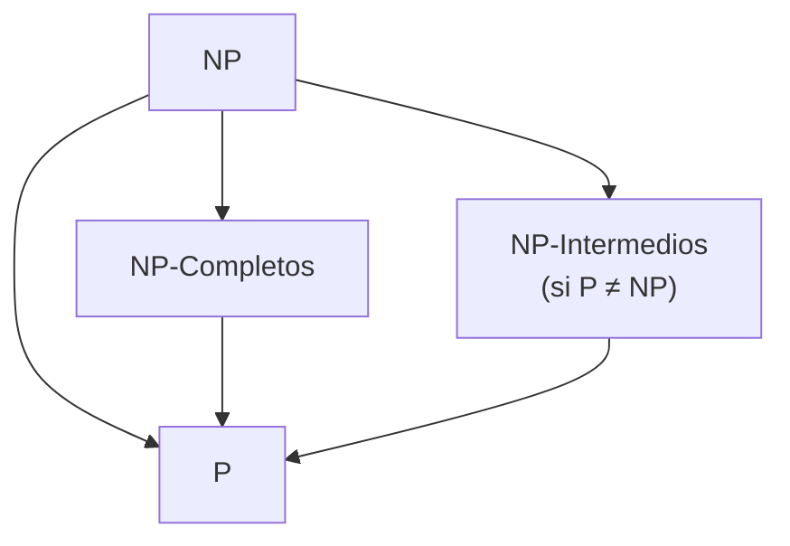
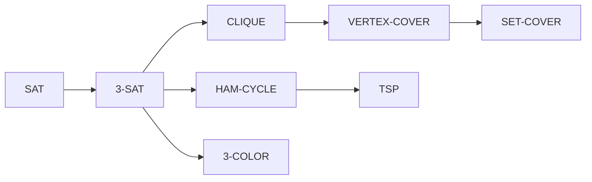

# Complejidad Computacional - La teoría de NP-Completez

## 2.4 Definición de NP-Completez.

---

La NP-completitud es un concepto fundamental en teoría de la complejidad computacional que identifica los problemas más difíciles dentro de la clase NP. Comprender su definición formal es esencial para trabajar con esta clase de problemas.

### Definición Formal de NP-Completitud

#### Definición Básica (Cook, 1971)

Un lenguaje $L$ es **NP-completo** si satisface dos condiciones:

1. **$L \in NP$** (pertenece a NP)
2. **$L$ es NP-difícil**: $\forall L' \in NP, L' \leq_p L$

Donde $\leq_p$ denota reducción en tiempo polinomial.

#### Definición Expandida

Formalmente, para un lenguaje $ L \subseteq \Sigma ^ * $:

$$ L \text{ es NP-completo} \Leftrightarrow  \begin{cases} L \in NP \\\ \forall L' \in NP, \exists f: \Sigma ^ * \to \Sigma ^ * \text{ computable en tiempo polinomial tal que } \\\ \quad x \in L' \Leftrightarrow f(x) \in L \end{cases} $$

### Componentes de la Definición

#### 1. Pertenencia a NP $(L \in NP)$

**Definición**: Existe un verificador $V$ y constante $c$ tal que:

$$ L = \{x \mid \exists y \text{ con } |y| \leq |x|^c \land V(x,y) = 1\} $$

**Ejemplo para SAT**:

- Certificado $y$: Asignación de verdad
- Verificador $V$: Evalúa la fórmula booleana

```python
def verificador_sat(formula, asignacion):
    """Verificador polinomial para SAT"""
    # Evaluar cada cláusula
    for clausula in formula:
        clausula_satisfecha = False
        for literal in clausula:
            variable = abs(literal)
            valor = asignacion.get(variable, False)
            if literal > 0 and valor:
                clausula_satisfecha = True
                break
            elif literal < 0 and not valor:
                clausula_satisfecha = True
                break

        if not clausula_satisfecha:
            return False
    return True
```

#### 2. NP-Dificultad ( $L$ es NP-difícil )

**Definición**: Todo problema en NP se reduce polinomialmente a $L$:

$$ \forall L' \in NP, L' \leq_p L $$

**Interpretación**: $L$ es al menos tan difícil como cualquier problema en NP.

### Teorema de Cook-Levin: El Primer NP-Completo

#### Enunciado Formal (Cook, 1971; Levin, 1973)

**SAT es NP-completo**

La demostración consta de dos partes:

1. **SAT ∈ NP**: Ya mostrado anteriormente
2. **SAT es NP-difícil**: Para toda $L \in NP$, existe reducción polinomial $L \leq_p SAT$

#### Esquema de la Demostración



#### Construcción de la Fórmula Φ

Para una MT no determinística $M$ que decide $L$ en tiempo $n^k$, la fórmula Φ tiene variables:

- $C_{i,j,t}$: En el paso $t$, la celda $i$ contiene símbolo $j$
- $H_{i,t}$: En el paso $t$, la cabeza está en posición $i$
- $Q_{q,t}$: En el paso $t$, la MT está en estado $q$

La fórmula Φ se construye como conjunción de cuatro partes:

$$
\Phi = \Phi_{celda} \land \Phi_{inicio} \land \Phi_{movimiento} \land \Phi_{acepta}
$$

### Diagrama de la Jerarquía NP



### Características de los Problemas NP-Completos

#### Propiedades Fundamentales

1. **Transitividad**: Si $L_1$ es NP-completo y $L_1 \leq_p L_2$, entonces $L_2$ es NP-difícil
2. **Equivalencia en dificultad**: Todos los problemas NP-completos tienen la misma dificultad computacional
3. **Implicación para P**: Si algún problema NP-completo está en P, entonces P = NP

#### Teorema: Consecuencia de la Completitud

**Teorema**: Si $L$ es NP-completo y $L \in P$, entonces $P = NP$.

**Demostración**:

- Sea $L$ NP-completo y $L \in P$
- Para cualquier $L' \in NP$, tenemos $L' \leq_p L$ (por completitud)
- Como $L \in P$ y P es cerrado bajo reducciones, $L' \in P$
- Por lo tanto, $NP \subseteq P$, y como $P \subseteq NP$, se tiene $P = NP$

### Ejemplos de Problemas NP-Completos

#### Problemas Clásicos y sus Reducciones



#### Tabla de Problemas NP-Completos Importantes

| Problema         | Descripción                      | Certificado           |
| ---------------- | -------------------------------- | --------------------- |
| **SAT**          | Satisfactibilidad booleana       | Asignación de verdad  |
| **3-SAT**        | SAT con 3 literales por cláusula | Asignación de verdad  |
| **CLIQUE**       | Clique de tamaño k en grafo      | Conjunto de vértices  |
| **VERTEX-COVER** | Cubierta de vértices de tamaño k | Conjunto de vértices  |
| **HAM-CYCLE**    | Ciclo hamiltoniano               | Secuencia de vértices |
| **TSP**          | Problema del viajante            | Ruta permutación      |

### Verificación de NP-Completitud

#### Algoritmo para Demostrar que L es NP-Completo

```python
def demostrar_np_completitud(L, L_conocido_npc):
    """
    Demuestra que L es NP-completo

    Args:
        L: Problema candidato
        L_conocido_npc: Problema NP-completo conocido
    """

    # Paso 1: Demostrar que L ∈ NP
    if not pertenece_a_np(L):
        return False, "L no está en NP"

    # Paso 2: Demostrar que L_conocido_npc ≤ₚ L
    def reduccion_polinomial(instancia_L_conocido):
        # Transformar instancia de problema conocido a instancia de L
        instancia_L = transformar(instancia_L_conocido)
        return instancia_L

    # Paso 3: Verificar que la reducción preserva las respuestas
    if not verificar_reduccion(reduccion_polinomial):
        return False, "Reducción incorrecta"

    return True, "L es NP-completo"
```

### Ejercicios Propuestos

#### Ejercicio 1: Demostraciones Formales

1. **Demuestre** que si $L_1$ es NP-completo, $L_1 \leq_p L_2$, y $L_2 \in NP$, entonces $L_2$ es NP-completo.

2. **Demuestre** la transitividad: Si $L_1 \leq_p L_2$ y $L_2 \leq_p L_3$, entonces $L_1 \leq_p L_3$.

3. **Demuestre** que si un problema NP-completo está en Co-NP, entonces NP = Co-NP.

#### Ejercicio 2: Análisis de Problemas

Para cada problema, determine si es NP-completo y justifique:

1. **2-SAT**: SAT con cláusulas de máximo 2 literales
2. **HORN-SAT**: SAT con cláusulas Horn
3. **GRAPH-ISOMORPHISM**: Isomorfismo de grafos
4. **FACTORIZATION**: Factorización de números enteros

#### Ejercicio 3: Construcción de Reducciones

Diseñe reducciones polinomiales para:

1. **3-SAT ≤ₚ INDEPENDENT-SET**
2. **VERTEX-COVER ≤ₚ SET-COVER**
3. **3-SAT ≤ₚ 3-COLOR**

### Teoremas Relacionados

#### Teorema de Ladner (1975)

Si $P \neq NP$, entonces existen problemas en $NP - P$ que no son NP-completos.

**Implicación**: La estructura de NP no es dicotómica bajo la hipótesis P ≠ NP.

#### Teorema de Mahaney (1982)

Si $P \neq NP$, entonces no existen conjuntos escasos (sparse sets) NP-completos.

### Estrategias para Trabajar con Problemas NP-Completos

#### En la Práctica

1. **Identificación**: Determinar si el problema es NP-completo antes de buscar soluciones exactas
2. **Relajaciones**: Considerar versiones relajadas o casos especiales tratables
3. **Aproximación**: Usar algoritmos de aproximación cuando sea posible
4. **Heurísticas**: Aplicar métodos heurísticos para instancias grandes

#### Casos Especiales Tratables

Algunos problemas NP-completos tienen casos especiales en P:

- **2-SAT** ∈ P (a diferencia de 3-SAT)
- **HORN-SAT** ∈ P
- **PLANAR-3-COLOR** es NP-completo, pero **PLANAR-4-COLOR** ∈ P

### Referencias Específicas

#### Bibliografía Básica

1. **Garey y Johnson (1997)**: Capítulo 2 - "NP-Completeness, Definitions and Foundations"
2. **Sipser (2005)**: Sección 7.4 - "NP-Completeness"
3. **Arora y Barak (2009)**: Capítulo 2 - "NP and NP Completeness"
4. **Kozen (2006)**: Capítulo 29 - "NP-Completeness"

#### Bibliografía Complementaria

1. **Hopcroft et al. (2006)**: Capítulo 10 - "NP-Completeness"
2. **Papadimitriou (1993)**: Capítulo 4 - "Completeness"
3. **Goldreich (2008)**: Capítulo 2 - "NP-Completeness"

### Preguntas de Comprensión Crítica

1. ¿Por qué es esencial que un problema NP-completo pertenezca a NP? ¿Qué pasaría si solo fuera NP-difícil?
2. Explique la importancia del Teorema de Cook-Levin como "piedra angular" de la teoría de NP-completitud
3. ¿Cómo afecta la transitividad de las reducciones a la estrategia de demostrar NP-completitud?
4. ¿Qué implicaciones prácticas tiene identificar que un problema es NP-completo en el desarrollo de software?

### Resumen de Puntos Clave

1. **NP-completo** = NP + NP-difícil
2. **SAT** fue el primer problema demostrado NP-completo (Cook-Levin)
3. La **transitividad** permite construir cadenas de reducciones
4. Si **P ≠ NP**, los problemas NP-completos no tienen soluciones eficientes exactas
5. La **identificación** de NP-completitud guía la selección de estrategias de solución
6. Existen **casos especiales** de problemas NP-completos que son tratables

La comprensión profunda de la NP-completitud es fundamental para cualquier profesional en ciencias de la computación, ya que proporciona herramientas para clasificar problemas y seleccionar enfoques de solución apropiados.
