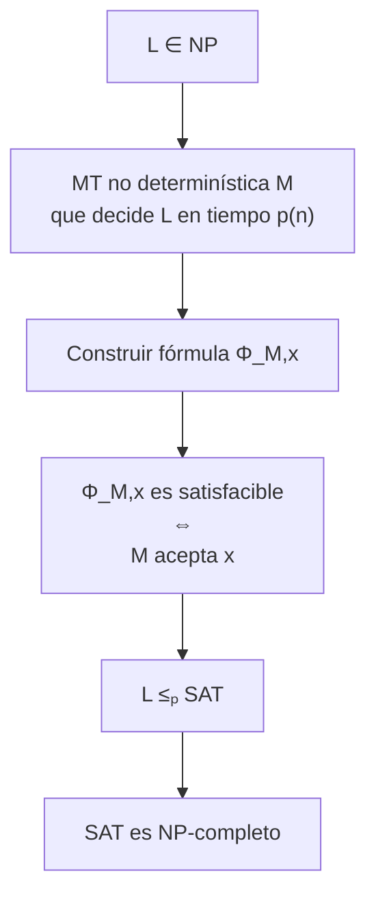
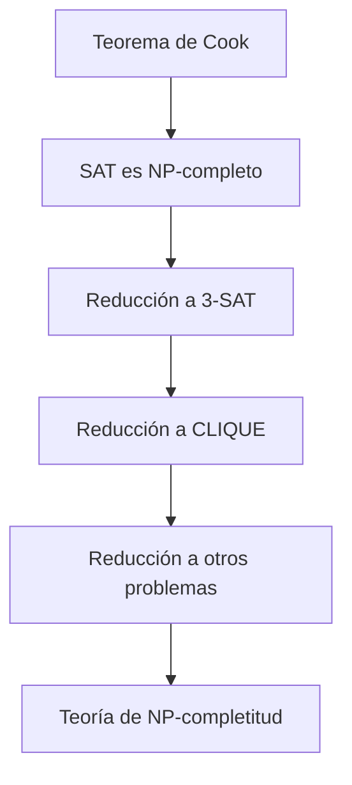

# Complejidad Computacional - La teoría de NP-Completez

## 2.5 Teorema de Cook.

---

El Teorema de Cook (también conocido como Teorema de Cook-Levin) es el resultado fundamental en la teoría de NP-completitud. Establece que el problema de satisfacibilidad booleana (SAT) es NP-completo, proporcionando así el primer problema NP-completo conocido.

### Enunciado del Teorema

#### Teorema de Cook-Levin (1971)

**SAT es NP-completo**

Formalmente:

1. **SAT ∈ NP**
2. **SAT es NP-difícil**: ∀L ∈ NP, L ≤ₚ SAT

### Estructura de la Demostración

#### Esquema General



### Parte 1: SAT ∈ NP

#### Verificador para SAT

Para demostrar que SAT ∈ NP, exhibimos un verificador polinomial:

**Certificado**: Asignación de verdad τ para las variables
**Verificador V(φ, τ)**:

- Evalúa la fórmula φ con la asignación τ
- Tiempo de ejecución: O(|φ|)

```python
def verificador_sat(formula, asignacion):
    """
    Verificador polinomial para SAT
    Tiempo: O(n) donde n es el tamaño de la fórmula
    """
    for clausula in formula:
        clausula_satisfecha = False
        for literal in clausula:
            variable = abs(literal)
            valor = asignacion.get(variable, False)

            # Literal positivo: variable True
            if literal > 0 and valor:
                clausula_satisfecha = True
                break
            # Literal negativo: variable False
            elif literal < 0 and not valor:
                clausula_satisfecha = True
                break

        if not clausula_satisfecha:
            return False
    return True
```

### Parte 2: SAT es NP-difícil

#### Construcción de la Fórmula Φ_M,x

Sea M una MT no determinística que decide L en tiempo p(n), donde n = |x|. Construimos una fórmula booleana Φ_M,x que es satisfacible si y solo si M acepta x.

##### Variables de la Fórmula

Para una computación de T = p(n) pasos:

- **Células**: $C_{i,j,t}$: En el paso t, la celda i contiene el símbolo j ∈ Γ
- **Posición de cabeza**: $H_{i,t}$: En el paso t, la cabeza está en posición i
- **Estado**: $Q_{q,t}$: En el paso t, la MT está en estado q ∈ Q

**Número total de variables**: O(T² × |Γ| × |Q|) = O(p(n)²)

##### Partes de la Fórmula

$$
\Phi_{M,x} = \Phi_{celda} \land \Phi_{inicio} \land \Phi_{movimiento} \land \Phi_{acepta}
$$

#### 1. Φ_celda: Restricciones de Celda

Cada celda contiene exactamente un símbolo en cada paso de tiempo:

$$
\Phi_{celda} = \bigwedge_{i=1}^{T} \bigwedge_{t=1}^{T} \left[ \bigvee_{j \in \Gamma} C_{i,j,t} \land \bigwedge_{j \neq k} (\neg C_{i,j,t} \lor \neg C_{i,k,t}) \right]
$$

#### 2. Φ_inicio: Configuración Inicial

La MT comienza con x en la cinta, cabeza en posición 1, estado q₀:

$$
\Phi_{inicio} = Q_{q_0,1} \land H_{1,1} \land \bigwedge_{i=1}^{n} C_{i,x_i,1} \land \bigwedge_{i=n+1}^{T} C_{i,\sqcup,1}
$$

#### 3. Φ_movimiento: Transiciones Válidas

Las configuraciones sucesivas deben seguir las transiciones de M:

Para cada t, la configuración en t+1 debe seguir legalmente de la configuración en t:

$$
\Phi_{movimiento} = \bigwedge_{t=1}^{T-1} \bigwedge_{i=1}^{T} \left[ (H_{i,t} \land Q_{q,t}) \Rightarrow \bigvee_{(q,a,q',b,D) \in \delta} \text{TRANSICIÓN} \right]
$$

#### 4. Φ_acepta: Estado de Aceptación

La MT debe alcanzar un estado de aceptación:

$$
\Phi_{acepta} = \bigvee_{t=1}^{T} Q_{q_{acepta},t}
$$

### Implementación de la Construcción

```python
class ConstructorFormulaCook:
    def __init__(self, mt, entrada, tiempo_maximo):
        self.mt = mt
        self.entrada = entrada
        self.T = tiempo_maximo
        self.n = len(entrada)
        self.variables = {}
        self.clausulas = []

    def construir_formula(self):
        """Construye la fórmula Φ_M,x completa"""
        # 1. Restricciones de celda
        self._agregar_restricciones_celda()

        # 2. Configuración inicial
        self._agregar_configuracion_inicial()

        # 3. Reglas de movimiento
        self._agregar_reglas_movimiento()

        # 4. Estado de aceptación
        self._agregar_aceptacion()

        return self.clausulas

    def _variable(self, tipo, *indices):
        """Crea una variable única para cada componente"""
        clave = (tipo,) + indices
        if clave not in self.variables:
            self.variables[clave] = len(self.variables) + 1
        return self.variables[clave]

    def _agregar_restricciones_celda(self):
        """Cada celda tiene exactamente un símbolo en cada tiempo"""
        for i in range(1, self.T + 1):
            for t in range(1, self.T + 1):
                # Al menos un símbolo
                clausula = []
                for simbolo in self.mt.alfabeto_cinta:
                    var = self._variable('C', i, simbolo, t)
                    clausula.append(var)
                self.clausulas.append(clausula)

                # A lo más un símbolo
                for s1 in self.mt.alfabeto_cinta:
                    for s2 in self.mt.alfabeto_cinta:
                        if s1 != s2:
                            var1 = self._variable('C', i, s1, t)
                            var2 = self._variable('C', i, s2, t)
                            self.clausulas.append([-var1, -var2])
```

### Ejemplo Detallado

#### MT Ejemplo para L = {0ⁿ1ⁿ}

Consideremos una MT simple que verifica si la entrada tiene igual número de 0s y 1s.

```python
# MT para L = {0^n1^n}
mt_ejemplo = {
    'estados': {'q0', 'q1', 'q_acepta', 'q_rechaza'},
    'alfabeto_entrada': {'0', '1'},
    'alfabeto_cinta': {'0', '1', 'X', 'Y', '_'},
    'transiciones': {
        ('q0', '0'): ('q1', 'X', 'R'),
        ('q0', 'Y'): ('q_acepta', 'Y', 'R'),
        ('q1', '0'): ('q1', '0', 'R'),
        ('q1', '1'): ('q2', 'Y', 'L'),
        # ... más transiciones
    }
}
```

#### Construcción de Φ para x = "0011"

Para entrada x = "0011" y T = 10:

- **Variables C\_{i,j,t}**: i ∈ [1,10], j ∈ {0,1,X,Y,_}, t ∈ [1,10]
- **Φ_inicio**: C_{1,0,1}, C_{2,0,1}, C_{3,1,1}, C_{4,1,1}, Q_{q0,1}, H_{1,1}
- **Φ_acepta**: ∨\_{t=1}^{10} Q_{q_acepta,t}

### Diagrama de la Computación Codificada


### Correctitud de la Construcción

#### Lema de Correctitud

**Φ_M,x es satisfacible ⇔ M acepta x en a lo más T pasos**

**Demostración (⇒)**: Si Φ_M,x es satisfacible, existe asignación τ que satisface todas las cláusulas. De τ podemos extraer una computación aceptadora de M.

**Demostración (⇐)**: Si M acepta x, existe computación aceptadora. De esta computación construimos asignación τ que satisface Φ_M,x.

### Complejidad de la Reducción

#### Tamaño de la Fórmula

- **Número de variables**: O(T² × |Γ| × |Q|) = O(p(n)²)
- **Número de cláusulas**: O(T² × |Γ|² × |Q| × |δ|) = O(p(n)²)
- **Tiempo de construcción**: Polinomial en n

Por lo tanto, la reducción es computable en tiempo polinomial.

### Ejercicios Propuestos

#### Ejercicio 1: Construcción Manual

Construya manualmente parte de Φ_M,x para una MT simple con:

- Estados: {q0, q_acepta, q_rechaza}
- Alfabeto: {0, 1, _}
- Entrada: x = "01"
- T = 3 pasos

Especifique:

1. Las variables necesarias
2. Las clausulas de Φ_inicio
3. Al menos dos cláusulas de Φ_movimiento

#### Ejercicio 2: Análisis de Complejidad

Calcule el número exacto de variables y cláusulas en función de:

- T = p(n) (tiempo máximo)
- |Γ| (tamaño del alfabeto de cinta)
- |Q| (número de estados)
- |δ| (número de transiciones)

#### Ejercicio 3: Extensión del Teorema

Demuestre que 3-SAT es NP-completo mediante reducción desde SAT. Diseñe la reducción que transforma una fórmula SAT arbitraria en una fórmula 3-CNF equivalente.

### Importancia del Teorema de Cook

#### Consecuencias Fundamentales

1. **Primer problema NP-completo**: SAT sirve como punto de partida
2. **Herramienta para demostraciones**: Permite probar NP-completitud de otros problemas
3. **Unificación teórica**: Establece relación entre lógica y computación
4. **Base para teoría de complejidad**: Cimiento de toda la teoría moderna

#### Aplicaciones Prácticas



### Variantes y Extensiones

#### Teorema de Cook para Circuitos

**CSAT** (satisfacibilidad de circuitos) también es NP-completo mediante construcción similar.

#### Teorema de Levin

Levin demostró independientemente la NP-completitud para problemas de optimización combinatoria.

### Referencias Específicas

#### Bibliografía Básica

1. **Garey y Johnson (1997)**: Apéndice - "Outline of the Proof of Cook's Theorem"
2. **Sipser (2005)**: Teorema 7.37 - "SAT is NP-complete"
3. **Arora y Barak (2009)**: Sección 2.3 - "The Cook-Levin Theorem"
4. **Kozen (2006)**: Teorema 29.1 - "Cook's Theorem"

#### Bibliografía Complementaria

1. **Hopcroft et al. (2006)**: Sección 10.3 - "A NP-Complete Problem"
2. **Papadimitriou (1993)**: Teorema 8.2 - "Cook's Theorem"
3. **Goldreich (2008)**: Sección 2.3 - "NP-Completeness of SAT"

### Preguntas de Comprensión Crítica

1. ¿Por qué es esencial que la reducción en el Teorema de Cook sea computable en tiempo polinomial?
2. Explique cómo las restricciones de Φ_celda garantizan que cada celda tenga exactamente un símbolo
3. ¿Qué pasaría si intentáramos codificar una MT determinística en lugar de no determinística?
4. ¿Cómo afecta la elección de T = p(n) a la correctitud y eficiencia de la reducción?

### Resumen de Puntos Clave

1. **SAT ∈ NP**: Tiene verificador polinomial mediante asignaciones de verdad
2. **SAT es NP-difícil**: Toda MT no determinística se reduce a SAT
3. **Construcción explícita**: Φ_M,x codifica computación de M sobre x
4. **Correctitud**: Φ_M,x satisfacible ⇔ M acepta x
5. **Eficiencia**: La reducción es computable en tiempo polinomial
6. **Impacto fundamental**: Establece base para toda la teoría de NP-completitud

El Teorema de Cook no solo es un resultado teórico profundo, sino también una herramienta práctica que ha guiado el desarrollo de la teoría de complejidad computacional durante décadas.
