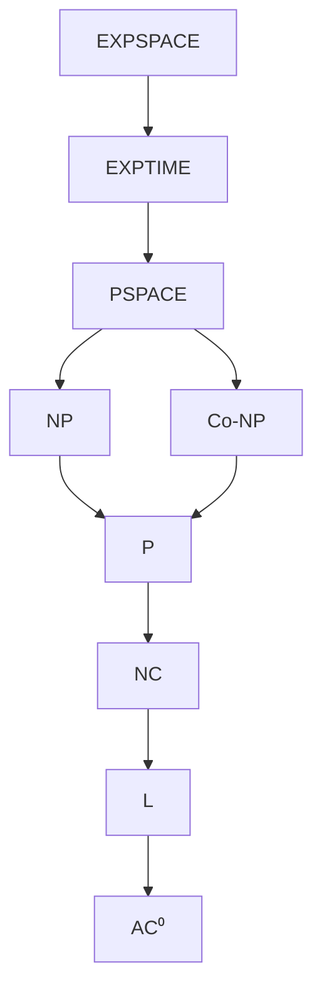
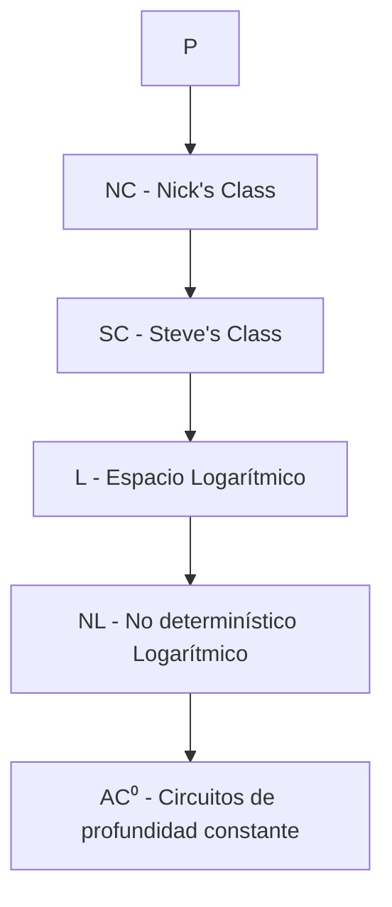
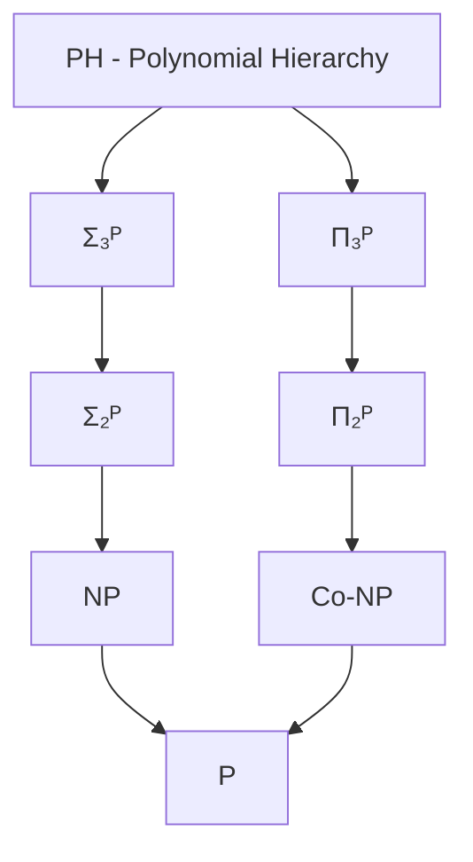
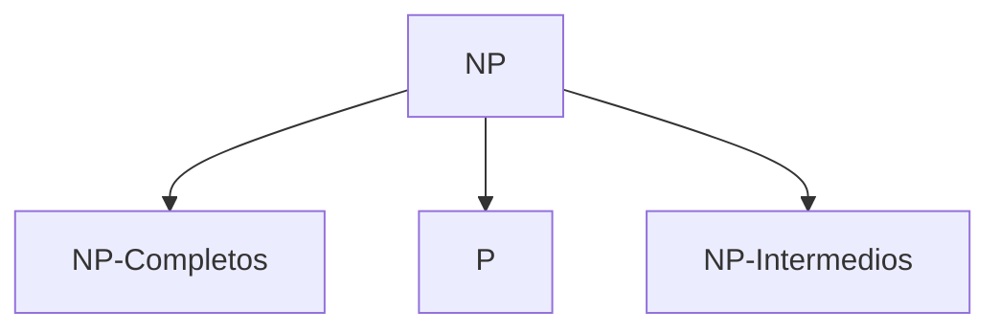

# Complejidad Computacional - La teoría de NP-Completez

## 2.6 Jerarquía de complejidad.

---

La jerarquía de complejidad organiza las clases de problemas computacionales según los recursos (tiempo y espacio) requeridos para resolverlos. Comprender esta estructura es fundamental para clasificar problemas y entender sus limitaciones inherentes.

### Conceptos Fundamentales

#### Definición: Clases de Complejidad Temporal

Para una función $f: \mathbb{N} \to \mathbb{N}$:

- **$\text{TIME}(f(n))$**: Lenguajes decidibles por MT determinísticas en tiempo $O(f(n))$
- **$\text{NTIME}(f(n))$**: Lenguajes decidibles por MT no determinísticas en tiempo $O(f(n))$

#### Definición: Clases de Complejidad Espacial

- **$\text{SPACE}(f(n))$**: Lenguajes decidibles por MT determinísticas en espacio $O(f(n))$
- **$\text{NSPACE}(f(n))$**: Lenguajes decidibles por MT no determinísticas en espacio $O(f(n))$

### Jerarquía Temporal

#### Teorema de Jerarquía Temporal (Hartmanis-Stearns, 1965)

Para funciones construibles en tiempo $f$ y $g$ con $f(n) \log f(n) = o(g(n))$:

$$ TIME(f(n)) \subsetneq TIME(g(n)) $$

#### Clases Temporales Importantes

$$ P = \bigcup_{k \in \mathbb{N}} TIME(n^k) $$

$$ NP = \bigcup_{k \in \mathbb{N}} NTIME(n^k) $$

$$ EXPTIME = \bigcup_{k \in \mathbb{N}} TIME(2^{n^k}) $$

$$ NEXPTIME = \bigcup_{k \in \mathbb{N}} NTIME(2^{n^k}) $$

### Jerarquía Espacial

#### Teorema de Jerarquía Espacial

Para funciones construibles en espacio $f$ y $g$ con $f(n) = o(g(n))$:

$$ SPACE(f(n)) \subsetneq SPACE(g(n)) $$

#### Clases Espaciales Importantes

$$ PSPACE = \bigcup_{k \in \mathbb{N}} SPACE(n^k) $$

$$ NPSPACE = \bigcup_{k \in \mathbb{N}} NSPACE(n^k) $$

$$ EXPSPACE = \bigcup_{k \in \mathbb{N}} SPACE(2^{n^k}) $$

### Diagrama Completo de la Jerarquía



### Relaciones entre Clases

#### Teoremas de Contención

1. **$P \subseteq NP$**: Todo problema resoluble eficientemente es verificable eficientemente
2. **$NP \subseteq PSPACE$**: La verificación puede hacerse reutilizando espacio
3. **$PSPACE \subseteq EXPTIME$**: MT con espacio s(n) tiene tiempo máximo $2^{O(s(n))}$
4. **$P \subsetneq EXPTIME$**: Por teorema de jerarquía temporal

#### Teorema de Savitch (1970)

Para cualquier función $f(n) \geq \log n$:

$$ NSPACE(f(n)) \subseteq SPACE(f(n)^2) $$

**Corolario**: $PSPACE = NPSPACE$

#### Teorema de Immerman-Szelepcsényi (1987)

Para $f(n) \geq \log n$:

$$ NSPACE(f(n)) = coNSPACE(f(n)) $$

### Clases dentro de P

#### Jerarquía de Problemas Tratables



#### Definición: Clase L y NL

- **L** = $\text{SPACE}(\log n)$: Problemas resolubles en espacio logarítmico
- **NL** = $\text{NSPACE}(\log n)$: Problemas verificables en espacio logarítmico

**Ejemplo en L**: ¿Están dos vértices en la misma componente conexa? (para grafos no dirigidos)

### Problemas Completos para Diferentes Clases

#### Tabla de Complejidad de Problemas Representativos

| Clase        | Problema Completo     | Descripción                                 |
| ------------ | --------------------- | ------------------------------------------- |
| **P**        | Circuit Value Problem | Evaluación de circuito booleano             |
| **NP**       | SAT                   | Satisfactibilidad booleana                  |
| **PSPACE**   | QSAT                  | Satisfactibilidad cuantificada              |
| **EXPTIME**  | Go generalizado       | Juego de Go en tablero n×n                  |
| **NEXPTIME** | Succinct SAT          | SAT con fórmula representada succinctamente |

#### Ejemplo: QSAT es PSPACE-completo

**Problema**: Dada una fórmula booleana con cuantificadores ∃ y ∀, ¿es verdadera?

```python
def qsat_eval(formula, variables, asignacion_actual):
    if not formula.cuantificadores:  # Solo literales
        return evaluar_formula(formula, asignacion_actual)

    cuant, var, subformula = formula.descomponer()

    if cuant == '∃':
        # Verificar si existe valor que haga verdadera la subfórmula
        for valor in [True, False]:
            nueva_asignacion = asignacion_actual.copy()
            nueva_asignacion[var] = valor
            if qsat_eval(subformula, variables, nueva_asignacion):
                return True
        return False
    else:  # cuant == '∀'
        # Verificar que para todos los valores la subfórmula es verdadera
        for valor in [True, False]:
            nueva_asignacion = asignacion_actual.copy()
            nueva_asignacion[var] = valor
            if not qsat_eval(subformula, variables, nueva_asignacion):
                return False
        return True
```

### La Jerarquía Polinomial

#### Definición

$$ \Delta_0^P = \Sigma_0^P = \Pi_0^P = P $$

Para $k \geq 0$:

- $\Sigma_{k+1}^P = NP^{\Sigma_k^P}$
- $\Pi_{k+1}^P = coNP^{\Sigma_k^P}$
- $\Delta_{k+1}^P = P^{\Sigma_k^P}$

#### Diagrama de la Jerarquía Polinomial



### Clases de Optimización y Aproximación

#### Clases para Problemas de Optimización

- **PO**: Problemas de optimización resolubles en tiempo polinomial
- **NPO**: Versión NP de problemas de optimización
- **APX**: Problemas con algoritmos de aproximación constante
- **PTAS**: Admite esquema de aproximación polinomial

### Ejercicios Propuestos

#### Ejercicio 1: Demostraciones de Contención

Demuestre formalmente:

1. **P ⊆ NP**: Construya una MT no determinística que simule una MT determinística
2. **NP ⊆ PSPACE**: Diseñe un algoritmo en PSPACE para verificar certificados NP
3. **PSPACE ⊆ EXPTIME**: Analice el tiempo máximo de una MT con espacio polinomial

#### Ejercicio 2: Análisis de Complejidad

Para cada problema, determine su clase de complejidad más específica:

1. **2-SAT** (satisfactibilidad con cláusulas de 2 literales)
2. **GRAPH-ISOMORPHISM** (isomorfismo de grafos)
3. **MIN-CUT** (corte mínimo en grafo)
4. **TRAVELING-SALESMAN** (problema del viajante)

#### Ejercicio 3: Construcción de Reducciones

Diseñe reducciones entre:

1. **SAT ≤ₚ 3-SAT** (dentro de NP)
2. **3-SAT ≤ₚ QSAT** (de NP a PSPACE)
3. **QSAT ≤ₚ GEOGRAPHY** (demostrando PSPACE-completitud)

### Teoremas de Separación

#### Conjeturas Principales

1. **P ≠ NP**: Problema del milenio no resuelto
2. **NP ≠ Co-NP**: Se cree verdadera si P ≠ NP
3. **P ≠ PSPACE**: Generalmente aceptada
4. **L ≠ NL**: Abierta pero se cree diferente

#### Teorema de Ladner (1975)

Si **P ≠ NP**, entonces existen problemas en **NP - P** que no son NP-completos.

**Estructura de NP si P ≠ NP**:



### Clases de Complejidad en la Práctica

#### Problemas por Clase de Complejidad

```python
# Clasificación práctica de problemas
problemas_por_clase = {
    'P': ['SORTING', 'SHORTEST-PATH', 'MIN-CUT', '2-SAT'],
    'NP-completo': ['SAT', '3-SAT', 'TSP', 'CLIQUE', 'VERTEX-COVER'],
    'PSPACE-completo': ['QSAT', 'GEOGRAPHY', 'GENERALIZED-GO'],
    'EXPTIME-completo': ['GENERALIZED-CHESS', 'REACHABILITY-PDA'],
    'Undecidable': ['HALTING', 'POST-CORRESPONDENCE']
}
```

### Referencias Específicas

#### Bibliografía Básica

1. **Garey y Johnson (1997)**: Capítulo 1 - "Computational Complexity"
2. **Sipser (2005)**: Capítulo 8 - "Space Complexity", Capítulo 9 - "Intractability"
3. **Arora y Barak (2009)**: Capítulo 3 - "The Polynomial Hierarchy", Capítulo 4 - "Space Complexity"
4. **Kozen (2006)**: Capítulo 28-30 - "Complexity Classes"

#### Bibliografía Complementaria

1. **Hopcroft et al. (2006)**: Capítulo 10 - "Intractable Problems"
2. **Papadimitriou (1993)**: Capítulo 3 - "Complexity Classes"
3. **Goldreich (2008)**: Capítulo 4 - "The Polynomial Hierarchy"

### Preguntas de Comprensión Crítica

1. ¿Por qué la jerarquía de espacio es "más densa" que la jerarquía de tiempo?
2. Explique la importancia del Teorema de Savitch para entender PSPACE = NPSPACE
3. ¿Qué implicaciones tendría demostrar que P = PSPACE para la teoría de complejidad?
4. ¿Cómo afecta la jerarquía polinomial a nuestra comprensión de la dificultad de problemas?

### Estrategias para Clasificar Problemas

#### Método Sistemático

1. **Identificar recursos**: ¿Tiempo o espacio? ¿Determinístico o no determinístico?
2. **Buscar cotas superiores**: Encontrar algoritmo que resuelva el problema
3. **Buscar cotas inferiores**: Demostrar que no puede resolverse con menos recursos
4. **Completitud**: Mostrar que es el problema más difícil en su clase

### Resumen de Puntos Clave

1. **Jerarquías estrictas**: TIME y SPACE forman jerarquías infinitas
2. **Contenciones conocidas**: P ⊆ NP ⊆ PSPACE ⊆ EXPTIME
3. **Igualdades notables**: PSPACE = NPSPACE (Savitch)
4. **Clases prácticas**: P, NP, PSPACE son las más estudiadas
5. **Problemas abiertos**: P vs NP es el más famoso
6. **Completitud**: Cada clase tiene problemas representativos completos

La comprensión de la jerarquía de complejidad permite no solo clasificar problemas, sino también entender los límites fundamentales de la computación y guiar el desarrollo de algoritmos eficientes.
