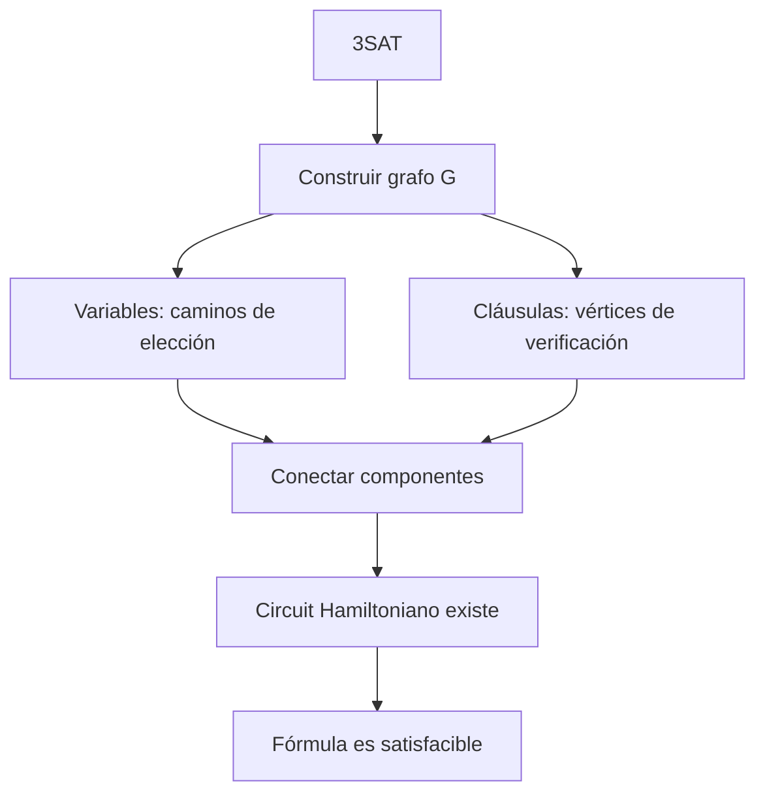
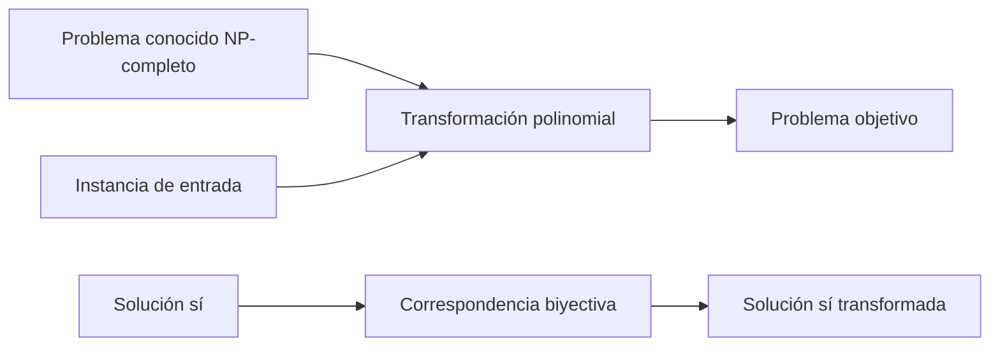
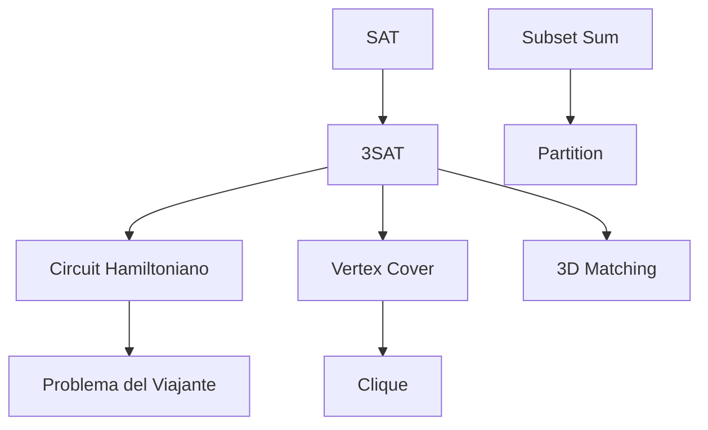

# Complejidad Computacional - Demostraciones de problemas NP-Completos

## 3.1 Problemas básicos: 3SAT, apareamientos, cubierta de vértices, circuito hamiltoniano, clan y partición.

---

La teoría de NP-completitud establece que ciertos problemas computacionalmente difíciles son equivalentes en términos de su complejidad. Si un problema NP-completo puede ser resuelto eficientemente, entonces todos los problemas en NP podrían resolverse eficientemente.

#### Definiciones Fundamentales

**Clase NP**: Clase de problemas de decisión para los cuales una solución propuesta puede ser verificada en tiempo polinomial.

**Reducción polinomial**: Un problema $A$ se reduce polinomialmente a un problema $B$ ( $A \leq_P B$ ) si existe una función $f$ computable en tiempo polinomial tal que para toda instancia $x$ de $A$, $x \in A$ si y solo si $f(x) \in B$.

**NP-completitud**: Un problema $B$ es NP-completo si:

1. $B \in NP$
2. Para todo $A \in NP$, $A \leq_P B$

### Problemas NP-Completos Básicos

#### 3SAT

**Definición**: Dada una fórmula booleana en forma normal conjuntiva (CNF) donde cada cláusula tiene exactamente 3 literales, determinar si existe una asignación de valores de verdad que satisfaga la fórmula.

**Fórmula general**:

$$\phi = (x_1 \vee x_2 \vee x_3) \wedge (x_4 \vee \neg x_5 \vee x_6) \wedge \cdots \wedge (x_{n-2} \vee x_{n-1} \vee x_n)$$

**Ejemplo**:

$$\phi = (x_1 \vee x_2 \vee \neg x_3) \wedge (\neg x_1 \vee x_3 \vee x_4) \wedge (x_2 \vee \neg x_3 \vee \neg x_4)$$

**Reducción desde SAT**:

- Cada cláusula $(l_1 \vee l_2 \vee \cdots \vee l_k)$ se transforma en múltiples cláusulas de 3 literales introduciendo variables auxiliares.

```python
# Ejemplo de verificación de 3SAT
def verificar_3SAT(formula, asignacion):
    for clausula in formula:
        satisfacible = False
        for literal in clausula:
            variable = abs(literal)
            valor = asignacion[variable]
            if literal > 0 and valor:
                satisfacible = True
                break
            elif literal < 0 and not valor:
                satisfacible = True
                break
        if not satisfacible:
            return False
    return True
```

#### Problema del Circuito Hamiltoniano

**Definición**: Dado un grafo no dirigido $G = (V, E)$, determinar si existe un ciclo que visite cada vértice exactamente una vez.

**Reducción desde 3SAT**:

- Se construye un grafo donde los vértices representan variables y cláusulas.
- Se crean caminos obligatorios que representan asignaciones de verdad.



#### Cubierta de Vértices (Vertex Cover)

**Definición**: Dado un grafo no dirigido $G = (V, E)$ y un entero $k$, determinar si existe un subconjunto $S \subseteq V$ con $|S| \leq k$ tal que cada arista en $E$ tiene al menos un extremo en $S$.

**Reducción desde 3SAT**:

- Para cada variable $x_i$, crear dos vértices $v_i$ y $\neg v_i$ conectados por una arista.
- Para cada cláusula, crear un triángulo de vértices.
- Conectar los vértices de cláusulas con los vértices de variables correspondientes.

**Fórmula del tamaño de la cubierta**:

$$k = n + 2m$$

donde $n$ es el número de variables y $m$ el número de cláusulas.

#### Problema del Clan (Clique)

**Definición**: Dado un grafo no dirigido $G = (V, E)$ y un entero $k$, determinar si existe un subconjunto $S \subseteq V$ con $|S| \geq k$ tal que cada par de vértices en $S$ esté conectado por una arista en $E$.

**Relación con Cubierta de Vértices**:

$$CLIQUE(G, k) \equiv VERTEX-COVER(\overline{G}, |V| - k)$$

donde $\overline{G}$ es el complemento de $G$.

#### Problema de la Partición

**Definición**: Dado un conjunto de números enteros $S = \{a_1, a_2, ..., a_n\}$, determinar si existe un subconjunto $S' \subseteq S$ tal que:

$$\sum_{a_i \in S'} a_i = \sum_{a_j \in S \setminus S'} a_j$$

**Reducción desde Subset Sum**:

- Dada una instancia de Subset Sum $(S, t)$, crear una instancia de Partición con $S' = S \cup \{2T - t, t\}$ donde $T = \sum_{a_i \in S} a_i$.

#### Problema del Apareamiento (Matching) 3-Dimensional

**Definición**: Dados tres conjuntos disjuntos $X$, $Y$, $Z$ y un conjunto de tripletas $T \subseteq X \times Y \times Z$, determinar si existe un subconjunto $M \subseteq T$ tal que:

1. $|M| = |X| = |Y| = |Z|$
2. No hay dos tripletas en $M$ que compartan coordenadas

**Reducción desde 3SAT**:

- Para cada variable, crear componentes de elección.
- Para cada cláusula, crear componentes de verificación.
- Las tripletas representan asignaciones consistentes.

### Técnicas de Demostración Comunes

#### Esquema General de Reducción



#### Verificación de Correctitud

Para demostrar que una reducción $f$ es correcta, debemos probar:

1. **Completitud**: Si $x \in L_1$, entonces $f(x) \in L_2$
2. **Solidez**: Si $f(x) \in L_2$, entonces $x \in L_1$

### Ejercicios Propuestos

#### Ejercicio 1: Reducción 3SAT a Vertex Cover

Demuestre que 3SAT ≤P Vertex Cover construyendo explícitamente la reducción para la fórmula:

$$\phi = (x_1 \vee x_2 \vee x_3) \wedge (\neg x_1 \vee x_2 \vee \neg x_3)$$

#### Ejercicio 2: Relación Clique - Vertex Cover

Demuestre formalmente que para cualquier grafo $G = (V, E)$ y entero $k$:

- $G$ tiene un clan de tamaño $k$ si y solo si $\overline{G}$ tiene una cubierta de vértices de tamaño $|V| - k$

#### Ejercicio 3: Partición desde Subset Sum

Dada una instancia de Subset Sum: $S = \{2, 4, 6, 8\}$, $t = 10$, construya una instancia equivalente de Partición.

#### Ejercicio 4: Circuito Hamiltoniano desde 3SAT

Para la fórmula $\phi = (x_1 \vee \neg x_2) \wedge (\neg x_1 \vee x_2)$, construya el grafo correspondiente para la reducción a Circuito Hamiltoniano.

### Código de Ejemplo: Verificador 3SAT

```python
class ThreeSAT:
    def __init__(self, formula):
        self.formula = formula
        self.variables = self._extract_variables()

    def _extract_variables(self):
        variables = set()
        for clause in self.formula:
            for literal in clause:
                variables.add(abs(literal))
        return sorted(list(variables))

    def verificar(self, asignacion):
        """Verifica si una asignación satisface la fórmula"""
        for clause in self.formula:
            clause_satisfied = False
            for literal in clause:
                var = abs(literal)
                if (literal > 0 and asignacion[var]) or \
                   (literal < 0 and not asignacion[var]):
                    clause_satisfied = True
                    break
            if not clause_satisfied:
                return False
        return True

    def es_satisfacible(self):
        """Fuerza bruta para verificar satisfacibilidad"""
        from itertools import product
        n = len(self.variables)

        for combination in product([True, False], repeat=n):
            asignacion = {self.variables[i]: combination[i] for i in range(n)}
            if self.verificar(asignacion):
                return True, asignacion
        return False, None

# Ejemplo de uso
if __name__ == "__main__":
    # φ = (x1 ∨ x2 ∨ ¬x3) ∧ (¬x1 ∨ x3 ∨ x4) ∧ (x2 ∨ ¬x3 ∨ ¬x4)
    formula = [[1, 2, -3], [-1, 3, 4], [2, -3, -4]]
    sat_solver = ThreeSAT(formula)

    satisfacible, asignacion = sat_solver.es_satisfacible()
    print(f"Fórmula satisfacible: {satisfacible}")
    if satisfacible:
        print(f"Asignación satisfactoria: {asignacion}")
```

### Diagrama de Relaciones entre Problemas



### Referencias Bibliográficas

#### Bibliografía Básica

1. Garey, M. R., & Johnson, D. S. (1997). _Computers and Intractability: A Guide to the Theory of NP-Completeness_. W. H. Freeman.
   - Capítulo 3: técnicas generales de reducción
   - Apéndice: lista completa de problemas NP-completos

2. Sipser, M. (2005). _Introduction to the Theory of Computation_. Cengage Learning.
   - Capítulo 7: medición de la complejidad
   - Capítulo 8: problemas NP-completos

3. Arora, S., & Barak, B. (2009). _Computational Complexity: A Modern Approach_. Cambridge University Press.
   - Capítulo 2: clases NP y reducciones

#### Bibliografía Complementaria

4. Papadimitriou, C. H. (1993). _Computational Complexity_. Addison-Wesley.
   - Capítulo 9: problemas NP-completos

5. Kozen, D. C. (2006). _Theory of Computation_. Springer.
   - Capítulo 7: complejidad computacional

### Consejos para las Demostraciones

1. **Siempre verificar ambas direcciones** de la reducción
2. **La transformación debe ser polinomial** en el tamaño de la entrada
3. **Mantener la correspondencia biyectiva** entre soluciones
4. **Probar casos límite** y condiciones de borde
5. **Documentar claramente** cada paso de la construcción
