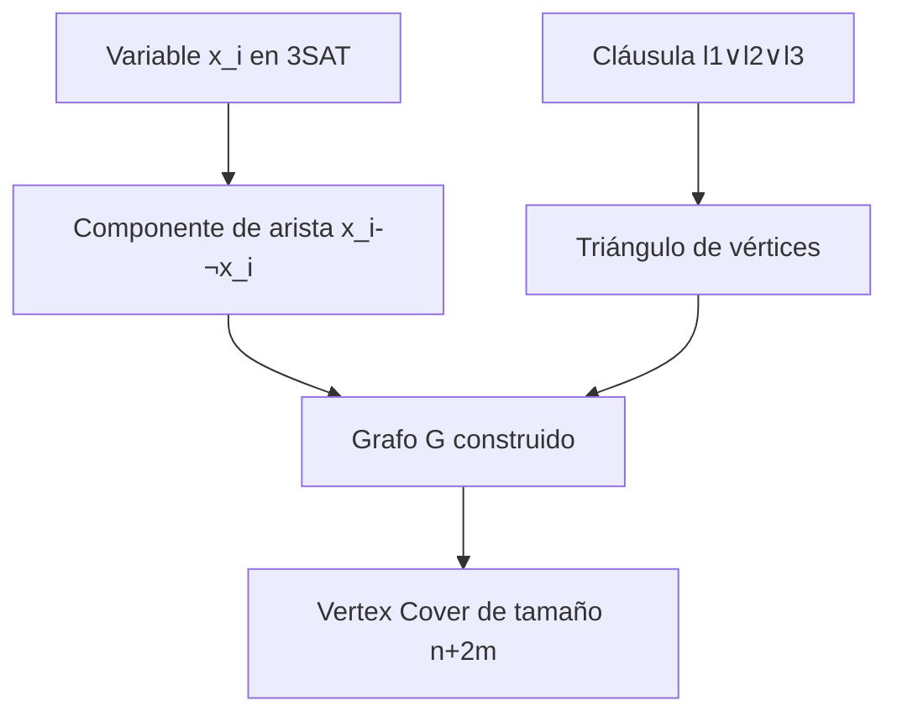
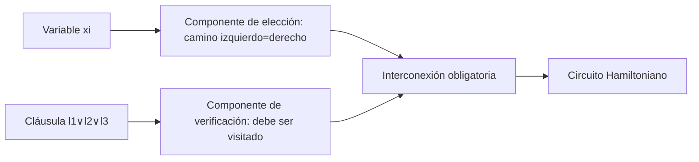
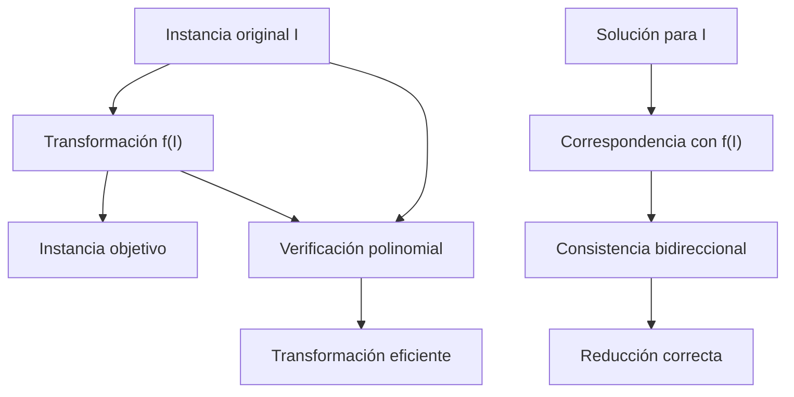

# Complejidad Computacional - Demostraciones de problemas NP-Completos

## 3.2 Técnicas: restricción, remplazo local y diseño de componentes.

---

Las técnicas sistemáticas para construir reducciones polinomiales son esenciales para demostrar la NP-completitud de nuevos problemas. Tres métodos fundamentales son: **restricción**, **reemplazo local** y **diseño de componentes**.

### Técnica de Restricción

#### Definición y Concepto

La técnica de restricción consiste en demostrar que un problema $P$ es NP-completo mostrando que contiene un problema NP-completo conocido $Q$ como caso especial.

**Formalización**: Si $Q \subseteq P$ y $Q$ es NP-completo, entonces $P$ es NP-completo.

#### Aplicación en SAT a 3SAT

**SAT**: Fórmula booleana en forma normal conjuntiva con cualquier número de literales por clausula.

**3SAT**: Caso restringido donde cada cláusula tiene exactamente 3 literales.

**Reducción por restricción**:

- Mostrar que 3SAT es una restricción de SAT
- Demostrar que SAT ≤ₚ 3SAT mediante transformación de cláusulas

```python
def sat_a_3sat(formula_sat):
    """
    Transforma una fórmula SAT general a 3SAT
    utilizando la técnica de restricción con variables auxiliares
    """
    formula_3sat = []

    for clausula in formula_sat:
        literales = clausula[:]  # Copia de la cláusula original

        while len(literales) > 3:
            # Crear nueva cláusula con primeros dos literales y variable auxiliar
            nueva_variable = generar_variable_auxiliar()
            nueva_clausula = literales[:2] + [nueva_variable]
            formula_3sat.append(nueva_clausula)

            # Reemplazar los dos literales por la negación de la variable auxiliar
            literales = [-nueva_variable] + literales[2:]

        # Añadir la cláusula final (con 3 literales o menos)
        if len(literales) == 3:
            formula_3sat.append(literales)
        elif len(literales) == 2:
            # Duplicar un literal para tener 3
            formula_3sat.append([literales[0], literales[1], literales[1]])
        else:  # 1 literal
            formula_3sat.append([literales[0], literales[0], literales[0]])

    return formula_3sat
```

#### Ejemplo: Clique desde Vertex Cover

**Teorema**: CLIQUE es NP-completo por restricción de VERTEX-COVER.

**Demostración**:

- Dado que $G$ tiene un clique de tamaño $k$ si y solo si $\overline{G}$ tiene vertex cover de tamaño $|V| - k$
- La transformación es polinomial: $f(G, k) = (\overline{G}, |V| - k)$

$$CLIQUE(G, k) \equiv \neg VERTEX\text{-}COVER(\overline{G}, |V| - k)$$

### Técnica de Reemplazo Local

#### Definición y Concepto

Consiste en reemplazar cada elemento de la instancia original por un componente pequeño y estructurado en la instancia objetivo.

#### Aplicación en 3SAT a Vertex Cover



**Construcción específica**:

- Para cada variable $x_i$: crear arista $(x_i, \neg x_i)$
- Para cada cláusula $(l_1 \vee l_2 \vee l_3)$: crear triángulo con vértices $c_1, c_2, c_3$
- Conectar cada vértice de cláusula con el literal correspondiente

```python
class ReemplazoLocal3SATaVC:
    def __init__(self, formula_3sat):
        self.formula = formula_3sat
        self.grafo = {}
        self.vertices = set()
        self.aristas = []

    def construir_grafo(self):
        """Construye el grafo para Vertex Cover usando reemplazo local"""
        n = self.contar_variables()
        m = len(self.formula)

        # Paso 1: Componentes para variables
        for i in range(1, n + 1):
            v_pos = f"x{i}"  # Literal positivo
            v_neg = f"¬x{i}" # Literal negativo
            self.agregar_arista(v_pos, v_neg)

        # Paso 2: Componentes para cláusulas
        for j, clausula in enumerate(self.formula):
            c1, c2, c3 = f"c{j}_1", f"c{j}_2", f"c{j}_3"
            # Triángulo para la cláusula
            self.agregar_arista(c1, c2)
            self.agregar_arista(c2, c3)
            self.agregar_arista(c3, c1)

            # Conexiones con literales
            for k, literal in enumerate(clausula):
                vertice_clausula = [c1, c2, c3][k]
                vertice_literal = f"x{abs(literal)}" if literal > 0 else f"¬x{abs(literal)}"
                self.agregar_arista(vertice_clausula, vertice_literal)

        return self.grafo, n + 2 * m  # k = n + 2m

    def agregar_arista(self, u, v):
        self.vertices.add(u)
        self.vertices.add(v)
        if u not in self.grafo:
            self.grafo[u] = []
        if v not in self.grafo:
            self.grafo[v] = []
        self.grafo[u].append(v)
        self.grafo[v].append(u)
        self.aristas.append((u, v))
```

### Técnica de Diseño de Componentes

#### Definición y Concepto

Se diseñan componentes complejos que simulan el comportamiento de elementos del problema original, permitiendo construir instancias del problema objetivo.

#### Aplicación en 3SAT a Circuito Hamiltoniano

**Componentes diseñados**:

- **Componente de variable**: Representa la asignación de verdad
- **Componente de cláusula**: Verifica la satisfacción



**Implementación de componentes**:

```python
class DiseñoComponentesHC:
    def __init__(self, formula_3sat):
        self.formula = formula_3sat
        self.vertices = []
        self.aristas = []
        self.componentes = {}

    def diseñar_componente_variable(self, variable_id):
        """Diseña el componente para una variable booleana"""
        # Crear camino con dos opciones: verdadero o falso
        entrada = f"v{variable_id}_in"
        salida = f"v{variable_id}_out"
        camino_verdadero = [f"v{variable_id}_true_{i}" for i in range(3)]
        camino_falso = [f"v{variable_id}_false_{i}" for i in range(3)]

        # Conectar caminos en paralelo
        self.agregar_arista(entrada, camino_verdadero[0])
        self.agregar_arista(entrada, camino_falso[0])
        self.agregar_arista(camino_verdadero[-1], salida)
        self.agregar_arista(camino_falso[-1], salida)

        self.componentes[variable_id] = {
            'tipo': 'variable',
            'entrada': entrada,
            'salida': salida,
            'camino_verdadero': camino_verdadero,
            'camino_falso': camino_falso
        }

    def diseñar_componente_clausula(self, clausula_id, literales):
        """Diseña el componente para una cláusula"""
        vertices_clausula = [f"c{clausula_id}_{i}" for i in range(4)]

        # Crear estructura que debe ser visitada
        for i in range(3):
            self.agregar_arista(vertices_clausula[i], vertices_clausula[i+1])

        # Puntos de conexión con componentes de variable
        puntos_conexion = {}
        for i, literal in enumerate(literales):
            var_id = abs(literal)
            es_positivo = literal > 0
            punto = f"c{clausula_id}_con_{var_id}_{'pos' if es_positivo else 'neg'}"
            puntos_conexion[literal] = punto
            self.agregar_arista(vertices_clausula[i], punto)

        self.componentes[clausula_id] = {
            'tipo': 'clausula',
            'vertices': vertices_clausula,
            'puntos_conexion': puntos_conexion
        }

    def interconectar_componentes(self):
        """Conecta todos los componentes en un grafo único"""
        # Conectar componentes de variable en serie
        variables = sorted([k for k, v in self.componentes.items() if v['tipo'] == 'variable'])
        for i in range(len(variables) - 1):
            actual = self.componentes[variables[i]]
            siguiente = self.componentes[variables[i+1]]
            self.agregar_arista(actual['salida'], siguiente['entrada'])

        # Conectar componentes de cláusula con variables
        for clausula_id, componente_clausula in self.componentes.items():
            if componente_clausula['tipo'] == 'clausula':
                for literal, punto_conexion in componente_clausula['puntos_conexion'].items():
                    var_id = abs(literal)
                    componente_var = self.componentes[var_id]
                    camino = (componente_var['camino_verdadero']
                             if literal > 0 else componente_var['camino_falso'])
                    # Conectar al camino correspondiente
                    self.agregar_arista(punto_conexion, camino[1])
```

### Comparación de Técnicas

| Técnica                | Aplicación Típica               | Complejidad | Ventajas          |
| ---------------------- | ------------------------------- | ----------- | ----------------- |
| **Restricción**        | Problemas que generalizan otros | Simple      | Fácil de entender |
| **Reemplazo Local**    | Transformaciones estructurales  | Media       | Sistemática       |
| **Diseño Componentes** | Construcciones complejas        | Alta        | Muy poderosa      |

### Ejercicios Propuestos

#### Ejercicio 1: Restricción en Subset Sum

Demuestre que PARTITION es NP-completo usando la técnica de restricción desde SUBSET SUM.

**Datos**: $S = \{a_1, a_2, ..., a_n\}$, $t$ (target)
**Transformación**: $S' = S \cup \{2T - t, t\}$ donde $T = \sum S$

#### Ejercicio 2: Reemplazo Local en Independent Set

Use reemplazo local para reducir VERTEX COVER a INDEPENDENT SET.

**Fórmula clave**: $S$ es vertex cover de tamaño $k$ en $G$ si y solo si $V-S$ es independent set de tamaño $|V|-k$.

#### Ejercicio 3: Diseño de Componentes para 3D Matching

Diseñe componentes para reducir 3SAT a 3D MATCHING.

**Componentes necesarios**:

- Selector de verdad para variables
- Verificador de cláusulas
- Mecanismo de consistencia

#### Ejercicio 4: Análisis de Complejidad

Para cada técnica, analice la complejidad temporal de la reducción:

- Restricción: $O(1)$ o $O(n)$
- Reemplazo local: $O(n + m)$
- Diseño de componentes: $O(n \times m)$

### Caso de Estudio Integrado

#### Reducción 3SAT a Hamiltonian Path usando las Tres Técnicas

```python
class ReduccionCompleta3SATaHP:
    """Ejemplo integrado usando las tres técnicas"""

    def __init__(self, formula):
        self.formula = formula
        self.grafo = Grafo()

    def aplicar_restriccion(self):
        """Asegura que la fórmula sea 3-CNF"""
        if not self.es_3cnf():
            self.formula = self.convertir_a_3cnf()

    def aplicar_reemplazo_local(self):
        """Reemplaza cada elemento con componentes locales"""
        for i, clausula in enumerate(self.formula):
            componente = self.crear_componente_clausula(clausula, i)
            self.grafo.agregar_componente(componente)

    def aplicar_diseno_componentes(self):
        """Diseña la estructura global del grafo"""
        self.grafo.disenar_estructura_global()
        self.grafo.crear_conexiones_obligatorias()

    def reducir(self):
        self.aplicar_restriccion()
        self.aplicar_reemplazo_local()
        self.aplicar_diseno_componentes()
        return self.grafo
```

### Verificación de Correctitud

#### Esquema General para Validar Reducciones



**Condiciones de verificación**:

1. **Completitud**: Si $I$ tiene solución, entonces $f(I)$ tiene solución
2. **Solidez**: Si $f(I)$ tiene solución, entonces $I$ tiene solución
3. **Polinomialidad**: $f$ computable en tiempo $O(n^k)$

### Referencias Bibliográficas

#### Bibliografía Básica

1. **Garey & Johnson** (Sección 3.2): Técnicas generales de reducción
2. **Sipser** (Capítulo 7): Análisis detallado de restricción y diseño
3. **Arora & Barak** (Capítulo 2): Fundamentos teóricos de las técnicas

#### Bibliografía Complementaria

4. **Papadimitriou** (Capítulo 9): Ejemplos avanzados de diseño de componentes
5. **Kozen** (Capítulo 7): Formalizaciones matemáticas

### Consejos Prácticos

1. **Empiece simple**: Use restricción cuando sea posible
2. **Documente cada componente**: Especifique claramente la función de cada parte
3. **Verifique ambos sentidos**: Asegure la equivalencia completa
4. **Analice complejidad**: Confirme que la transformación es polinomial
5. **Pruebe con ejemplos**: Valide con instancias pequeñas pero no triviales
