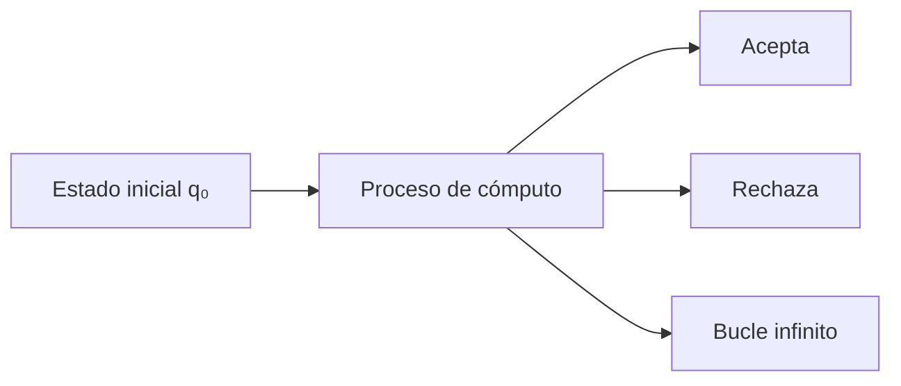
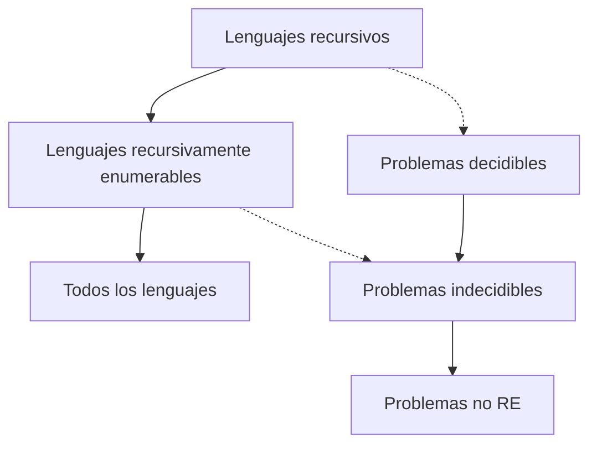

# Complejidad Computacional - Temas selectos

## 4.1 Problemas no computables y máquinas de Turing universales.

---

En esta guía exploraremos los límites fundamentales de la computación, centrándonos en problemas que no pueden ser resueltos por ningún algoritmo y en el concepto fundamental de máquinas de Turing universales.

### Máquinas de Turing: Repaso

#### Definición formal

Una máquina de Turing (MT) es una 7-tupla:

$$M = (Q, \Sigma, \Gamma, \delta, q_0, q_{acepta}, q_{rechaza})$$

Donde:

- $Q$: conjunto finito de estados
- $\Sigma$: alfabeto de entrada (sin el símbolo blanco)
- $\Gamma$: alfabeto de cinta $(\Sigma \subseteq \Gamma$, $\sqcup \in \Gamma)$
- $\delta$: función de transición $(\delta: Q \times \Gamma \to Q \times \Gamma \times \{L, R\})$
- $q_0 \in Q$: estado inicial
- $q_{acepta} \in Q$: estado de aceptación
- $q_{rechaza} \in Q$: estado de rechazo

#### Diagrama de una máquina de Turing



### Codificación de máquinas de Turing

#### Representación binaria

Toda máquina de Turing puede ser codificada como una cadena binaria. Sea $\langle M \rangle$ la codificación de la máquina M.

**Ejemplo de codificación simplificada:**

- Estados: $q_0, q_1, ..., q_n$ → codificados en binario
- Símbolos: $0, 1, \sqcup$ → codificados
- Transiciones: $\delta(q_i, a) = (q_j, b, D)$ → tupla codificada

### Máquina de Turing Universal

#### Definición

Una máquina de Turing universal $U$ es una MT que puede simular el comportamiento de cualquier otra máquina de Turing $M$ cuando se le proporciona la descripción $\langle M \rangle$ y una entrada $w$.

#### Función de la MTU

$$U(\langle M \rangle, w) = M(w)$$

#### Implementación conceptual

```python
class MaquinaTuringUniversal:
    def simular(self, codificacion_M, entrada_w):
        """
        Simula la máquina M con entrada w
        """
        # 1. Decodificar la máquina M
        estados, alfabeto, transiciones = self.decodificar_MT(codificacion_M)

        # 2. Configurar cinta con la entrada
        cinta = list(entrada_w)
        cabeza = 0
        estado_actual = estado_inicial

        # 3. Ejecutar simulación paso a paso
        while estado_actual not in [estado_aceptacion, estado_rechazo]:
            simbolo_actual = cinta[cabeza]
            transicion = transiciones[(estado_actual, simbolo_actual)]

            # Aplicar transición
            estado_actual, nuevo_simbolo, movimiento = transicion
            cinta[cabeza] = nuevo_simbolo
            cabeza += 1 if movimiento == 'R' else -1

            # Manejar extensión de cinta
            if cabeza >= len(cinta):
                cinta.append('_')  # símbolo blanco

        return estado_actual == estado_aceptacion
```

### Problemas no computables

#### El problema de la parada (Halting Problem)

##### Definición

Dada una máquina de Turing $M$ y una entrada $w$, determinar si $M$ se detiene (para) con entrada $w$.

Formalmente:

$$HALT = \{ \langle M, w \rangle \mid M \text{ se detiene con entrada } w \}$$

##### Teorema de Turing (1936)

El problema de la parada es indecidible. No existe ninguna máquina de Turing que pueda decidir $HALT$.

##### Demostración por contradicción

Supongamos que existe una máquina $H$ que decide el problema de la parada:

```python
def H(M, w):
    """Supuesta máquina que resuelve el problema de la parada"""
    if M se detiene con w:
        return True
    else:
        return False
```

Construimos una máquina $D$ (máquina diagonal):

```python
def D(M):
    codificacion_M = codificar(M)
    if H(M, codificacion_M):  # Si M se detiene con su propia codificación
        while True:  # Bucle infinito
            pass
    else:
        return True  # Se detiene
```

**Contradicción:** ¿Qué pasa con $D(D)$?

- Si $D$ se detiene con entrada $D$, entonces $H(D, D)$ devuelve True, por lo que $D(D)$ entra en bucle infinito.
- Si $D$ no se detiene con entrada $D$, entonces $H(D, D)$ devuelve False, por lo que $D(D)$ se detiene.

¡Contradicción en ambos casos!

### Otros problemas no computables

#### Problema de la equivalencia

Dadas dos máquinas de Turing $M_1$ y $M_2$, ¿aceptan el mismo lenguaje?

$$EQ_{TM} = \{ \langle M_1, M_2 \rangle \mid L(M_1) = L(M_2) \}$$

#### Teorema de Rice

Toda propiedad no trivial de los lenguajes recursivamente enumerables es indecidible.

**Propiedad no trivial:** Algunos lenguajes la tienen, otros no.
**Propiedad trivial:** Todos los lenguajes la tienen o ninguno la tiene.

### Jerarquía de lenguajes



### Ejemplos y ejercicios

#### Ejemplo 1: Máquina que siempre para

```python
def M_para(w):
    # Esta máquina siempre se detiene
    return True  # Acepta todas las entradas
```

#### Ejemplo 2: Máquina que nunca para

```python
def M_nunca_para(w):
    while True:
        pass  # Bucle infinito
```

#### Ejercicios propuestos

**Ejercicio 1:**
Demuestre que el siguiente problema es indecidible:

$$A_{TM} = \{ \langle M, w \rangle \mid M \text{ acepta } w \}$$

**Ejercicio 2:**
Demuestre que si el problema de la parada fuera decidible, entonces $A_{TM}$ sería decidible.

**Ejercicio 3:**
Construya una reducción desde $A_{TM}$ al problema de determinar si el lenguaje de una MT es vacío:

$$E_{TM} = \{ \langle M \rangle \mid L(M) = \emptyset \}$$

**Ejercicio 4:**
Demuestre que el siguiente problema es indecidible usando el Teorema de Rice:
¿Dada una MT M, acepta M exactamente 100 cadenas?

### Aplicaciones e implicaciones

#### En la práctica

- Verificación de programas: No existe un verificador perfecto
- Optimización de compiladores: Límites en lo que se puede optimizar automáticamente
- Inteligencia Artificial: Limitaciones fundamentales en lo que las máquinas pueden decidir

#### En matemáticas

- Teoremas de incompletitud de Gödel
- Límites en la automatización de demostraciones matemáticas

### Referencias

#### Bibliografía básica

1. **Michael Sipser** - _Introduction to the Theory of Computation_: Capítulo 4 y 5 para máquinas de Turing y indecidibilidad.
2. **Michael Garey y David Johnson** - _Computers and Intractability_: Apéndice para fundamentos teóricos.
3. **Sanjeev Arora y Boaz Barak** - _Computational Complexity: A Modern Approach_: Capítulo 1 para perspectiva histórica.
4. **Dexter C. Kozen** - _Theory of Computation_: Capítulo 6 para tratamiento formal.

#### Bibliografía complementaria

1. **Hopcroft, Motwani y Ullman** - _Introduction to Automata Theory_: Capítulo 8 para ejemplos detallados.
2. **Christos Papadimitriou** - _Computational Complexity_: Capítulo 2 para conexiones con complejidad.
3. **Oded Goldreich** - _Computational Complexity: A Conceptual Perspective_: Enfoque conceptual de límites.

### Resumen de fórmulas importantes

#### Codificación de MT

$$\langle M \rangle \in \{0,1\}^*$$

#### Problema de la parada

$$HALT = \{ \langle M, w \rangle \mid M(w) \downarrow \}$$

#### Problema de aceptación

$$A_{TM} = \{ \langle M, w \rangle \mid M \text{ acepta } w \}$$

#### Teorema de Rice

Sea $P$ una propiedad no trivial de lenguajes RE, entonces:

$$L_P = \{ \langle M \rangle \mid L(M) \in P \} \text{ es indecidible}$$

### Consejos de estudio

1. **Entender las demostraciones por contradicción**: Son fundamentales en este tema.
2. **Practicar con reducciones**: Convertir un problema indecidible conocido a otro.
3. **Visualizar las máquinas**: Usar diagramas para entender el flujo de las MT.
4. **Trabajar en grupo**: Discutir las paradojas y contradicciones.
