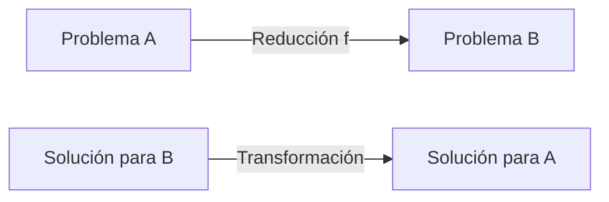
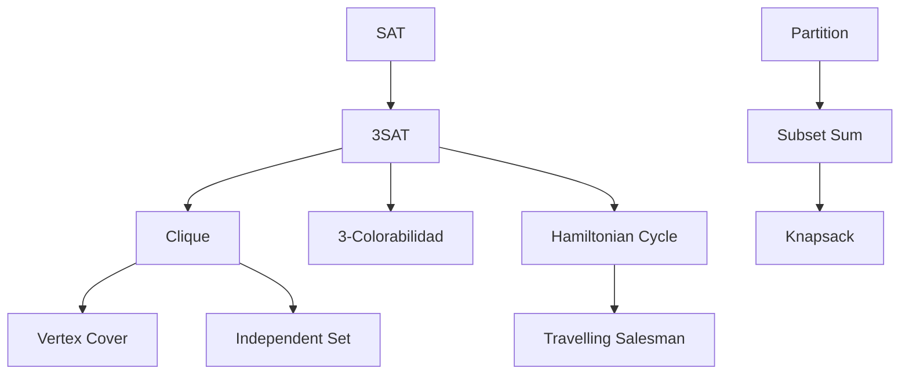

# Complejidad Computacional - Temas selectos

## 4.2 Utilizando NP-Completez para analizar problemas.

---

La teoría de NP-completez proporciona un marco formal para clasificar problemas computacionales según su dificultad intrínseca y establecer límites fundamentales sobre lo que puede ser eficientemente computable.

### Conceptos fundamentales

#### Clases de complejidad

**Definición P:**

$$P = \{L \mid \exists \text{ MT determinística que decide } L \text{ en tiempo polinomial}\}$$

**Definición NP:**

$$NP = \{L \mid \exists \text{ MT no determinística que decide } L \text{ en tiempo polinomial}\}$$

**Definición alternativa NP (vía verificador):**

$$L \in NP \iff \exists V \text{ (verificador) y } c \geq 0 \text{ tal que } \forall x:$$

$$x \in L \iff \exists y (|y| \leq |x|^c \land V(x,y) = 1)$$

#### Reducciones polinomiales

**Definición:** $A \leq_P B$ si existe función computable en tiempo polinomial $f$ tal que:

$$\forall x: x \in A \iff f(x) \in B$$



### Problemas NP-Completos

#### Definición formal

Un lenguaje $L$ es **NP-completo** si:

1. $L \in NP$
2. $\forall A \in NP, A \leq_P L$

#### Teorema de Cook-Levin (1971)

**SAT es NP-completo:**

$$SAT = \{\phi \mid \phi \text{ es una fórmula booleana satisfacible}\}$$

### Estrategias para demostrar NP-Completez

#### Metodología general

Para demostrar que un problema $B$ es NP-completo:

1. **Demostrar que $B \in NP$**
2. **Elegir un problema NP-completo conocido $A$**
3. **Construir una reducción polinomial $f: A \leq_P B$**
4. **Demostrar que la reducción es correcta y polinomial**

### Análisis de problemas mediante reducciones

#### Reducción de SAT a 3SAT

**Ejemplo de reducción:**
Convertir una cláusula $(x_1 \lor x_2 \lor x_3 \lor x_4)$ en 3SAT:

```python
def reducir_SAT_a_3SAT(formula):
    """
    Reduce una fórmula SAT arbitraria a 3SAT
    """
    nuevas_clausulas = []

    for clausula in formula:
        if len(clausula) <= 3:
            nuevas_clausulas.append(clausula)
        else:
            # Dividir clausula larga usando variables auxiliares
            variables_aux = generar_variables_auxiliares(len(clausula))
            clausulas_3sat = dividir_clausula(clausula, variables_aux)
            nuevas_clausulas.extend(clausulas_3sat)

    return nuevas_clausulas

def dividir_clausula(clausula, variables_aux):
    """Divide una cláusula larga en cláusulas de 3 literales"""
    resultado = []
    n = len(clausula)

    # Primera cláusula
    resultado.append([clausula[0], clausula[1], variables_aux[0]])

    # Cláusulas intermedias
    for i in range(1, n-2):
        resultado.append([-variables_aux[i-1], clausula[i+1], variables_aux[i]])

    # Última cláusula
    resultado.append([-variables_aux[n-3], clausula[n-1]])

    return resultado
```

#### Reducción de 3SAT a Clique

**Teorema:** 3SAT $\leq_P$ CLIQUE

**Construcción:**

- Para cada cláusula, crear un grupo de 3 vértices (uno por literal)
- Conectar vértices de diferentes cláusulas si los literales no son complementarios
- $k$ = número de cláusulas

```python
def reducir_3SAT_a_CLIQUE(formula_3sat):
    """
    Reduce una instancia de 3SAT a una instancia de CLIQUE
    """
    k = len(formula_3sat)  # Número de cláusulas
    grafo = Grafo()

    # Crear vértices
    for i, clausula in enumerate(formula_3sat):
        for literal in clausula:
            vertice_id = f"clausula_{i}_literal_{literal}"
            grafo.agregar_vertice(vertice_id, literal)

    # Crear aristas
    for i in range(len(formula_3sat)):
        for j in range(i + 1, len(formula_3sat)):
            for literal_i in formula_3sat[i]:
                for literal_j in formula_3sat[j]:
                    if not son_complementarios(literal_i, literal_j):
                        vertice_i = f"clausula_{i}_literal_{literal_i}"
                        vertice_j = f"clausula_{j}_literal_{literal_j}"
                        grafo.agregar_arista(vertice_i, vertice_j)

    return grafo, k

def son_complementarios(lit1, lit2):
    """Verifica si dos literales son complementarios"""
    return abs(lit1) == abs(lit2) and ((lit1 > 0 and lit2 < 0) or (lit1 < 0 and lit2 > 0))
```

### Problemas NP-Completos clásicos

#### Lista de problemas fundamentales

| Problema             | Descripción                           | Reducción desde |
| -------------------- | ------------------------------------- | --------------- |
| **SAT**              | Satisfacibilidad booleana             | Cook-Levin      |
| **3SAT**             | SAT con cláusulas de 3 literales      | SAT             |
| **Clique**           | Encontrar clique de tamaño k          | 3SAT            |
| **Vertex Cover**     | Cubrir todas las aristas con vértices | Clique          |
| **Hamiltonian Path** | Camino que visita todos los vértices  | 3SAT            |
| **Subset Sum**       | Subconjunto que suma exactamente k    | 3SAT            |

#### Diagrama de reducciones



### Técnicas de reducción comúnmente usadas

#### 1. Reducción por componentes locales

Cada restricción del problema original se mapea a un componente del problema objetivo.

**Ejemplo:** 3SAT → Clique

#### 2. Reducción por sustitución de gadgets

Se crean "gadgets" que simulan el comportamiento de variables y restricciones.

**Ejemplo:** 3SAT → Hamiltonian Path

#### 3. Reducción por restricciones de recursos

Se transforman restricciones lógicas en restricciones de recursos.

**Ejemplo:** Subset Sum → Knapsack

### Análisis práctico de problemas

#### Caso de estudio: Vertex Cover

**Definición:**

$$VERTEX-COVER = \{\langle G, k \rangle \mid G \text{ tiene un vertex cover de tamaño } \leq k\}$$

**Reducción desde Clique:**

```python
def reducir_CLIQUE_a_VERTEX_COVER(grafo, k):
    """
    Reduce CLIQUE(G, k) a VERTEX-COVER(Ḡ, |V| - k)
    """
    grafo_complemento = grafo.complemento()
    k_vc = len(grafo.vertices) - k
    return grafo_complemento, k_vc
```

**Teorema:** $G$ tiene una clique de tamaño $k$ si y solo si $\bar{G}$ tiene un vertex cover de tamaño $|V| - k$.

#### Demostración de correctitud

Sea $C$ una clique en $G$ de tamaño $k$. Entonces $V \setminus C$ es un vertex cover en $\bar{G}$:

- En $\bar{G}$, no hay aristas entre vértices de $C$ (pues en $G$ estaban todas conectadas)
- Toda arista en $\bar{G}$ debe tener al menos un extremo en $V \setminus C$

### Ejercicios propuestos

#### Ejercicio 1: Demostrar NP-Completez

Demuestre que el siguiente problema es NP-completo:

**Problema del Conjunto Independiente (Independent Set):**
Dado un grafo $G = (V, E)$ y un entero $k$, ¿existe un conjunto $S \subseteq V$ de tamaño al menos $k$ tal que ningún par de vértices en $S$ está conectado por una arista?

**Indicación:** Use reducción desde Clique.

#### Ejercicio 2: Reducción práctica

Dada la siguiente instancia de 3SAT:

$$(x_1 \lor x_2 \lor \neg x_3) \land (\neg x_1 \lor x_3 \lor x_4) \land (x_2 \lor \neg x_3 \lor \neg x_4)$$

Construya la reducción a Clique y encuentre la clique correspondiente a la asignación satisfacible:

$$x_1 = V, x_2 = V, x_3 = F, x_4 = V$$

#### Ejercicio 3: Análisis de reducción

Demuestre que la siguiente reducción es correcta:

**Problema A (3-Coloreabilidad):** ¿Se puede colorear un grafo con 3 colores?
**Problema B (3SAT):** ¿Es satisfacible una fórmula booleana?

Construya una reducción de 3-Coloreabilidad a 3SAT.

#### Ejercicio 4: Diseño de gadgets

Diseñe un gadget para reducir 3SAT al problema del Camino Hamiltoniano. Su gadget debe poder:

- Representar variables booleanas
- Representar cláusulas
- Forzar consistencia en las asignaciones

### Estrategias para tratar con problemas NP-Completos

#### 1. Algoritmos de aproximación

```python
def aproximacion_vertex_cover(grafo):
    """
    Algoritmo 2-aproximación para Vertex Cover
    """
    cover = set()
    aristas = grafo.aristas.copy()

    while aristas:
        u, v = aristas.pop()
        cover.add(u)
        cover.add(v)
        # Eliminar todas las aristas incidentes a u o v
        aristas = [(x, y) for x, y in aristas if x != u and x != v and y != u and y != v]

    return cover
```

#### 2. Algoritmos paramétricos

```python
def vertex_cover_parametrizado(grafo, k):
    """
    Algoritmo FPT para Vertex Cover
    """
    if k == 0:
        return set()
    if not grafo.aristas:
        return set()

    # Elegir una arista (u, v)
    u, v = grafo.aristas[0]

    # Caso 1: u está en el cover
    grafo_sin_u = grafo.eliminar_vertice(u)
    cover1 = vertex_cover_parametrizado(grafo_sin_u, k-1)
    if cover1 is not None:
        return cover1.union({u})

    # Caso 2: v está en el cover
    grafo_sin_v = grafo.eliminar_vertice(v)
    cover2 = vertex_cover_parametrizado(grafo_sin_v, k-1)
    if cover2 is not None:
        return cover2.union({v})

    return None
```

### Herramientas para el análisis

#### Teorema de Ladner

Si $P \neq NP$, entonces existen problemas en $NP$ que no están en $P$ y no son NP-completos.

#### Jerarquía polinomial

$$P \subseteq NP \subseteq \Sigma_2^P \subseteq \Pi_2^P \subseteq \cdots \subseteq PH$$

### Referencias clave

#### Bibliografía básica

1. **Garey & Johnson** - _Computers and Intractability_: La "biblia" de NP-completez, con lista completa de problemas.
2. **Sipser** - _Introduction to the Theory of Computation_: Capítulo 7 para fundamentos teóricos.
3. **Arora & Barak** - _Computational Complexity_: Capítulo 2 para reducciones y completitud.

#### Bibliografía complementaria

1. **Papadimitriou** - _Computational Complexity_: Capítulo 9 para reducciones creativas.
2. **Kozen** - _Theory of Computation_: Capítulo 7 para tratamiento formal.

### Consejos para el estudio

1. **Dominar las reducciones clásicas:** SAT → 3SAT → Clique → Vertex Cover
2. **Practicar con ejemplos concretos:** Construir reducciones paso a paso
3. **Entender las demostraciones de correctitud:** Verificar ambas direcciones
4. **Explorar aplicaciones prácticas:** Cómo usar NP-completez en diseño de algoritmos
