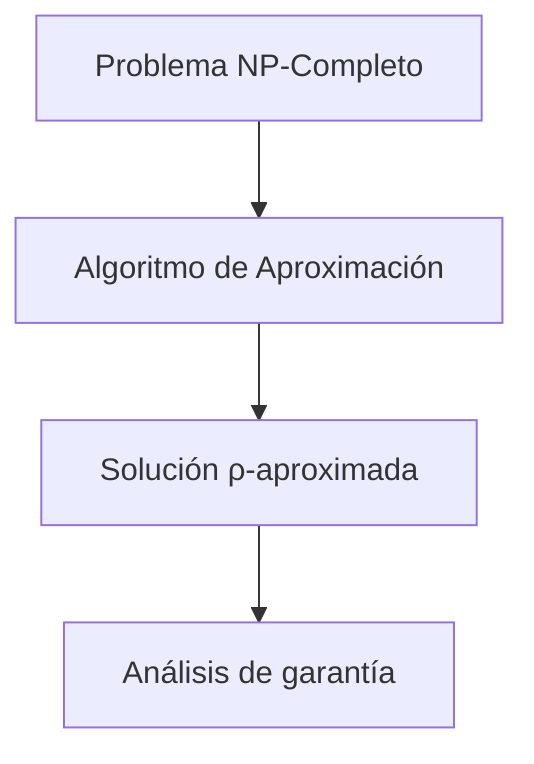

# Complejidad Computacional - Temas selectos

## 4.3 Enfrentando problemas NP-Completos: aproximación, heurísticas, etc.

---

### Introducción a las estrategias prácticas

Cuando nos enfrentamos a problemas NP-completos en la práctica, existen múltiples estrategias que permiten obtener soluciones útiles aunque no necesariamente óptimas.

### Algoritmos de aproximación

#### Conceptos fundamentales

**Definición:** Un algoritmo de aproximación para un problema de optimización es un algoritmo polinomial que produce una solución cuyo valor está dentro de un factor garantizado del valor óptimo.

**Ratio de aproximación:** Para un problema de minimización, un algoritmo tiene ratio de aproximación $ \rho(n) $ si:

$$ \frac{C}{C ^ *} \leq \rho(n) $$

donde $C$ es el costo de la solución del algoritmo y $C ^ *$ es el costo óptimo.



#### Clasificación por calidad de aproximación

| Tipo     | Ratio                                        | Ejemplos                    |
| -------- | -------------------------------------------- | --------------------------- |
| PTAS     | $1 + \epsilon$ para cualquier $\epsilon > 0$ | Scheme para Knapsack        |
| APX      | Ratio constante                              | Vertex Cover (2-aprox)      |
| Log-APX  | $O(\log n)$                                  | Set Cover                   |
| Poly-APX | $O(n^c)$                                     | Algunos problemas difíciles |

### Algoritmos de aproximación clásicos

#### Vertex Cover - 2-aproximación

```python
def aproximacion_vertex_cover(grafo):
    """
    Algoritmo 2-aproximación para Vertex Cover
    Basado en emparejamiento máximo
    """
    cover = set()
    aristas_restantes = set(grafo.aristas)

    while aristas_restantes:
        # Elegir cualquier arista (u, v)
        u, v = next(iter(aristas_restantes))
        cover.add(u)
        cover.add(v)

        # Eliminar todas las aristas incidentes a u o v
        aristas_restantes = {(x, y) for x, y in aristas_restantes
                           if x != u and x != v and y != u and y != v}

    return cover
```

**Análisis de ratio:**

- Sea $M$ el conjunto de aristas seleccionadas (son disjuntas)
- El cover óptimo $C^*$ debe contener al menos un vértice de cada arista en $M$
- Por lo tanto $|C^*| \geq |M|$
- Nuestro algoritmo devuelve $2|M|$ vértices
- Ratio: $\frac{2|M|}{|C^*|} \leq 2$

#### Problema del Viajante (TSP) métrico

**Algoritmo del árbol generador mínimo + preorden:**

```python
def aproximacion_tsp_metrico(grafo_completo):
    """
    2-aproximación para TSP métrico
    """
    # 1. Calcular MST
    mst = calcular_mst(grafo_completo)

    # 2. Recorrido en preorden del MST
    recorrido_preorden = preorden(mst)

    # 3. Short-cut para eliminar vértices repetidos
    tour = shortcut(recorrido_preorden)

    return tour

def preorden(arbol, raiz=0):
    """Recorrido en preorden del árbol"""
    recorrido = []
    stack = [raiz]
    visitado = set()

    while stack:
        nodo = stack.pop()
        if nodo not in visitado:
            visitado.add(nodo)
            recorrido.append(nodo)
            # Agregar hijos en orden inverso para procesamiento correcto
            for hijo in reversed(arbol.vecinos(nodo)):
                if hijo not in visitado:
                    stack.append(hijo)

    return recorrido

def shortcut(recorrido):
    """Elimina vértices duplicados usando shortcut"""
    visitado = set()
    tour = []

    for nodo in recorrido:
        if nodo not in visitado:
            tour.append(nodo)
            visitado.add(nodo)

    # Volver al inicio
    tour.append(tour[0])
    return tour
```

**Análisis:**

- Costo(MST) ≤ Costo(TSP óptimo)
- Recorrido preorden: 2 × Costo(MST)
- Shortcut no aumenta costo (desigualdad triangular)
- Ratio: 2

### Esquemas de aproximación (PTAS)

#### Knapsack - Esquema de aproximación polinomial

```python
def ptas_knapsack(items, capacidad, epsilon):
    """
    PTAS para el problema de la mochila
    """
    # 1. Escalar y redondear valores
    valor_max = max(item.valor for item in items)
    factor = (epsilon * valor_max) / len(items)

    items_escalados = []
    for item in items:
        nuevo_valor = int(item.valor / factor)
        items_escalados.append(Item(item.peso, nuevo_valor))

    # 2. Programación dinámica con valores escalados
    n = len(items)
    max_valor_escalado = sum(item.valor for item in items_escalados)

    # DP[i][v] = peso mínimo para alcanzar valor v con primeros i items
    dp = [[float('inf')] * (max_valor_escalado + 1) for _ in range(n + 1)]
    dp[0][0] = 0

    for i in range(1, n + 1):
        for v in range(max_valor_escalado + 1):
            dp[i][v] = dp[i-1][v]  # No tomar el item
            if v >= items_escalados[i-1].valor:
                dp[i][v] = min(dp[i][v],
                              dp[i-1][v - items_escalados[i-1].valor] + items[i-1].peso)

    # 3. Encontrar mejor solución factible
    mejor_valor = 0
    for v in range(max_valor_escalado + 1):
        if dp[n][v] <= capacidad:
            mejor_valor = max(mejor_valor, v * factor)

    return mejor_valor
```

### Algoritmos heurísticos

#### Búsqueda local

```python
class BusquedaLocal:
    def __init__(self, problema, max_iter=1000):
        self.problema = problema
        self.max_iter = max_iter

    def resolver(self):
        # Solución inicial aleatoria
        solucion_actual = self.solucion_inicial()
        costo_actual = self.evaluar(solucion_actual)

        for iteracion in range(self.max_iter):
            vecinos = self.generar_vecinos(solucion_actual)
            mejor_vecino = None
            mejor_costo = costo_actual

            for vecino in vecinos:
                costo_vecino = self.evaluar(vecino)
                if costo_vecino < mejor_costo:  # Minimización
                    mejor_vecino = vecino
                    mejor_costo = costo_vecino

            if mejor_vecino is None:
                break  # Óptimo local

            solucion_actual = mejor_vecino
            costo_actual = mejor_costo

        return solucion_actual, costo_actual

    def generar_vecinos(self, solucion):
        """Genera soluciones vecinas (depende del problema)"""
        vecinos = []
        # Ejemplo: intercambiar dos elementos
        for i in range(len(solucion)):
            for j in range(i + 1, len(solucion)):
                vecino = solucion.copy()
                vecino[i], vecino[j] = vecino[j], vecino[i]
                vecinos.append(vecino)
        return vecinos
```

#### Algoritmos genéticos

```python
class AlgoritmoGenetico:
    def __init__(self, tam_poblacion=100, prob_mutacion=0.01, max_generaciones=100):
        self.tam_poblacion = tam_poblacion
        self.prob_mutacion = prob_mutacion
        self.max_generaciones = max_generaciones

    def resolver(self):
        # Inicializar población
        poblacion = [self.generar_solucion() for _ in range(self.tam_poblacion)]

        for generacion in range(self.max_generaciones):
            # Evaluar fitness
            fitness = [self.fitness(individuo) for individuo in poblacion]

            # Selección
            padres = self.seleccion(poblacion, fitness)

            # Cruzamiento
            descendencia = self.cruzamiento(padres)

            # Mutación
            descendencia = [self.mutar(individuo) for individuo in descendencia]

            # Reemplazo
            poblacion = self.reemplazo(poblacion, descendencia, fitness)

        return max(poblacion, key=self.fitness)

    def seleccion_ruleta(self, poblacion, fitness):
        """Selección proporcional al fitness"""
        total_fitness = sum(fitness)
        probabilidades = [f/total_fitness for f in fitness]
        return np.random.choice(poblacion, size=len(poblacion), p=probabilidades)
```

### Técnicas de relajación

#### Relajación lineal y rounding

```python
import pulp

def relajacion_lineal_set_cover(conjuntos, universo):
    """
    Relajación lineal para Set Cover con rounding
    """
    # Crear problema de optimización
    prob = pulp.LpProblem("SetCover", pulp.LpMinimize)

    # Variables de decisión (continuas entre 0 y 1)
    x = {}
    for S in conjuntos:
        x[S] = pulp.LpVariable(f"x_{S}", 0, 1)

    # Función objetivo: minimizar suma de x_S
    prob += pulp.lpSum(x[S] for S in conjuntos)

    # Restricciones: cada elemento debe estar cubierto
    for elemento in universo:
        prob += pulp.lpSum(x[S] for S in conjuntos if elemento in S) >= 1

    # Resolver relajación lineal
    prob.solve()

    # Rounding aleatorio
    solucion = []
    for S in conjuntos:
        if random.random() <= x[S].varValue:
            solucion.append(S)

    return solucion
```

### Algoritmos paramétricos (FPT)

#### Vertex Cover paramétrico

```python
def fpt_vertex_cover(grafo, k):
    """
    Algoritmo FPT para Vertex Cover usando búsqueda en árbol
    """
    if k < 0:
        return None
    if not grafo.aristas:
        return set()

    # Regla de grado alto
    for vertice in grafo.vertices:
        if grafo.grado(vertice) > k:
            return fpt_vertex_cover(grafo.eliminar_vertice(vertice), k-1).union({vertice})

    # Elegir arista (u, v)
    u, v = grafo.aristas[0]

    # Rama 1: incluir u en el cover
    sol1 = fpt_vertex_cover(grafo.eliminar_vertice(u), k-1)
    if sol1 is not None:
        return sol1.union({u})

    # Rama 2: incluir v en el cover
    sol2 = fpt_vertex_cover(grafo.eliminar_vertice(v), k-1)
    if sol2 is not None:
        return sol2.union({v})

    return None
```

### Ejercicios propuestos

#### Ejercicio 1: Análisis de aproximación

Para el algoritmo de 2-aproximación de Vertex Cover:
a) Construya un grafo donde el algoritmo logre exactamente ratio 2
b) Demuestre que el ratio 2 es tight (no se puede mejorar con este algoritmo)
c) Proponga una mejora heurística al algoritmo

#### Ejercicio 2: Diseño de algoritmo

Diseñe un algoritmo de aproximación para el problema de la Mochila (Knapsack) que garantice ratio 2. Implemente y pruebe con el siguiente ejemplo:

- Capacidad: 10
- Items: (peso=6, valor=8), (peso=5, valor=5), (peso=4, valor=4), (peso=3, valor=3)

#### Ejercicio 3: Búsqueda local

Implemente una búsqueda local para el problema del Agente Viajero (TSP) con la siguiente función de vecindad:

- 2-opt: intercambiar dos aristas no adyacentes
  Pruebe con 5 ciudades en posición aleatoria.

#### Ejercicio 4: Análisis de PTAS

Para el PTAS de Knapsack:
a) Demuestre que el tiempo de ejecución es $O(n^3/\epsilon)$
b) Analice cómo afecta ε a la calidad de la solución vs tiempo de ejecución
c) Implemente y pruebe con ε = 0.1, 0.5, 0.9

### Estrategias híbridas

#### Framework de combinación

```python
class SolucionadorHibrido:
    def __init__(self, problema):
        self.problema = problema

    def resolver(self, tiempo_limite):
        start_time = time.time()
        mejor_solucion = None
        mejor_costo = float('inf')

        # Fase 1: Solución greedy inicial
        solucion_greedy = self.algoritmo_greedy()
        mejor_solucion, mejor_costo = self.actualizar_mejor(solucion_greedy, mejor_solucion, mejor_costo)

        # Fase 2: Búsqueda local
        if time.time() - start_time < tiempo_limite/2:
            solucion_bl = self.busqueda_local(solucion_greedy, tiempo_limite/4)
            mejor_solucion, mejor_costo = self.actualizar_mejor(solucion_bl, mejor_solucion, mejor_costo)

        # Fase 3: Búsqueda tabú
        if time.time() - start_time < tiempo_limite:
            solucion_tabu = self.busqueda_tabu(mejor_solucion, tiempo_limite - (time.time() - start_time))
            mejor_solucion, mejor_costo = self.actualizar_mejor(solucion_tabu, mejor_solucion, mejor_costo)

        return mejor_solucion, mejor_costo
```

### Análisis de rendimiento experimental

#### Métricas de evaluación

```python
class Evaluador:
    def evaluar_algoritmo(self, algoritmo, instancias):
        resultados = {}

        for instancia in instancias:
            # Tiempo de ejecución
            start_time = time.time()
            solucion = algoritmo.resolver(instancia)
            tiempo = time.time() - start_time

            # Calidad de solución
            costo = self.evaluar_solucion(solucion)
            optimo = self.optimo_conocido(instancia)
            ratio = costo / optimo if optimo > 0 else 1

            resultados[instancia.nombre] = {
                'tiempo': tiempo,
                'costo': costo,
                'optimo': optimo,
                'ratio': ratio,
                'gap': (costo - optimo) / optimo * 100 if optimo > 0 else 0
            }

        return resultados

    def reporte_estadistico(self, resultados):
        ratios = [r['ratio'] for r in resultados.values()]
        tiempos = [r['tiempo'] for r in resultados.values()]

        return {
            'ratio_promedio': np.mean(ratios),
            'ratio_maximo': np.max(ratios),
            'tiempo_promedio': np.mean(tiempos),
            'porcentaje_optimos': sum(1 for r in ratios if r == 1) / len(ratios) * 100
        }
```

### Referencias clave

#### Bibliografía básica

1. **Garey & Johnson** - _Computers and Intractability_: Apéndice con técnicas de aproximación.
2. **Arora & Barak** - _Computational Complexity_: Capítulo 11 para algoritmos de aproximación.
3. **Vazirani** - _Approximation Algorithms_: Texto especializado en aproximación.

#### Bibliografía complementaria

1. **Papadimitriou** - _Computational Complexity_: Capítulo 13 para algoritmos aleatorizados.
2. **Williamson & Shmoys** - _The Design of Approximation Algorithms_: Tratamiento completo.

### Consejos para la práctica

1. **Conozca las garantías:** Entienda los límites de rendimiento de cada técnica
2. **Combine estrategias:** Use métodos híbridos para mejor rendimiento
3. **Perfile el algoritmo:** Adapte parámetros según las instancias específicas
4. **Considere el contexto:** La "mejor" estrategia depende del tiempo disponible y calidad requerida
