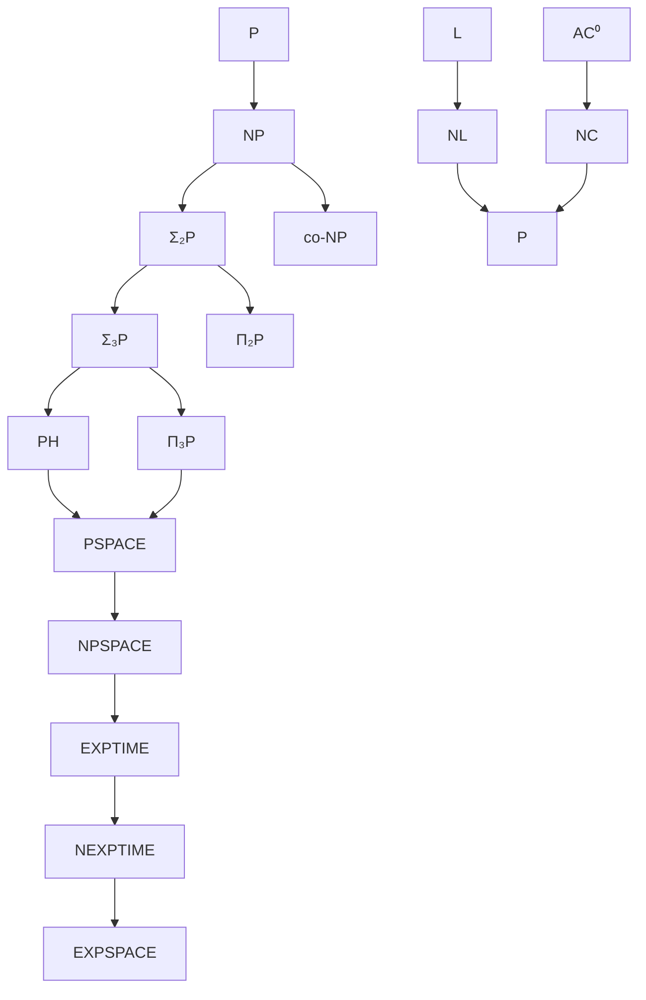

# Complejidad Computacional - Temas selectos

## 4.4 Otras clases de complejidad.

---

### Introducción a la jerarquía de complejidad

Más allá de las clases P y NP, existe un rico panorama de clases de complejidad que capturan diferentes recursos computacionales y modos de computación.

### Clases fundamentales beyond P y NP

#### Diagrama general de la jerarquía



### Clases de complejidad espacial

#### Clase L (Espacio logarítmico)

**Definición:**

$$L = SPACE(\log n)$$

Lenguajes decidibles por máquinas de Turing determinísticas usando espacio $O(\log n)$.

**Ejemplo:** ¿Está un grafo conexo?

```python
def es_conexo_logspace(grafo, n):
    # Algoritmo de Reingold (2005) - Undirected S-T Connectivity en L
    # Usa transformaciones de grafos y caminos aleatorios
    pass
```

#### Clase NL (Espacio logarítmico no determinístico)

**Definición:**

$$NL = NSPACE(\log n)$$

**Teorema de Immerman-Szelepcsényi:**

$$NL = co\text{-}NL$$

**Problema completo:** PATH = {(G, s, t) | existe camino de s a t en G}

#### Relación entre clases espaciales

**Teorema de Savitch:**
Para $f(n) \geq \log n$:

$$NSPACE(f(n)) \subseteq SPACE(f(n)^2)$$

**Corolario:** $PSPACE = NPSPACE$

### La jerarquía polinomial (Polynomial Hierarchy - PH)

#### Definición recursiva

**Base:**

- $\Delta_0^P = \Sigma_0^P = \Pi_0^P = P$
- $\Sigma_1^P = NP$
- $\Pi_1^P = co\text{-}NP$

**Paso recursivo:**

- $\Delta_{i+1}^P = P^{\Sigma_i^P}$
- $\Sigma_{i+1}^P = NP^{\Sigma_i^P}$
- $\Pi_{i+1}^P = co\text{-}\Sigma_{i+1}^P$

#### Definición alterna via cuantificadores

Un lenguaje $L$ está en $\Sigma_k^P$ si existe un polinomio $p$ y un lenguaje $A \in P$ tal que:

$$x \in L \iff \exists y_1 \forall y_2 \exists y_3 \cdots Q y_k: (x, y_1, \ldots, y_k) \in A$$
donde $|y_i| \leq p(|x|)$ y alternan $k-1$ cuantificadores.

#### Problemas completos para niveles de PH

**$\Sigma_2^P\text{-completo:}$** SAT cuantificado $\exists \forall$

```python
def QBF_Σ2(formula, variables_existenciales, variables_universales):
    """
    Problema de fórmulas booleanas cuantificadas con 2 alternancias
    """
    # ∃x∀y φ(x,y)
    for asignacion_ex in todas_asignaciones(variables_existenciales):
        satisfacible = True
        for asignacion_univ in todas_asignaciones(variables_universales):
            if not evaluar(formula, asignacion_ex ∪ asignacion_univ):
                satisfacible = False
                break
        if satisfacible:
            return True
    return False
```

**$\Pi_2^P\text{-completo:}$** MINIMAL CIRCUIT - ¿Es un circuito booleano mínimo?

### Clases de counting: #P

#### Definición

**Clase #P:** Lenguajes de funciones que cuentan el número de certificados de aceptación de una MT no determinística en tiempo polinomial.

$$ f \in \#P \iff \exists \text{ MTN } M: f(x) = \text{número de rutas de aceptación de } M(x) $$

**Ejemplo:** #SAT - Contar el número de asignaciones satisfacibles.

#### Completitud en #P

**Teorema:** #SAT es #P-completo (Valiant, 1979)

```python
def contar_satisfacibles(formula):
    """
    Problema #SAT - Contar asignaciones satisfacibles
    """
    variables = obtener_variables(formula)
    contador = 0

    for asignacion in todas_asignaciones(variables):
        if evaluar_formula(formula, asignacion):
            contador += 1

    return contador
```

#### Relación con otras clases

**Teorema de Toda:** $$ PH \subseteq P ^ {\#P } $$

### Clases de complejidad aleatorizadas

#### Clase BPP (Bounded-error Probabilistic Polynomial time)

**Definición:** $L \in BPP$ si existe una MT probabilística $M$ tal que:

- Si $x \in L$, entonces $Pr[M(x) = 1] \geq 2/3$
- Si $x \notin L$, entonces $Pr[M(x) = 0] \geq 2/3$

**Amplificación de probabilidad:**

```python
def amplificar_bpp(algoritmo, entrada, repeticiones):
    aciertos = 0
    for i in range(repeticiones):
        if algoritmo(entrada):
            aciertos += 1

    # Con repeticiones suficientes, error exponencialmente pequeño
    return aciertos > repeticiones / 2
```

#### Clase RP (Random Polynomial time)

**Definición:** $L \in RP$ si existe MT probabilística $M$ tal que:

- Si $x \in L$, entonces $Pr[M(x) = 1] \geq 1/2$
- Si $x \notin L$, entonces $Pr[M(x) = 1] = 0$

#### Relaciones conocidas

$$P \subseteq ZPP \subseteq RP \subseteq NP \subseteq PP$$

$$RP \subseteq BPP \subseteq PSPACE$$

### Clases de circuitos

#### Clase NC (Nick's Class)

**Definición:** $NC^k$ = lenguajes decidibles por circuitos booleanos uniformes de profundidad $O(\log^k n)$ y tamaño polinomial.

**Jerarquía NC:**

$$NC = \bigcup_{k \geq 1} NC^k$$

**Problemas en NC:**

- Suma de números grandes
- Multiplicación de matrices
- Algoritmos paralelizables eficientemente

#### Clase AC (Alternating Circuits)

**Definición:** $AC^k$ = como $NC^k$ pero con puertas de fan-in ilimitado.

**Relación:** $$NC^k \subseteq AC^k \subseteq NC^{k+1}$$

### Clases de complejidad exponencial

#### EXPTIME

**Definición:**

$$EXPTIME = \bigcup_{k \geq 1} TIME(2^{n^k})$$

**Problema completo:** Juego del Go generalizado, ajedrez generalizado.

#### NEXPTIME

**Definición:**

$$NEXPTIME = \bigcup_{k \geq 1} NTIME(2^{n^k})$$

#### Relaciones exponenciales

$$P \subseteq NP \subseteq PSPACE \subseteq EXPTIME \subseteq NEXPTIME \subseteq EXPSPACE$$

**Teorema de la jerarquía temporal:** $$P \subsetneq EXPTIME$$

### Clases de complejidad descriptiva

#### Conexión con lógica matemática

**Teorema de Fagin:** $NP = SO\exists$ (lógica de segundo orden con cuantificadores existenciales)

**Teorema de Immerman:** $P = FO(LFP)$ (lógica de primer orden con punto fijo)

### Ejemplos y ejercicios propuestos

#### Ejercicio 1: Análisis de pertenencia a clases

Para cada problema, determine a qué clase de complejidad pertenece:

1. Dado un circuito booleano, ¿es mínimo (no existe circuito equivalente más pequeño)?
2. Dada una fórmula QBF $\forall x \exists y \varphi(x,y)$, ¿es verdadera?
3. Dado un grafo, contar el número de 3-coloraciones válidas.
4. Dado un programa y una entrada, ¿se detiene en $2^n$ pasos?

#### Ejercicio 2: Demostraciones de contención

Demuestre las siguientes contenciones:
a) $NP \subseteq PSPACE$
b) $BPP \subseteq \Sigma_2^P \cap \Pi_2^P$ (con el lema de amplificación)
c) $NL \subseteq P$

#### Ejercicio 3: Completitud en PH

Demuestre que el siguiente problema es $\Sigma_2^P\text{-completo:}$

**MIN-CIRCUIT-NONMINIMAL:** Dado un circuito booleano C, ¿existe un circuito C' más pequeño que compute la misma función?

#### Ejercicio 4: Algoritmos para clases espaciales

Diseñe un algoritmo $O(\log n)\text{-espacio}$ para:
a) Verificar si un grafo dirigido es acíclico
b) Comprobar si un número en binario es primo (usando el test de primalidad de Reingold)

### Teoremas importantes de separación

#### Teorema de la jerarquía espacial

Para funciones $f(n)$ completamente espacial-constructibles:

$$SPACE(f(n)) \subsetneq SPACE(f(n) \cdot \log n)$$

#### Teorema de la jerarquía temporal

Para funciones $f(n)$ completamente tiempo-constructibles:

$$TIME(f(n)) \subsetneq TIME(f(n) \cdot \log f(n))$$

#### Conjeturas importantes

1. $P \neq NP$ (abierto)
2. $NP \neq co\text{-}NP$ (se cree cierto)
3. $P = BPP$ (se cree cierto por derandomización)

### Aplicaciones prácticas

#### Criptografía y complejidad

- Basada en la conjetura $P \neq NP$
- Protocolos que usan problemas en NP ∩ co-NP (como primalidad)

#### Verificación formal

- Model checking puede ser PSPACE-completo
- Verificación de protocolos en clases temporales altas

#### Aprendizaje automático

- Problemas de aprendizaje PAC en relación con PH
- Complejidad de training de redes neuronales

### Implementación de algoritmos para diferentes clases

#### Simulador de MT con límite espacial

```python
class MaquinaTuringEspacial:
    def __init__(self, cinta_entrada, espacio_maximo):
        self.cinta = list(cinta_entrada)
        self.cabeza = 0
        self.estado = 'q0'
        self.espacio_usado = len(cinta_entrada)
        self.espacio_maximo = espacio_maximo

    def simular_paso(self):
        if self.espacio_usado > self.espacio_maximo:
            raise Exception("Excedido límite de espacio")

        # Implementar transiciones...
        pass

    def simular_logspace(self):
        """Simula computación en espacio O(log n)"""
        self.espacio_maximo = math.ceil(math.log2(len(self.cinta))) + 1
        return self.simular_completo()
```

#### Contador de soluciones (#P)

```python
class ContadorSoluciones:
    def contar_certificados(self, verificador, instancia, tamano_certificado):
        """
        Cuenta certificados para un verificador polinomial
        """
        contador = 0
        n = len(instancia)

        # Generar todos los posibles certificados de tamaño polinomial
        for certificado in self.generar_cadenas(tamano_certificado):
            if verificador(instancia, certificado):
                contador += 1

        return contador

    def generar_cadenas(self, longitud):
        """Genera todas las cadenas binarias de longitud dada"""
        if longitud == 0:
            yield ""
        else:
            for cadena in self.generar_cadenas(longitud - 1):
                yield "0" + cadena
                yield "1" + cadena
```

### Referencias clave

#### Bibliografía básica

1. **Arora & Barak** - _Computational Complexity_: Capítulos 4, 5, 6, 7 para PH, espacio, aleatorización.
2. **Sipser** - _Introduction to the Theory of Computation_: Capítulos 8, 9, 10 para espacio, intratabilidad.
3. **Papadimitriou** - _Computational Complexity_: Capítulos 16-20 para clases avanzadas.

#### Bibliografía complementaria

1. **Kozen** - _Theory of Computation_: Capítulos 6-8 para tratamiento formal.
2. **Goldreich** - _Computational Complexity_: Perspectiva conceptual de clases.
3. **Complexity Zoo** (complexityzoo.net): Referencia completa de clases.

### Consejos para el estudio

1. **Enfoque jerárquico:** Comprender las relaciones de contención entre clases.
2. **Problemas completos:** Identificar problemas característicos de cada clase.
3. **Técnicas de demostración:** Dominar diagonalización, reducciones, padding.
4. **Aplicaciones prácticas:** Relacionar clases abstractas con problemas concretos.
