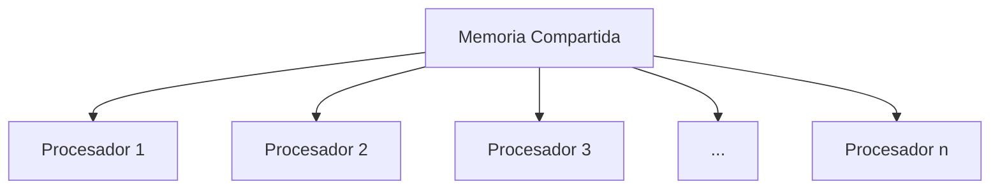
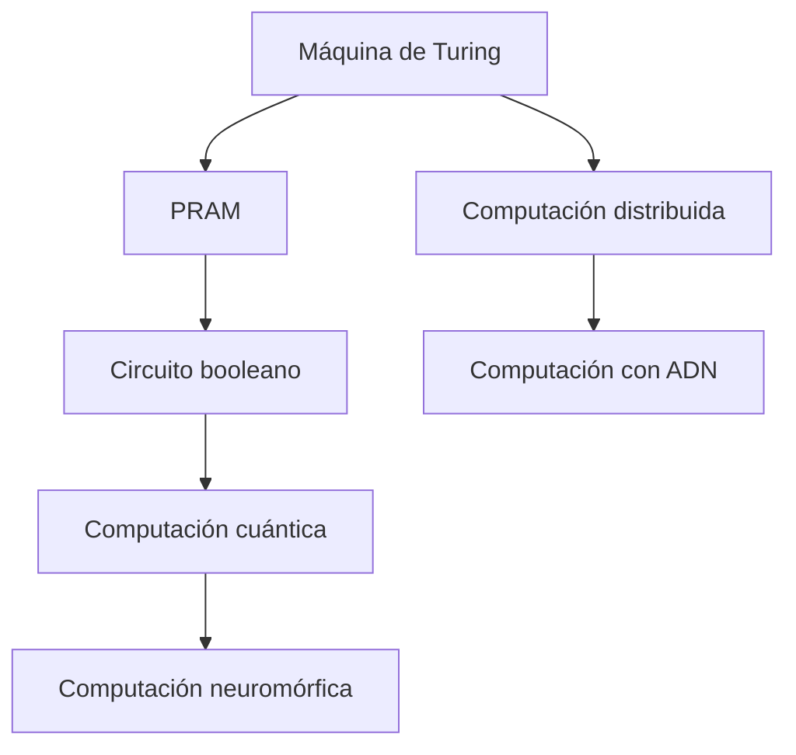

# Complejidad Computacional - Temas selectos

## 4.5 Otros modelos de cómputo: DNA, paralelos, distribuidos, cuánticos, etc.

---

### Introducción a modelos alternativos

Más allá del modelo estándar de máquinas de Turing, existen diversos modelos de cómputo que capturan diferentes aspectos físicos y biológicos de la computación, ofreciendo perspectivas únicas sobre la complejidad computacional.

### Computación paralela

#### Modelo PRAM (Parallel Random Access Machine)

**Definición:** Múltiples procesadores accediendo a una memoria compartida simultáneamente.

**Variantes:**

- EREW: Exclusive Read, Exclusive Write
- CREW: Concurrent Read, Exclusive Write
- CRCW: Concurrent Read, Concurrent Write



#### Clase NC (Nick's Class)

**Definición:** $$NC^k = \text{lenguajes decidibles por circuitos booleanos uniformes de profundidad } O(\log^k n)$$

**Ejemplo: Suma paralela**

```python
def suma_paralela(arr):
    """
    Suma de n números en tiempo O(log n) con O(n) procesadores
    """
    n = len(arr)
    # Usar técnica de reducción binaria
    while n > 1:
        # Cada procesador suma dos elementos
        for i in range(0, n, 2):
            if i + 1 < n:
                arr[i//2] = arr[i] + arr[i+1]
        n = (n + 1) // 2
    return arr[0]
```

#### Algoritmo paralelo para prefix sums

```python
def prefix_sum_paralelo(arr):
    """
    Computa la suma de prefijos en O(log n) tiempo
    """
    n = len(arr)
    # Fase upward (reducción)
    for d in range(0, math.ceil(math.log2(n))):
        for k in range(0, n, 2**(d+1)):
            if k + 2**d < n:
                arr[k + 2**(d+1) - 1] += arr[k + 2**d - 1]

    # Fase downward
    arr[n-1] = 0
    for d in range(math.ceil(math.log2(n))-1, -1, -1):
        for k in range(0, n, 2**(d+1)):
            if k + 2**d < n:
                temp = arr[k + 2**d - 1]
                arr[k + 2**d - 1] = arr[k + 2**(d+1) - 1]
                arr[k + 2**(d+1) - 1] += temp

    return arr
```

### Computación distribuida

#### Modelo de red de procesos

**Complejidades clave:**

- **Complejidad de mensajes:** Número total de mensajes
- **Complejidad de rondas:** Número de pasos de comunicación
- **Tiempo:** Tiempo total de ejecución

#### Algoritmo distribuido para elección de líder

```python
class ProcesoDistribuido:
    def __init__(self, id_proceso, vecinos):
        self.id = id_proceso
        self.vecinos = vecinos
        self.lider = None
        self.mensajes_recibidos = []

    def algoritmo_lider_anillo(self):
        """
        Algoritmo para elección de líder en anillo
        Complejidad: O(n) mensajes, O(n) tiempo
        """
        # Enviar ID a siguiente proceso
        enviar_mensaje(self.vecinos[0], {'tipo': 'eleccion', 'id': self.id})

        while True:
            mensaje = recibir_mensaje()
            if mensaje['tipo'] == 'eleccion':
                if mensaje['id'] > self.id:
                    # Reenviar ID mayor
                    enviar_mensaje(self.vecinos[0], mensaje)
                elif mensaje['id'] == self.id:
                    # Yo soy el líder
                    self.lider = self.id
                    # Notificar a todos
                    enviar_mensaje(self.vecinos[0], {'tipo': 'lider', 'id': self.id})
            elif mensaje['tipo'] == 'lider':
                self.lider = mensaje['id']
                if mensaje['id'] != self.id:
                    # Reenviar notificación
                    enviar_mensaje(self.vecinos[0], mensaje)
                break
```

### Computación con ADN

#### Modelo de computación con ADN (Adleman, 1994)

**Operaciones básicas:**

- **Síntesis:** Crear cadenas de ADN
- **Separación:** Extraer cadenas que contengan cierta secuencia
- **Amplificación:** PCR para replicar cadenas
- **Detección:** Verificar presencia de cadenas

#### Resolución del problema del camino hamiltoniano con ADN

```python
class ComputacionADN:
    def camino_hamiltoniano_adn(self, grafo, n):
        """
        Resuelve el problema del camino hamiltoniano usando ADN
        """
        # 1. Codificar vértices como secuencias de ADN
        vertices_adn = self.codificar_vertices(n)

        # 2. Generar todas las rutas posibles
        rutas_adn = self.generar_rutas(vertices_adn, n)

        # 3. Filtrar rutas de longitud n
        rutas_longitud_n = self.filtrar_longitud(rutas_adn, n)

        # 4. Verificar que vértices consecutivos sean adyacentes
        rutas_validas = self.verificar_aristas(rutas_longitud_n, grafo)

        # 5. Verificar que todos los vértices sean distintos
        rutas_hamiltonianas = self.verificar_unicidad(rutas_validas, n)

        return len(rutas_hamiltonianas) > 0

    def codificar_vertices(self, n):
        """Codifica cada vértice como secuencia única de ADN"""
        return {i: f"ACGT{i:08b}" for i in range(n)}
```

#### Ventajas y limitaciones del cómputo con ADN

**Ventaja:** Paralelismo masivo - $10^{18}$ operaciones simultáneas
**Limitación:** Tiempo de operaciones bioquímicas y tasas de error

### Computación cuántica

#### Qubits y superposición

**Estado de un qubit:** $$|\psi\rangle = \alpha|0\rangle + \beta|1\rangle$$ donde $|\alpha|^2 + |\beta|^2 = 1$

**Estado de n qubits:** $$|\psi\rangle = \sum_{x \in \{0,1\}^n} \alpha_x |x\rangle$$

#### Algoritmo de Grover

**Búsqueda en base de datos no ordenada:**

- Clásico: $O(N)$ operaciones
- Cuántico: $O(\sqrt{N})$ operaciones

```python
import numpy as np

class AlgoritmoGrover:
    def __init__(self, oracle, n_qubits):
        self.oracle = oracle  # Función que marca el elemento buscado
        self.n = n_qubits
        self.N = 2**n_qubits

    def iteracion_grover(self, estado):
        """Una iteración del algoritmo de Grover"""
        # Aplicar oracle
        estado = self.oracle(estado)

        # Aplicar difusor
        estado = self.difusor(estado)

        return estado

    def buscar(self):
        """Ejecuta la búsqueda de Grover"""
        # Estado uniforme inicial
        estado = np.ones(self.N) / np.sqrt(self.N)

        # Número óptimo de iteraciones
        iteraciones = int(np.pi/4 * np.sqrt(self.N))

        for _ in range(iteraciones):
            estado = self.iteracion_grover(estado)

        # Medición
        return np.argmax(np.abs(estado)**2)
```

#### Algoritmo de Shor

**Factorización en tiempo polinomial cuántico:**

- Clásico: subexponencial
- Cuántico: polinomial

**Complejidad:** $O((\log n)^2 (\log \log n) (\log \log \log n))$

### Computación neuromórfica

#### Modelo de redes neuronales spiking

**Neurona integra-y-dispara:**
$$\tau_m \frac{dV}{dt} = -V(t) + RI(t)$$

**Complejidad:** Capacidad de resolver problemas NP-completos mediante computación analógica en tiempo constante (teórico).

### Computación reversible

#### Principio de reversibilidad Landauer

**Costo energético:** Borrar un bit requiere disipar $kT \ln 2$ de energía.

**Computación reversible:** Sin borrado, teóricamente sin disipación de energía.

#### Puertas reversibles

**Puerta Toffoli (CCNOT):**
$$(a, b, c) \to (a, b, c \oplus (a \land b))$$

**Implementación de funciones reversibles:**

```python
class ComputacionReversible:
    def funcion_reversible(self, x):
        """Implementa una función reversible (biyectiva)"""
        # Ejemplo: permutación de bits
        y = (x & 0x0F) << 4 | (x & 0xF0) >> 4
        return (x, y)  # Salida que preserva información

    def circuito_toffoli(self, a, b, c):
        """Implementa puerta Toffoli"""
        # (a, b, c) -> (a, b, c XOR (a AND b))
        nuevo_c = c ^ (a & b)
        return a, b, nuevo_c
```

### Computación analógica

#### Modelo de computación analógica

**Ventaja:** Ciertos problemas pueden resolverse en tiempo constante usando fenómenos físicos.

**Ejemplo: Resolver sistemas lineales:**
$$\mathbf{A}\mathbf{x} = \mathbf{b}$$

Mediante circuitos analógicos que implementan la matriz A.

### Ejercicios propuestos

#### Ejercicio 1: Algoritmo paralelo para sorting

Diseñe un algoritmo paralelo para ordenar n números en el modelo PRAM:
a) Implemente Odd-Even Transposition Sort
b) Analice tiempo $(O(n))$ y número de procesadores $(O(n))$
c) Compare con algoritmo secuencial

#### Ejercicio 2: Simulación de cómputo con ADN

Simule el algoritmo de Adleman para el camino hamiltoniano en un grafo de 4 vértices:
a) Diseñe secuencias de ADN para vértices y aristas
b) Simule las operaciones bioquímicas
c) Analice escalabilidad del método

#### Ejercicio 3: Algoritmo cuántico para búsqueda

Implemente una simulación clásica del algoritmo de Grover para buscar un elemento en una lista de 8 elementos:
a) Diseñe el oracle para el elemento buscado
b) Implemente las iteraciones de Grover
c) Verifique la probabilidad de éxito después de $\frac{\pi}{4}\sqrt{N}$ iteraciones

#### Ejercicio 4: Análisis de complejidad distribuida

Analice la complejidad de comunicación del problema del consenso en redes:
a) En una red completa de n nodos
b) En un anillo de n nodos
c) En una malla $\sqrt{n} \times \sqrt{n}$

### Comparativa de modelos

#### Tabla de complejidades

| Modelo           | Recursos principales               | Clase análoga | Ventajas                |
| ---------------- | ---------------------------------- | ------------- | ----------------------- |
| **Paralelo**     | Procesadores, tiempo               | NC            | Speedup polinomial      |
| **Distribuido**  | Mensajes, rondas                   | -             | Tolerancia a fallos     |
| **ADN**          | Moléculas, operaciones bioquímicas | PSPACE        | Paralelismo masivo      |
| **Cuántico**     | Qubits, compuertas                 | BQP           | Speedup exponencial     |
| **Neuromórfico** | Neuronas, spikes                   | -             | Bajo consumo energético |

#### Relaciones de simulación



### Límites físicos de la computación

#### Límite de Bekenstein-Hawking

Máxima información en un volumen espacial:

$$I \leq \frac{2\pi RE}{\hbar c \ln 2}$$

#### Límite de Bremermann

Máxima velocidad de cómputo por masa:

$$\frac{1.36 \times 10^{47} \text{ bits}}{\text{kg} \cdot \text{s}}$$

#### Límite de Margolus-Levitin

Máximas operaciones por segundo:

$$ops \leq \frac{2E}{h}$$

### Aplicaciones prácticas

#### Computación paralela moderna

```python
# Ejemplo usando multiprocessing en Python
import multiprocessing as mp

def procesar_chunck(datos):
    return sum(datos)  # Operación paralelizable

def computacion_paralela_practica():
    datos = list(range(1000000))
    n_procesadores = mp.cpu_count()
    chunk_size = len(datos) // n_procesadores

    with mp.Pool(n_procesadores) as pool:
        resultados = pool.map(procesar_chunck,
                            [datos[i:i+chunk_size] for i in range(0, len(datos), chunk_size)])

    return sum(resultados)
```

#### Simulación cuántica con Qiskit

```python
from qiskit import QuantumCircuit, Aer, execute
from qiskit.visualization import plot_histogram

def ejemplo_qiskit():
    # Crear circuito cuántico
    qc = QuantumCircuit(2, 2)

    # Aplicar compuertas
    qc.h(0)  # Hadamard
    qc.cx(0, 1)  # CNOT

    # Medición
    qc.measure([0, 1], [0, 1])

    # Simular
    simulator = Aer.get_backend('qasm_simulator')
    result = execute(qc, simulator, shots=1000).result()

    return result.get_counts()
```

### Referencias clave

#### Bibliografía básica

1. **Arora & Barak** - _Computational Complexity_: Capítulo 20 para computación cuántica.
2. **Sipser** - _Introduction to the Theory of Computation_: Apéndice para modelos alternativos.
3. **Papadimitriou** - _Computational Complexity_: Capítulo 19 para computación paralela.

#### Bibliografía especializada

1. **Nielsen & Chuang** - _Quantum Computation and Quantum Information_: Biblia de computación cuántica.
2. **Lynch** - _Distributed Algorithms_: Para computación distribuida.
3. **Paun, Rozenberg, Salomaa** - _DNA Computing_: Para computación con ADN.

### Desafíos futuros y direcciones de investigación

#### Problemas abiertos

1. ¿BQP = PSPACE? (Relación entre computación cuántica y clásica)
2. Límites físicos fundamentales de la computación
3. Escalabilidad de computación cuántica práctica
4. Interfaces entre modelos biológicos y digitales

#### Tendencias emergentes

- Computación cuántica tolerante a fallos
- Memcomputing y computación con memristores
- Computación basada en ADN sintético
- Redes neuromórficas escalables
