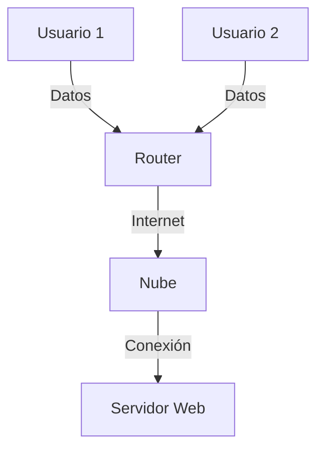
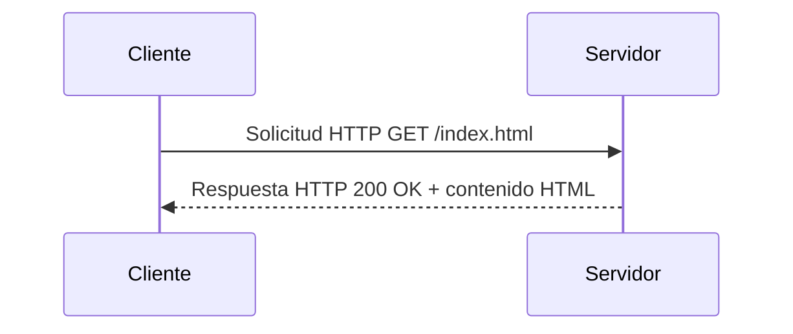
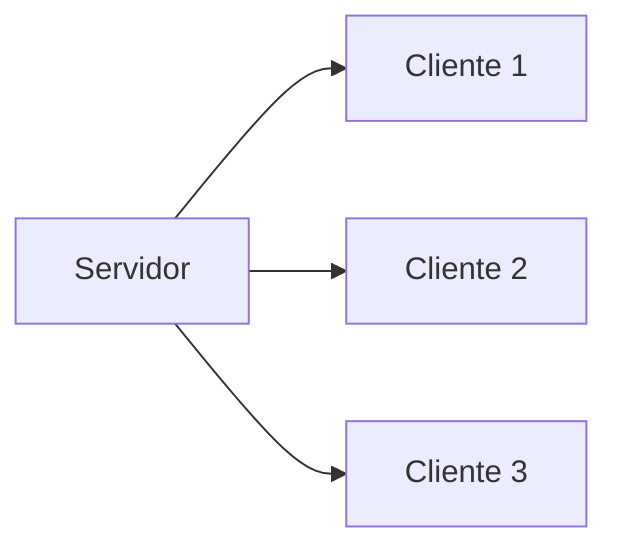
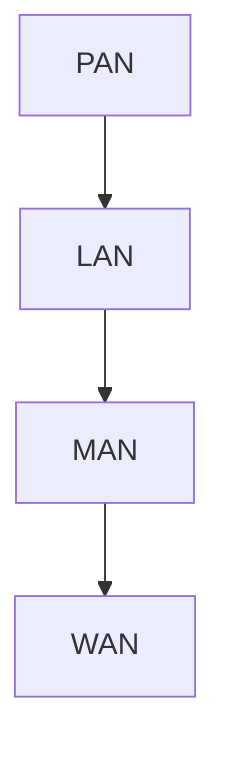

# Redes de Computadoras - Conceptos generales

## 1.1 Redes de computadoras. Uso de las redes de computadoras. Internet. Conectividad, la influencia de los medios de comunicación Clasificación de las redes de computadoras: por estructura, por espacio geográfico.

---

Las **redes de computadoras** constituyen la infraestructura que permite la **comunicación e intercambio de información** entre dispositivos digitales. A través de ellas se transmiten datos, voz, video y servicios que sustentan el funcionamiento del Internet moderno, los sistemas empresariales y los servicios en la nube.

Según Kurose y Ross (2010), una red de computadoras puede definirse como:

> “Un conjunto de dispositivos interconectados que pueden comunicarse entre sí para compartir recursos e información.”

### 1. Concepto de Red de Computadoras

Una **red de computadoras** está compuesta por **nodos** (hosts, servidores, routers, switches, etc.) y **enlaces** (cables, fibra óptica, enlaces inalámbricos) que permiten la **transmisión de datos**.

#### Diagrama general



#### Componentes principales

- **Nodos finales (hosts)**: computadoras, servidores, smartphones.
- **Dispositivos de red**: routers, switches, hubs, puntos de acceso.
- **Medios de transmisión**: cables de cobre (UTP), fibra óptica, ondas de radio.
- **Protocolos**: conjunto de reglas que definen cómo se comunican los dispositivos (TCP/IP, HTTP, DNS, etc.).

### 2. Uso de las Redes de Computadoras

Las redes permiten múltiples usos según el contexto:

| Uso                          | Descripción                                                | Ejemplo            |
| ---------------------------- | ---------------------------------------------------------- | ------------------ |
| **Compartición de recursos** | Acceso a impresoras, archivos, bases de datos.             | Red de oficina.    |
| **Comunicación**             | Correo electrónico, videollamadas, mensajería instantánea. | Zoom, WhatsApp.    |
| **Acceso a información**     | Navegación web, servicios en la nube.                      | Google, Wikipedia. |
| **Entretenimiento**          | Juegos en línea, streaming.                                | Netflix, Twitch.   |

#### Ejemplo de comunicación cliente-servidor



### 3. Internet y Conectividad

#### Definición

**Internet** es la **interconexión global de redes** que usan el protocolo **TCP/IP** para comunicarse. No es una sola red, sino una red de redes.

> Según Peterson y Davie (2011):
> “Internet es un sistema global de redes interconectadas que utilizan protocolos comunes para ofrecer servicios de comunicación.”

#### Concepto de Conectividad

La **conectividad** se refiere a la **capacidad de un dispositivo o red para acceder a otra red o recurso**.
Puede medirse mediante parámetros como:

$$ C = \frac{N_{alcanzables}}{N_{totales}} \times 100\% $$

donde:

- $N_{alcanzables}$ = número de nodos que se pueden alcanzar.
- $N_{totales}$ = número total de nodos en la red.

### 4. Influencia de los Medios de Comunicación

Los **medios físicos** afectan directamente la **velocidad**, **fiabilidad** y **costo** de una red.

| Medio                | Velocidad      | Distancia | Interferencia   | Costo |
| -------------------- | -------------- | --------- | --------------- | ----- |
| Par trenzado (UTP)   | Hasta 10 Gbps  | 100 m     | Media           | Bajo  |
| Fibra óptica         | Hasta 400 Gbps | Km        | Muy baja        | Alto  |
| Radio (WiFi, 4G, 5G) | Variable       | Alta      | Alta            | Medio |
| Satélite             | Media          | Muy alta  | Alta (latencia) | Alto  |

> Fórmula de capacidad de canal (Ley de Shannon):
>
> $$
> C = B \log_2 (1 + \frac{S}{N})
> $$
>
> donde $C$ es la capacidad en bits por segundo, $B$ el ancho de banda (Hz), y $S/N$ la relación señal-ruido.

### 5. Clasificación de las Redes de Computadoras

Las redes pueden clasificarse **por su estructura física o lógica**, y **por su alcance geográfico**.

#### 5.1 Por Estructura

| Tipo                    | Descripción                                         | Ejemplo                            |
| ----------------------- | --------------------------------------------------- | ---------------------------------- |
| **Cliente-Servidor**    | Un nodo central provee servicios a varios clientes. | Servidor web.                      |
| **Punto a Punto (P2P)** | Todos los nodos actúan como clientes y servidores.  | Redes de intercambio (BitTorrent). |
| **Híbrida**             | Combinación de cliente-servidor y P2P.              | Skype, redes corporativas.         |

**Ejemplo de topología cliente-servidor:**



#### 5.2 Por Espacio Geográfico

| Tipo                                | Cobertura | Descripción                        | Ejemplo         |
| ----------------------------------- | --------- | ---------------------------------- | --------------- |
| **PAN** (Personal Area Network)     | 1-10 m    | Red personal.                      | Bluetooth, USB. |
| **LAN** (Local Area Network)        | 10-1000 m | Red local en un edificio o campus. | Oficina, hogar. |
| **MAN** (Metropolitan Area Network) | 1-50 km   | Red urbana.                        | Red municipal.  |
| **WAN** (Wide Area Network)         | >50 km    | Conecta ciudades o países.         | Internet.       |

**Diagrama de jerarquía geográfica:**



### 6. Ejercicios Propuestos

#### Ejercicio 1

Explica las diferencias entre los tipos de red **LAN, MAN y WAN** en términos de:

- Alcance geográfico
- Velocidad típica
- Tecnologías usadas

#### Ejercicio 2

Dibuja un diagrama que represente una red **cliente-servidor** donde 3 clientes acceden a un servidor de archivos compartido.

#### Ejercicio 3

Calcula la **capacidad de canal** $(C)$ de un medio con ancho de banda de $1$ MHz y una relación señal-ruido de $30$ dB.

$$ C = B \log_2(1 + \frac{S}{N}) $$

_Recuerda que_ $30$ dB = $10^{30/10} = 1000$

### 7. Ejemplo Práctico (Código)

#### Verificación de Conectividad (Ping en Python)

```python
import os

def ping(host):
    response = os.system(f"ping -c 1 {host}")
    if response == 0:
        print(f"{host} está en línea.")
    else:
        print(f"{host} no responde.")

ping("8.8.8.8")
```

### 8. Conclusión

Las **redes de computadoras** son la columna vertebral de la sociedad digital. Comprender sus **conceptos básicos**, **clasificación** y **funcionamiento** permite entender cómo fluyen los datos en Internet y cómo las decisiones de diseño afectan el rendimiento y la conectividad.

### Referencias

1. James F. Kurose, Keith W. Ross. _Computer Networking: A Top-Down Approach_, Addison-Wesley, 5th Ed., 2010.
2. Andrew S. Tanenbaum, David J. Wetherall. _Computer Networks_, Prentice Hall, 5th Ed., 2010.
3. Larry L. Peterson, Bruce S. Davie. _Computer Networks: A Systems Approach_, Morgan Kaufmann, 5th Ed., 2011.
4. William Stallings. _Data and Computer Communications_, Prentice Hall, 9th Ed., 2010.
5. Fred Halsall. _Data Communications, Computer Networks and Open Systems_, Addison Wesley, 5th Ed., 2005.
6. Douglas E. Comer. _Computer Networks and Internets_, Prentice-Hall, 5th Ed., 2009.
