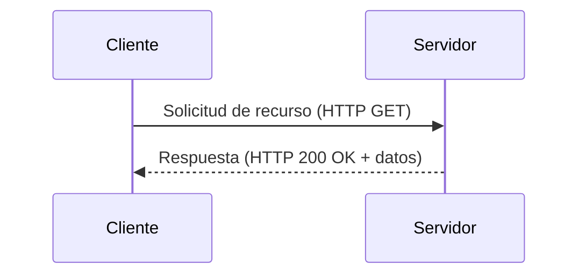
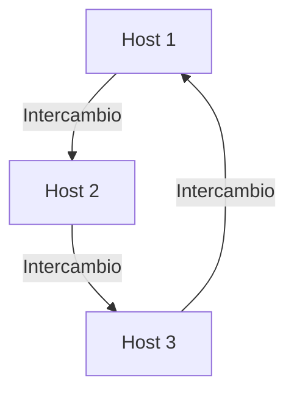
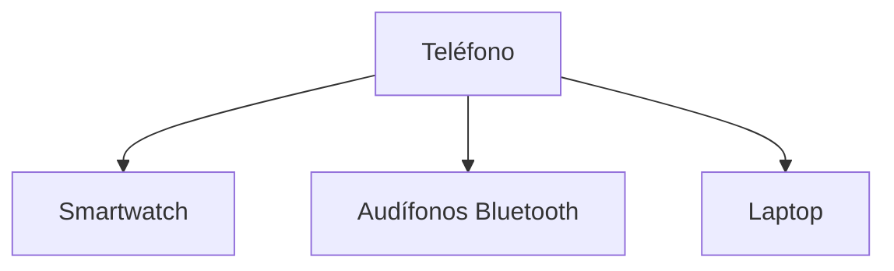
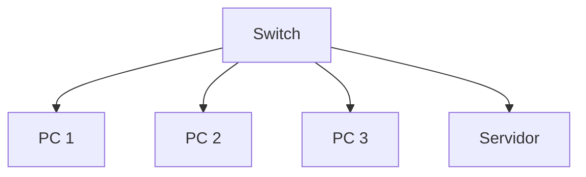

# Redes de Computadoras - Conceptos generales

## 1.2 Clasificación de las redes de computadoras: por estructura, por espacio geográfico.

---

### 1. Introducción

Las **redes de computadoras** permiten la comunicación y el intercambio de información entre dispositivos a través de enlaces físicos o inalámbricos. Su **clasificación** facilita el estudio, diseño y administración de las diferentes topologías y arquitecturas que se emplean en el mundo real.

> Según Kurose y Ross (2010):
> “Una red de computadoras es un conjunto de dispositivos interconectados que comparten recursos mediante un conjunto de protocolos bien definidos.”

### 2. Clasificación General

Las redes pueden clasificarse de varias formas, pero las más comunes son:

1. **Por su estructura (arquitectura lógica o topológica).**
2. **Por su alcance o espacio geográfico.**

Estas categorías no son excluyentes, y una red puede pertenecer a más de una según su configuración y uso.

### 3. Clasificación por Estructura

La **estructura** de una red describe **cómo se organiza la comunicación** entre los dispositivos (nodos) y **cómo se gestionan los recursos compartidos**.
Existen tres grandes modelos: **cliente-servidor**, **punto a punto (P2P)** y **mixta o híbrida**.

### # 3.1 Red Cliente-Servidor

En esta arquitectura, uno o varios **servidores** proporcionan servicios o recursos a múltiples **clientes**.

- **Cliente:** realiza peticiones.
- **Servidor:** responde y gestiona recursos compartidos.

**Ventajas:**

- Centralización del control y la seguridad.
- Mantenimiento más sencillo.
- Escalabilidad vertical (mejora del servidor).

**Desventajas:**

- Dependencia del servidor.
- Mayor costo en hardware y administración.

**Ejemplo de flujo:**



**Ejemplo práctico (Python):**

```python
# Servidor simple en Python
import socket

server = socket.socket(socket.AF_INET, socket.SOCK_STREAM)
server.bind(('localhost', 8080))
server.listen(1)
print("Servidor esperando conexión...")

conn, addr = server.accept()
print("Conectado con:", addr)
conn.send(b"Hola cliente, soy el servidor.")
conn.close()
```

### # 3.2 Red Punto a Punto (Peer-to-Peer o P2P)

En una red **P2P**, todos los nodos tienen **igual jerarquía**: actúan como **clientes y servidores simultáneamente**.

- Ejemplos: BitTorrent, redes de blockchain, Skype.
- Ideal para intercambio de archivos o distribución descentralizada.

**Ventajas:**

- No depende de un servidor central.
- Escalable horizontalmente.
- Mayor tolerancia a fallos.

**Desventajas:**

- Control de seguridad más difícil.
- Gestión de recursos descentralizada.

**Diagrama P2P:**



### # 3.3 Red Híbrida

Combinan características de ambos modelos anteriores.
Ejemplo: Skype y sistemas de videojuegos en línea utilizan **servidores centrales** para autenticación y **P2P** para la comunicación de voz o datos entre usuarios.

**Diagrama de red híbrida:**


### 4. Clasificación por Espacio Geográfico

Esta clasificación describe el **alcance físico o geográfico** de la red, que depende de la **distancia entre los nodos**, **tecnología utilizada**, y **propósito**.

### # 4.1 PAN – Personal Area Network

- **Cobertura:** 1 a 10 metros.
- **Uso:** comunicación entre dispositivos personales.
- **Ejemplo:** conexión Bluetooth entre un teléfono y audífonos.

**Diagrama:**



### # 4.2 LAN – Local Area Network

- **Cobertura:** dentro de un edificio o campus.
- **Velocidad típica:** 100 Mbps – 10 Gbps.
- **Tecnología:** Ethernet, WiFi (IEEE 802.3 / 802.11).
- **Uso:** redes empresariales, hogares, escuelas.

> Fórmula de velocidad efectiva:
>
> $$
> V_{ef} = V_{nominal} \times (1 - \frac{P_{overhead}}{100})
> $$

Ejemplo: si la red Ethernet tiene $V_{nominal} = 1,Gbps$ y un 5% de sobrecarga,
entonces $V_{ef} = 950,Mbps$.

**Ejemplo de topología LAN en estrella:**



### # 4.3 MAN – Metropolitan Area Network

- **Cobertura:** una ciudad o zona metropolitana (~50 km).
- **Ejemplo:** red universitaria intercampus o red de videovigilancia municipal.
- **Tecnologías:** fibra óptica, enlaces de microondas, Metro Ethernet.


### # 4.4 WAN – Wide Area Network

- **Cobertura:** países o continentes.
- **Ejemplo:** Internet, redes corporativas internacionales (VPN).
- **Tecnologías:** MPLS, Frame Relay, enlaces satelitales, fibra óptica submarina.

> La latencia en una WAN puede aproximarse por:
>
> $$
> t = \frac{d}{v}
> $$
>
> donde $d$ es la distancia (m) y $v$ la velocidad de propagación (≈ $2.3 \times 10^8$ m/s en fibra óptica).

### # 4.5 Otras Redes Especializadas

| Tipo | Descripción | Ejemplo |
| | - | |
| **CAN** (Campus Area Network) | Conecta varios edificios cercanos. | Universidad. |
| **SAN** (Storage Area Network) | Red dedicada al almacenamiento de datos. | Centros de datos. |
| **VPN** (Virtual Private Network) | Red privada virtual sobre Internet. | Conexiones remotas seguras. |

### 5. Comparativa entre tipos de redes

| Tipo | Cobertura | Velocidad | Tecnología | Ejemplo |
| - | - | - | | |
| PAN | 1–10 m | 1–100 Mbps | Bluetooth | Smartphone – Audífono |
| LAN | 100–1000 m | 100 Mbps–10 Gbps | Ethernet / WiFi | Oficina |
| MAN | 1–50 km | 10–1000 Mbps | Fibra óptica | Red municipal |
| WAN | >50 km | Variable | MPLS, Satélite | Internet |

### 6. Ejercicios Propuestos

### # Ejercicio 1

Clasifica los siguientes escenarios según su tipo de red:
a) Conexión de audífonos Bluetooth a un teléfono.
b) Red de oficinas de una empresa nacional.
c) Red doméstica de computadoras y TV inteligentes.
d) Red entre dos campus universitarios.

### # Ejercicio 2

Calcula la **velocidad efectiva** de una red LAN de $1$ Gbps si tiene una sobrecarga del 8%.
Aplica:

$$
V_{ef} = V_{nominal} \times (1 - \frac{P_{overhead}}{100})
$$

### # Ejercicio 3

Dibuja (con Mermaid o a mano) un diagrama de una red híbrida donde los usuarios se conecten a un servidor de autenticación y luego intercambien datos entre sí.

### 7. Conclusión

Comprender la **clasificación de las redes** permite diseñar soluciones de comunicación adecuadas al **tamaño**, **uso** y **recursos disponibles**.
Las **redes por estructura** definen el modelo lógico de comunicación, mientras que las **redes por espacio geográfico** determinan su alcance y tecnología.

> “El conocimiento de la topología y el alcance de una red es esencial para garantizar la eficiencia, la seguridad y la escalabilidad.”
> — _William Stallings, Data and Computer Communications (2010)_

### 8. Referencias Bibliográficas

**Bibliografía básica:**

1. James F. Kurose & Keith W. Ross. _Computer Networking: A Top-Down Approach_. Addison-Wesley, 5th Ed., 2010.
2. Andrew S. Tanenbaum & David J. Wetherall. _Computer Networks_. Prentice Hall, 5th Ed., 2010.
3. Larry L. Peterson & Bruce S. Davie. _Computer Networks: A Systems Approach_. Morgan Kaufmann, 5th Ed., 2011.
4. William Stallings. _Data and Computer Communications_. Prentice Hall, 9th Ed., 2010.
5. Fred Halsall. _Data Communications, Computer Networks and Open Systems_. Addison Wesley, 5th Ed., 2005.
6. Douglas E. Comer. _Computer Networks and Internets_. Prentice-Hall, 5th Ed., 2009.

**Bibliografía complementaria:**

1. Uyless D. Black. _IP Routing Protocols: RIP, OSPF, BGP, PNNI and Cisco Routing Protocols_, Prentice Hall, 2000.
2. Gerard J. Holzmann. _Design and Validation of Computer Protocols_, Prentice Hall, 1991.
