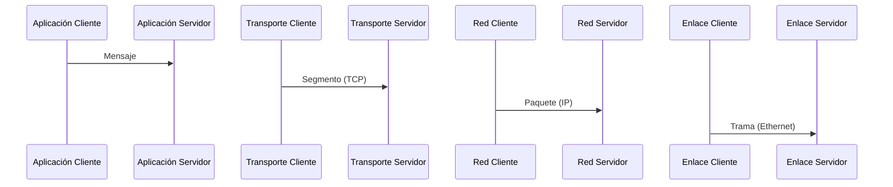
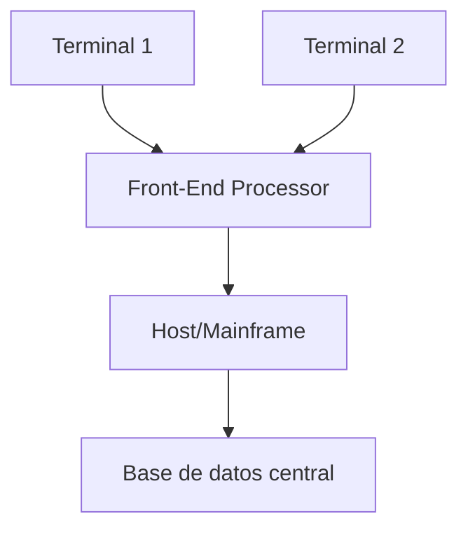
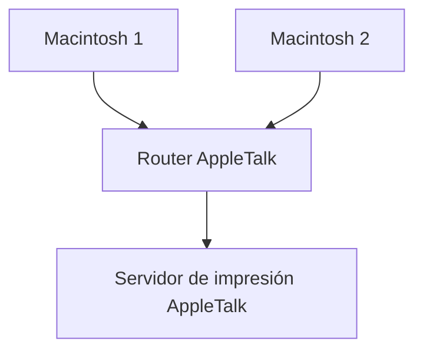
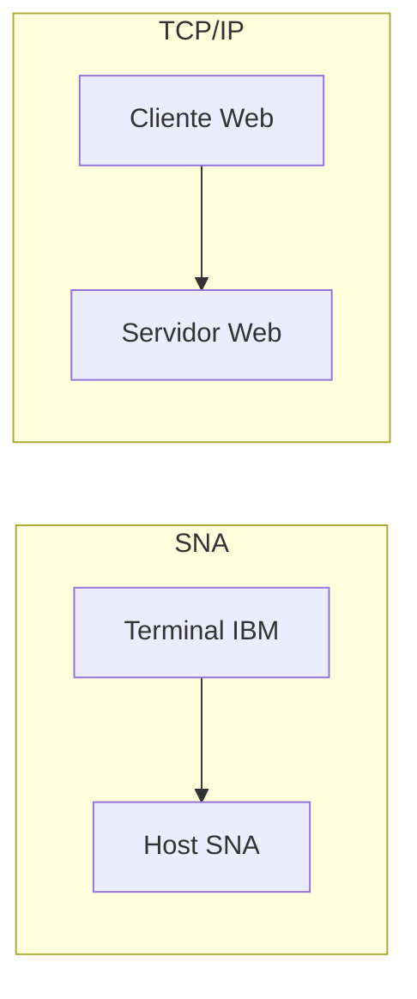

# Redes de Computadoras - Conceptos generales

## 1.3 Arquitectura de redes. Definición, ejemplos de arquitecturas (cerradas).

---

### 1. Introducción

Las **arquitecturas de red** establecen la forma en que los componentes de una red —hardware, software, protocolos y servicios— interactúan para permitir la comunicación de datos entre dispositivos.

> Según Tanenbaum y Wetherall (2010):
> “La arquitectura de red es el marco que define la organización funcional de los sistemas de comunicación, especificando las capas, los protocolos y las interfaces que las unen.”

### 2. Definición de Arquitectura de Red

Una **arquitectura de red** es el **modelo conceptual y estructural** que define la **forma en que se comunican los dispositivos dentro de una red**.
Describe **las capas** (niveles de abstracción) y **los protocolos** (conjuntos de reglas) que se utilizan para la transmisión de datos.

Formalmente, puede considerarse como una función de capas:

$$ A = { C_1, C_2, ..., C_n } $$

donde cada $C_i$ representa una capa que proporciona servicios a la capa superior y utiliza los de la capa inferior.

#### Propósitos de una arquitectura de red

1. Estandarizar la comunicación entre sistemas heterogéneos.
2. Permitir la interoperabilidad entre distintos fabricantes.
3. Simplificar el diseño mediante la **modularización** por capas.
4. Facilitar la detección y corrección de errores.
5. Permitir la evolución tecnológica sin rediseñar toda la red.

### 3. Componentes Clave

| Componente     | Descripción                                                                           |
| -------------- | ------------------------------------------------------------------------------------- |
| **Capas**      | Niveles lógicos que agrupan funciones de comunicación.                                |
| **Protocolos** | Reglas que definen el formato, orden y significado de los mensajes.                   |
| **Interfaces** | Puntos de conexión entre capas adyacentes.                                            |
| **Servicios**  | Funcionalidades que una capa ofrece a otra (por ejemplo: entrega de datos confiable). |

> Ejemplo de comunicación entre capas (según Peterson y Davie, 2011):

### 4. Tipos de Arquitectura

Existen dos categorías principales:

1. **Arquitecturas abiertas**: permiten interoperabilidad entre equipos de diferentes fabricantes (ej. OSI, TCP/IP).
2. **Arquitecturas cerradas**: son propietarias, diseñadas y controladas por una organización o empresa; **no están abiertas al público**.

Esta guía se enfoca en **arquitecturas cerradas**.

### 5. Arquitecturas Cerradas

Una **arquitectura cerrada** es aquella cuyos **protocolos, especificaciones e implementaciones no están disponibles públicamente**.
El control completo pertenece a una entidad (empresa o consorcio), y su uso suele requerir licencia o acuerdos comerciales.

> Ejemplo: “IBM Systems Network Architecture (SNA)” — una arquitectura propietaria ampliamente usada antes del auge del modelo TCP/IP.

#### Características principales

| Característica            | Descripción                                                      |
| ------------------------- | ---------------------------------------------------------------- |
| Propietaria               | Diseñada y mantenida por una sola organización.                  |
| No interoperable          | No compatible con sistemas externos sin pasarelas o adaptadores. |
| Control centralizado      | La empresa define los estándares y actualizaciones.              |
| Documentación restringida | No disponible al público general.                                |

#### 5.1 Ejemplo 1: IBM SNA (Systems Network Architecture)

- **Desarrollada:** por IBM en 1974.
- **Objetivo:** conectar terminales y mainframes en redes empresariales.
- **Organización jerárquica:** comunicación estrictamente controlada por un nodo principal.

**Diagrama simplificado de SNA:**

**Capas del modelo SNA (simplificado):**

| Capa                       | Función                          |
| -------------------------- | -------------------------------- |
| Aplicación                 | Manejo de programas de usuario.  |
| Control de presentación    | Traducción de formatos de datos. |
| Control de sesión          | Sincronización entre nodos.      |
| Transporte                 | Gestión del flujo de datos.      |
| Control de enlace de datos | Control de errores y flujo.      |
| Físico                     | Transmisión por el medio físico. |

> A diferencia del modelo OSI (7 capas), SNA empleaba 6 capas con funciones integradas.

#### 5.2 Ejemplo 2: AppleTalk (Apple Inc.)

- **Desarrollada:** por Apple (1985).
- **Objetivo:** interconectar computadoras Macintosh.
- **Protocolo principal:** DDP (Datagram Delivery Protocol).
- **Características:**

  - Autoconfiguración.
  - Direccionamiento jerárquico (red/nodo/sockets).
  - Compatibilidad limitada fuera del ecosistema Apple.

**Diagrama conceptual:**

#### 5.3 Ejemplo 3: DECnet (Digital Equipment Corporation)

- **Introducida:** en los años 70 por DEC.
- **Uso:** interconectar minicomputadoras VAX y PDP.
- **Protocolos propietarios**, pero con algunas similitudes al OSI.
- Posteriormente evolucionó hasta soportar TCP/IP, volviéndose híbrida.

#### 5.4 Comparativa entre arquitecturas cerradas

| Arquitectura | Empresa | Año | Capas | Interoperabilidad | Estado actual |
| | - | - | | -- | - |
| IBM SNA | IBM | 1974 | 6 | Limitada | Obsoleta, pero influyente |
| AppleTalk | Apple | 1985 | 5 | Limitada | Sustituida por TCP/IP |
| DECnet | DEC | 1975 | 7 (v4) | Parcial | Integrada con IP |

### 6. Fórmulas y Conceptos Relacionados

Aunque la arquitectura es un concepto lógico, se relaciona con medidas de rendimiento y eficiencia:

- **Tasa de transferencia efectiva:**

  $$ T\_{ef} = \frac{D\_\text{útil}}{D\_{total}} \times R $$

  donde $D\_\text{útil}$ es el tamaño del mensaje útil, $D_{total}$ el total transmitido (incluyendo cabeceras), y $R$ la tasa nominal de transmisión.

- **Relación entre capas:**

  $$ S_{i+1} = f(S_i, P_i) $$

  donde $S_i$ es el servicio ofrecido por la capa $i$, y $P_i$ los protocolos usados para implementarlo.

### 7. Ejemplo Práctico (Simulación conceptual)

#### Ejemplo: Comparación entre arquitectura cerrada (SNA) y abierta (TCP/IP)

**Análisis:**

- SNA: comunicación controlada, protocolos no públicos, entornos cerrados.
- TCP/IP: comunicación abierta, estándares públicos, interoperabilidad global.

### 8. Ejercicios Propuestos

#### Ejercicio 1

Explica las diferencias entre una **arquitectura abierta** y una **cerrada**, e indica al menos dos ventajas de cada una.

#### Ejercicio 2

Investiga y describe una arquitectura cerrada moderna (por ejemplo, alguna de Cisco o Huawei).
Identifica si su documentación es pública o propietaria.

#### Ejercicio 3

Dibuja un diagrama que represente una red basada en **IBM SNA**, identificando los roles de terminal, procesador de comunicaciones y host principal.

#### Ejercicio 4

Calcula la **tasa de transferencia efectiva** si:

- El tamaño total transmitido es $1,200$ bytes.
- El tamaño útil del mensaje es $960$ bytes.
- La tasa nominal de transmisión es $R = 100$ Mbps.

Aplica:

$$ T_{ef} = \frac{D\_\text{útil}}{D\_{total}} \times R $$

### 9. Conclusión

Las **arquitecturas cerradas** fueron fundamentales en los inicios de las redes de computadoras, ya que proporcionaban **estabilidad, control y seguridad** dentro de entornos corporativos.
Sin embargo, su falta de interoperabilidad impulsó el desarrollo de **arquitecturas abiertas**, como OSI y TCP/IP, que hoy sustentan el Internet moderno.

> “Las arquitecturas cerradas mostraron la importancia del control estructural, pero su rigidez dio paso a la flexibilidad de los estándares abiertos.”
> — _William Stallings, Data and Computer Communications (2010)_

### 10. Referencias Bibliográficas

**Bibliografía básica:**

1. James F. Kurose & Keith W. Ross. _Computer Networking: A Top-Down Approach_. Addison-Wesley, 5th Ed., 2010.
2. Andrew S. Tanenbaum & David J. Wetherall. _Computer Networks_. Prentice Hall, 5th Ed., 2010.
3. Larry L. Peterson & Bruce S. Davie. _Computer Networks: A Systems Approach_. Morgan Kaufmann, 5th Ed., 2011.
4. William Stallings. _Data and Computer Communications_. Prentice Hall, 9th Ed., 2010.
5. Fred Halsall. _Data Communications, Computer Networks and Open Systems_. Addison Wesley, 5th Ed., 2005.
6. Douglas E. Comer. _Computer Networks and Internets_. Prentice-Hall, 5th Ed., 2009.

**Bibliografía complementaria:**

1. Uyless D. Black. _Computer Networks: Protocols, Standards, and Interfaces_, Prentice Hall, 2nd Ed., 1993.
2. Gerard J. Holzmann. _Design and Validation of Computer Protocols_, Prentice Hall, 1991.
