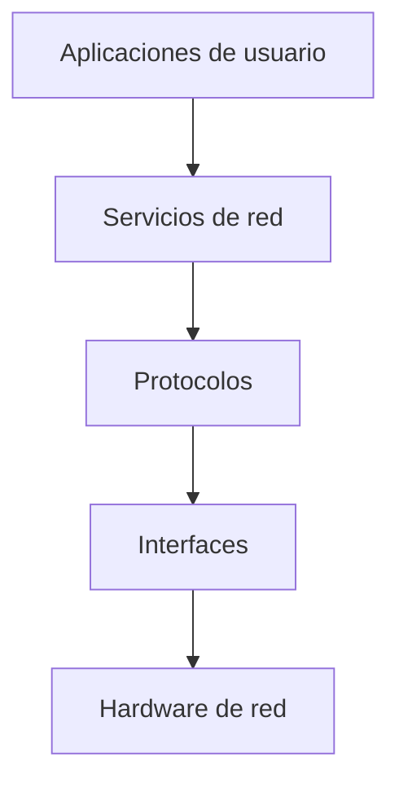
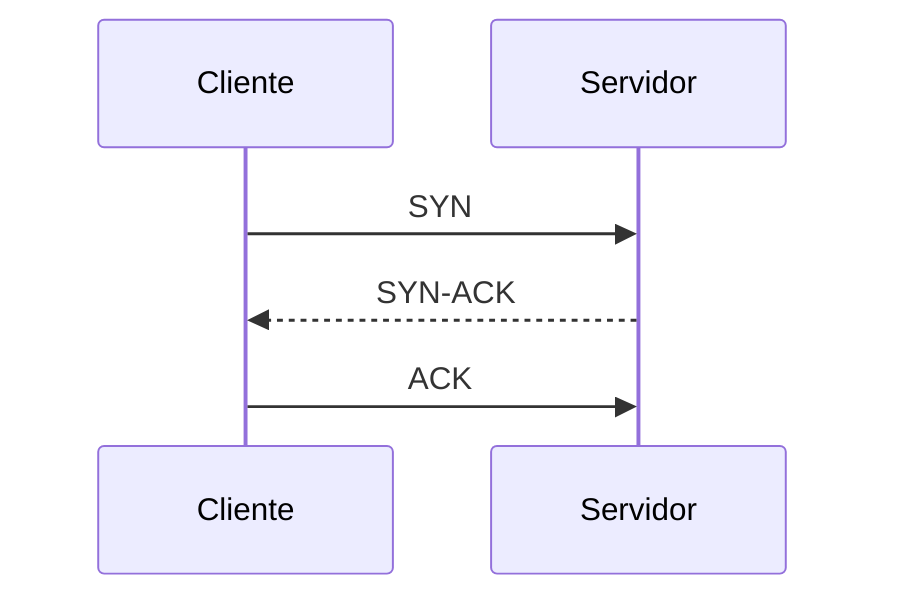
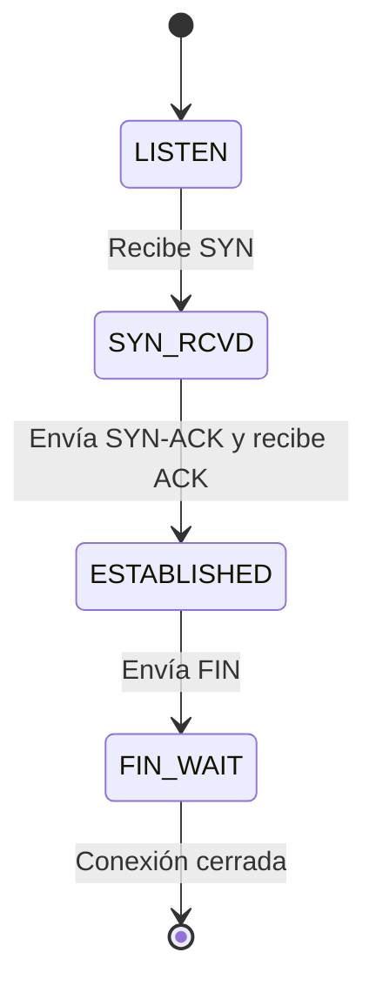
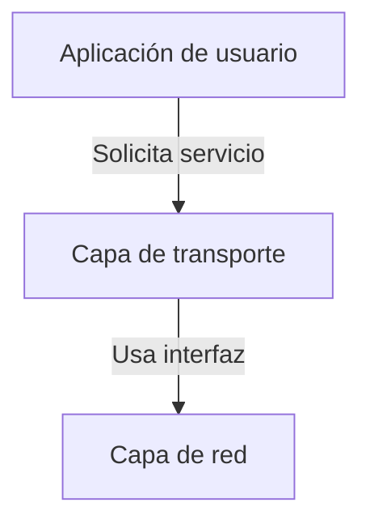

# Redes de Computadoras - Conceptos generales

## 1.4 Software para redes de computadoras. Protocolos. Especificación y verificación. Interfaces y servicios.

---

### 1. Introducción

En una red de computadoras, el **software de red** constituye la **inteligencia funcional** que permite a los dispositivos comunicarse, coordinarse y compartir recursos.
Este software se basa en **protocolos**, **interfaces** y **servicios** estandarizados que garantizan la interoperabilidad entre equipos de distintos fabricantes.

> Según Tanenbaum y Wetherall (2010):
> “El software de red define el comportamiento lógico que determina cómo los datos se empaquetan, transmiten y reciben en un sistema de comunicación.”

### 2. Software para Redes de Computadoras

El **software de red** es el conjunto de programas y módulos que permiten la **comunicación entre sistemas conectados**.
Opera en distintas **capas del modelo de red**, desde la transmisión física hasta la aplicación final.

#### Componentes principales

| Componente                     | Función                                                                          |
| ------------------------------ | -------------------------------------------------------------------------------- |
| **Protocolos de comunicación** | Definen las reglas de intercambio de datos.                                      |
| **Servicios de red**           | Proveen funciones a usuarios o aplicaciones (DNS, HTTP, FTP, etc.).              |
| **Interfaces**                 | Conectan las capas de la arquitectura de red (por ejemplo, API de sockets).      |
| **Software de gestión**        | Controla el funcionamiento de la red (monitorización, configuración, seguridad). |

#### Diagrama de relación general



### 3. Protocolos de Red

Un **protocolo de red** es un **conjunto de reglas y convenciones** que define el formato, orden y significado de los mensajes intercambiados entre dispositivos.

> Según Kurose y Ross (2010):
> “Un protocolo especifica cómo se comunican las entidades de la red, definiendo el formato, orden y acciones ante el envío o recepción de mensajes.”

#### Características de los protocolos

1. **Sintaxis:** estructura o formato del mensaje.
2. **Semántica:** significado de cada campo.
3. **Temporización:** orden y velocidad de transmisión.

#### Ejemplo de intercambio de protocolo TCP (simplificado)



El ejemplo anterior representa el **handshake de tres vías** de TCP, utilizado para establecer una conexión confiable.

#### Clasificación de los protocolos

| Nivel      | Ejemplo de protocolo | Función principal                   |
| ---------- | -------------------- | ----------------------------------- |
| Aplicación | HTTP, FTP, DNS       | Comunicación entre programas        |
| Transporte | TCP, UDP             | Entrega confiable o rápida de datos |
| Red        | IP, ICMP             | Enrutamiento y direccionamiento     |
| Enlace     | Ethernet, WiFi       | Transmisión en el medio físico      |
| Físico     | IEEE 802.3           | Codificación y señalización         |

#### Ejemplo de encabezado TCP

| Campo               | Tamaño  | Descripción                 |
| ------------------- | ------- | --------------------------- |
| Puerto origen       | 16 bits | Identifica proceso emisor   |
| Puerto destino      | 16 bits | Identifica proceso receptor |
| Número de secuencia | 32 bits | Orden de los datos          |
| ACK                 | 32 bits | Reconocimiento del receptor |
| Bandera SYN/ACK/FIN | 6 bits  | Control de conexión         |

#### Concepto de overhead (sobrecarga)

Los protocolos agregan información adicional (cabeceras), reduciendo la eficiencia del canal.
La **eficiencia del protocolo** se calcula como:

$$
\eta = \frac{D\_\text{útil}}{D_{total}}
$$

donde:

- $D\_\text{útil}$ = datos de aplicación,
- $D\_{total}$ = datos transmitidos (útiles + cabeceras).

### 4. Especificación y Verificación de Protocolos

La **especificación** define formalmente el comportamiento esperado de un protocolo.
La **verificación** asegura que el protocolo cumpla esas reglas y funcione sin errores (como bloqueos o pérdida de mensajes).

> Según Holzmann (1991):
> “La verificación de protocolos implica comprobar que el sistema distribuido no presenta errores de diseño, tales como interbloqueos o pérdida de sincronización.”

#### Métodos comunes de especificación

| Método                                        | Descripción                                              |
| --------------------------------------------- | -------------------------------------------------------- |
| **Diagramas de estados finitos (FSM)**        | Representan los estados y transiciones del protocolo.    |
| **Lenguajes formales (como SDL, LOTOS)**      | Permiten especificar y validar el comportamiento lógico. |
| **Modelos matemáticos (temporal logic, CSP)** | Usados para análisis formal de corrección.               |

#### Ejemplo: Esquema FSM del protocolo de handshake TCP



#### Propiedades verificables

1. **Seguridad:** no se llega a estados no deseados.
2. **Vivienda (liveness):** siempre se puede avanzar en la comunicación.
3. **Corrección:** cada mensaje tiene una respuesta esperada.

**Ejemplo formal de propiedad de seguridad:**

$$
\Box \neg (estado =\ error)
$$

**Ejemplo formal de propiedad de liveness:**

$$
\Diamond (mensaje_enviado \Rightarrow mensaje_recibido)
$$

### 5. Interfaces y Servicios

Una **interfaz** define cómo interactúan las capas de la arquitectura de red; un **servicio** es lo que una capa ofrece a la superior.

> Según Peterson y Davie (2011):
> “Una interfaz es el punto de acceso a los servicios de una capa; un servicio describe el conjunto de operaciones disponibles.”

#### 5.1 Interfaces

Las **interfaces** establecen la comunicación entre capas adyacentes.
Un ejemplo moderno es la **API de sockets**, que permite a las aplicaciones comunicarse a través de la red.

**Ejemplo (Python, API de sockets):**

```python
import socket

# Crear socket
s = socket.socket(socket.AF_INET, socket.SOCK_STREAM)
s.connect(("example.com", 80))
s.send(b"GET / HTTP/1.1\r\nHost: example.com\r\n\r\n")
print(s.recv(1024))
s.close()
```

#### 5.2 Servicios

Un **servicio de red** es una funcionalidad provista por una capa o por un conjunto de protocolos.
Se clasifican según su **orientación a la conexión**:

| Tipo                        | Ejemplo | Características                      |
| --------------------------- | ------- | ------------------------------------ |
| **Orientado a conexión**    | TCP     | Establece sesión antes de transmitir |
| **No orientado a conexión** | UDP     | Envío directo sin sesión previa      |

#### Diagrama: relación entre servicios e interfaces



### 6. Relación entre Protocolos, Interfaces y Servicios

| Elemento      | Define                          | Ejemplo                    |
| ------------- | ------------------------------- | -------------------------- |
| **Protocolo** | Cómo se comunican las entidades | TCP, HTTP                  |
| **Interfaz**  | Cómo una capa accede a otra     | Sockets API                |
| **Servicio**  | Qué funcionalidad se ofrece     | Entrega confiable de datos |

> Relación formal entre ellos:
>
> $$
> Servicio = f(Protocolo, Interfaz)
> $$

### 7. Ejercicios Propuestos

#### Ejercicio 1

Explica con tus palabras la diferencia entre un **protocolo**, una **interfaz** y un **servicio**.
Da un ejemplo de cada uno.

#### Ejercicio 2

Diseña un **diagrama de estados** para un protocolo simple de solicitud/respuesta (REQ–RESP).

#### Ejercicio 3

Simula mediante código (Python o pseudocódigo) un cliente que se comunique con un servidor TCP y reciba un mensaje.

#### Ejercicio 4

Calcula la **eficiencia del protocolo** si un paquete contiene 80 bytes de datos útiles y 20 bytes de cabecera.

$$
\eta = \frac{D\_\text{útil}}{D_{total}}
$$

#### Ejercicio 5

Investiga una herramienta moderna de **verificación de protocolos** (como SPIN, Uppaal o NuSMV) y resume su funcionamiento.

### 8. Conclusión

El software de red constituye el corazón funcional de toda comunicación digital.
Los **protocolos** garantizan la interoperabilidad, la **especificación y verificación** aseguran su corrección, y las **interfaces y servicios** hacen posible que las aplicaciones utilicen la red de forma eficiente y estandarizada.

> “Sin protocolos definidos, la red sería un conjunto de cables sin propósito.”
> — _William Stallings, Data and Computer Communications (2010)_

### 9. Referencias Bibliográficas

**Bibliografía básica:**

1. James F. Kurose & Keith W. Ross. _Computer Networking: A Top-Down Approach_, Addison-Wesley, 5th Ed., 2010.
2. Andrew S. Tanenbaum & David J. Wetherall. _Computer Networks_, Prentice Hall, 5th Ed., 2010.
3. Larry L. Peterson & Bruce S. Davie. _Computer Networks: A Systems Approach_, Morgan Kaufmann, 5th Ed., 2011.
4. William Stallings. _Data and Computer Communications_, Prentice Hall, 9th Ed., 2010.
5. Fred Halsall. _Data Communications, Computer Networks and Open Systems_, Addison Wesley, 5th Ed., 2005.
6. Douglas E. Comer. _Computer Networks and Internets_, Prentice-Hall, 5th Ed., 2009.

**Bibliografía complementaria:**

1. Gerard J. Holzmann. _Design and Validation of Computer Protocols_, Prentice-Hall, 1991.
2. Uyless D. Black. _Computer Networks: Protocols, Standards, and Interfaces_, Prentice Hall, 2nd Ed., 1993.
