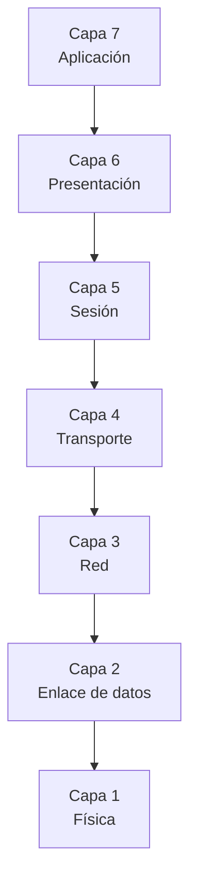
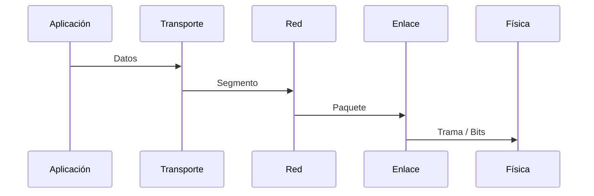
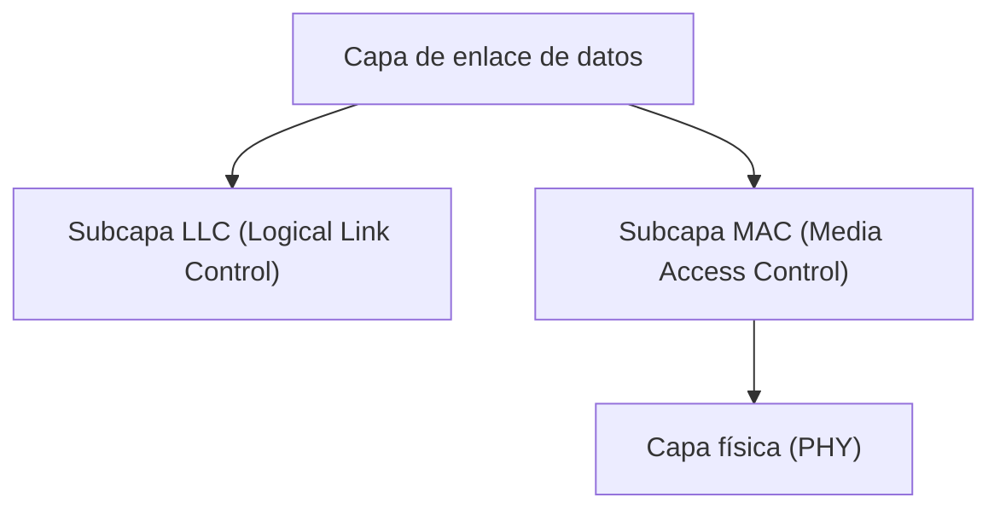
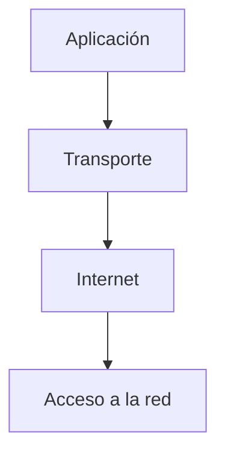
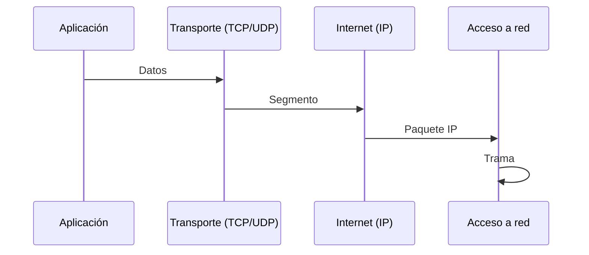

# Redes de Computadoras - Conceptos generales

## 1.5 Modelos de referencia: Modelo OSI de ISO. Estándar 802 de IEEE. Arquitectura de Internet. Protocolos TCP/IP.

---

### 1. Introducción

Los **modelos de referencia** en redes de computadoras son estructuras conceptuales que describen cómo los sistemas de comunicación deben interactuar para lograr una transmisión confiable de datos.
Estos modelos permiten **estandarizar la comunicación**, promoviendo la interoperabilidad entre distintos fabricantes y tecnologías.

> Según Tanenbaum y Wetherall (2010):
> “Un modelo de referencia divide el proceso de comunicación en capas, cada una con funciones definidas, para reducir la complejidad del diseño.”

Los tres pilares conceptuales de la arquitectura de red moderna son:

- El **modelo OSI (ISO 7498)**
- El **estándar IEEE 802**
- La **arquitectura TCP/IP**, base de Internet.

### 2. Modelo OSI de ISO (Open Systems Interconnection)

El modelo **OSI (Open Systems Interconnection)** fue desarrollado por la **ISO (International Organization for Standardization)** en 1984 para estandarizar la comunicación entre sistemas heterogéneos.

#### 2.1. Estructura del modelo OSI

El modelo consta de **siete capas**, cada una con funciones específicas y servicios definidos.



| Nº  | Capa            | Función principal                      | Ejemplo             |
| --- | --------------- | -------------------------------------- | ------------------- |
| 7   | Aplicación      | Interacción con el usuario             | HTTP, FTP, SMTP     |
| 6   | Presentación    | Traducción, cifrado, compresión        | SSL/TLS, JPEG       |
| 5   | Sesión          | Control de diálogo y sincronización    | RPC, NetBIOS        |
| 4   | Transporte      | Entrega confiable de extremo a extremo | TCP, UDP            |
| 3   | Red             | Direccionamiento y enrutamiento        | IP, ICMP            |
| 2   | Enlace de datos | Detección de errores, control de flujo | Ethernet, PPP       |
| 1   | Física          | Transmisión de bits en el medio        | RJ-45, fibra óptica |

#### 2.2. Flujo de datos en el modelo OSI

Durante una comunicación, los datos se **encapsulan** a medida que descienden por las capas del modelo.



> Cada capa añade su propia **cabecera**, proceso conocido como _encapsulamiento_.

#### 2.3. Fórmula de encapsulamiento

Si cada capa añade una cabecera de tamaño $H_i$, y el mensaje original tiene tamaño $M$, el tamaño total transmitido será:

$$
T = M + \sum_{i=1}^{n} H_i
$$

donde $n = 7$ (número de capas OSI).

### 3. Estándar IEEE 802

El **IEEE (Institute of Electrical and Electronics Engineers)** desarrolló la familia de estándares **802**, que define las especificaciones para las **capas física y de enlace de datos** del modelo OSI.

> Según Stallings (2010):
> “El estándar IEEE 802 define cómo los dispositivos en una red local comparten un medio común y acceden al canal de transmisión.”

#### 3.1. Subcapas del estándar 802



| Subcapa | Función                         | Ejemplo de protocolo             |
| ------- | ------------------------------- | -------------------------------- |
| **LLC** | Comunicación lógica entre nodos | IEEE 802.2                       |
| **MAC** | Control de acceso al medio      | Ethernet (802.3), Wi-Fi (802.11) |
| **PHY** | Transmisión eléctrica/óptica    | 802.3, 802.11, 802.15            |

#### 3.2. Ejemplos de estándares IEEE 802

| Estándar   | Tecnología | Descripción                      |
| ---------- | ---------- | -------------------------------- |
| **802.3**  | Ethernet   | Red cableada basada en CSMA/CD   |
| **802.11** | Wi-Fi      | Red inalámbrica                  |
| **802.15** | Bluetooth  | Comunicación de corto alcance    |
| **802.16** | WiMAX      | Acceso inalámbrico metropolitano |
| **802.1Q** | VLAN       | Segmentación lógica de red       |

### 4. Arquitectura de Internet y Modelo TCP/IP

El **modelo TCP/IP** fue desarrollado en los años 70 por DARPA y constituye la **base de Internet moderna**.

> Según Kurose y Ross (2010):
> “La arquitectura TCP/IP se diseñó desde la práctica, con énfasis en la interconexión eficiente de redes heterogéneas.”

#### 4.1. Capas del modelo TCP/IP

El modelo TCP/IP consta de **cuatro capas** principales:



| Capa            | Equivalente OSI | Ejemplo de protocolo | Función                         |
| --------------- | --------------- | -------------------- | ------------------------------- |
| Aplicación      | 7, 6, 5         | HTTP, FTP, DNS, SMTP | Comunicación con el usuario     |
| Transporte      | 4               | TCP, UDP             | Comunicación extremo a extremo  |
| Internet        | 3               | IP, ICMP, ARP        | Enrutamiento y direccionamiento |
| Acceso a la red | 2, 1            | Ethernet, Wi-Fi      | Transmisión física de datos     |

#### 4.2. Encapsulamiento TCP/IP



#### 4.3. Diferencias entre OSI y TCP/IP

| Aspecto     | Modelo OSI                  | Modelo TCP/IP          |
| ----------- | --------------------------- | ---------------------- |
| Nº de capas | 7                           | 4                      |
| Enfoque     | Teórico, normativo          | Práctico, implementado |
| Desarrollo  | ISO (1984)                  | DARPA (1970s)          |
| Estándar    | Internacional               | De facto (Internet)    |
| Dependencia | Independiente del protocolo | Basado en IP           |

#### 4.4. Principales protocolos TCP/IP

| Protocolo                                    | Capa       | Función                         |
| -------------------------------------------- | ---------- | ------------------------------- |
| **IP (Internet Protocol)**                   | Internet   | Direccionamiento y enrutamiento |
| **TCP (Transmission Control Protocol)**      | Transporte | Conexión confiable              |
| **UDP (User Datagram Protocol)**             | Transporte | Comunicación sin conexión       |
| **ICMP (Internet Control Message Protocol)** | Internet   | Diagnóstico de red (ping)       |
| **DNS (Domain Name System)**                 | Aplicación | Resolución de nombres           |
| **HTTP/HTTPS**                               | Aplicación | Comunicación web                |

#### 4.5. Ejemplo de conexión TCP en Python

```python
import socket

s = socket.socket(socket.AF_INET, socket.SOCK_STREAM)
s.connect(("example.com", 80))
s.send(b"GET / HTTP/1.1\r\nHost: example.com\r\n\r\n")
print(s.recv(1024))
s.close()
```

### 5. Fórmulas y conceptos útiles

#### 5.1. Relación entre capas (función de servicio)

Si una capa $i$ proporciona un servicio $S_i$ a la capa superior $i+1$, entonces:

$$
S_{i+1} = f(S_i, P_i)
$$

donde $P_i$ es el protocolo de la capa $i$.

#### 5.2. Tasa de transferencia efectiva

La eficiencia de transmisión de una red se puede expresar como:

$$
\eta = \frac{T_{datos}}{T_{total}} = \frac{L_{datos}}{L_{datos} + L_{cabecera}}
$$

donde $L_{datos}$ es la longitud útil y $L_{cabecera}$ la sobrecarga del protocolo.

### 6. Ejercicios Propuestos

#### Ejercicio 1

Explica la diferencia entre el **modelo OSI** y el **modelo TCP/IP** en cuanto a capas, diseño y enfoque práctico.

#### Ejercicio 2

Dibuja un **diagrama de encapsulamiento TCP/IP** para una comunicación HTTP desde una aplicación cliente.

#### Ejercicio 3

Enumera las **subcapas del estándar IEEE 802** y explica su función.

#### Ejercicio 4

Simula en pseudocódigo la transmisión de datos usando el modelo de capas OSI.

#### Ejercicio 5

Calcula la **eficiencia del protocolo** si una trama Ethernet contiene 1500 bytes de datos útiles y 38 bytes de cabecera:

$$
\eta = \frac{1500}{1500 + 38}
$$

### 7. Conclusión

Los modelos de referencia son esenciales para comprender la **complejidad de las redes modernas**.
El **modelo OSI** aporta un marco conceptual, el **IEEE 802** define las redes locales, y la **arquitectura TCP/IP** constituye la implementación práctica que hace posible Internet.

> “El verdadero poder de las redes radica en la estandarización: la capacidad de diferentes sistemas de hablar un mismo idioma.”
> — _Larry L. Peterson, Computer Networks: A Systems Approach (2011)_

### 8. Referencias Bibliográficas

**Bibliografía básica:**

1. James F. Kurose & Keith W. Ross. _Computer Networking: A Top-Down Approach_, Addison-Wesley, 5th Ed., 2010.
2. Andrew S. Tanenbaum & David J. Wetherall. _Computer Networks_, Prentice Hall, 5th Ed., 2010.
3. Larry L. Peterson & Bruce S. Davie. _Computer Networks: A Systems Approach_, Morgan Kaufmann, 5th Ed., 2011.
4. William Stallings. _Data and Computer Communications_, Prentice Hall, 9th Ed., 2010.
5. Fred Halsall. _Data Communications, Computer Networks and Open Systems_, Addison Wesley, 5th Ed., 2005.
6. Douglas E. Comer. _Computer Networks and Internets_, Prentice-Hall, 5th Ed., 2009.

**Bibliografía complementaria:**

1. Uyless D. Black. _Computer Networks: Protocols, Standards, and Interfaces_, Prentice Hall, 2nd Ed., 1993.
2. Gerard J. Holzmann. _Design and Validation of Computer Protocols_, Prentice-Hall, 1991.
