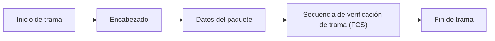
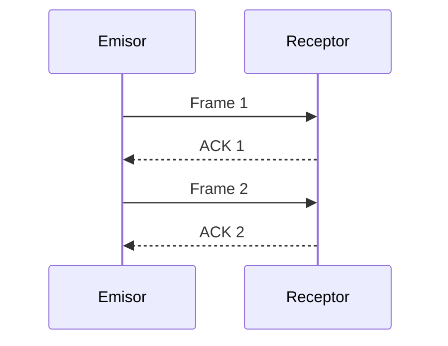
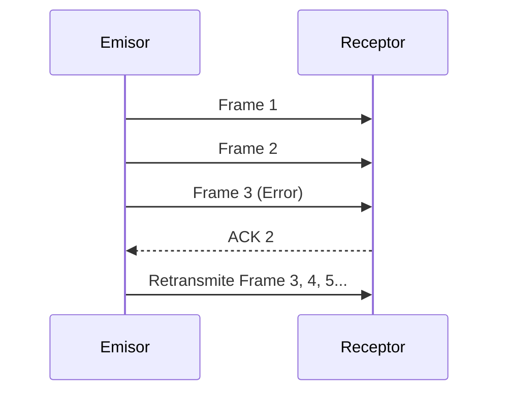

# Redes de Computadoras - Nivel de enlace de datos

## 2.1 Creación de paquetes. Detección de errores. Control de flujo. Ejemplos de protocolos a nivel de enlace.

---

### 1. Introducción al Nivel de Enlace de Datos

El **nivel de enlace de datos** (Data Link Layer) se encuentra entre el nivel físico y el nivel de red en el modelo OSI. Su función principal es **garantizar la transmisión confiable de datos a través de un enlace físico** mediante la **organización, detección y corrección de errores**, y la **regulación del flujo de información**.

#### Funciones principales:

- **Enmarcado (Framing):** división de la secuencia de bits en unidades llamadas _tramas (frames)_.
- **Detección y corrección de errores:** identificación de errores en la transmisión.
- **Control de flujo:** regulación de la velocidad entre emisor y receptor.
- **Control de acceso al medio (MAC):** coordinación del uso compartido del canal de transmisión.

### 2. Creación de Paquetes (Enmarcado)

El **enmarcado (framing)** consiste en tomar los datos del nivel de red (paquetes) y encapsularlos dentro de una **trama** agregando encabezados y colas que contienen información de control.

#### Estructura general de una trama



#### Campos típicos de una trama

- **Dirección de origen y destino:** identificación de los nodos.
- **Campo de control:** tipo de trama, número de secuencia, acuses, etc.
- **Datos:** carga útil proveniente del nivel de red.
- **CRC (Cyclic Redundancy Check):** verificación de errores.

#### Métodos de delimitación de tramas

1. **Conteo de caracteres:** el primer campo indica el número de bytes.
2. **Bytes o bits de bandera:** se usan secuencias especiales (p. ej., `01111110` en HDLC).
3. **Inserción de bytes/bits (byte stuffing/bit stuffing):** evita confusión con banderas.
4. **Violaciones de codificación física:** cambios en la señal para marcar límites.

### 3. Detección de Errores

Los errores en la transmisión pueden deberse a ruido, interferencias o degradación de señal.
El nivel de enlace **detecta (y a veces corrige)** estos errores.

#### Tipos de errores:

- **Error de bit único:** un bit cambia de 0 a 1 o viceversa.
- **Errores en ráfaga:** varios bits consecutivos se alteran.

#### Métodos de detección

##### a) Paridad simple

Se agrega un bit de paridad $p$ tal que:

$$
p = \sum_{i=1}^{n} b_i \mod 2
$$

Si el número de bits 1 es impar, se agrega un bit para hacerlo par (o viceversa).

##### b) Paridad bidimensional

Se aplican bits de paridad por filas y columnas, permitiendo detectar y, a veces, corregir un bit erróneo.

##### c) Suma de verificación (Checksum)

Usado en IP, TCP y UDP:

1. Se agrupan los datos en palabras de 16 bits.
2. Se suman y se toma el complemento a uno.

##### d) Código de Redundancia Cíclica (CRC)

Uno de los métodos más robustos.
Se representa la trama como un polinomio $T(x)$, y se divide entre un polinomio generador $G(x)$:

$$
R(x) = T(x) \mod G(x)
$$

El **resto $R(x)$** se anexa al final de la trama.
El receptor verifica que:

$$
(T(x) \cdot x^r + R(x)) \mod G(x) = 0
$$

donde $r$ es el grado de $G(x)$.

### 4. Control de Flujo

El **control de flujo** evita que el emisor envíe más datos de los que el receptor puede manejar.

#### Métodos principales

##### a) Stop-and-Wait

El emisor envía una trama y espera un **ACK** antes de enviar la siguiente.



Ventajas: simple.
Desventajas: bajo rendimiento para enlaces de alta latencia.

##### b) Ventana deslizante (Sliding Window)

Permite que el emisor envíe múltiples tramas sin esperar un ACK por cada una.
Cada trama tiene un **número de secuencia**.

Si el tamaño de la ventana es $W$, el emisor puede enviar $W$ tramas antes de detenerse.

Formulación:

$$
\text{Eficiencia} = \frac{1}{1 + 2a}
$$

donde $a = \frac{T_{prop}}{T_{trans}}$.

Ejemplo: Protocolos **Go-Back-N** y **Selective Repeat**.

### 5. Ejemplos de Protocolos de Enlace

#### a) HDLC (High-Level Data Link Control)

- Estándar ISO.
- Orientado a bit.
- Usa control de flujo y detección de errores con CRC.
- Tipos de tramas: **I (Información), S (Supervisión), U (No numeradas)**.

#### b) PPP (Point-to-Point Protocol)

- Usado para conexiones directas (modem, túneles).
- Encapsula datagramas IP.
- Campos: Flag | Address | Control | Protocol | Payload | FCS | Flag.

#### c) Ethernet (IEEE 802.3)

- Subnivel MAC del estándar 802.
- Tramas con direcciones MAC, tipo/longitud, datos y CRC.
- Usa **CSMA/CD (Carrier Sense Multiple Access with Collision Detection)**.

#### d) LAPB / LAPD

- Usados en X.25 e ISDN respectivamente.
- Basados en HDLC.

### 6. Ejemplo práctico (Python): Cálculo de CRC

```python
def crc(data, generator):
    data = list(map(int, data))
    gen = list(map(int, generator))
    for i in range(len(data) - len(gen) + 1):
        if data[i] == 1:
            for j in range(len(gen)):
                data[i + j] ^= gen[j]
    return ''.join(map(str, data[-(len(gen)-1):]))

# Ejemplo:
data = "1101011011"
generator = "10011"
print("CRC:", crc(data + "0000", generator))
```

Salida esperada: `CRC: 1110`

### 7. Ejercicios Propuestos

1. Diseña una trama de datos con los campos mínimos requeridos por HDLC.
2. Calcula el CRC de los datos `1011001` usando el polinomio generador `1101`.
3. Implementa en pseudocódigo el control de flujo tipo Stop-and-Wait.
4. Explica cómo se comporta el protocolo Go-Back-N ante la pérdida de un ACK.
5. Investiga las diferencias entre el control de flujo y el control de congestión en TCP.

### 8. Diagramas de apoyo

#### a) Comunicación mediante Go-Back-N



### 9. Resumen

| Función              | Descripción                     | Ejemplo                  |
| -------------------- | ------------------------------- | ------------------------ |
| Enmarcado            | Divide datos en tramas          | HDLC, Ethernet           |
| Detección de errores | CRC, paridad, checksum          | PPP, Ethernet            |
| Control de flujo     | Regula envío entre nodos        | Stop-and-Wait, Go-Back-N |
| Protocolos           | Implementan funciones de enlace | HDLC, PPP, Ethernet      |

### 10. Referencias Bibliográficas

**Bibliografía básica:**

1. Kurose, J. F. & Ross, K. W. (2010). _Computer Networking: A Top-Down Approach_, 5th ed. Addison-Wesley.
2. Tanenbaum, A. S., & Wetherall, D. (2010). _Computer Networks_, 5th ed. Prentice Hall.
3. Peterson, L. L., & Davie, B. S. (2011). _Computer Networks: A Systems Approach_, 5th ed. Morgan Kaufmann.
4. Stallings, W. (2010). _Data and Computer Communications_, 9th ed. Prentice Hall.
5. Halsall, F. (2005). _Data Communications, Computer Networks and Open Systems_, 5th ed. Addison Wesley.

**Bibliografía complementaria:**

1. Black, U. D. (2000). _IP Routing Protocols: RIP, OSPF, BGP, PNNI and Cisco Routing Protocols_, Prentice-Hall.
2. Holzmann, G. J. (1991). _Design and Validation of Computer Protocols_, Prentice-Hall.
3. Black, U. D. (1993). _Computer Networks: Protocols, Standards, and Interfaces_, 2nd ed. Prentice Hall.
