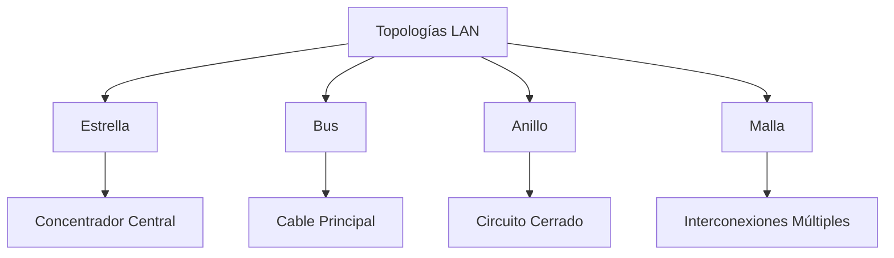
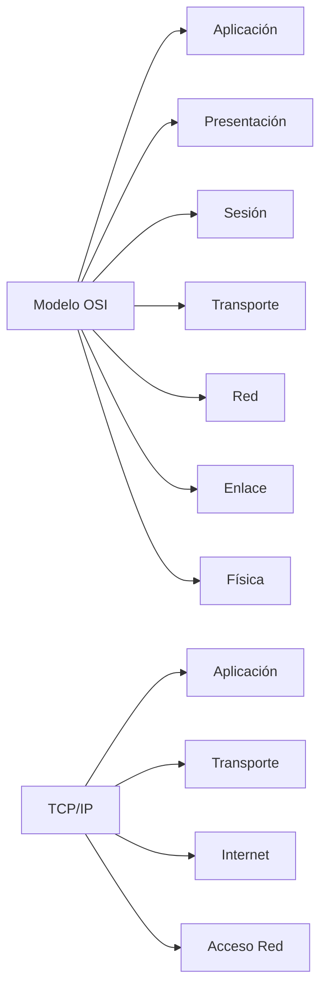
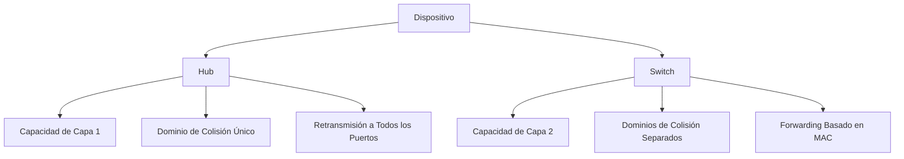
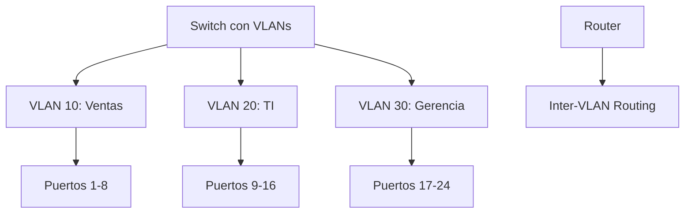

# Redes de Computadoras - Redes locales

## 3.1 Características generales.

---

### Introducción a las Redes Locales

Las redes de área local (LAN) son infraestructuras de comunicaciones diseñadas para conectar dispositivos dentro de un área geográfica limitada, como un edificio, campus o conjunto de edificios cercanos.

#### Definición Formal

Según Tanenbaum (2010), una red local se define como:

> "Un sistema de comunicaciones que permite a dispositivos independientes comunicarse entre sí dentro de un área restringida, utilizando un medio de transmisión físico compartido y una topología común."

### Características Fundamentales de las LAN

#### 1. Alcance Geográfico Limitado

Las LAN típicamente cubren áreas de hasta:

- Edificio individual: 100-200 metros
- Campus pequeño: 1-2 kilómetros
- Sin necesidad de enlaces de larga distancia

#### 2. Velocidad de Transmisión

Las velocidades en las LAN modernas varían según la tecnología:

| Tecnología | Velocidad Típica   | Estándar    |
| ---------- | ------------------ | ----------- |
| Ethernet   | 10 Mbps - 100 Gbps | IEEE 802.3  |
| Wi-Fi      | 11 Mbps - 9.6 Gbps | IEEE 802.11 |
| Token Ring | 4-16 Mbps          | IEEE 802.5  |

#### 3. Topologías Comunes



#### 4. Medios de Transmisión

##### Cableado Estructurado

- **Par Trenzado**: Categorías 5e, 6, 6A, 7
- **Fibra Óptica**: Multimodo y Monomodo
- **Coaxial**: Menos común en instalaciones modernas

##### Características del Medio

- **Ancho de Banda**: $B = \frac{1}{T}$ donde $T$ es el tiempo de bit
- **Atenuación**: $P_{out} = P_{in} \times 10^{-\alpha L/10}$
- **Relación Señal-Ruido**: $SNR = 10 \log_{10}\left(\frac{P_{signal}}{P_{noise}}\right)$ dB

### Arquitectura de Redes LAN

#### Modelo OSI vs TCP/IP en LAN



#### Protocolos Específicos de LAN

##### Ethernet (IEEE 802.3)

```python
# Simulación básica de detección de colisiones CSMA/CD
import random
import time

class EthernetNode:
    def __init__(self, node_id):
        self.id = node_id
        self.backoff_count = 0

    def transmit(self, medium_busy):
        if medium_busy:
            self.wait_random_backoff()
            return False
        else:
            # Transmisión exitosa
            return True

    def wait_random_backoff(self):
        # Algoritmo de retroceso exponencial
        max_backoff = min(2 ** self.backoff_count, 1024)
        self.backoff_count += 1
        wait_time = random.randint(0, max_backoff - 1)
        time.sleep(wait_time * 0.0001)  # Simular tiempo de espera
```

### Componentes Hardware de LAN

#### Dispositivos de Conectividad

##### Switch vs Hub



#### Direccionamiento en LAN

##### Direcciones MAC

- Formato: 48 bits (6 bytes)
- Ejemplo: `00:1A:2B:3C:4D:5E`
- Única a nivel mundial
- Estructura: OUI (24 bits) + Número de serie (24 bits)

### Ejemplos Prácticos

#### Ejemplo 1: Cálculo de Throughput

Supongamos una LAN Ethernet de 100 Mbps con 20 estaciones. Si cada estación transmite el 5% del tiempo:

$$ Throughput_{total} = N \times R \times p \times (1-p)^{N-1} $$

Donde:

- $N = 20$ estaciones
- $R = 100$ Mbps
- $p = 0.05$ probabilidad de transmisión

#### Ejemplo 2: Diseño de Subred

**Problema**: Diseñar una subred para 50 hosts con máscara óptima.

**Solución**:

- Se necesitan 6 bits para hosts ( $2^6 - 2 = 62$ hosts )
- Máscara: `255.255.255.192` o `/26`
- Rango de direcciones: Ej. `192.168.1.0` - `192.168.1.63`

### Ejercicios Propuestos

#### Ejercicio 1: Análisis de Rendimiento

Una LAN Ethernet opera a 1 Gbps con 30 estaciones. Cada estación genera tráfico a una tasa promedio de 10 Mbps. Calcule:

1. La utilización promedio del medio
2. La probabilidad de colisión
3. El throughput efectivo por estación

**Fórmulas útiles**:

- Utilización: $U = \frac{\lambda}{\mu}$ donde $\lambda$ es tasa de llegada, $\mu$ es tasa de servicio
- Probabilidad de colisión en CSMA/CD: $P_{col} = 1 - (1-p)^N$

#### Ejercicio 2: Diseño de Cableado

Diseñe el cableado estructurado para un edificio de 4 pisos con:

- 40 oficinas por piso
- 2 puntos de red por oficina
- Distancia máxima al rack: 80 metros

Determine:

1. Categoría de cable recomendada
2. Número de switches necesarios (24 puertos)
3. Esquema de direccionamiento IP

#### Ejercicio 3: Configuración VLAN

Configure VLANs para segregar tráfico en una empresa con:

- Departamento de Ventas: 15 usuarios
- Departamento de TI: 8 usuarios
- Gerencia: 5 usuarios

Proponga:

1. Esquema de VLANs
2. Direccionamiento por VLAN
3. Reglas de routing entre VLANs

### Tecnologías LAN Avanzadas

#### VLAN (Virtual LAN)



#### Spanning Tree Protocol (STP)

**Objetivo**: Prevenir bucles en topologías redundantes

**Algoritmo**:

1. Elección de Root Bridge
2. Determinación de Root Ports
3. Determinación de Designated Ports
4. Bloqueo de puertos redundantes

### Consideraciones de Seguridad en LAN

#### Amenazas Comunes

- **MAC Flooding**: Saturación de tabla MAC
- **ARP Spoofing**: Suplantación de identidad
- **VLAN Hopping**: Salto entre VLANs no autorizado

#### Medidas de Protección

- Port Security en switches
- DHCP Snooping
- Dynamic ARP Inspection

### Referencias Bibliográficas

#### Bibliografía Básica

1. Kurose, J. F., & Ross, K. W. (2010). _Computer Networking: A Top-Down Approach_. Capítulo 5.
2. Tanenbaum, A. S., & Wetherall, D. J. (2010). _Computer Networks_. Capítulo 4.
3. Stallings, W. (2010). _Data and Computer Communications_. Capítulos 15-16.

#### Bibliografía Complementaria

1. Black, U. (2000). _IP Routing Protocols_. Para profundizar en routing entre VLANs.
2. Comer, D. E. (2009). _Computer Networks and Internets_. Capítulo 10.

### Glosario de Términos

- **CSMA/CD**: Carrier Sense Multiple Access with Collision Detection
- **MTU**: Maximum Transmission Unit
- **MAC**: Media Access Control
- **VLAN**: Virtual Local Area Network
- **STP**: Spanning Tree Protocol
