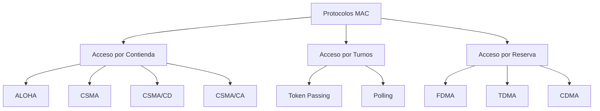
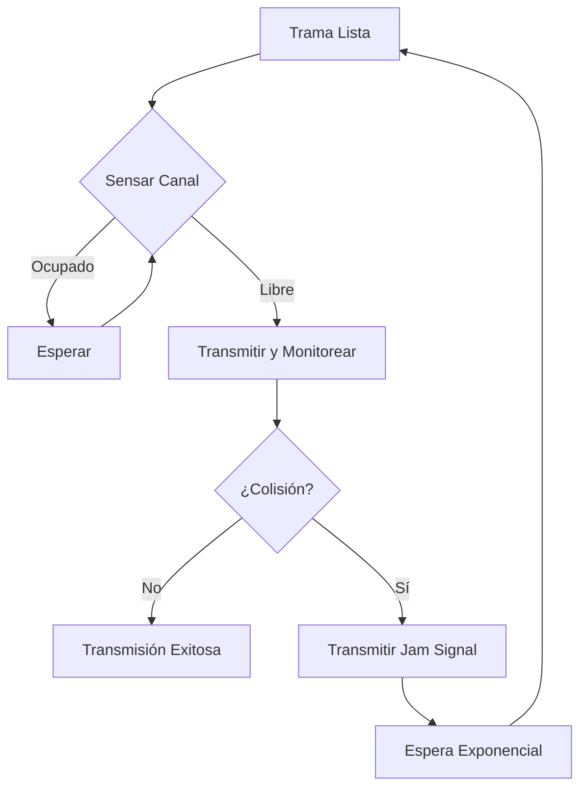
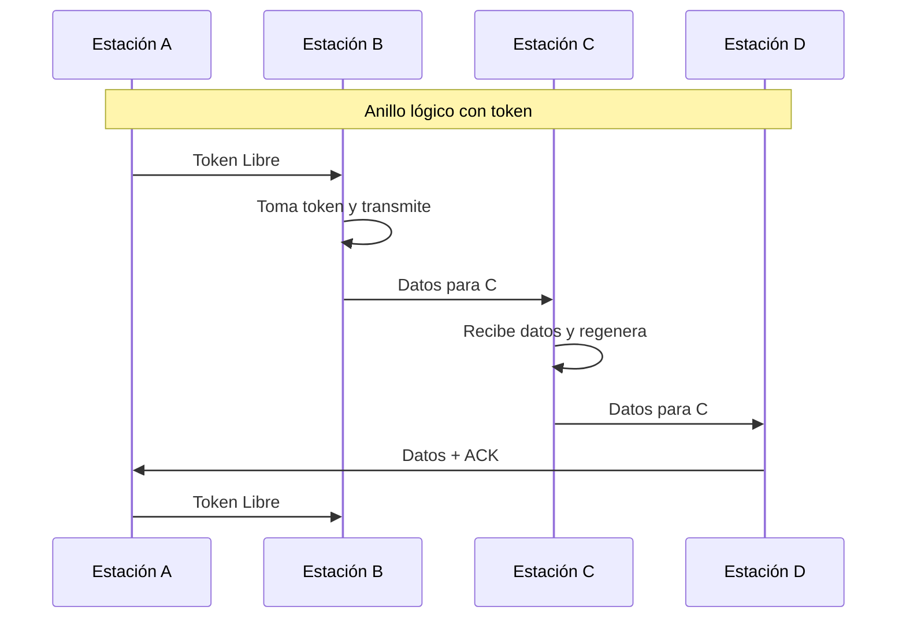

# Redes de Computadoras - Redes locales

## 3.2 Protocolos de acceso a un medio de comunicación compartido.

---

Los protocolos de acceso al medio (MAC - Medium Access Control) son mecanismos que permiten a múltiples dispositivos compartir un canal de comunicación de manera ordenada y eficiente. Según Tanenbaum (2010), "estos protocolos determinan quién puede usar el canal cuando hay competencia por su uso".

### Clasificación de Protocolos MAC



### Protocolos por Contienda

#### ALOHA Puro

**Concepto**: Transmisión inmediata cuando hay datos, sin verificar el canal.

**Eficiencia**:

$$
S = G \times e^{-2G}
$$

Donde:

- $S$: Throughput normalizado
- $G$: Oferta de tráfico normalizada

**Ejemplo**:

```python
import math
import matplotlib.pyplot as plt
import numpy as np

# Cálculo de eficiencia del ALOHA puro
G = np.linspace(0, 2, 100)
S = G * np.exp(-2 * G)

max_eficiencia = 1 / (2 * math.e)
print(f"Eficiencia máxima del ALOHA puro: {max_eficiencia:.4f} (18.4%)")
```

#### ALOHA Ranurado

**Mejora**: Transmisiones solo al inicio de intervalos de tiempo discretos.

**Eficiencia**:

$$
S = G \times e^{-G}
$$

**Máxima eficiencia**: $S_{max} = \frac{1}{e} \approx 0.368$ (36.8%)

### Protocolos CSMA (Carrier Sense Multiple Access)

#### CSMA 1-Persistente

```python
class CSMA_1Persistent:
    def __init__(self, node_id):
        self.node_id = node_id
        self.collision_count = 0

    def transmit(self, channel_busy, data):
        while True:
            if not channel_busy:
                # Transmitir inmediatamente
                return self.send_data(data)
            else:
                # Esperar continuamente hasta que el canal esté libre
                self.wait_for_channel_free()

    def handle_collision(self):
        self.collision_count += 1
        backoff_time = self.exponential_backoff()
        self.wait(backoff_time)

    def exponential_backoff(self):
        return random.randint(0, 2 ** min(self.collision_count, 10) - 1)
```

#### CSMA no Persistente

**Comportamiento**: Si el canal está ocupado, espera un tiempo aleatorio antes de volver a sensar.

#### CSMA p-Persistente

**Comportamiento**: Si el canal está libre, transmite con probabilidad $p$, o espera con probabilidad $1-p$.

### CSMA/CD (Collision Detection)

#### Principio de Operación

Según Stallings (2010), CSMA/CD sigue este algoritmo:



#### Cálculo del Tiempo de Slot

Para Ethernet (IEEE 802.3):

$$
T_{slot} = 2 \times \tau + T_{jam}
$$

Donde:

- $\tau$: Retardo de propagación máximo
- $T_{jam}$: Tiempo de señal de jam (32-48 bits)

**Ejemplo cálculo**:

```python
def calcular_tiempo_slot(longitud_red, velocidad_propagacion, velocidad_transmision):
    """
    Calcula el tiempo de slot para CSMA/CD

    Args:
        longitud_red: longitud máxima en metros
        velocidad_propagacion: velocidad de propagación (m/s)
        velocidad_transmision: velocidad de transmisión (bps)
    """
    tau = longitud_red / velocidad_propagacion  # Retardo de propagación
    tiempo_jam = 48 / velocidad_transmision     # 48 bits de jam signal

    tiempo_slot = 2 * tau + tiempo_jam
    return tiempo_slot

# Ejemplo para Ethernet 10BASE-T
tiempo = calcular_tiempo_slot(
    longitud_red=2500,  # 2.5 km
    velocidad_propagacion=2e8,  # 2/3 velocidad luz
    velocidad_transmision=10e6  # 10 Mbps
)
print(f"Tiempo de slot: {tiempo*1e6:.2f} μs")
```

### CSMA/CA (Collision Avoidance)

#### Mecanismos en Wi-Fi (IEEE 802.11)

```python
class CSMA_CA:
    def __init__(self, node_id):
        self.node_id = node_id
        self.CW = 15  # Ventana de contienda inicial
        self.NAV = 0  # Network Allocation Vector

    def transmit_frame(self, data):
        # 1. Esperar DIFS
        self.wait_DIFS()

        # 2. Backoff aleatorio
        backoff_slots = random.randint(0, self.CW)
        self.wait_slots(backoff_slots)

        # 3. Transmitir RTS (opcional)
        if self.use_rts_cts:
            self.send_RTS()
            if not self.receive_CTS():
                self.handle_collision()
                return False

        # 4. Transmitir datos
        self.send_data(data)

        # 5. Esperar ACK
        if self.receive_ACK():
            self.CW = 15  # Reset ventana
            return True
        else:
            self.handle_collision()
            return False

    def handle_collision(self):
        self.CW = min(2 * self.CW, 1023)  # Duplicar ventana
```

### Protocolos por Turnos

#### Token Passing



#### Polling

**Maestro-Esclavo**: Estación central pregunta secuencialmente a cada estación si tiene datos para transmitir.

### Protocolos por Reserva

#### TDMA (Time Division Multiple Access)

**Estructura de trama**:

$$
T_{trama} = N \times T_{slot} + T_{overhead}
$$

**Ejemplo cálculo capacidad**:

```python
def calcular_capacidad_tdma(ancho_banda, num_estaciones, eficiencia):
    """
    Calcula la capacidad por estación en TDMA

    Args:
        ancho_banda: ancho de banda total (Hz)
        num_estaciones: número de estaciones
        eficiencia: eficiencia de modulación (bps/Hz)
    """
    capacidad_total = ancho_banda * eficiencia
    capacidad_estacion = capacidad_total / num_estaciones
    return capacidad_estacion

# Ejemplo para sistema con 8 estaciones
capacidad = calcular_capacidad_tdma(
    ancho_banda=1e6,  # 1 MHz
    num_estaciones=8,
    eficiencia=2  # 2 bps/Hz
)
print(f"Capacidad por estación: {capacidad/1e3:.2f} kbps")
```

### Ejercicios Propuestos

#### Ejercicio 1: Análisis de Eficiencia

Una red ALOHA ranurado tiene 100 estaciones, cada una transmitiendo a una tasa promedio de 1 trama/segundo. El tiempo de slot es de 10 ms. Calcule:

1. La oferta de tráfico normalizada $G$
2. El throughput normalizado $S$
3. La probabilidad de transmisión exitosa para una trama específica

**Fórmulas**:

- $G = N \times \lambda \times T_{slot}$
- $S = G \times e^{-G}$
- $P\_\text{éxito} = e^{-G}$

#### Ejercicio 2: Diseño de Red CSMA/CD

Diseñe una red Ethernet 100BASE-T que cumpla con la restricción de CSMA/CD:

- Velocidad: 100 Mbps
- Tamaño mínimo de trama: 512 bits
- Velocidad de propagación: $2 \times 10^8$ m/s

Calcule:

1. La distancia máxima permitida entre estaciones
2. El tiempo de slot
3. Verifique si se cumple la condición: $T\_\text{transmisión} \geq 2 \times \tau_{max}$

#### Ejercicio 3: Simulación CSMA/CA

Implemente una simulación simplificada de CSMA/CA con las siguientes características:

- 5 estaciones Wi-Fi
- Cada estación genera tramas según proceso Poisson con λ=2 tramas/segundo
- DIFS = 50 μs, SIFS = 10 μs
- Slot time = 20 μs
- CWmin = 15, CWmax = 1023

Calcule:

1. Throughput total del sistema
2. Probabilidad de colisión
3. Tiempo promedio de acceso al medio

### Comparativa de Protocolos

#### Ventajas y Desventajas

| Protocolo   | Ventajas                   | Desventajas                       | Aplicación Típica    |
| ----------- | -------------------------- | --------------------------------- | -------------------- |
| **ALOHA**   | Simple, descentralizado    | Baja eficiencia                   | Sistemas satelitales |
| **CSMA**    | Mejor eficiencia que ALOHA | Vulnerable a colisiones           | Ethernet temprano    |
| **CSMA/CD** | Detecta colisiones         | Limitación geográfica             | Ethernet cableado    |
| **CSMA/CA** | Evita colisiones           | Overhead adicional                | Wi-Fi                |
| **Token**   | Acceso deterministico      | Complejidad, punto único de fallo | Token Ring, FDDI     |
| **TDMA**    | Sin colisiones, equitativo | Requiere sincronización           | Celular, satelital   |

### Rendimiento y Análisis

#### Throughput Normalizado

Para protocolos de contienda:

$$
S = \frac{T\_\text{transmisión}}{T_{ciclo}} \times P\_\text{éxito}
$$

#### Delay Promedio

$$
D = T_{espera} + T\_\text{transmisión} + T\_\text{propagación}
$$

### Referencias Bibliográficas

#### Bibliografía Básica

1. Tanenbaum, A. S., & Wetherall, D. J. (2010). _Computer Networks_. Capítulo 4, Sección 4.2.
2. Kurose, J. F., & Ross, K. W. (2010). _Computer Networking: A Top-Down Approach_. Capítulo 6.
3. Stallings, W. (2010). _Data and Computer Communications_. Capítulo 16.

#### Bibliografía Complementaria

1. Peterson, L. L., & Davie, B. S. (2011). _Computer Networks: A Systems Approach_. Capítulo 2.
2. Black, U. (1993). _Computer Networks: Protocols, Standards, and Interfaces_. Capítulo 10.

### Glosario de Términos

- **DIFS**: Distributed Inter-Frame Space
- **SIFS**: Short Inter-Frame Space
- **CW**: Contention Window
- **NAV**: Network Allocation Vector
- **RTS/CTS**: Request to Send / Clear to Send
- **BEB**: Binary Exponential Backoff
