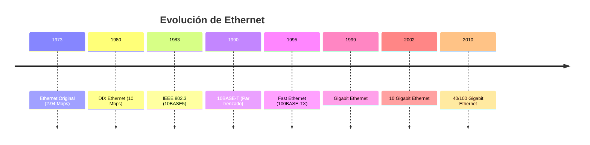
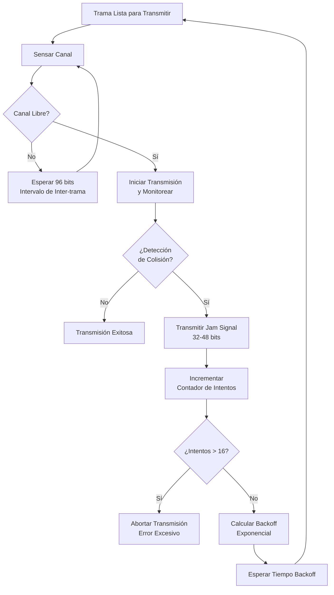
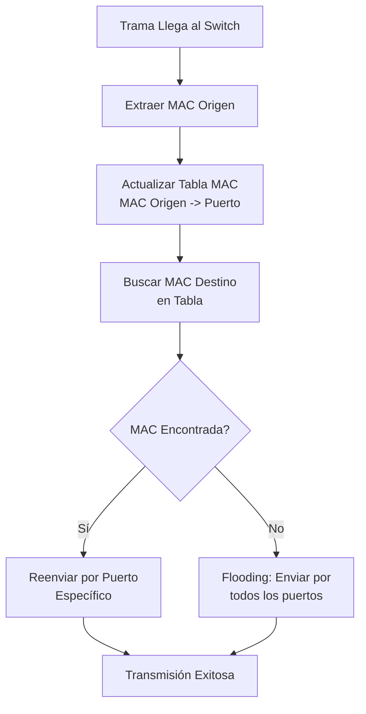

# Redes de Computadoras - Redes locales

## 3.3 Ethernet. Propiedades físicas; protocolo de acceso al medio; servicios de acceso a Ethernet.

---

### Introducción a Ethernet

Según Stallings (2010), "Ethernet es la tecnología de red local más ampliamente implementada, originalmente desarrollada por Xerox PARC en 1973 y posteriormente estandarizada como IEEE 802.3".

### Evolución Histórica de Ethernet



### Propiedades Físicas de Ethernet

#### Medios de Transmisión

##### Especificaciones Físicas Comunes

| Estándar    | Medio          | Velocidad | Distancia Máx. | Topología |
| ----------- | -------------- | --------- | -------------- | --------- |
| 10BASE5     | Coaxial grueso | 10 Mbps   | 500 m          | Bus       |
| 10BASE2     | Coaxial fino   | 10 Mbps   | 185 m          | Bus       |
| 10BASE-T    | UTP Cat3       | 10 Mbps   | 100 m          | Estrella  |
| 100BASE-TX  | UTP Cat5       | 100 Mbps  | 100 m          | Estrella  |
| 1000BASE-T  | UTP Cat5e      | 1 Gbps    | 100 m          | Estrella  |
| 1000BASE-SX | Fibra MMF      | 1 Gbps    | 550 m          | Estrella  |

#### Codificación de Señal

##### Manchester Differential Encoding

**Característica**: Transición en medio de cada bit

- Bit 0: Transición de alto a bajo
- Bit 1: Transición de bajo a alto

**Ventaja**: Autosincronización y componente DC nulo

```python
def codificar_manchester(bits):
    """
    Codifica una secuencia de bits usando codificación Manchester
    """
    señal = []
    for bit in bits:
        if bit == 0:
            señal.extend([1, 0])  # Alto a bajo
        else:
            señal.extend([0, 1])  # Bajo a alto
    return señal

# Ejemplo: codificar '1010'
bits = [1, 0, 1, 0]
señal_codificada = codificar_manchester(bits)
print(f"Bits: {bits} -> Señal: {señal_codificada}")
```

#### Cálculo de Parámetros Físicos

##### Atenuación en Cable UTP

$$
P_{recepcion} = P_{transmision} - \alpha \times L - \sum M_{conectores}
$$

Donde:

- $\alpha$: Atenuación por metro (dB/m)
- $L$: Longitud del cable (m)
- $M$: Pérdidas en conectores (dB)

##### Relación Señal-Ruido (SNR)

$$
SNR_{dB} = 10 \log_{10}\left(\frac{P\_\text{señal}}{P_{ruido}}\right)
$$

**Ejemplo cálculo**:

```python
def calcular_margen_snr(potencia_transmision, atenuacion_cable, sensibilidad_receptor, ruido_ambiente):
    """
    Calcula el margen de SNR para un enlace Ethernet
    """
    potencia_recibida = potencia_transmision - atenuacion_cable
    snr_linear = potencia_recibida / ruido_ambiente
    snr_db = 10 * math.log10(snr_linear)
    margen = snr_db - sensibilidad_receptor
    return margen

# Ejemplo para 100BASE-TX
margen = calcular_margen_snr(
    potencia_transmision=20,  # dBm
    atenuacion_cable=12,     # dB
    sensibilidad_receptor=10, # dB
    ruido_ambiente=0.1       # mW
)
print(f"Margen de SNR: {margen:.2f} dB")
```

### Protocolo de Acceso al Medio CSMA/CD

#### Algoritmo Completo CSMA/CD



#### Implementación CSMA/CD

```python
class CSMA_CD_Station:
    def __init__(self, station_id):
        self.station_id = station_id
        self.attempt_count = 0
        self.collision_count = 0
        self.success_count = 0

    def transmit_frame(self, frame, channel):
        """
        Implementa el protocolo CSMA/CD para transmitir una trama
        """
        while self.attempt_count < 16:
            # Paso 1: Sensar el canal
            if channel.is_busy():
                self.wait_interframe_gap()
                continue

            # Paso 2: Transmitir y monitorear
            collision_detected = channel.transmit_and_monitor(frame, self.station_id)

            if not collision_detected:
                # Transmisión exitosa
                self.success_count += 1
                self.attempt_count = 0
                return True
            else:
                # Colisión detectada
                self.handle_collision()

        # Demasiados intentos fallidos
        self.attempt_count = 0
        return False

    def handle_collision(self):
        """Maneja una colisión según el algoritmo de backoff exponencial"""
        self.collision_count += 1
        self.attempt_count += 1

        # Transmitir jam signal
        self.transmit_jam_signal()

        # Calcular backoff
        k = min(self.attempt_count, 10)
        backoff_slots = random.randint(0, 2**k - 1)

        # Esperar tiempo de backoff
        self.wait_slot_time(backoff_slots)

    def wait_slot_time(self, num_slots):
        """Espera múltiplos del tiempo de slot (512 bits para Ethernet)"""
        slot_time = 512 / self.bit_rate  # Segundos
        total_wait = num_slots * slot_time
        time.sleep(total_wait)
```

#### Parámetros Temporales de Ethernet

##### Tiempo de Slot

$$
T_{slot} = \frac{512 \text{ bits}}{R \text{ bps}}
$$

Para diferentes velocidades:

- 10 Mbps: $T_{slot} = 51.2 \mu s$
- 100 Mbps: $T_{slot} = 5.12 \mu s$
- 1 Gbps: $T_{slot} = 0.512 \mu s$

##### Restricción de Redondeo

$$
Longitud_{max} \leq \frac{T_{slot} \times v}{2}
$$

Donde $v$ es la velocidad de propagación ( $\approx 2 \times 10^8$ m/s )

### Formato de Trama Ethernet

#### Estructura IEEE 802.3

```python
class EthernetFrame:
    def __init__(self, dest_mac, src_mac, payload, ethertype=0x0800):
        self.preamble = bytes([0xAA] * 7)  # 7 bytes de preámbulo
        self.sfd = bytes([0xAB])           # Start Frame Delimiter
        self.dest_mac = dest_mac           # 6 bytes
        self.src_mac = src_mac             # 6 bytes
        self.ethertype = ethertype         # 2 bytes
        self.payload = payload             # 46-1500 bytes
        self.fcs = None                    # Frame Check Sequence

    def calculate_fcs(self):
        """Calcula CRC-32 para detección de errores"""
        data = self.dest_mac + self.src_mac + \
               self.ethertype.to_bytes(2, 'big') + self.payload
        crc = binascii.crc32(data) & 0xFFFFFFFF
        self.fcs = crc.to_bytes(4, 'big')

    def frame_size(self):
        """Tamaño total de la trama en bytes"""
        return 7 + 1 + 6 + 6 + 2 + len(self.payload) + 4  # 64-1518 bytes
```

#### Campos de la Trama

| Campo            | Tamaño        | Descripción                         |
| ---------------- | ------------- | ----------------------------------- |
| Preámbulo        | 7 bytes       | Sincronización (10101010...)        |
| SFD              | 1 byte        | Delimitador de inicio (10101011)    |
| MAC Destino      | 6 bytes       | Dirección física destino            |
| MAC Origen       | 6 bytes       | Dirección física origen             |
| EtherType/Length | 2 bytes       | Tipo de protocolo o longitud        |
| Datos            | 46-1500 bytes | Carga útil                          |
| FCS              | 4 bytes       | Verificación de redundancia cíclica |

### Servicios de Acceso a Ethernet

#### Servicios de la Capa MAC

##### 1. Servicio de Transferencia de Datos

- **MA_DATA.request**: Solicitud de transmisión
- **MA_DATA.indication**: Notificación de recepción
- **MA_DATA.confirm**: Confirmación de transmisión

##### 2. Servicios de Gestión de MAC

```python
class MACManagementService:
    def __init__(self):
        self.mac_table = {}  # Tabla de direcciones MAC
        self.statistics = {
            'frames_transmitted': 0,
            'frames_received': 0,
            'collisions_detected': 0,
            'crc_errors': 0
        }

    def update_mac_table(self, mac_address, port):
        """Actualiza la tabla de aprendizaje MAC"""
        self.mac_table[mac_address] = {
            'port': port,
            'timestamp': time.time(),
            'age': 0
        }

    def get_port_for_mac(self, mac_address):
        """Obtiene el puerto asociado a una dirección MAC"""
        return self.mac_table.get(mac_address, {}).get('port')
```

#### Operación de Switches Ethernet



### Ejercicios Propuestos

#### Ejercicio 1: Diseño de Red Ethernet

Diseñe una red Ethernet 10BASE2 para un edificio con las siguientes características:

- 4 departamentos con 25 estaciones cada uno
- Distancia máxima entre estaciones más lejanas: 400 metros
- Cable coaxial fino con atenuación de 0.1 dB/m

Calcule:

1. Número de segmentos necesarios
2. Repetidores requeridos
3. Pérdida total de señal
4. Verifique cumplimiento de regla 5-4-3

#### Ejercicio 2: Análisis de Rendimiento CSMA/CD

Una red Ethernet de 100 Mbps tiene 50 estaciones activas. Cada estación genera tráfico según una distribución Poisson con tasa promedio de 100 tramas/segundo. El tamaño promedio de trama es de 1000 bytes.

Calcule:

1. Oferta de tráfico normalizada $G$
2. Throughput efectivo del sistema
3. Probabilidad de colisión
4. Tiempo promedio de acceso al medio

**Fórmulas útiles**:

- $G = N \times \lambda \times T_{transmision}$
- $S = \frac{G \times e^{-2G}}{1 + 2G \times e^{-2G}}$ (para CSMA/CD 1-persistente)

#### Ejercicio 3: Configuración de Switch

Configure un switch Ethernet de 24 puertos para los siguientes requisitos:

- VLAN 10: Puertos 1-8 (Departamento de Ventas)
- VLAN 20: Puertos 9-16 (Departamento de TI)
- VLAN 30: Puertos 17-24 (Gerencia)
- Trunk entre switches: Puerto 24

Desarrolle:

1. Tabla de asignación de VLANs
2. Configuración de puertos trunk
3. Esquema de direccionamiento MAC esperado

### Estándares Ethernet Avanzados

#### Gigabit Ethernet (1000BASE-T)

**Características**:

- 4 pares de categoría 5e o superior
- Codificación 4D-PAM5
- Distancia máxima: 100 metros
- Full duplex obligatorio

#### Ethernet en Entornos Industriales

```python
class IndustrialEthernet:
    def __init__(self):
        self.redundancy_protocols = ['HSR', 'PRP']
        self.deterministic_ethernet = True

    def calculate_deterministic_latency(self, hop_count, processing_delay, propagation_delay):
        """
        Calcula la latencia determinística para Ethernet industrial
        """
        switch_latency = hop_count * processing_delay
        total_latency = switch_latency + propagation_delay
        jitter = processing_delay * 0.1  # 10% de variación
        return total_latency, jitter
```

### Referencias Bibliográficas

#### Bibliografía Básica

1. Stallings, W. (2010). _Data and Computer Communications_. Capítulo 16 - Ethernet.
2. Tanenbaum, A. S., & Wetherall, D. J. (2010). _Computer Networks_. Capítulo 4 - Medium Access Control Sublayer.
3. Kurose, J. F., & Ross, K. W. (2010). _Computer Networking: A Top-Down Approach_. Capítulo 5 - Link Layer.

#### Bibliografía Complementaria

1. IEEE 802.3-2018 - Standard for Ethernet
2. Peterson, L. L., & Davie, B. S. (2011). _Computer Networks: A Systems Approach_. Capítulo 2 - Direct Link Networks.

### Glosario de Términos

- **CSMA/CD**: Carrier Sense Multiple Access with Collision Detection
- **SFD**: Start Frame Delimiter
- **FCS**: Frame Check Sequence
- **MTU**: Maximum Transmission Unit
- **VLAN**: Virtual Local Area Network
- **HSR**: High-availability Seamless Redundancy
- **PRP**: Parallel Redundancy Protocol
