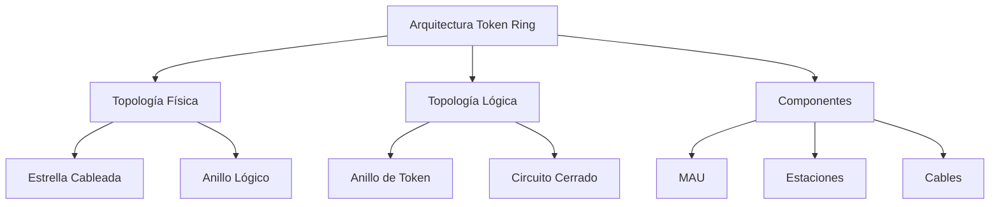
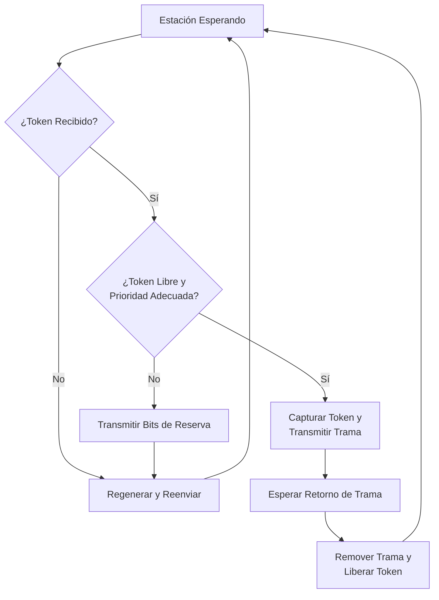

# Redes de Computadoras - Redes locales

## 3.4 Token Ring.

---

Según Tanenbaum (2010), "Token Ring es una tecnología de red local que utiliza una topología lógica en anillo y un token como mecanismo de control de acceso al medio, estandarizada como IEEE 802.5".

### Arquitectura Fundamental

#### Concepto Básico

**Definición**: Token Ring es un protocolo de acceso múltiple donde las estaciones se organizan en un anillo lógico y un token especial circula continuamente, permitiendo la transmisión solo a la estación que posee el token.



### Topología y Componentes Físicos

#### Multi-station Access Unit (MAU)

```python
class MAU:
    def __init__(self, num_ports=8):
        self.ports = [None] * num_ports
        self.ring_in = None
        self.ring_out = None
        self.bypass_relays = [False] * num_ports

    def connect_station(self, station, port):
        """Conecta una estación al MAU"""
        if 0 <= port < len(self.ports):
            self.ports[port] = station
            self.bypass_relays[port] = False

    def disconnect_station(self, port):
        """Desconecta una estación del MAU"""
        if 0 <= port < len(self.ports):
            self.ports[port] = None
            self.bypass_relays[port] = True

    def get_active_ports(self):
        """Retorna lista de puertos activos"""
        return [i for i, station in enumerate(self.ports) if station is not None]
```

#### Cableado y Especificaciones Físicas

| Parámetro              | Token Ring IEEE 802.5 | Token Ring IBM |
| ---------------------- | --------------------- | -------------- |
| Velocidad              | 4/16 Mbps             | 4/16 Mbps      |
| Medio                  | STP/UTP               | Tipo 1, 2, 3   |
| Estaciones/Anillo      | 250                   | 260            |
| Distancia MAU-Estación | 100 m                 | 45-100 m       |

### Protocolo de Acceso al Medio

#### Formato del Token y Trama

```python
class TokenRingFrame:
    def __init__(self, frame_type="token"):
        # Delimitador de inicio (SD)
        self.start_delimiter = "JK0JK000"

        # Control de acceso (AC)
        if frame_type == "token":
            self.access_control = "00000000"  # Token libre
        else:
            self.access_control = "00000000"  # Trama de datos

        # Control de trama (FC)
        self.frame_control = "00000000"

        # Direcciones
        self.destination_address = "000000000000"
        self.source_address = "000000000000"

        # Datos
        self.data = ""

        # Checksum y delimitador final
        self.frame_check_sequence = "00000000"
        self.end_delimiter = "JK1JK1IE"

    def is_token_free(self):
        """Verifica si el token está libre"""
        return self.access_control[3] == '0'  # Bit de token

    def claim_token(self, station_address):
        """Marca el token como ocupado"""
        if self.is_token_free():
            self.access_control = self.access_control[:3] + '1' + self.access_control[4:]
            self.source_address = station_address
            return True
        return False
```

#### Campos de la Trama Token Ring

| Campo                      | Tamaño   | Descripción                                      |
| -------------------------- | -------- | ------------------------------------------------ |
| Start Delimiter (SD)       | 1 byte   | Patrón único: JK0JK000                           |
| Access Control (AC)        | 1 byte   | PPPTMRRR (Priority, Token, Monitor, Reservation) |
| Frame Control (FC)         | 1 byte   | FFZZZZZZ (Frame Type, Control Bits)              |
| Destination Address        | 6 bytes  | Dirección MAC destino                            |
| Source Address             | 6 bytes  | Dirección MAC origen                             |
| Data                       | Variable | 0-17800 bytes (4 Mbps) / 0-17800 bytes (16 Mbps) |
| Frame Check Sequence (FCS) | 4 bytes  | CRC-32                                           |
| End Delimiter (ED)         | 1 byte   | JK1JK1IE                                         |
| Frame Status (FS)          | 1 byte   | AcrrAcrr (Address Recognized, Frame Copied)      |

#### Algoritmo de Operación



### Implementación del Protocolo

```python
class TokenRingStation:
    def __init__(self, mac_address, ring_interface):
        self.mac_address = mac_address
        self.ring_interface = ring_interface
        self.transmit_queue = []
        self.current_token = None
        self.token_hold_time = 10  # ms
        self.priority = 0

    def receive_frame(self, frame):
        """Procesa una trama recibida"""
        if frame.is_token() and frame.is_free():
            self.handle_free_token(frame)
        elif frame.destination_address == self.mac_address:
            self.handle_data_frame(frame)
        else:
            self.forward_frame(frame)

    def handle_free_token(self, token):
        """Maneja la recepción de un token libre"""
        if self.transmit_queue and self.can_claim_token(token):
            # Capturar el token y transmitir
            self.current_token = token
            self.transmit_data_frame()
        else:
            # Reenviar el token con posibles reservas
            self.update_token_reservation(token)
            self.forward_frame(token)

    def transmit_data_frame(self):
        """Transmite una trama de datos"""
        if not self.current_token or not self.transmit_queue:
            return

        data_frame = self.transmit_queue.pop(0)
        data_frame.source_address = self.mac_address
        data_frame.token_bit = 0  # Ya no es token

        # Transmitir la trama
        self.ring_interface.transmit(data_frame)

        # Esperar a que la trama complete el circuito
        self.wait_for_frame_return()

    def wait_for_frame_return(self):
        """Espera a que la trama transmitida complete el anillo"""
        # Implementación del mecanismo de stripping
        pass

    def release_token(self):
        """Libera el token después de la transmisión"""
        if self.current_token:
            self.current_token.set_free()
            self.forward_frame(self.current_token)
            self.current_token = None
```

### Temporización y Control

#### Parámetros de Temporización

##### Tiempo de Rotación del Token

$$
T_{rotacion} = \sum_{i=1}^{N} T_{prop_i} + \sum_{i=1}^{N} T_{retardo_i} + T_{token}
$$

Donde:

- $T_{prop_i}$: Tiempo de propagación entre estaciones
- $T_{retardo_i}$: Retardo de regeneración en cada estación
- $T_{token}$: Tiempo de transmisión del token

##### Throughput Máximo Teórico

$$
S_{max} = \frac{T_{transmision}}{T_{transmision} + T_{rotacion}}
$$

**Ejemplo cálculo**:

```python
def calcular_throughput_token_ring(num_estaciones, velocidad, longitud_anillo, tamaño_trama):
    """
    Calcula el throughput máximo de una red Token Ring

    Args:
        num_estaciones: número de estaciones en el anillo
        velocidad: velocidad de la red (bps)
        longitud_anillo: longitud total del anillo (metros)
        tamaño_trama: tamaño promedio de trama (bits)
    """
    # Tiempo de propagación (velocidad = 2e8 m/s)
    tiempo_propagacion = longitud_anillo / 2e8

    # Retardo por estación (1 bit time por estación)
    retardo_estacion = num_estaciones / velocidad

    # Tiempo de transmisión de trama
    tiempo_transmision = tamaño_trama / velocidad

    # Tiempo de transmisión de token (24 bits)
    tiempo_token = 24 / velocidad

    # Tiempo total de rotación
    tiempo_rotacion = tiempo_propagacion + retardo_estacion + tiempo_token

    # Throughput
    throughput = tiempo_transmision / (tiempo_transmision + tiempo_rotacion)

    return throughput

# Ejemplo para red de 16 Mbps
throughput = calcular_throughput_token_ring(
    num_estaciones=50,
    velocidad=16e6,
    longitud_anillo=1000,
    tamaño_trama=1000*8
)
print(f"Throughput máximo: {throughput:.2%}")
```

### Mecanismos de Prioridad

#### Campos de Prioridad y Reserva

**Access Control Field**: `PPPTMRRR`

- `PPP`: Bits de prioridad (0-7)
- `T`: Bit de token (0=libre, 1=ocupado)
- `M`: Bit de monitor
- `RRR`: Bits de reserva

#### Algoritmo de Prioridad

```python
class TokenRingPriority:
    def __init__(self):
        self.station_priority = 0
        self.token_priority = 0
        self.reservation_priority = 0

    def can_claim_token(self, token):
        """Determina si puede reclamar el token basado en prioridad"""
        token_priority = token.get_priority()

        if self.station_priority >= token_priority:
            return True
        return False

    def set_reservation(self, token, frame_priority):
        """Establece bits de reserva en el token"""
        current_reservation = token.get_reservation()

        if frame_priority > current_reservation:
            token.set_reservation(frame_priority)
```

### Monitoreo y Recuperación de Fallos

#### Estación Monitora

```python
class MonitorStation:
    def __init__(self, mac_address):
        self.mac_address = mac_address
        self.active_monitor = False
        self.token_circulation_time = 0
        self.max_token_time = 10.0  # segundos

    def monitor_ring_health(self):
        """Monitorea la salud del anillo"""
        if self.active_monitor:
            self.check_token_circulation()
            self.detect_duplicate_tokens()
            self.verify_ring_continuity()

    def check_token_circulation(self):
        """Verifica que el token circule correctamente"""
        current_time = time.time()
        if current_time - self.token_circulation_time > self.max_token_time:
            self.regenerate_token()

    def regenerate_token(self):
        """Regenera un token perdido"""
        new_token = TokenRingFrame(frame_type="token")
        self.broadcast_frame(new_token)
        self.token_circulation_time = time.time()

    def claim_monitor_role(self):
        """Participa en elección de estación monitora"""
        # Implementar algoritmo de elección
        pass
```

### Ejercicios Propuestos

#### Ejercicio 1: Análisis de Rendimiento

Una red Token Ring de 16 Mbps tiene las siguientes características:

- 80 estaciones activas
- Longitud física del anillo: 2 km
- Retardo por estación: 2 bits
- Tamaño promedio de trama: 1500 bytes
- Tiempo de procesamiento: 10 μs por estación

Calcule:

1. Tiempo de rotación del token
2. Throughput máximo teórico
3. Eficiencia del protocolo
4. Tiempo de acceso promedio para una estación

#### Ejercicio 2: Diseño de Red Token Ring

Diseñe una red Token Ring para un campus universitario con:

- 5 edificios con 60 estaciones cada uno
- Distancia entre edificios: 200-500 metros
- Requisito de prioridad: Tráfico de voz (alta prioridad), datos (media), impresión (baja)

Determine:

1. Número de anillos necesarios
2. Ubicación de MAUs y repetidores
3. Esquema de prioridades
4. Plan de cableado

#### Ejercicio 3: Simulación de Protocolo

Implemente una simulación simplificada de Token Ring con:

- 8 estaciones
- Tráfico generado según distribución Poisson
- Mecanismos de prioridad
- Detección y recuperación de fallos

Analice:

1. Throughput bajo diferentes cargas
2. Tiempo de acceso promedio
3. Comportamiento con fallos de estación

### Comparativa con Otras Tecnologías

#### Token Ring vs Ethernet

| Característica             | Token Ring     | Ethernet       |
| -------------------------- | -------------- | -------------- |
| **Acceso al Medio**        | Determinístico | Probabilístico |
| **Rendimiento en Carga**   | Constante      | Decreciente    |
| **Complexidad**            | Alta           | Media          |
| **Costo**                  | Alto           | Bajo           |
| **Recuperación de Fallos** | Buena          | Limitada       |
| **Escalabilidad**          | Media          | Alta           |

### Referencias Bibliográficas

#### Bibliografía Básica

1. Tanenbaum, A. S., & Wetherall, D. J. (2010). _Computer Networks_. Capítulo 4, Sección 4.3 - Token Ring.
2. Stallings, W. (2010). _Data and Computer Communications_. Capítulo 16 - LAN Systems.
3. Kurose, J. F., & Ross, K. W. (2010). _Computer Networking: A Top-Down Approach_. Capítulo 5 - Link Layer.

#### Bibliografía Complementaria

1. IEEE 802.5-1998 - Token Ring Access Method
2. IBM Token Ring Network Architecture Reference (1994)
3. Peterson, L. L., & Davie, B. S. (2011). _Computer Networks: A Systems Approach_. Capítulo 2 - Direct Link Networks.

### Glosario de Términos

- **MAU**: Multi-station Access Unit
- **SD**: Start Delimiter
- **AC**: Access Control
- **FCS**: Frame Check Sequence
- **ED**: End Delimiter
- **FS**: Frame Status
- **AM**: Active Monitor
- **NAUN**: Nearest Active Upstream Neighbor
