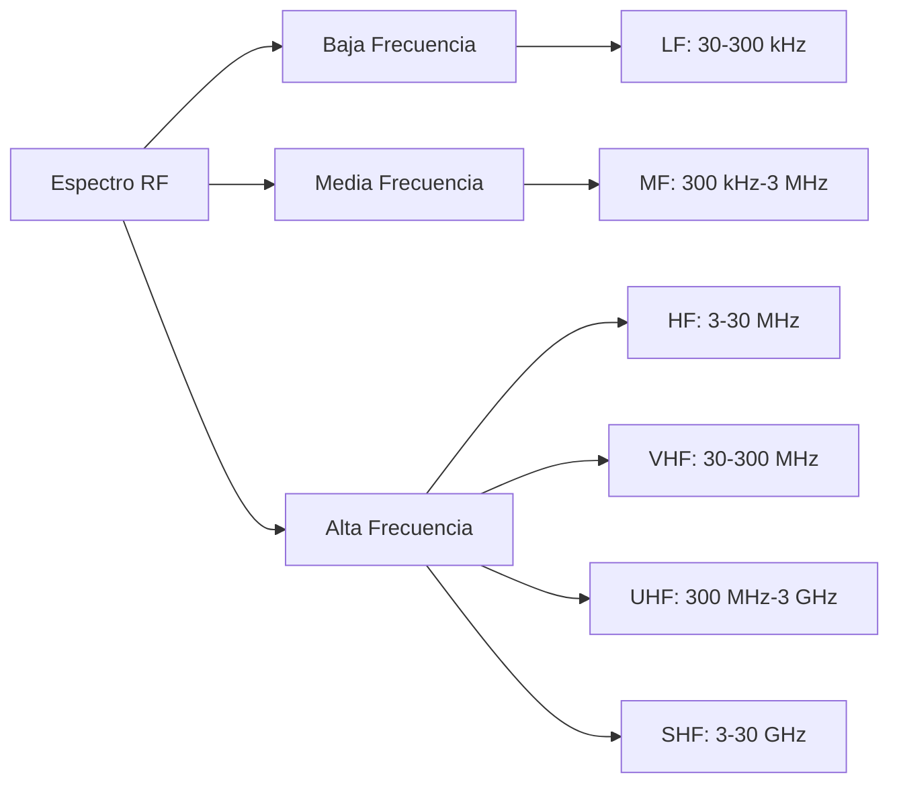
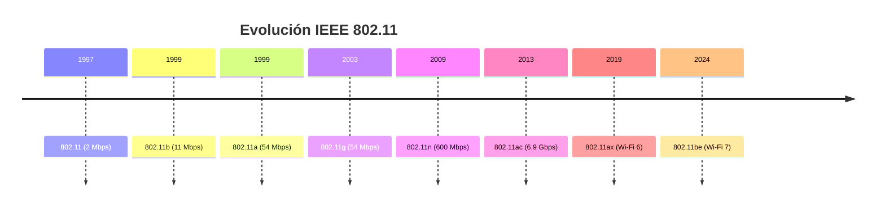
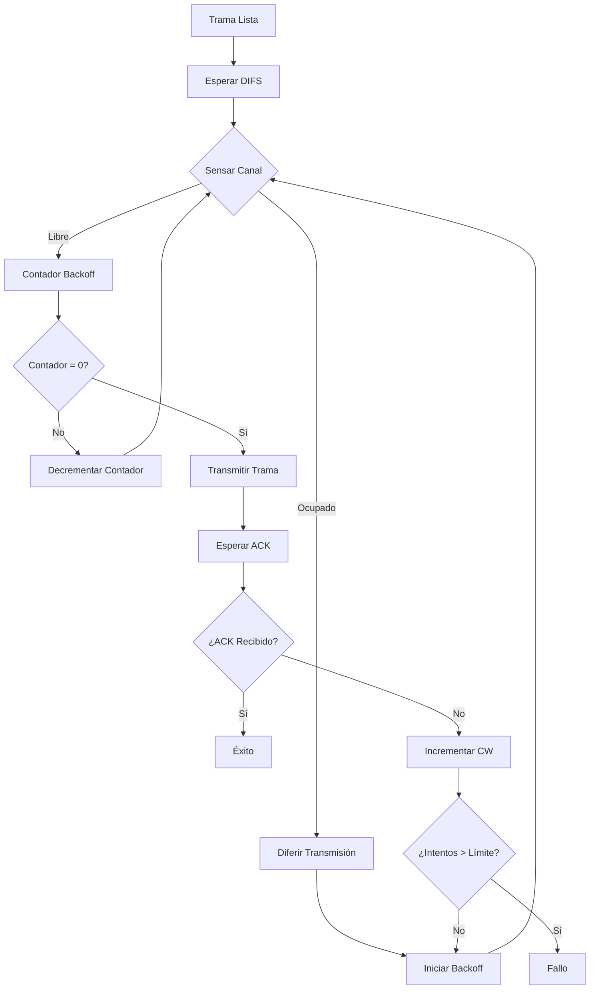
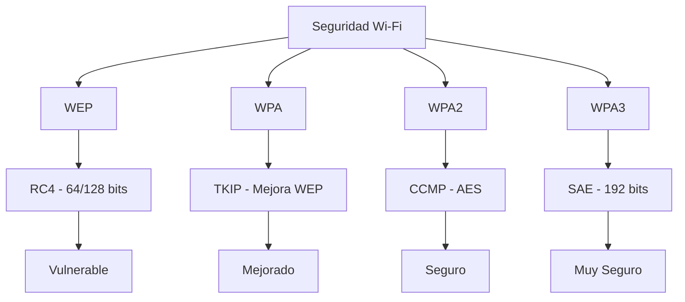

# Redes de Computadoras - Redes locales

## 3.5 Redes inalámbricas.

---

Según Kurose y Ross (2010), "Las redes inalámbricas permiten la comunicación entre dispositivos sin necesidad de conexión física, utilizando ondas electromagnéticas como medio de transmisión".

### Fundamentos de Comunicaciones Inalámbricas

#### Propiedades de las Ondas Electromagnéticas

##### Ecuación Fundamental

$$
c = \lambda \times f
$$

Donde:

- $c$: Velocidad de la luz ( $3 \times 10^8$ m/s )
- $\lambda$: Longitud de onda (metros)
- $f$: Frecuencia (Hz)

**Ejemplo cálculo**:

```python
def calcular_parametros_onda(frecuencia):
    """
    Calcula parámetros de onda electromagnética
    """
    c = 3e8  # Velocidad de la luz m/s
    longitud_onda = c / frecuencia
    periodo = 1 / frecuencia

    return {
        'longitud_onda': longitud_onda,
        'periodo': periodo,
        'energia_foton': 6.626e-34 * frecuencia  # E = hf
    }

# Ejemplo para Wi-Fi 2.4 GHz
parametros = calcular_parametros_onda(2.4e9)
print(f"Longitud de onda: {parametros['longitud_onda']:.3f} m")
```

#### Espectro Electromagnético para Redes Inalámbricas



### Tecnologías de Redes Inalámbricas Locales

#### Estándares IEEE 802.11 (Wi-Fi)



#### Características de Estándares Wi-Fi

| Estándar | Frecuencia  | Velocidad Máx. | Ancho Banda | Modulación |
| -------- | ----------- | -------------- | ----------- | ---------- |
| 802.11b  | 2.4 GHz     | 11 Mbps        | 20 MHz      | DSSS       |
| 802.11a  | 5 GHz       | 54 Mbps        | 20 MHz      | OFDM       |
| 802.11g  | 2.4 GHz     | 54 Mbps        | 20 MHz      | OFDM       |
| 802.11n  | 2.4/5 GHz   | 600 Mbps       | 20/40 MHz   | MIMO-OFDM  |
| 802.11ac | 5 GHz       | 6.9 Gbps       | 80/160 MHz  | MU-MIMO    |
| 802.11ax | 2.4/5/6 GHz | 9.6 Gbps       | 160 MHz     | OFDMA      |

### Propagación de Señales Inalámbricas

#### Pérdidas en el Espacio Libre

##### Ecuación de Friis

$$
P_r = P_t + G_t + G_r - 20 \log_{10}\left(\frac{4\pi d}{\lambda}\right) - L
$$

Donde:

- $P_r$: Potencia recibida (dBm)
- $P_t$: Potencia transmitida (dBm)
- $G_t, G_r$: Ganancia de antenas (dBi)
- $d$: Distancia (metros)
- $\lambda$: Longitud de onda (metros)
- $L$: Pérdidas adicionales (dB)

**Implementación**:

```python
import math

class Propagacioninalambrica:
    def __init__(self):
        self.perdidas_pared = 10  # dB
        self.perdidas_piso = 20   # dB

    def calcular_potencia_recibida(self, pt, gt, gr, distancia, frecuencia):
        """
        Calcula la potencia recibida usando la ecuación de Friis
        """
        # Convertir a unidades lineales para cálculo
        pt_linear = 10**(pt / 10) / 1000  # dBm to Watts
        gt_linear = 10**(gt / 10)
        gr_linear = 10**(gr / 10)

        # Longitud de onda
        lambda_ = 3e8 / frecuencia

        # Cálculo de pérdidas en espacio libre
        perdidas_espacio_libre = (4 * math.pi * distancia / lambda_)**2

        # Potencia recibida en Watts
        pr_linear = (pt_linear * gt_linear * gr_linear) / perdidas_espacio_libre

        # Convertir a dBm
        pr_dbm = 10 * math.log10(pr_linear * 1000)

        return pr_dbm

    def calcular_max_distancia(self, pt, gt, gr, sensibilidad, frecuencia):
        """
        Calcula la distancia máxima para una sensibilidad dada
        """
        lambda_ = 3e8 / frecuencia
        pr_min_linear = 10**(sensibilidad / 10) / 1000

        pt_linear = 10**(pt / 10) / 1000
        gt_linear = 10**(gt / 10)
        gr_linear = 10**(gr / 10)

        distancia_max = (lambda_ / (4 * math.pi)) * \
                       math.sqrt((pt_linear * gt_linear * gr_linear) / pr_min_linear)

        return distancia_max

# Ejemplo de uso
prop = Propagacioninalambrica()
pr = prop.calcular_potencia_recibida(
    pt=20, gt=2, gr=2, distancia=50, frecuencia=2.4e9
)
print(f"Potencia recibida: {pr:.2f} dBm")
```

#### Modelos de Propagación

##### Modelo Log-Distance Path Loss

$$
PL(d) = PL(d_0) + 10n \log_{10}\left(\frac{d}{d_0}\right) + X_\sigma
$$

Donde:

- $PL(d)$: Pérdida de trayectoria a distancia $d$
- $PL(d_0)$: Pérdida de trayectoria a distancia de referencia
- $n$: Exponente de pérdida de trayectoria
- $X_\sigma$: Variable aleatoria con distribución normal (desvanecimiento)

### Protocolos de Acceso al Medio Inalámbricos

#### CSMA/CA (Carrier Sense Multiple Access with Collision Avoidance)



#### Implementación CSMA/CA

```python
class CSMA_CA_Station:
    def __init__(self, station_id):
        self.station_id = station_id
        self.CW_min = 15
        self.CW_max = 1023
        self.CW = self.CW_min
        self.attempt_count = 0
        self.max_attempts = 7

        # Tiempos de espera
        self.DIFS = 50e-6  # 50 μs
        self.SIFS = 10e-6  # 10 μs
        self.slot_time = 20e-6  # 20 μs

    def transmit_frame(self, frame, channel):
        """
        Implementa el protocolo CSMA/CA para transmitir una trama
        """
        self.attempt_count = 0
        self.CW = self.CW_min

        while self.attempt_count < self.max_attempts:
            # Paso 1: Esperar DIFS si el canal ha estado libre
            if not self.wait_DIFS(channel):
                continue

            # Paso 2: Backoff aleatorio
            backoff_slots = random.randint(0, self.CW - 1)
            if not self.wait_backoff(backoff_slots, channel):
                continue

            # Paso 3: Transmitir trama
            if channel.transmit(frame, self.station_id):
                # Paso 4: Esperar ACK
                if self.wait_for_ack(channel):
                    # Transmisión exitosa
                    self.CW = self.CW_min
                    return True

            # Colisión o falta de ACK
            self.handle_transmission_failure()

        # Fallo después de máximo número de intentos
        self.reset_parameters()
        return False

    def wait_DIFS(self, channel):
        """Espera DIFS mientras el canal permanece libre"""
        start_time = time.time()
        while time.time() - start_time < self.DIFS:
            if channel.is_busy():
                return False
            time.sleep(1e-6)  # 1 μs
        return True

    def wait_backoff(self, num_slots, channel):
        """Espera el tiempo de backoff"""
        for _ in range(num_slots):
            if channel.is_busy():
                return False
            time.sleep(self.slot_time)
        return True

    def handle_transmission_failure(self):
        """Maneja fallo de transmisión"""
        self.attempt_count += 1
        self.CW = min(2 * self.CW, self.CW_max)
```

### Arquitectura de Redes Wi-Fi

#### Componentes Básicos

```python
class AccessPoint:
    def __init__(self, ssid, channel, security):
        self.ssid = ssid
        self.channel = channel
        self.security = security
        self.associated_stations = {}
        self.beacon_interval = 100  # ms

    def broadcast_beacon(self):
        """Transmite tramas beacon periódicamente"""
        beacon_frame = {
            'timestamp': time.time(),
            'beacon_interval': self.beacon_interval,
            'capability_info': {
                'ess': 1,
                'ibss': 0,
                'privacy': 1 if self.security else 0
            },
            'ssid': self.ssid,
            'supported_rates': [1, 2, 5.5, 11, 6, 9, 12, 18, 24, 36, 48, 54]
        }
        return beacon_frame

    def handle_association_request(self, station, capabilities):
        """Maneja solicitud de asociación de estación"""
        if self.authenticate_station(station):
            self.associated_stations[station.mac_address] = {
                'station': station,
                'association_time': time.time(),
                'capabilities': capabilities
            }
            return True
        return False

class WirelessStation:
    def __init__(self, mac_address):
        self.mac_address = mac_address
        self.current_ap = None
        self.signal_strength = 0
        self.supported_rates = [1, 2, 5.5, 11, 6, 9, 12, 18, 24, 36, 48, 54]

    def scan_networks(self, channel_list):
        """Escanea redes disponibles en los canales especificados"""
        networks = []
        for channel in channel_list:
            # Cambiar a canal y escuchar beacons
            networks_found = self.listen_beacons(channel)
            networks.extend(networks_found)

        # Ordenar por intensidad de señal
        networks.sort(key=lambda x: x['signal_strength'], reverse=True)
        return networks

    def connect_to_ap(self, ap, password=None):
        """Conecta a un Access Point específico"""
        # Autenticación
        if not self.authenticate_with_ap(ap, password):
            return False

        # Asociación
        association_success = ap.handle_association_request(self, self.supported_rates)
        if association_success:
            self.current_ap = ap
            return True
        return False
```

### Seguridad en Redes Inalámbricas

#### Evolución de Protocolos de Seguridad



#### Implementación WPA2

```python
class WPA2Security:
    def __init__(self, passphrase, ssid):
        self.passphrase = passphrase
        self.ssid = ssid
        self.ptk = None  # Pairwise Transient Key
        self.gtk = None  # Group Temporal Key

    def four_way_handshake(self, authenticator_nonce, supplicant_nonce):
        """
        Implementa el four-way handshake de WPA2
        """
        # Paso 1: Calcular PMK (Pairwise Master Key)
        pmk = self.calculate_pmk()

        # Paso 2: Calcular PTK
        self.ptk = self.calculate_ptk(pmk, authenticator_nonce, supplicant_nonce)

        # Los 4 mensajes del handshake...
        return True

    def calculate_pmk(self):
        """Calcula PMK usando PBKDF2"""
        import hashlib
        import hmac

        # PMK = PBKDF2(Passphrase, SSID, 4096, 256)
        pmk = hashlib.pbkdf2_hmac(
            'sha1',
            self.passphrase.encode(),
            self.ssid.encode(),
            4096,
            32  # 256 bits
        )
        return pmk

    def calculate_ptk(self, pmk, anonce, snonce, mac_ap, mac_sta):
        """Calcula PTK usando PRF-512"""
        # PTK = PRF-512(PMK, "Pairwise key expansion",
        #               Min(AP_MAC, STA_MAC) || Max(AP_MAC, STA_MAC) ||
        #               Min(ANonce, SNonce) || Max(ANonce, SNonce))
        pass
```

### Ejercicios Propuestos

#### Ejercicio 1: Diseño de Cobertura Wi-Fi

Diseñe la cobertura Wi-Fi para un edificio de oficinas de 3 pisos:

- Cada piso: 50m × 30m
- Paredes internas: pérdida de 6 dB
- Pisos entre niveles: pérdida de 20 dB
- Potencia AP: 20 dBm, sensibilidad cliente: -85 dBm
- Usar modelo de pérdidas: $PL(d) = 40 + 35\log_{10}(d)$ dB

Calcule:

1. Número de APs necesarios por piso
2. Ubicación óptima de APs
3. Plan de canales para evitar interferencia

#### Ejercicio 2: Análisis de Capacidad

Una red 802.11ac opera en canal de 80 MHz con:

- 50 estaciones activas
- Tamaño promedio de trama: 1500 bytes
- Efficiency: 70%
- MCS9 (modulación 256-QAM, 5/6 coding rate)

Calcule:

1. Throughput máximo teórico
2. Throughput por estación
3. Impacto de sobrecarga de protocolo
4. Eficiencia espectral

**Fórmulas**:

- $Throughput = \frac{Datos\_\text{útil}}{T\_{total}}$
- $T_{total} = T_{datos} + T_{ACK} + T_{DIFS} + T_{SIFS} + T_{backoff}$

#### Ejercicio 3: Simulación de Handover

Implemente un algoritmo de handover para un dispositivo móvil que se mueve entre 3 APs con coordenadas:

- AP1: (0, 0), potencia: 20 dBm
- AP2: (50, 0), potencia: 20 dBm
- AP3: (25, 40), potencia: 20 dBm

Trayectoria del dispositivo: (0, 0) → (50, 0) → (25, 40)

Determine:

1. Puntos de handover óptimos
2. Tiempo de handover
3. Pérdida de paquetes durante handover

### Tecnologías Inalámbricas Emergentes

#### Wi-Fi 6 (802.11ax)

```python
class WiFi6Features:
    def __init__(self):
        self.ofdma = True
        self.mu_mimo = True
        self.bss_coloring = True
        self.target_wake_time = True

    def schedule_ofdma(self, stations, resource_units):
        """
        Programa transmisiones OFDMA para múltiples estaciones
        """
        schedule = {}
        ru_size = len(resource_units) // len(stations)

        for i, station in enumerate(stations):
            start_ru = i * ru_size
            end_ru = start_ru + ru_size
            schedule[station] = resource_units[start_ru:end_ru]

        return schedule

    def calculate_throughput_11ax(self, mcs, channel_width, spatial_streams):
        """
        Calcula throughput para 802.11ax
        """
        # Tabla MCS para 802.11ax
        mcs_table = {
            0: {'modulation': 'BPSK', 'coding': 1/2, 'data_rate': 0.5},
            1: {'modulation': 'QPSK', 'coding': 1/2, 'data_rate': 1},
            # ... más entradas MCS
            11: {'modulation': '1024-QAM', 'coding': 5/6, 'data_rate': 5.4}
        }

        mcs_info = mcs_table.get(mcs, mcs_table[0])
        symbol_rate = channel_width * 1e6 / 3.2e-6  # 3.2 μs símbolo
        data_rate = mcs_info['data_rate'] * symbol_rate * spatial_streams

        return data_rate
```

### Referencias Bibliográficas

#### Bibliografía Básica

1. Kurose, J. F., & Ross, K. W. (2010). _Computer Networking: A Top-Down Approach_. Capítulo 6 - Wireless and Mobile Networks.
2. Tanenbaum, A. S., & Wetherall, D. J. (2010). _Computer Networks_. Capítulo 4 - Medium Access Control Sublayer.
3. Stallings, W. (2010). _Data and Computer Communications_. Capítulo 17 - Wireless LANs.

#### Bibliografía Complementaria

1. IEEE 802.11-2020 - Wireless LAN Medium Access Control and Physical Layer Specifications
2. Gast, M. (2013). _802.11 Wireless Networks: The Definitive Guide_.
3. Peterson, L. L., & Davie, B. S. (2011). _Computer Networks: A Systems Approach_. Capítulo 2 - Direct Link Networks.

### Glosario de Términos

- **BSS**: Basic Service Set
- **ESS**: Extended Service Set
- **SSID**: Service Set Identifier
- **CSMA/CA**: Carrier Sense Multiple Access with Collision Avoidance
- **OFDM**: Orthogonal Frequency Division Multiplexing
- **MIMO**: Multiple Input Multiple Output
- **RSSI**: Received Signal Strength Indicator
- **SNR**: Signal-to-Noise Ratio
