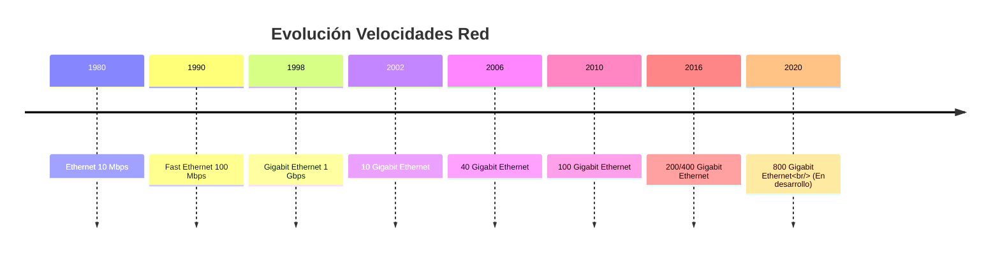
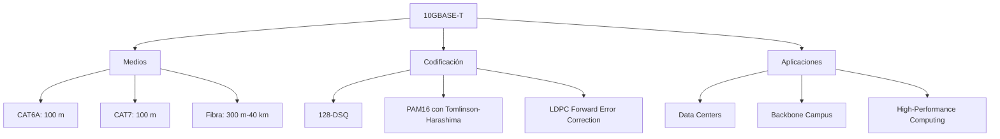
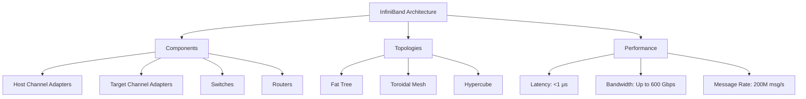

# Redes de Computadoras - Redes locales

## 3.6 Redes de alta velocidad.

---

Según Stallings (2010), "Las redes de alta velocidad se definen como aquellas que proporcionan tasas de transferencia significativamente superiores a las redes tradicionales, típicamente por encima de 1 Gbps, diseñadas para satisfacer demandas crecientes de ancho de banda y baja latencia".

### Evolución de las Redes de Alta Velocidad



### Fundamentos Teóricos de Alta Velocidad

#### Ley de Nielsen sobre Ancho de Banda

$$
B_t = B_0 \times 1.5^t
$$

Donde:

- $B_t$: Ancho de banda en el año $t$
- $B_0$: Ancho de banda inicial
- $t$: Tiempo en años

#### Cálculo de Throughput Efectivo

$$ Throughput_{efectivo} = \frac{ Tamanio_{util} }{ T_{transmision} + T_{propagacion} + T_{procesamiento} } $$

**Ejemplo cálculo**:

```python
def calcular_throughput_efectivo(tamaño_trama, velocidad, distancia, overhead_protocolo=0.1):
    """
    Calcula el throughput efectivo considerando todos los factores
    """
    # Tiempo de transmisión
    t_transmision = tamaño_trama / velocidad

    # Tiempo de propagación (velocidad = 2e8 m/s en cobre)
    t_propagacion = distancia / 2e8

    # Tiempo de procesamiento (estimado)
    t_procesamiento = 1e-6  # 1 μs

    # Overhead de protocolo
    overhead = 1 + overhead_protocolo

    throughput_bruto = tamaño_trama / t_transmision
    throughput_efectivo = throughput_bruto / overhead

    return {
        'bruto': throughput_bruto,
        'efectivo': throughput_efectivo,
        'eficiencia': 1/overhead
    }

# Ejemplo para 10 Gbps
resultado = calcular_throughput_efectivo(
    tamaño_trama=1500,  # bytes
    velocidad=10e9,     # 10 Gbps
    distancia=100       # metros
)
print(f"Throughput efectivo: {resultado['efectivo']/1e9:.2f} Gbps")
```

### Tecnologías Ethernet de Alta Velocidad

#### Gigabit Ethernet (1000BASE-T)

```python
class GigabitEthernet:
    def __init__(self):
        self.standard = "IEEE 802.3ab"
        self.speed = 1e9  # 1 Gbps
        self.medium = "CAT5e/6 UTP"
        self.distance_max = 100  # metros
        self.coding = "4D-PAM5"

    def calculate_symbol_rate(self):
        """Calcula la tasa de símbolos para 1000BASE-T"""
        # Usa 4 pares, 125 MHz por par
        symbols_per_second = 125e6
        bits_per_symbol = 2  # 4 niveles PAM5 = 2 bits
        total_bits = symbols_per_second * bits_per_symbol * 4  # 4 pares
        return total_bits

    def analyze_power_requirements(self, cable_length, temperature):
        """
        Analiza requisitos de potencia para Gigabit Ethernet
        """
        # Pérdidas por cable (dB/100m para CAT6)
        loss_per_meter = 0.2 / 100
        cable_loss = loss_per_meter * cable_length

        # Pérdidas por temperatura
        temp_loss = 0.01 * (temperature - 20)  # 0.01 dB/°C sobre 20°C

        total_loss = cable_loss + temp_loss
        required_power = -10 + total_loss  # Sensibilidad típica: -10 dBm

        return {
            'cable_loss': cable_loss,
            'temp_loss': temp_loss,
            'total_loss': total_loss,
            'required_power': required_power
        }
```

#### 10 Gigabit Ethernet (10GBASE-T)

##### Características Técnicas



#### Especificaciones Físicas Comparadas

| Estándar      | Velocidad | Medio   | Distancia | Codificación |
| ------------- | --------- | ------- | --------- | ------------ |
| 1000BASE-T    | 1 Gbps    | CAT5e/6 | 100 m     | 4D-PAM5      |
| 10GBASE-T     | 10 Gbps   | CAT6A/7 | 100 m     | 128-DSQ      |
| 40GBASE-SR4   | 40 Gbps   | MMF     | 150 m     | NRZ          |
| 100GBASE-SR4  | 100 Gbps  | MMF     | 100 m     | PAM4         |
| 400GBASE-SR16 | 400 Gbps  | MMF     | 100 m     | PAM4         |

### Tecnologías de Fibra Óptica para Alta Velocidad

#### Fundamentos de Transmisión Óptica

##### Pérdidas en Fibra Óptica

$$
\alpha_{total} = \alpha_\text{absorción} + \alpha_\text{dispersión} + \alpha_{conectores} + \alpha_{empalmes}
$$

##### Presupuesto de Potencia Óptica

$$
P_{rx} = P_{tx} - \alpha_{fibra} \times L - \sum \alpha_{conectores} - M_{margen}
$$

**Implementación**:

```python
class OpticalLinkBudget:
    def __init__(self):
        self.connector_loss = 0.3  # dB por conector
        self.splice_loss = 0.1     # dB por empalme
        self.system_margin = 3.0   # dB margen del sistema

    def calculate_link_budget(self, tx_power, fiber_loss_db_km, distance_km, num_connectors, num_splices, rx_sensitivity):
        """
        Calcula el presupuesto de enlace óptico
        """
        # Pérdidas en fibra
        fiber_loss = fiber_loss_db_km * distance_km

        # Pérdidas en conectores
        connector_loss = num_connectors * self.connector_loss

        # Pérdidas en empalmes
        splice_loss = num_splices * self.splice_loss

        # Pérdidas totales
        total_loss = fiber_loss + connector_loss + splice_loss + self.system_margin

        # Potencia recibida
        rx_power = tx_power - total_loss

        # Margen del sistema
        system_margin = rx_power - rx_sensitivity

        return {
            'rx_power': rx_power,
            'total_loss': total_loss,
            'system_margin': system_margin,
            'link_viable': system_margin > 0
        }

# Ejemplo para enlace 10 km
link_calc = OpticalLinkBudget()
resultado = link_calc.calculate_link_budget(
    tx_power=0,           # dBm
    fiber_loss_db_km=0.3, # dB/km
    distance_km=10,
    num_connectors=2,
    num_splices=1,
    rx_sensitivity=-28    # dBm
)
print(f"Margen del sistema: {resultado['system_margin']:.2f} dB")
```

#### Multiplexación por División de Longitud de Onda (WDM)

```python
class WDMSystem:
    def __init__(self, channel_spacing=100):  # GHz
        self.channel_spacing = channel_spacing
        self.channels = {}
        self.c_band_start = 191.3  # THz (1565 nm)
        self.c_band_end = 196.1    # THz (1528 nm)

    def add_channel(self, channel_id, frequency, power, modulation):
        """Añade un canal WDM"""
        self.channels[channel_id] = {
            'frequency': frequency,  # THz
            'wavelength': 299792.458 / frequency,  # nm
            'power': power,
            'modulation': modulation
        }

    def calculate_capacity(self, baud_rate, bits_per_symbol):
        """
        Calcula capacidad total del sistema WDM
        """
        num_channels = len(self.channels)
        capacity_per_channel = baud_rate * bits_per_symbol
        total_capacity = num_channels * capacity_per_channel

        return total_capacity

    def analyze_crosstalk(self):
        """Analiza interferencia entre canales"""
        crosstalk_results = {}
        channels_list = sorted(self.channels.keys())

        for i, ch1 in enumerate(channels_list):
            for j, ch2 in enumerate(channels_list):
                if i != j:
                    freq_diff = abs(self.channels[ch1]['frequency'] -
                                  self.channels[ch2]['frequency'])
                    # Modelo simplificado de crosstalk
                    crosstalk = -20 * math.log10(freq_diff / self.channel_spacing)
                    crosstalk_results[(ch1, ch2)] = crosstalk

        return crosstalk_results
```

### Protocolos y Arquitecturas de Alta Velocidad

#### InfiniBand



#### Implementación InfiniBand

```python
class InfiniBandHost:
    def __init__(self, node_id, hca_type):
        self.node_id = node_id
        self.hca_type = hca_type
        self.queue_pairs = {}
        self.completion_queues = {}

    def create_queue_pair(self, qp_num, qp_type="RC"):
        """Crea un par de colas InfiniBand"""
        qp = {
            'qp_num': qp_num,
            'qp_type': qp_type,  # RC, UC, UD, Raw
            'send_queue': [],
            'receive_queue': [],
            'state': 'RESET'
        }
        self.queue_pairs[qp_num] = qp
        return qp

    def post_send(self, qp_num, work_request):
        """Publica una solicitud de envío"""
        if qp_num in self.queue_pairs:
            qp = self.queue_pairs[qp_num]
            if qp['state'] == 'READY':
                qp['send_queue'].append(work_request)
                return self.process_send_queue(qp_num)
        return False

    def calculate_throughput(self, packet_size, link_speed, utilization=0.8):
        """Calcula throughput teórico"""
        # InfiniBand overhead: 84 bytes por paquete
        overhead = 84
        effective_packet_size = packet_size - overhead
        theoretical_throughput = link_speed * utilization
        packets_per_second = theoretical_throughput / (packet_size * 8)

        return {
            'theoretical': theoretical_throughput,
            'effective': packets_per_second * effective_packet_size * 8,
            'efficiency': effective_packet_size / packet_size
        }
```

### Tecnologías Emergentes

#### Ethernet 400 Gbps y Beyond

```python
class FourHundredGigabitEthernet:
    def __init__(self):
        self.standard = "IEEE 802.3bs"
        self.speed = 400e9
        self.modulation = "PAM4"
        self.fec = "Reed-Solomon (544,514)"

    def analyze_power_consumption(self, distance, medium):
        """
        Analiza consumo de potencia para 400 GbE
        """
        # Consumo base por tecnología
        power_base = {
            'SR8': 8.0,    # Watts
            'DR4': 12.0,
            'FR8': 15.0,
            'LR8': 18.0
        }

        base_power = power_base.get(medium, 10.0)

        # Consumo adicional por distancia
        distance_factor = 1 + (distance / 100) * 0.1

        # Consumo por FEC y procesamiento
        processing_power = 3.0  # Watts

        total_power = base_power * distance_factor + processing_power

        return {
            'total_power': total_power,
            'power_per_gbps': total_power / 400,
            'efficiency': 400e9 / total_power  # Gbps/Watt
        }

    def calculate_serdes_requirements(self):
        """Calcula requisitos de SerDes para 400G"""
        # PAM4 tiene 2 bits por símbolo
        symbol_rate = self.speed / 2  # 200 GBaud

        # Para 8 lanes (400GBASE-SR8)
        lane_rate = symbol_rate / 8  # 25 GBaud por lane

        return {
            'symbol_rate': symbol_rate,
            'lane_rate': lane_rate,
            'required_bandwidth': lane_rate * 1.6  # Regla práctica
        }
```

### Ejercicios Propuestos

#### Ejercicio 1: Diseño de Data Center 100G

Diseñe la red de un data center con los siguientes requisitos:

- 1000 servidores, cada uno con 100 Gbps
- 40 switches de top-of-rack (32 puertos cada uno)
- 4 switches de core
- Tráfico Este-Oeste: 60%, Norte-Sur: 40%

Calcule:

1. Ancho de banda total requerido
2. Arquitectura de red óptima (Fat Tree, Leaf-Spine)
3. Número de puertos 400G necesarios en core
4. Presupuesto de potencia

#### Ejercicio 2: Análisis de Rendimiento 400GbE

Una red 400GBASE-SR8 tiene las siguientes características:

- 8 fibras multimodo OM4
- Distancia: 100 metros
- Pérdidas: 3.5 dB/km
- Potencia transmisor: -4 dBm
- Sensibilidad receptor: -10 dBm

Determine:

1. Presupuesto de potencia óptico
2. Margen del sistema
3. Throughput efectivo considerando FEC
4. Máxima distancia posible

#### Ejercicio 3: Migración a Alta Velocidad

Una empresa necesita migrar de 10G a 40G/100G:

- 50 switches actuales (10G)
- 2000 puntos de red
- Presupuesto: $500,000
- Tiempo de migración: 6 meses

Desarrolle:

1. Plan de migración por fases
2. Análisis ROI
3. Estrategia de coexistencia
4. Plan de pruebas de rendimiento

### Consideraciones de Implementación

#### Gestión de Calidad de Servicio (QoS)

```python
class HighSpeedQoS:
    def __init__(self):
        self.queue_priorities = {
            'voice': 7,
            'video': 6,
            'critical_data': 5,
            'best_effort': 0,
            'background': 1
        }

    def calculate_buffer_requirements(self, link_speed, rtt, utilization):
        """
        Calcula requisitos de buffer para evitar congestión
        Buffer = Delay × Bandwidth
        """
        # Regla de buffer BDP (Bandwidth-Delay Product)
        bdp = link_speed * rtt

        # Buffer para alta utilización
        buffer_size = bdp * utilization

        return {
            'bdp': bdp,
            'recommended_buffer': buffer_size,
            'packets_64B': buffer_size / (64 * 8)  # En paquetes de 64 bytes
        }

    def configure_dcb(self, traffic_classes):
        """
        Configura Data Center Bridging (DCB)
        """
        dcb_config = {
            'pfc_priorities': [],
            'ets_bands': [],
            'qcn_config': {}  # Quantized Congestion Notification
        }

        for tc in traffic_classes:
            if tc['priority'] >= 3:  # Prioridades para PFC
                dcb_config['pfc_priorities'].append(tc['priority'])

        return dcb_config
```

### Referencias Bibliográficas

#### Bibliografía Básica

1. Stallings, W. (2010). _Data and Computer Communications_. Capítulo 16 - High-Speed LANs.
2. Tanenbaum, A. S., & Wetherall, D. J. (2010). _Computer Networks_. Capítulo 4 - Medium Access Control Sublayer.
3. Kurose, J. F., & Ross, K. W. (2010). _Computer Networking: A Top-Down Approach_. Capítulo 6 - Wireless and Mobile Networks.

#### Bibliografía Complementaria

1. IEEE 802.3bs-2017 - 400 Gb/s Ethernet
2. InfiniBand Trade Association. (2015). _InfiniBand Architecture Specification_.
3. Cisco Systems. (2020). _Data Center Infrastructure Design Guide_.

### Glosario de Términos

- **PAM4**: Pulse Amplitude Modulation 4-level
- **FEC**: Forward Error Correction
- **SerDes**: Serializer/Deserializer
- **WDM**: Wavelength Division Multiplexing
- **HCA**: Host Channel Adapter
- **QoS**: Quality of Service
- **DCB**: Data Center Bridging
- **BDP**: Bandwidth-Delay Product
