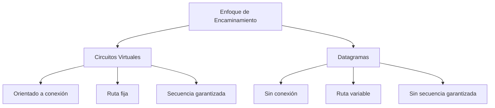
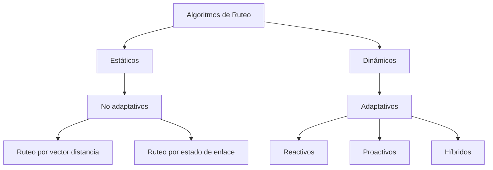
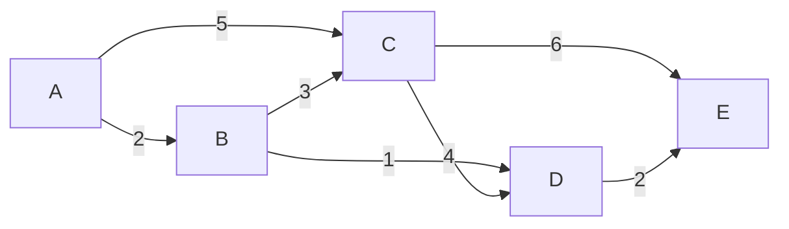
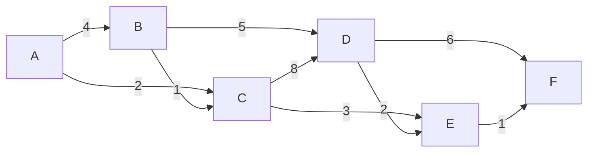

# Redes de Computadoras - Interconexión de redes de computadoras

## 4.1 Retransmisión de información. Circuitos virtuales y datagramas; algoritmos de ruteo; problemas de congestion.

---

La interconexión de redes permite conectar diferentes redes de computadoras para formar una red más grande y funcional. Este proceso implica el diseño e implementación de mecanismos que faciliten la comunicación entre dispositivos a través de múltiples redes.

### Retransmisión de Información

#### Definición y Conceptos Fundamentales

La retransmisión de información se refiere al proceso de reenviar paquetes de datos a través de dispositivos intermedios en una red para alcanzar su destino final.

**Dispositivos de retransmisión:**

- **Repetidores:** Regeneran señales a nivel físico
- **Bridges/Puentes:** Operan en la capa de enlace de datos
- **Routers/Encaminadores:** Operan en la capa de red
- **Gateways/Pasarelas:** Operan en múltiples capas

#### Funcionamiento de la Retransmisión

```python
class PacketForwarder:
    def __init__(self, routing_table):
        self.routing_table = routing_table
        self.buffer = []

    def forward_packet(self, packet, destination):
        next_hop = self.lookup_routing_table(destination)
        if next_hop:
            self.send_to_next_hop(packet, next_hop)
            return True
        return False

    def lookup_routing_table(self, destination):
        # Algoritmo de búsqueda en tabla de routing
        return self.routing_table.get(destination)
```

### Circuitos Virtuales y Datagramas

#### Circuitos Virtuales

**Definición:** Un circuito virtual establece una ruta predefinida a través de la red antes de que comience la transferencia de datos.

**Características:**

- Establecimiento de conexión previo
- Todos los paquetes siguen la misma ruta
- Control de flujo y errores
- Secuencia de paquetes garantizada

**Fases de operación:**

1. Establecimiento del circuito
2. Transferencia de datos
3. Liberación del circuito

#### Datagramas

**Definición:** Cada paquete se encamina independientemente sin establecer una conexión previa.

**Características:**

- Sin establecimiento de conexión
- Cada paquete se encamina independientemente
- Posibles rutas diferentes para cada paquete
- No hay garantía de orden de llegada

#### Comparación



**Tabla Comparativa:**

| Característica        | Circuitos Virtuales       | Datagramas         |
| --------------------- | ------------------------- | ------------------ |
| Establecimiento       | Requerido                 | No requerido       |
| Direccionamiento      | Identificador de circuito | Dirección completa |
| Ruta                  | Fija                      | Variable           |
| Orden de paquetes     | Garantizado               | No garantizado     |
| Control de congestión | Más fácil                 | Más complejo       |

### Algoritmos de Ruteo

#### Clasificación de Algoritmos



#### Algoritmo de Vector Distancia

**Ecuación de actualización:**
$$ D_x(y) = min_v\{c(x,v) + D_v(y)\} $$

Donde:

- $D_x(y)$ = costo mínimo de x a y
- $c(x,v)$ = costo del enlace directo de x a v
- $D_v(y)$ = costo reportado por v para llegar a y

**Ejemplo - Algoritmo de Bellman-Ford:**

```python
class DistanceVectorRouting:
    def __init__(self, node_id, neighbors):
        self.node_id = node_id
        self.distance_vector = {node_id: 0}
        self.neighbors = neighbors
        self.routing_table = {}

    def update_routing_table(self):
        updated = False
        for destination in self.get_all_destinations():
            min_cost = float('inf')
            best_next_hop = None

            for neighbor, cost in self.neighbors.items():
                neighbor_dv = self.get_neighbor_dv(neighbor)
                if destination in neighbor_dv:
                    total_cost = cost + neighbor_dv[destination]
                    if total_cost < min_cost:
                        min_cost = total_cost
                        best_next_hop = neighbor

            if min_cost != self.distance_vector.get(destination, float('inf')):
                self.distance_vector[destination] = min_cost
                self.routing_table[destination] = best_next_hop
                updated = True

        return updated
```

#### Algoritmo de Estado de Enlace

**Proceso del algoritmo:**

1. Detección de vecinos
2. Medición de costos de enlace
3. Construcción del paquete de estado de enlace
4. Distribución del paquete mediante flooding
5. Cálculo de rutas usando el algoritmo de Dijkstra

**Algoritmo de Dijkstra:**

```python
import heapq

def dijkstra(graph, start_node):
    # Inicialización
    distances = {node: float('inf') for node in graph}
    distances[start_node] = 0
    previous_nodes = {node: None for node in graph}
    priority_queue = [(0, start_node)]

    while priority_queue:
        current_distance, current_node = heapq.heappop(priority_queue)

        # Si encontramos una distancia mejor, la ignoramos
        if current_distance > distances[current_node]:
            continue

        for neighbor, weight in graph[current_node].items():
            distance = current_distance + weight

            # Si encontramos un camino más corto
            if distance < distances[neighbor]:
                distances[neighbor] = distance
                previous_nodes[neighbor] = current_node
                heapq.heappush(priority_queue, (distance, neighbor))

    return distances, previous_nodes
```

#### Ejemplo de Aplicación

**Problema:** Calcular las rutas más cortas desde el nodo A en la siguiente topología:



**Solución usando Dijkstra:**

| Paso | Nodo | Distancia desde A | Ruta    |
| ---- | ---- | ----------------- | ------- |
| 1    | A    | 0                 | A       |
| 2    | B    | 2                 | A→B     |
| 3    | C    | 5                 | A→C     |
| 4    | D    | 3                 | A→B→D   |
| 5    | E    | 5                 | A→B→D→E |

### Problemas de Congestión

#### Definición y Causas

**Congestión:** Ocurre cuando la demanda de recursos de red excede la capacidad disponible.

**Causas principales:**

- Capacidad de buffer insufciente
- Ancho de banda limitado
- Procesamiento lento en routers
- Tráfico bursty

#### Métricas de Congestión

- **Throughput:** $ Throughput = \frac{Datos\ transmitidos}{Tiempo} $
- **Delay:** $ Delay = D_{proc} + D_{queue} + D_{trans} + D_{prop} $
- **Pérdida de paquetes:** $ Loss\ Rate = \frac{Paquetes\ perdidos}{Paquetes\ enviados} $

#### Mecanismos de Control de Congestión

##### Control Preventivo

**Algoritmo de la cubeta con fugas (Leaky Bucket):**

```python
class LeakyBucket:
    def __init__(self, capacity, leak_rate):
        self.capacity = capacity
        self.leak_rate = leak_rate
        self.current_level = 0
        self.last_leak_time = time.time()

    def add_packet(self, packet_size):
        current_time = time.time()
        time_elapsed = current_time - self.last_leak_time

        # Calcular fuga
        leak_amount = self.leak_rate * time_elapsed
        self.current_level = max(0, self.current_level - leak_amount)
        self.last_leak_time = current_time

        # Verificar si hay espacio
        if self.current_level + packet_size <= self.capacity:
            self.current_level += packet_size
            return True  # Paquete aceptado
        else:
            return False  # Paquete descartado
```

**Algoritmo del cubo token (Token Bucket):**

```python
class TokenBucket:
    def __init__(self, capacity, fill_rate):
        self.capacity = capacity
        self.fill_rate = fill_rate
        self.tokens = capacity
        self.last_fill_time = time.time()

    def consume(self, tokens_required):
        current_time = time.time()
        time_elapsed = current_time - self.last_fill_time

        # Agregar tokens nuevos
        new_tokens = self.fill_rate * time_elapsed
        self.tokens = min(self.capacity, self.tokens + new_tokens)
        self.last_fill_time = current_time

        # Verificar si hay tokens suficientes
        if self.tokens >= tokens_required:
            self.tokens -= tokens_required
            return True
        else:
            return False
```

##### Control Reactivo

**Algoritmo de TCP para control de congestión:**

```python
class TCPCongestionControl:
    def __init__(self):
        self.cwnd = 1  # Congestion Window
        self.ssthresh = 65535  # Slow Start Threshold
        self.state = "slow_start"

    def on_ack_received(self):
        if self.state == "slow_start":
            self.cwnd *= 2
            if self.cwnd >= self.ssthresh:
                self.state = "congestion_avoidance"
        else:  # congestion_avoidance
            self.cwnd += 1

    def on_timeout(self):
        self.ssthresh = max(self.cwnd // 2, 2)
        self.cwnd = 1
        self.state = "slow_start"

    def on_duplicate_ack(self):
        self.ssthresh = max(self.cwnd // 2, 2)
        self.cwnd = self.ssthresh + 3
        self.state = "fast_recovery"
```

#### Ejercicios Propuestos

##### Ejercicio 1: Algoritmo de Vector Distancia

Dada la siguiente tabla de enrutamiento inicial para el nodo A:

| Destino | Costo | Siguiente Salto |
| ------- | ----- | --------------- |
| B       | 2     | B               |
| C       | 5     | C               |
| D       | ∞     | -               |
| E       | ∞     | -               |

Y recibes los siguientes vectores de distancia:

- De B: {A:2, C:3, D:1, E:∞}
- De C: {A:5, B:3, D:4, E:6}

**Calcular la nueva tabla de enrutamiento para el nodo A.**

##### Ejercicio 2: Algoritmo de Dijkstra

Aplicar el algoritmo de Dijkstra para encontrar las rutas más cortas desde el nodo A:



##### Ejercicio 3: Control de Congestión

Un router tiene una capacidad de buffer de 100 paquetes y usa el algoritmo de cubeta con fugas con tasa de 10 paquetes/segundo. Si llegan los siguientes paquetes:

- t=0s: 15 paquetes
- t=1s: 20 paquetes
- t=2s: 25 paquetes
- t=3s: 30 paquetes

**¿Cuántos paquetes serán descartados y cuál será el nivel de la cubeta en cada instante?**

### Casos de Estudio y Aplicaciones

#### Protocolos de Ruteo en Internet

**RIP (Routing Information Protocol):**

- Usa vector distancia
- Métrica: hop count
- Límite de 15 saltos
- Actualizaciones cada 30 segundos

**OSPF (Open Shortest Path First):**

- Usa estado de enlace
- Áreas jerárquicas
- Métricas basadas en costo
- Convergencia rápida

**BGP (Border Gateway Protocol):**

- Protocolo de gateway exterior
- Ruteo basado en políticas
- Vector de path attributes

#### Simulación de Redes

```python
import simpy
import random

class NetworkSimulation:
    def __init__(self, env, bandwidth, delay):
        self.env = env
        self.bandwidth = bandwidth
        self.delay = delay
        self.queue = simpy.Store(env)
        self.packets_sent = 0
        self.packets_dropped = 0

    def packet_generator(self, arrival_rate):
        while True:
            yield self.env.timeout(random.expovariate(arrival_rate))
            packet_size = random.randint(64, 1500)
            if len(self.queue.items) < 100:  # Buffer limit
                self.queue.put(packet_size)
                self.packets_sent += 1
            else:
                self.packets_dropped += 1

    def packet_processor(self):
        while True:
            packet = yield self.queue.get()
            transmission_time = packet * 8 / self.bandwidth
            yield self.env.timeout(transmission_time + self.delay)
```

### Referencias Bibliográficas

#### Bibliografía Básica

1. Kurose, J. F., & Ross, K. W. (2010). _Computer Networking: A Top-Down Approach_. Addison-Wesley.
2. Tanenbaum, A. S., & Wetherall, D. J. (2010). _Computer Networks_. Prentice Hall.
3. Peterson, L. L., & Davie, B. S. (2011). _Computer Networks: A Systems Approach_. Morgan Kaufmann.
4. Stallings, W. (2010). _Data and Computer Communications_. Prentice Hall.

#### Bibliografía Complementaria

1. Black, U. D. (2000). _IP Routing Protocols: RIP, OSPF, BGP, PNNI and Cisco Routing Protocols_. Prentice-Hall.
2. Holzmann, G. J. (1991). _Design and Validation of Computer Protocols_. Prentice-Hall.

### Soluciones a Ejercicios Propuestos

#### Solución Ejercicio 1

**Nueva tabla de enrutamiento para nodo A:**

| Destino | Costo | Siguiente Salto | Cálculo            |
| ------- | ----- | --------------- | ------------------ |
| B       | 2     | B               | Directo            |
| C       | 5     | C               | Directo            |
| D       | 3     | B               | min(2+1, 5+4) = 3  |
| E       | 11    | C               | min(2+∞, 5+6) = 11 |

#### Solución Ejercicio 2

**Resultados de Dijkstra desde nodo A:**

| Nodo | Distancia | Ruta    |
| ---- | --------- | ------- |
| A    | 0         | A       |
| B    | 4         | A→B     |
| C    | 2         | A→C     |
| D    | 7         | A→B→C→D |
| E    | 5         | A→C→E   |
| F    | 6         | A→C→E→F |

#### Solución Ejercicio 3

**Evolución de la cubeta con fugas:**

| Tiempo | Llegada | Fuga | Nivel antes | Nivel después | Descartados |
| ------ | ------- | ---- | ----------- | ------------- | ----------- |
| 0s     | 15      | 0    | 0           | 15            | 0           |
| 1s     | 20      | 10   | 15          | 25            | 0           |
| 2s     | 25      | 10   | 25          | 40            | 0           |
| 3s     | 30      | 10   | 40          | 60            | 0           |

**Total de paquetes descartados: 0**
