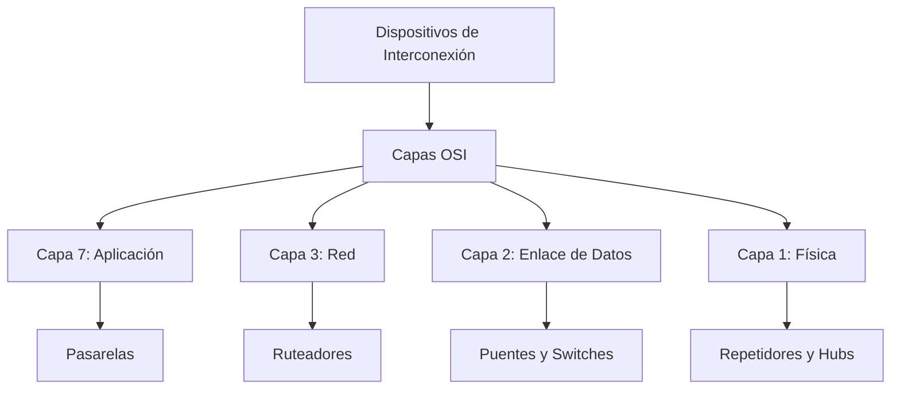
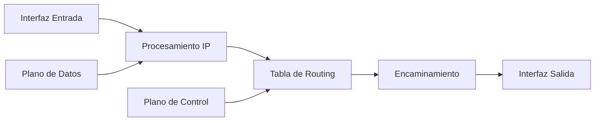
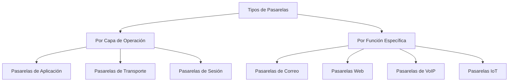
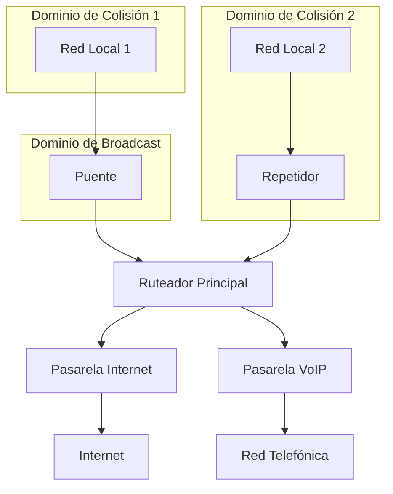
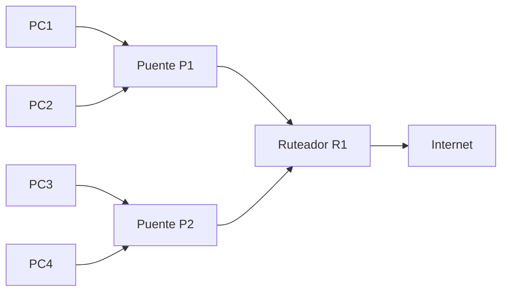

# Redes de Computadoras - Interconexión de redes de computadoras

## 4.2 Interconexión de redes locales. Repetidores, puentes, ruteadores, pasarelas.

---

La interconexión de redes locales permite conectar múltiples segmentos de red para formar una infraestructura de comunicación más extensa y funcional. Los dispositivos de interconexión operan en diferentes capas del modelo OSI y cumplen funciones específicas según su nivel de operación.

### Modelo de Capas OSI y Dispositivos de Interconexión



### Repetidores (Repeaters)

#### Definición y Características

**Definición:** Dispositivos que operan en la **capa física** del modelo OSI y se utilizan para regenerar señales eléctricas que se han attenuado durante la transmisión.

**Características principales:**

- Operan en la capa física (Capa 1 OSI)
- Regeneran señales eléctricas
- No examinan direcciones MAC o IP
- Conectan segmentos idénticos de red
- Extienden la distancia física de la red

#### Funcionamiento Técnico

**Fórmula de atenuación de señal:**
$$ P_{salida} = P_{entrada} \times 10^{-\alpha L/10} $$

Donde:

- $P_{salida}$ = Potencia de salida (dBm)
- $P_{entrada}$ = Potencia de entrada (dBm)
- $\alpha$ = Coeficiente de atenuación (dB/km)
- $L$ = Longitud del medio (km)

**Ejemplo de implementación:**

```python
class Repeater:
    def __init__(self, gain_threshold, noise_factor):
        self.gain_threshold = gain_threshold
        self.noise_factor = noise_factor
        self.signal_buffer = []

    def process_signal(self, input_signal):
        """
        Procesa y regenera una señal de entrada
        """
        # Medir potencia de entrada
        input_power = self.measure_power(input_signal)

        # Aplicar ganancia si la señal está por debajo del umbral
        if input_power < self.gain_threshold:
            output_signal = self.amplify_signal(input_signal)
        else:
            output_signal = self.regenerate_signal(input_signal)

        # Agregar ruido del repetidor
        output_signal = self.add_noise(output_signal, self.noise_factor)

        return output_signal

    def measure_power(self, signal):
        return sum(x**2 for x in signal) / len(signal)

    def amplify_signal(self, signal):
        amplification_factor = self.gain_threshold / self.measure_power(signal)
        return [x * amplification_factor for x in signal]

    def regenerate_signal(self, signal):
        # Reconstrucción digital de la señal
        return [1 if x > 0.5 else 0 for x in signal]
```

#### Aplicaciones y Limitaciones

**Aplicaciones comunes:**

- Extensión de cables Ethernet más allá de 100m
- Conexión de segmentos de red en edificios grandes
- Sistemas de cableado estructurado

**Limitaciones:**

- No separan dominios de colisión
- Propagación de errores
- Ancho de banda compartido
- Número limitado por estándares (ej: 4 repetidores máximo en Ethernet)

### Puentes (Bridges)

#### Definición y Funcionamiento

**Definición:** Dispositivos que operan en la **capa de enlace de datos** y conectan segmentos de red basándose en direcciones MAC.

**Características principales:**

- Operan en capa 2 (Enlace de datos)
- Filtrado basado en direcciones MAC
- Crean dominios de colisión separados
- Protocolo Spanning Tree para evitar bucles
- Aprendizaje automático de direcciones

#### Algoritmo de Aprendizaje y Forwarding

```python
class EthernetBridge:
    def __init__(self, ports):
        self.ports = ports
        self.mac_table = {}  # MAC -> Puerto
        self.aging_time = 300  # 5 minutos

    def process_frame(self, frame, input_port):
        """
        Procesa un frame Ethernet entrante
        """
        src_mac = frame.source_mac
        dst_mac = frame.destination_mac

        # Aprendizaje: actualizar tabla MAC
        self.learn_mac_address(src_mac, input_port)

        # Decisión de forwarding
        if self.is_broadcast(dst_mac):
            self.flood_frame(frame, input_port)
        else:
            output_port = self.mac_table.get(dst_mac)
            if output_port:
                self.forward_frame(frame, output_port)
            else:
                self.flood_frame(frame, input_port)

    def learn_mac_address(self, mac, port):
        self.mac_table[mac] = {
            'port': port,
            'timestamp': time.time()
        }

    def flood_frame(self, frame, except_port):
        for port in self.ports:
            if port != except_port:
                self.forward_frame(frame, port)

    def cleanup_old_entries(self):
        current_time = time.time()
        expired_macs = [
            mac for mac, info in self.mac_table.items()
            if current_time - info['timestamp'] > self.aging_time
        ]
        for mac in expired_macs:
            del self.mac_table[mac]
```

#### Protocolo Spanning Tree (STP)

**Objetivo:** Prevenir bucles en topologías de red con múltiples caminos.

**Algoritmo básico:**

1. Elección del bridge raíz
2. Determinación de puertos raíz
3. Selección de puertos designados
4. Bloqueo de puertos alternativos

**Fórmula de costo de ruta:**
$$ Costo = \frac{Bandwidth\ de\ referencia}{Bandwidth\ del\ enlace} $$

| Velocidad | Costo STP |
| --------- | --------- |
| 10 Mbps   | 100       |
| 100 Mbps  | 19        |
| 1 Gbps    | 4         |
| 10 Gbps   | 2         |

### Ruteadores (Routers)

#### Definición y Funcionalidades

**Definición:** Dispositivos que operan en la **capa de red** y conectan diferentes redes basándose en direcciones IP.

**Características principales:**

- Operan en capa 3 (Red)
- Toma de decisiones basada en direcciones IP
- Separación de dominios de broadcast
- Soporte para múltiples protocolos de routing
- Funciones de seguridad (ACLs, NAT, Firewall)

#### Arquitectura Interna



#### Procesamiento de Paquetes IP

```python
class IPRouter:
    def __init__(self, routing_table, interfaces):
        self.routing_table = routing_table
        self.interfaces = interfaces
        self.forwarding_cache = {}

    def route_packet(self, ip_packet, input_interface):
        """
        Procesa y encamina un paquete IP
        """
        # Verificar checksum
        if not self.verify_checksum(ip_packet):
            return "Checksum error"

        # Decrementar TTL
        ip_packet.ttl -= 1
        if ip_packet.ttl == 0:
            return "TTL exceeded"

        # Buscar ruta
        destination_ip = ip_packet.destination_ip
        next_hop = self.lookup_route(destination_ip)

        if next_hop:
            # Actualizar checksum
            ip_packet.update_checksum()

            # Forwarding
            output_interface = self.get_output_interface(next_hop)
            self.forward_to_interface(ip_packet, output_interface)
            return "Forwarded"
        else:
            return "No route to host"

    def lookup_route(self, destination_ip):
        """
        Búsqueda de ruta usando longest prefix match
        """
        best_match = None
        longest_prefix = -1

        for network, prefix_length, next_hop in self.routing_table:
            if self.ip_in_network(destination_ip, network, prefix_length):
                if prefix_length > longest_prefix:
                    longest_prefix = prefix_length
                    best_match = next_hop

        return best_match

    def ip_in_network(self, ip, network, prefix_length):
        # Conversión de IP a entero para comparación
        ip_int = self.ip_to_int(ip)
        network_int = self.ip_to_int(network)
        mask = (1 << 32) - (1 << (32 - prefix_length))

        return (ip_int & mask) == (network_int & mask)
```

#### Tablas de Routing

**Estructura típica de una tabla de routing:**

| Red Destino | Máscara       | Next Hop      | Interfaz | Métrica |
| ----------- | ------------- | ------------- | -------- | ------- |
| 192.168.1.0 | 255.255.255.0 | 0.0.0.0       | eth0     | 10      |
| 10.0.0.0    | 255.0.0.0     | 192.168.1.1   | eth0     | 5       |
| 0.0.0.0     | 0.0.0.0       | 192.168.1.254 | eth0     | 1       |

### Pasarelas (Gateways)

#### Definición y Alcance

**Definición:** Dispositivos que operan en **múltiples capas** del modelo OSI y permiten la interconexión entre redes con diferentes arquitecturas y protocolos.

**Características principales:**

- Operan en capas superiores (4-7)
- Conversión de protocolos
- Traducción de direcciones
- Funciones de aplicación específicas
- Conectividad entre redes heterogéneas

#### Tipos de Pasarelas



#### Arquitectura de una Pasarela

```python
class ApplicationGateway:
    def __init__(self, protocol_mappings, translation_rules):
        self.protocol_mappings = protocol_mappings
        self.translation_rules = translation_rules
        self.session_table = {}

    def process_message(self, message, source_protocol):
        """
        Procesa y traduce mensajes entre protocolos
        """
        # Identificar protocolo destino
        target_protocol = self.protocol_mappings.get(source_protocol)

        if not target_protocol:
            return "Protocol not supported"

        # Aplicar reglas de traducción
        translated_message = self.translate_message(
            message,
            source_protocol,
            target_protocol
        )

        # Mantener estado de sesión si es necesario
        session_id = self.get_session_id(message)
        if session_id:
            self.update_session_table(session_id, translated_message)

        return translated_message

    def translate_message(self, message, src_protocol, dst_protocol):
        """
        Traduce mensajes entre diferentes protocolos de aplicación
        """
        translation_rule = self.translation_rules.get(
            (src_protocol, dst_protocol)
        )

        if translation_rule:
            return translation_rule.apply(message)
        else:
            return self.default_translation(message, src_protocol, dst_protocol)

    def default_translation(self, message, src_protocol, dst_protocol):
        # Traducción genérica de campos comunes
        common_fields = self.extract_common_fields(message, src_protocol)
        return self.construct_message(common_fields, dst_protocol)
```

### Comparativa de Dispositivos

#### Tabla Comparativa Completa

| Característica        | Repetidores | Puentes  | Ruteadores | Pasarelas  |
| --------------------- | ----------- | -------- | ---------- | ---------- |
| **Capa OSI**          | 1           | 2        | 3          | 4-7        |
| **Direccionamiento**  | Señales     | MAC      | IP         | Aplicación |
| **Dominio Colisión**  | Mismo       | Separado | Separado   | Separado   |
| **Dominio Broadcast** | Mismo       | Mismo    | Separado   | Separado   |
| **Inteligencia**      | Baja        | Media    | Alta       | Muy Alta   |
| **Costo**             | Bajo        | Medio    | Alto       | Muy Alto   |
| **Protocolos**        | Físicos     | MAC      | IP, ICMP   | Múltiples  |

#### Ejemplo de Escenario Integrado



### Ejercicios Propuestos

#### Ejercicio 1: Diseño de Red con Dispositivos de Interconexión

**Enunciado:** Una empresa necesita conectar 4 departamentos con las siguientes características:

- Departamento A: 50 PCs, tráfico interno intenso
- Departamento B: 30 PCs, acceso frecuente a servidores en Departamento A
- Departamento C: 20 PCs, requiere conexión a Internet
- Departamento D: 10 PCs, tráfico muy bajo

**Requisitos:**

- Separar dominios de colisión
- Optimizar el rendimiento
- Controlar el tráfico entre departamentos
- Conexión a Internet compartida

**Diseña la topología indicando:** tipos de dispositivos a usar, ubicación de cada dispositivo y justificación técnica de las decisiones.

#### Ejercicio 2: Análisis de Tablas MAC y Routing

**Enunciado:** Dada la siguiente topología:



**Direcciones MAC:**

- PC1: AA:AA:AA:AA:AA:AA
- PC2: BB:BB:BB:BB:BB:BB
- PC3: CC:CC:CC:CC:CC:CC
- PC4: DD:DD:DD:DD:DD:DD

**Direcciones IP:**

- PC1: 192.168.1.10/24
- PC2: 192.168.1.11/24
- PC3: 192.168.2.10/24
- PC4: 192.168.2.11/24
- R1 eth0: 192.168.1.1/24
- R1 eth1: 192.168.2.1/24

**Preguntas:**

1. ¿Cómo se vería la tabla MAC del puente P1 después de que PC1 envíe un paquete a PC2?
2. ¿Qué ocurre cuando PC1 intenta comunicarse con PC3?
3. ¿Cómo debe configurarse la tabla de routing en R1?
4. ¿Qué dispositivo responde a una solicitud ARP de PC1 para PC3?

#### Ejercicio 3: Configuración de Pasarela

**Enunciado:** Diseña una pasarela que traduzca entre protocolos HTTP y CoAP (Protocolo de Aplicación para Constreñidos) para dispositivos IoT.

**Especificaciones:**

- HTTP → CoAP: Convertir métodos HTTP a métodos CoAP equivalentes
- CoAP → HTTP: Traducir códigos de respuesta CoAP a HTTP
- Manejar diferencias en headers y formatos de mensaje

**Desarrolla:**

1. Tabla de mapeo de métodos HTTP/CoAP
2. Algoritmo de traducción de headers
3. Manejo de sesiones stateful/stateless

### Casos de Estudio Realistas

#### Caso 1: Migración de Red Corporativa

**Situación:** Una empresa con red basada en hubs y repetidores necesita modernizar su infraestructura debido a problemas de rendimiento.

**Solución propuesta:**

- Reemplazar hubs por switches (puentes multipuerto)
- Implementar ruteadores para segmentar la red
- Usar pasarelas para servicios específicos (VoIP, video)

#### Caso 2: Integración de Redes Heterogéneas

**Situación:** Fusión de dos empresas con diferentes tecnologías de red:

- Empresa A: Red Ethernet tradicional
- Empresa B: Red industrial con protocolos propietarios

**Solución:** Implementación de pasarelas de aplicación para permitir la comunicación entre sistemas dispares.

### Referencias Bibliográficas

#### Bibliografía Básica

1. **Tanenbaum, A. S., & Wetherall, D. J. (2010).** _Computer Networks_. Prentice Hall. - Capítulos 4 y 5
2. **Kurose, J. F., & Ross, K. W. (2010).** _Computer Networking: A Top-Down Approach_. Addison-Wesley. - Capítulos 4 y 5
3. **Stallings, W. (2010).** _Data and Computer Communications_. Prentice Hall. - Capítulos 15 y 16

#### Bibliografía Complementaria

1. **IEEE 802.1D** - Standard for MAC Bridges
2. **RFC 1812** - Requirements for IP Version 4 Routers
3. **Black, U. D. (1993).** _Computer Networks: Protocols, Standards, and Interfaces_. Prentice Hall.
