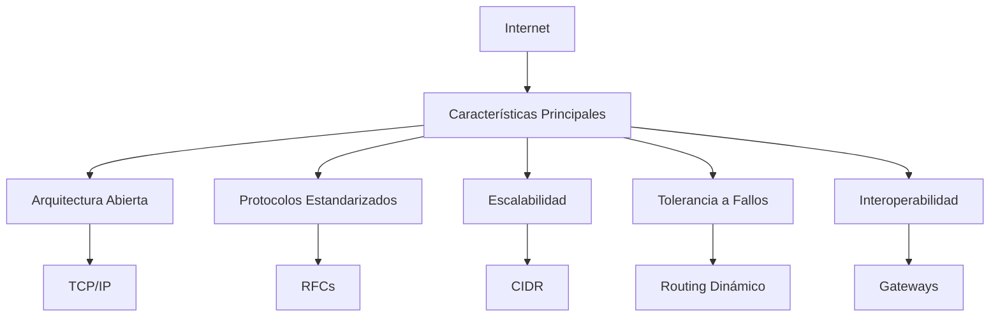
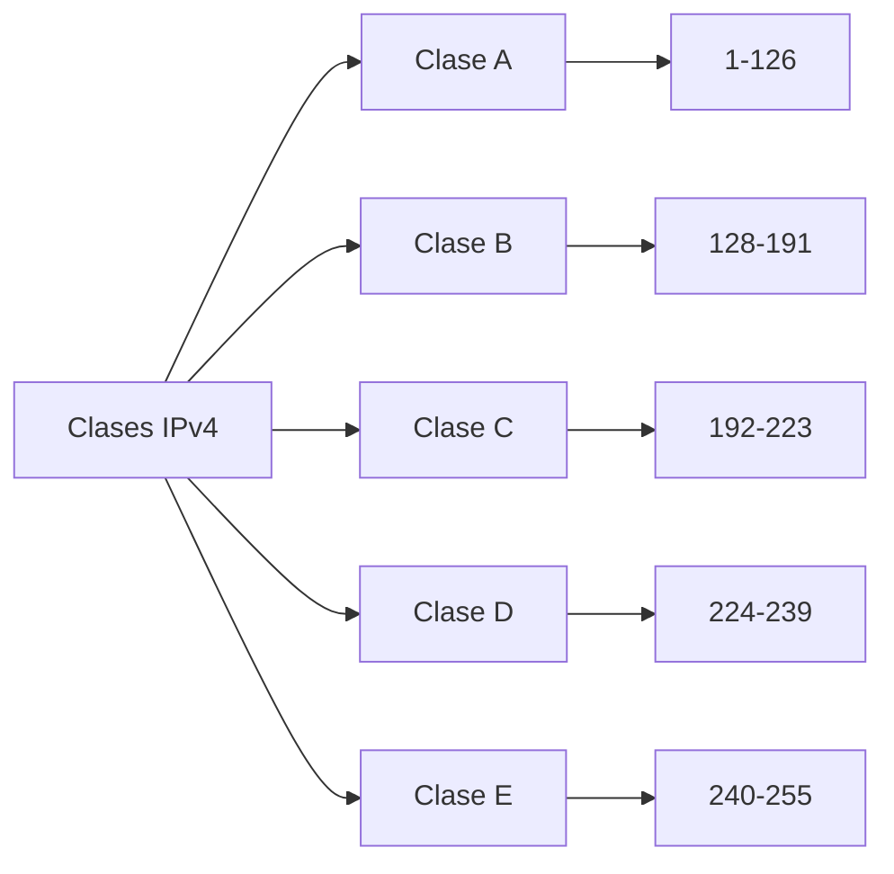
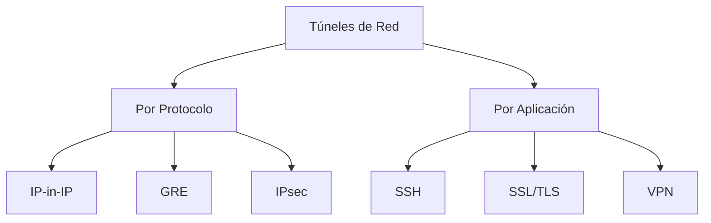
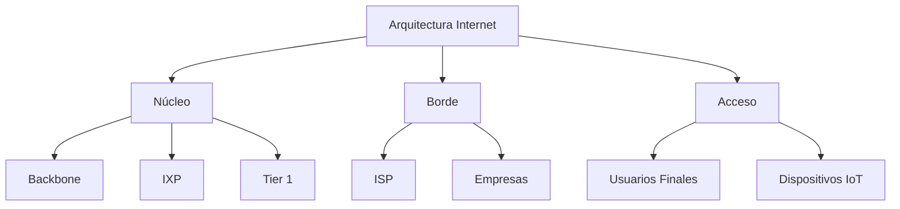

# Redes de Computadoras - Interconexión de redes de computadoras

## 4.3 Internet. Características generales; manejo de direcciones (físicas y lógicas); IPv4; redes virtuales y túneles; subredes; características generales.

---

**Internet** es una red global de redes de computadoras interconectadas que utilizan el protocolo TCP/IP para comunicarse. Es una "red de redes" que conecta millones de dispositivos en todo el mundo.

**Características principales:**

- Arquitectura descentralizada
- Protocolo TCP/IP como estándar
- Escalabilidad y robustez
- Interconexión de redes heterogéneas
- Servicios distribuidos



### Manejo de Direcciones

#### Direcciones Físicas (MAC)

**Definición:** Dirección única asignada por el fabricante a cada interfaz de red, operando en la capa de enlace de datos.

**Formato:** 48 bits representados en hexadecimal

$$ MAC = XX:XX:XX:XX:XX:XX $$

**Estructura:**

- **24 bits primeros:** OUI (Organizational Unique Identifier)
- **24 bits últimos:** Número de serie del fabricante

```python
class MACAddress:
    def __init__(self, address):
        self.address = self.normalize(address)

    def normalize(self, mac):
        """Normaliza formato MAC a 00:00:00:00:00:00"""
        mac = mac.replace('-', ':').lower()
        parts = mac.split(':')
        if len(parts) != 6:
            raise ValueError("Formato MAC inválido")
        return ':'.join(part.zfill(2) for part in parts)

    def get_manufacturer(self):
        """Obtiene fabricante basado en OUI"""
        oui = self.address[:8]
        # Base de datos OUI (ejemplo simplificado)
        oui_database = {
            "00:0c:29": "VMware",
            "00:50:56": "VMware",
            "08:00:27": "Oracle VirtualBox",
            "a4:4c:c8": "Dell",
            "fc:15:b4": "Samsung"
        }
        return oui_database.get(oui, "Desconocido")

    def is_unicast(self):
        """Verifica si es dirección unicast"""
        first_byte = int(self.address[:2], 16)
        return (first_byte & 0x01) == 0

    def is_multicast(self):
        """Verifica si es dirección multicast"""
        first_byte = int(self.address[:2], 16)
        return (first_byte & 0x01) == 1

# Ejemplo de uso
mac = MACAddress("00:0C:29:AB:CD:EF")
print(f"Fabricante: {mac.get_manufacturer()}")
print(f"Unicast: {mac.is_unicast()}")
```

#### Direcciones Lógicas (IP)

**Definición:** Dirección asignada lógicamente a un dispositivo en la capa de red, permitiendo el routing entre redes.

**Tipos:**

- **IPv4:** 32 bits (4.3 billones de direcciones)
- **IPv6:** 128 bits (3.4×10³⁸ direcciones)

### IPv4 (Internet Protocol Version 4)

#### Estructura de IPv4

**Formato:** 32 bits divididos en 4 octetos

$$ IPv4 = A.B.C.D \quad donde \quad A,B,C,D \in [0,255] $$

**Representación binaria:**

$$ IPv4 = 11000000.10101000.00000001.00000001 = 192.168.1.1 $$

#### Clases de Direcciones IPv4



**Fórmulas para cálculo de direcciones por clase:**

**Clase A:**

- Redes: $2^7 - 2 = 126$
- Hosts por red: $2^{24} - 2 = 16,777,214$

**Clase B:**

- Redes: $2^{14} = 16,384$
- Hosts por red: $2^{16} - 2 = 65,534$

**Clase C:**

- Redes: $2^{21} = 2,097,152$
- Hosts por red: $2^8 - 2 = 254$

#### Implementación de Clases IPv4

```python
class IPv4Address:
    def __init__(self, address):
        self.address = address
        self.octets = [int(octet) for octet in address.split('.')]
        self.binary = ''.join(f'{octet:08b}' for octet in self.octets)

    def get_class(self):
        """Determina la clase de la dirección IP"""
        first_octet = self.octets[0]

        if 1 <= first_octet <= 126:
            return 'A'
        elif 128 <= first_octet <= 191:
            return 'B'
        elif 192 <= first_octet <= 223:
            return 'C'
        elif 224 <= first_octet <= 239:
            return 'D'  # Multicast
        elif 240 <= first_octet <= 255:
            return 'E'  # Experimental
        else:
            return 'Desconocida'

    def is_private(self):
        """Verifica si es dirección privada"""
        first_octet, second_octet = self.octets[0], self.octets[1]

        # Clase A privada: 10.0.0.0/8
        if first_octet == 10:
            return True
        # Clase B privada: 172.16.0.0/12
        elif first_octet == 172 and 16 <= second_octet <= 31:
            return True
        # Clase C privada: 192.168.0.0/16
        elif first_octet == 192 and second_octet == 168:
            return True
        return False

    def is_loopback(self):
        """Verifica si es dirección loopback"""
        return self.octets[0] == 127

    def to_binary(self):
        return self.binary

    def to_hex(self):
        return '.'.join(f'{octet:02x}' for octet in self.octets)

# Ejemplos de uso
ips_ejemplo = [
    "10.0.0.1",
    "172.16.0.1",
    "192.168.1.1",
    "8.8.8.8",
    "224.0.0.1",
    "127.0.0.1"
]

for ip in ips_ejemplo:
    ip_obj = IPv4Address(ip)
    print(f"IP: {ip} | Clase: {ip_obj.get_class()} | Privada: {ip_obj.is_private()}")
```

### Máscaras de Red y Subredes

#### Concepto de Máscara de Red

**Definición:** Patrón de bits que identifica la porción de red y host en una dirección IP.

**Notación:**

- Decimal: 255.255.255.0
- CIDR: /24
- Binario: 11111111.11111111.11111111.00000000

#### Cálculo de Subredes

**Fórmulas principales:**

**Número de subredes:**
$$ Subredes = 2^n $$
donde $n$ = bits prestados de la parte de host.

**Hosts por subred:**
$$ Hosts = 2^m - 2 $$
donde $m$ = bits restantes para host.

**Máscara de subred:**
$$ \text{Máscara} = \text{Máscara}\_{base} + bits\_{prestados} $$

#### Implementación de Cálculo de Subredes

```python
class SubnetCalculator:
    def __init__(self, network_ip, cidr):
        self.network_ip = IPv4Address(network_ip)
        self.cidr = cidr
        self.mask = self.calculate_mask()

    def calculate_mask(self):
        """Calcula máscara a partir de CIDR"""
        mask_binary = '1' * self.cidr + '0' * (32 - self.cidr)
        octets = [mask_binary[i:i+8] for i in range(0, 32, 8)]
        return '.'.join(str(int(octet, 2)) for octet in octets)

    def get_network_address(self):
        """Calcula dirección de red"""
        network_binary = ''.join([
            '1' if self.network_ip.binary[i] == '1' and self.mask_binary[i] == '1'
            else '0' for i in range(32)
        ])
        return self.binary_to_ip(network_binary)

    def get_broadcast_address(self):
        """Calcula dirección de broadcast"""
        network_bin = self.ip_to_binary(self.get_network_address())
        host_bits = 32 - self.cidr
        broadcast_bin = network_bin[:self.cidr] + '1' * host_bits
        return self.binary_to_ip(broadcast_bin)

    def get_total_hosts(self):
        """Calcula número total de hosts"""
        return 2 ** (32 - self.cidr) - 2

    def get_useful_ip_range(self):
        """Obtiene rango de IPs útiles"""
        network = self.ip_to_binary(self.get_network_address())
        broadcast = self.ip_to_binary(self.get_broadcast_address())

        first_useful = self.binary_to_ip(network[:-1] + '1')
        last_useful = self.binary_to_ip(broadcast[:-1] + '0')

        return first_useful, last_useful

    def ip_to_binary(self, ip):
        octets = [int(octet) for octet in ip.split('.')]
        return ''.join(f'{octet:08b}' for octet in octets)

    def binary_to_ip(self, binary):
        octets = [binary[i:i+8] for i in range(0, 32, 8)]
        return '.'.join(str(int(octet, 2)) for octet in octets)

    @property
    def mask_binary(self):
        return self.ip_to_binary(self.mask)

# Ejemplo de uso
calculator = SubnetCalculator("192.168.1.0", 24)
print(f"Red: {calculator.get_network_address()}")
print(f"Broadcast: {calculator.get_broadcast_address()}")
print(f"Máscara: {calculator.mask}")
print(f"Hosts disponibles: {calculator.get_total_hosts()}")
print(f"Rango útil: {calculator.get_useful_ip_range()}")
```

### Redes Virtuales y Túneles

#### Concepto de Túneles

**Definición:** Mecanismo que permite transportar paquetes de un protocolo a través de una red que usa un protocolo diferente.

**Aplicaciones comunes:**

- VPNs (Virtual Private Networks)
- IPv6 sobre IPv4
- Protocolos de encapsulación

#### Tipos de Túneles



#### Implementación de Tunnel Básico

```python
import socket
import struct

class IPTunnel:
    def __init__(self, source_ip, dest_ip, protocol=4):
        self.source_ip = source_ip
        self.dest_ip = dest_ip
        self.protocol = protocol  # 4 = IP-in-IP

    def create_ip_header(self, payload, ttl=64):
        """Crea header IP para tunnel"""
        version_ihl = (4 << 4) | 5  # IPv4, IHL=5
        total_length = 20 + len(payload)
        identification = 54321
        flags_fragment = 0
        ttl = ttl
        protocol = self.protocol

        # Convertir IPs a formato binario
        src_ip = socket.inet_aton(self.source_ip)
        dst_ip = socket.inet_aton(self.dest_ip)

        # Calcular checksum
        checksum = 0
        pseudo_header = struct.pack('!BBHHHBBH4s4s',
                                  version_ihl, 0, total_length,
                                  identification, flags_fragment,
                                  ttl, protocol, checksum,
                                  src_ip, dst_ip)

        # Header IP final
        ip_header = struct.pack('!BBHHHBBH4s4s',
                               version_ihl, 0, total_length,
                               identification, flags_fragment,
                               ttl, protocol, checksum,
                               src_ip, dst_ip)

        return ip_header

    def encapsulate(self, inner_packet):
        """Encapsula paquete interno"""
        outer_header = self.create_ip_header(inner_packet)
        return outer_header + inner_packet

    def decapsulate(self, tunnel_packet):
        """Decapsula paquete del tunnel"""
        # Remover header exterior (primeros 20 bytes)
        inner_packet = tunnel_packet[20:]
        return inner_packet

# Ejemplo de uso
tunnel = IPTunnel("192.168.1.1", "10.0.0.1")

# Paquete interno (simulado)
inner_packet = b'\x45\x00\x00\x1c\x00\x00\x40\x00\x40\x11\x00\x00\xc0\xa8\x01\x01\x08\x08\x08\x08'

# Encapsulación
tunnel_packet = tunnel.encapsulate(inner_packet)
print(f"Paquete encapsulado: {len(tunnel_packet)} bytes")

# Decapsulación
recovered_packet = tunnel.decapsulate(tunnel_packet)
print(f"Paquete recuperado: {len(recovered_packet)} bytes")
```

### Ejercicios Propuestos

#### Ejercicio 1: Análisis de Direcciones IP

**Enunciado:** Para las siguientes direcciones IP, determina:

1. Clase de dirección
2. Si es pública o privada
3. Dirección de red
4. Dirección de broadcast
5. Rango de hosts útiles

**Direcciones:**

- 172.16.25.30/16
- 192.168.0.100/24
- 10.0.15.20/8
- 8.8.8.8/24

#### Ejercicio 2: Diseño de Subredes

**Enunciado:** Una empresa necesita dividir la red 192.168.50.0/24 en 6 subredes con los siguientes requerimientos:

- Subred A: 60 hosts
- Subred B: 30 hosts
- Subred C: 15 hosts
- Subred D: 10 hosts
- Subred E: 5 hosts
- Subred F: 2 hosts

**Calcula para cada subred:**

1. Máscara de subred
2. Dirección de red
3. Dirección de broadcast
4. Rango de IPs útiles
5. Número de hosts disponibles

#### Ejercicio 3: Implementación de Calculadora de Subredes

**Enunciado:** Desarrolla una clase en Python que permita:

```python
class AdvancedSubnetCalculator:
    def calculate_vlsm(self, network, requirements):
        """
        Calcula VLSM para una lista de requerimientos de hosts
        """
        pass

    def summarize_routes(self, networks):
        """
        Resume rutas usando CIDR
        """
        pass

    def validate_ip(self, ip):
        """
        Valida formato y tipo de IP
        """
        pass
```

**Requerimientos:**

- Soporte para VLSM (Variable Length Subnet Masking)
- Resumen de rutas
- Validación de direcciones
- Cálculo de supernets

### Características Generales de Internet

#### Arquitectura de Internet



#### Protocolos Fundamentales

**TCP/IP Stack:**

| Capa       | Protocolos           | Función                        |
| ---------- | -------------------- | ------------------------------ |
| Aplicación | HTTP, FTP, SMTP, DNS | Servicios de usuario           |
| Transporte | TCP, UDP             | Comunicación extremo a extremo |
| Internet   | IP, ICMP, ARP        | Routing y direccionamiento     |
| Enlace     | Ethernet, WiFi       | Acceso al medio                |

#### Sistema de Nombres de Dominio (DNS)

**Función:** Traduce nombres de dominio a direcciones IP

**Estructura jerárquica:**
$$ dominio = subdominio.dominio.tld $$

**Ejemplo de consulta DNS:**

```python
import socket

def dns_lookup(domain, record_type='A'):
    """
    Realiza consulta DNS
    """
    try:
        if record_type == 'A':
            return socket.gethostbyname(domain)
        elif record_type == 'MX':
            return socket.getaddrinfo(domain, None, socket.AF_INET)
    except socket.gaierror as e:
        return f"Error DNS: {e}"

# Ejemplos
print(f"Google: {dns_lookup('google.com')}")
print(f"UNAM: {dns_lookup('unam.mx')}")
```

### Ejercicio Integrador

#### Caso Práctico: Diseño de Red Corporativa

**Escenario:** Una empresa con sede central y 3 sucursales necesita:

**Sede Central:**

- 5 departamentos con 50 hosts cada uno
- Servidores: 20 hosts
- Red WiFi: 100 hosts móviles

**Sucursales:**

- Sucursal A: 30 hosts
- Sucursal B: 15 hosts
- Sucursal C: 10 hosts

**Requerimientos:**

1. Asignar bloque de direcciones 172.16.0.0/16
2. Diseñar esquema de subredes usando VLSM
3. Configurar túneles VPN entre sucursales
4. Reservar direcciones para crecimiento futuro

**Desarrolla:**

- Tabla de asignación de subredes
- Esquema de direccionamiento
- Configuración de túneles
- Plan de crecimiento (20% adicional)

### Referencias Bibliográficas

#### Bibliografía Básica

1. **Kurose, J. F., & Ross, K. W. (2010).** _Computer Networking: A Top-Down Approach_. Addison-Wesley. - Capítulos 4 y 5
2. **Tanenbaum, A. S., & Wetherall, D. J. (2010).** _Computer Networks_. Prentice Hall. - Capítulos 5 y 6
3. **Peterson, L. L., & Davie, B. S. (2011).** _Computer Networks: A Systems Approach_. Morgan Kaufmann. - Capítulo 3

#### RFCs Fundamentales

- **RFC 791** - Internet Protocol (IP)
- **RFC 1519** - Classless Inter-Domain Routing (CIDR)
- **RFC 1918** - Address Allocation for Private Internets
- **RFC 2003** - IP Encapsulation within IP

#### Estándares Importantes

- **IEEE 802.3** - Ethernet
- **IEEE 802.11** - Wireless LAN
- **ISO/IEC 11801** - Cableado Estructurado
