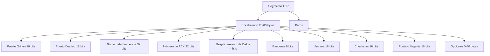
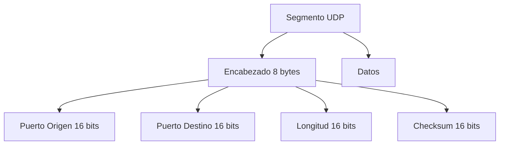
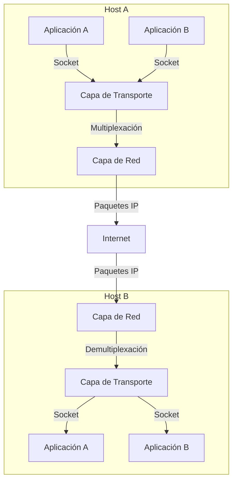

# Redes de Computadoras - Transporte

## 5.1 Características generales.

---

### Introducción a la Capa de Transporte

La capa de transporte constituye el cuarto nivel del modelo OSI y es fundamental en la arquitectura de redes. Su propósito principal es proporcionar comunicación lógica entre procesos de aplicación que se ejecutan en diferentes hosts, como si estuvieran directamente conectados.

#### Definición Fundamental

Según Kurose y Ross (2010), la capa de transporte ofrece **comunicación lógica** entre procesos de aplicación que se ejecutan en diferentes hosts. Mientras que la capa de red proporciona comunicación lógica entre hosts, la capa de transporte extiende este servicio a los procesos de aplicación.

### Funciones Principales de la Capa de Transporte

#### Multiplexación y Demultiplexación

La multiplexación permite que múltiples aplicaciones compartan la misma conexión de red, mientras que la demultiplexación dirige los datos recibidos a la aplicación correcta.

```python
# Ejemplo conceptual de demultiplexación
def demultiplexar_segmento(segmento, puerto_destino):
    """
    Función que simula la demultiplexación basada en puertos
    """
    aplicaciones = {
        80: "Servidor Web",
        443: "Servidor HTTPS",
        25: "Servidor SMTP",
        53: "Servidor DNS"
    }

    if puerto_destino in aplicaciones:
        return f"Segmento entregado a: {aplicaciones[puerto_destino]}"
    else:
        return "Segmento descartado - Puerto no registrado"

# Uso del ejemplo
segmento_ejemplo = "Datos HTTP"
print(demultiplexar_segmento(segmento_ejemplo, 80))
```

#### Entrega Confiable de Datos

Garantiza que los datos lleguen completos y en el orden correcto al proceso de destino, utilizando mecanismos como:

- **Números de secuencia**: $seq_{num} = (seq_{num} + longitud_{datos}) \mod 2^{32}$
- **Acuse de recibo**: $ACK = seq_{num} + longitud_{datos}$
- **Retransmisiones**: $timeout = RTT + 4 \times RTT_{var}$

#### Control de Congestión

Regula la tasa de transmisión para evitar la saturación de la red:

$$
Tasa_\text{transmisión} = \min(Ventana_\text{congestión}, Ventana_\text{recepción})
$$

#### Control de Flujo

Evita que un emisor rápido sature a un receptor lento:

$$
Ventana_{disponible} = Ventana_{recepcion} - (Ultimo_{enviado} - Ultimo_{confirmado})
$$

### Protocolos Principales de Transporte

#### TCP (Transmission Control Protocol)

**Características:**

- Orientado a conexión
- Entrega confiable
- Control de flujo
- Control de congestión
- Transferencia full-duplex

##### Estructura del Segmento TCP



#### UDP (User Datagram Protocol)

**Características:**

- No orientado a conexión
- No confiable
- Sin control de flujo
- Sin control de congestión
- Overhead mínimo

##### Estructura del Segmento UDP



### Modelo Matemático de TCP

#### Cálculo del Timeout

$$
RTT_{estimado} = (1 - \alpha) \times RTT_{estimado} + \alpha \times RTT_{muestra}
$$

$$
Dev_{RTT} = (1 - \beta) \times Dev_{RTT} + \beta \times |RTT_{muestra} - RTT_{estimado}|
$$

$$
Timeout = RTT_{estimado} + 4 \times Dev_{RTT}
$$

Donde típicamente $\alpha = 0.125$ y $\beta = 0.25$.

### Ejemplos Prácticos

#### Ejemplo 1: Establecimiento de Conexión TCP (Three-Way Handshake)

```python
class TCPHandshake:
    def __init__(self):
        self.estado = "CLOSED"

    def iniciar_conexion(self):
        # SYN
        self.estado = "SYN_SENT"
        print("Cliente → Servidor: SYN, seq=x")

        # SYN-ACK
        self.estado = "SYN_RECEIVED"
        print("Servidor → Cliente: SYN-ACK, seq=y, ack=x+1")

        # ACK
        self.estado = "ESTABLISHED"
        print("Cliente → Servidor: ACK, seq=x+1, ack=y+1")
        print("Conexión establecida")

# Ejecutar ejemplo
conexion = TCPHandshake()
conexion.iniciar_conexion()
```

#### Ejemplo 2: Cálculo de Throughput TCP

$$ Throughput_{TCP} = \frac{\text{Tamaño}_{Ventana}}{RTT} $$

Para una ventana de 64KB y RTT de 100ms:

$$
Throughput = \frac{64 \times 1024 \times 8\ bits}{0.1\ s} = 5.24\ Mbps
$$

### Ejercicios Propuestos

#### Ejercicio 1: Análisis de Throughput

Un enlace TCP tiene un RTT de 200ms y una tasa de pérdida de paquetes del 1%. Calcule el throughput aproximado utilizando la fórmula de Mathis:

$$
Throughput \leq \frac{MSS}{RTT \times \sqrt{p}}
$$

Donde MSS = 1460 bytes y p = 0.01.

**Solución:**

$$
Throughput \leq \frac{1460 \times 8}{0.2 \times \sqrt{0.01}} = \frac{11680}{0.2 \times 0.1} = 584,000\ bps = 584\ Kbps
$$

#### Ejercicio 2: Multiplexación de Puertos

Un servidor web recibe las siguientes conexiones simultáneas:

- Cliente A: Puerto origen 54321 → Puerto destino 80
- Cliente B: Puerto origen 54322 → Puerto destino 80
- Cliente C: Puerto origen 54323 → Puerto destino 443

Explique cómo el servidor distingue entre estas conexiones.

#### Ejercicio 3: Cálculo de RTT

Dadas las siguientes mediciones de RTT: 100ms, 120ms, 80ms, 150ms
Calcule el RTT estimado después de cada muestra usando α = 0.125, comenzando con RTT estimado = 100ms.

### Comparativa TCP vs UDP

| Característica        | TCP                | UDP                        |
| --------------------- | ------------------ | -------------------------- |
| Orientación           | Conexión           | Sin conexión               |
| Fiabilidad            | Alta               | Baja                       |
| Control de flujo      | Sí                 | No                         |
| Control de congestión | Sí                 | No                         |
| Overhead              | Alto (20-60 bytes) | Bajo (8 bytes)             |
| Orden de datos        | Garantizado        | No garantizado             |
| Casos de uso          | Web, email, FTP    | DNS, VoIP, video streaming |

### Diagrama de Arquitectura de la Capa de Transporte



### Casos de Estudio

#### Caso 1: Aplicaciones Sensibles a la Latencia

**Problema:** Una aplicación de VoIP requiere baja latencia pero puede tolerar alguna pérdida de paquetes.

**Solución:** Usar UDP en lugar de TCP, ya que:

- Evita la sobrecarga del establecimiento de conexión
- No hay retransmisiones que aumenten la latencia
- El control de congestión se maneja a nivel de aplicación

#### Caso 2: Transferencia de Archivos

**Problema:** Se necesita transferir un archivo grande de forma confiable.

**Solución:** Usar TCP porque:

- Garantiza la entrega ordenada y sin errores
- Control de congestión evita saturar la red
- Mecanismos de retransmisión manejan pérdidas de paquetes

### Referencias Bibliográficas

#### Bibliografía Básica

1. **Kurose y Ross (2010) - Capítulo 3**: Exhaustiva explicación de los principios de la capa de transporte
2. **Tanenbaum y Wetherall (2010) - Capítulo 6**: Descripción detallada de los protocolos TCP y UDP
3. **Peterson y Davie (2011) - Capítulo 5**: Enfoque en los aspectos de sistemas de la capa de transporte
4. **Stallings (2010) - Capítulo 20**: Cobertura completa de los mecanismos de transporte

#### Bibliografía Complementaria

1. **Black (2000)**: Protocolos de routing y su interacción con la capa de transporte
2. **Holzmann (1991)**: Diseño y validación formal de protocolos

### Resumen de Fórmulas Importantes

#### TCP

- **Throughput máximo**: $Throughput = \frac{Ventana}{RTT}$
- **Timeout**: $Timeout = RTT_{estimado} + 4 \times Dev_{RTT}$
- **Ventana de congestión**: $Ventana = \min(Ventana_{congestion}, Ventana_{recepcion})$

#### General

- **Número de secuencia**: $seq_{nuevo} = (seq_{actual} + longitud) \mod 2^{32}$
- **ACK**: $ACK = seq_{recibido} + longitud$

### Tendencias y Evolución

#### Nuevos Protocolos de Transporte

- **QUIC**: Protocolo desarrollado por Google que opera sobre UDP
- **MPTCP**: Extensión de TCP para soportar múltiples rutas
- **SCTP**: Protocolo que combina características de TCP y UDP

### Glosario de Términos

- **Socket**: Punto final de una comunicación bidireccional
- **Puerto**: Identificador numérico de 16 bits para aplicaciones
- **Segmento**: Unidad de datos en la capa de transporte
- **MSS (Maximum Segment Size)**: Tamaño máximo de datos en un segmento TCP
- **RTT (Round-Trip Time)**: Tiempo de ida y vuelta de un paquete
