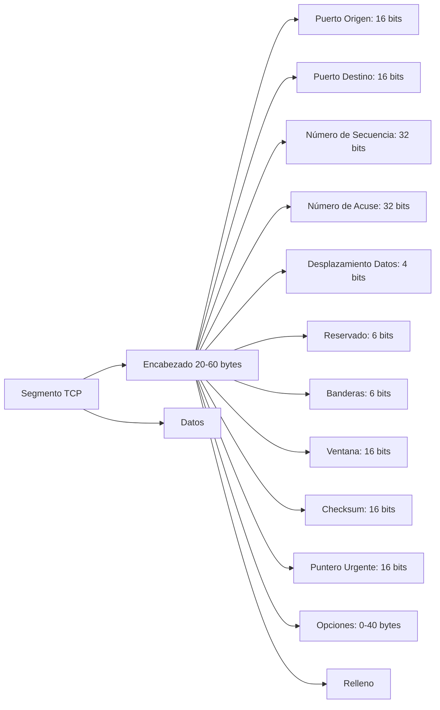
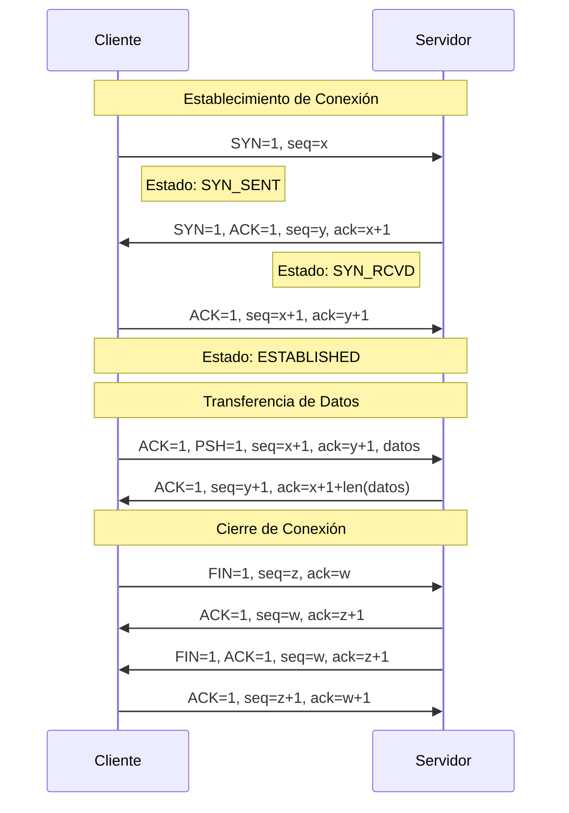
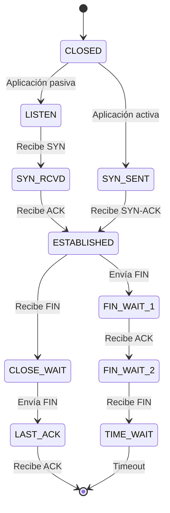

# Redes de Computadoras - Transporte

## 5.2 Protocolo TCP.

---

El Protocolo de Control de Transmisión (TCP) es un protocolo de la capa de transporte orientado a conexión que proporciona un servicio confiable de entrega de datos. Según Kurose y Ross (2010), TCP ofrece un servicio de transferencia de datos **confiable**, **orientado a conexión** y **bidireccional** entre aplicaciones.

#### Características Fundamentales

- **Orientado a conexión**: Requiere establecimiento de conexión antes de la transferencia de datos
- **Entrega confiable**: Garantiza que los datos lleguen sin errores y en orden
- **Control de flujo**: Evita que el emisor sature al receptor
- **Control de congestión**: Regula la transmisión para proteger la red
- **Transferencia full-duplex**: Comunicación bidireccional simultánea

### Estructura del Segmento TCP

#### Formato del Encabezado TCP



#### Campos del Encabezado TCP

**Puerto Origen y Destino (16 bits cada uno):**

- Identifican las aplicaciones emisora y receptora
- Rango: 0-65535

**Número de Secuencia (32 bits):**

- Posición del primer byte de datos en el segmento
- $seq_{nuevo} = (seq_{actual} + longitud_{datos}) \mod 2^{32}$

**Número de Acuse de Recibo (32 bits):**

- Próximo byte esperado por el receptor
- $ ACK = \text{último byte recibido} + 1 $

**Banderas de Control (6 bits):**

- URG: Datos urgentes
- ACK: Campo ACK válido
- PSH: Función push
- RST: Resetear conexión
- SYN: Sincronizar números de secuencia
- FIN: Finalizar conexión

### Establecimiento de Conexión: Three-Way Handshake

#### Proceso de Handshake

```python
class TCPThreeWayHandshake:
    def __init__(self):
        self.estado_cliente = "CLOSED"
        self.estado_servidor = "CLOSED"

    def handshake(self):
        print("=== ESTABLECIMIENTO DE CONEXIÓN TCP ===")

        # Paso 1: SYN del cliente
        self.estado_cliente = "SYN_SENT"
        seq_cliente = 1000  # ISN (Initial Sequence Number)
        print(f"1. CLIENTE → SERVIDOR: SYN=1, seq={seq_cliente}")

        # Paso 2: SYN-ACK del servidor
        self.estado_servidor = "SYN_RECEIVED"
        seq_servidor = 5000  # ISN del servidor
        ack_servidor = seq_cliente + 1
        print(f"2. SERVIDOR → CLIENTE: SYN=1, ACK=1, seq={seq_servidor}, ack={ack_servidor}")

        # Paso 3: ACK del cliente
        self.estado_cliente = "ESTABLISHED"
        ack_cliente = seq_servidor + 1
        print(f"3. CLIENTE → SERVIDOR: ACK=1, seq={ack_servidor}, ack={ack_cliente}")

        self.estado_servidor = "ESTABLISHED"
        print("✓ Conexión establecida exitosamente")

# Ejemplo de uso
conexion = TCPThreeWayHandshake()
conexion.handshake()
```

#### Diagrama de Three-Way Handshake



### Mecanismos de Fiabilidad

#### Números de Secuencia y ACK

Cada byte transmitido está numerado secuencialmente. El campo ACK indica el próximo byte esperado.

**Ejemplo de transmisión confiable:**

```python
def transmision_confiable():
    # Secuencia de transmisión y acuse de recibo
    secuencia = [
        {"segmento": 1, "seq": 1000, "datos": 100, "ACK_recibido": True},
        {"segmento": 2, "seq": 1100, "datos": 100, "ACK_recibido": True},
        {"segmento": 3, "seq": 1200, "datos": 100, "ACK_recibido": False},  # Se perdió
        {"segmento": 3, "seq": 1200, "datos": 100, "ACK_recibido": True},  # Retransmisión
        {"segmento": 4, "seq": 1300, "datos": 100, "ACK_recibido": True}
    ]

    for seg in secuencia:
        estado = "✓" if seg["ACK_recibido"] else "✗ (Retransmitir)"
        print(f"Segmento {seg['segmento']}: seq={seg['seq']}, ACK={estado}")

transmision_confiable()
```

#### Temporizadores y Retransmisiones

##### Cálculo de RTT y Timeout

Según Jacobson's Algorithm (Kurose & Ross, 2010):

$$
RTT_{estimado} = (1 - \alpha) \times RTT_{estimado} + \alpha \times RTT_{muestra}
$$

$$
Dev_{RTT} = (1 - \beta) \times Dev_{RTT} + \beta \times |RTT_{muestra} - RTT_{estimado}|
$$

$$
Timeout = RTT_{estimado} + 4 \times Dev_{RTT}
$$

Donde $\alpha = 0.125$ y $\beta = 0.25$.

```python
import math

class RTTEstimator:
    def __init__(self, alpha=0.125, beta=0.25):
        self.alpha = alpha
        self.beta = beta
        self.estimated_rtt = 100  # Valor inicial en ms
        self.dev_rtt = 0

    def update_rtt(self, sample_rtt):
        self.estimated_rtt = (1 - self.alpha) * self.estimated_rtt + self.alpha * sample_rtt
        self.dev_rtt = (1 - self.beta) * self.dev_rtt + self.beta * abs(sample_rtt - self.estimated_rtt)

    def get_timeout(self):
        return self.estimated_rtt + 4 * self.dev_rtt

# Ejemplo de cálculo
rtt_calc = RTTEstimator()
muestras = [100, 120, 80, 150, 90]

print("Evolución del cálculo de timeout:")
for i, muestra in enumerate(muestras, 1):
    rtt_calc.update_rtt(muestra)
    timeout = rtt_calc.get_timeout()
    print(f"Muestra {i}: RTT={muestra}ms, RTT_estimado={rtt_calc.estimated_rtt:.2f}ms, "
          f"Dev_RTT={rtt_calc.dev_rtt:.2f}ms, Timeout={timeout:.2f}ms")
```

### Control de Flujo

#### Ventana de Recepción

El receptor anuncia el espacio disponible en su buffer mediante el campo "Ventana" en el encabezado TCP.

$$ \text{Ventana disponible} = \text{Tamaño buffer} - (\text{Último byte leído} - \text{Último byte confirmado}) $$

```python
class TCPFlowControl:
    def __init__(self, buffer_size=65535):
        self.buffer_size = buffer_size
        self.last_byte_read = 0
        self.last_byte_received = 0
        self.advertised_window = buffer_size

    def receive_data(self, data_size, seq_number):
        # Simular recepción de datos
        self.last_byte_received = seq_number + data_size
        buffer_used = self.last_byte_received - self.last_byte_read

        # Calcular nueva ventana
        self.advertised_window = self.buffer_size - buffer_used

        print(f"Datos recibidos: {data_size} bytes")
        print(f"Buffer usado: {buffer_used}/{self.buffer_size} bytes")
        print(f"Ventana anunciada: {self.advertised_window} bytes")

        return self.advertised_window

    def read_data(self, bytes_read):
        # Simular lectura de datos por la aplicación
        self.last_byte_read += bytes_read
        self.advertised_window += bytes_read
        print(f"Leídos {bytes_read} bytes. Ventana actual: {self.advertised_window} bytes")

# Ejemplo de control de flujo
flow_control = TCPFlowControl(10000)
flow_control.receive_data(2000, 1000)
flow_control.receive_data(3000, 3000)
flow_control.read_data(4000)
```

### Control de Congestión

#### Algoritmo de Control de Congestión TCP

TCP utiliza un algoritmo que opera en tres fases: inicio lento, evitación de congestión y recuperación rápida.

##### Ventana de Congestión

$$ \text{Ventana transmisión} = \min( \text{Ventana congestión}, \text{Ventana recepción} ) $$

```python
class TCPCongestionControl:
    def __init__(self):
        self.cwnd = 1  # Ventana de congestión (en segmentos)
        self.ssthresh = 65535  # Umbral de inicio lento
        self.state = "Slow Start"

    def on_ack_received(self):
        if self.state == "Slow Start":
            self.cwnd += 1
            if self.cwnd >= self.ssthresh:
                self.state = "Congestion Avoidance"
        else:  # Congestion Avoidance
            self.cwnd += 1 / self.cwnd

    def on_timeout(self):
        self.ssthresh = max(self.cwnd // 2, 2)
        self.cwnd = 1
        self.state = "Slow Start"
        print(f"Timeout: ssthresh={self.ssthresh}, cwnd={self.cwnd}")

    def on_duplicate_ack(self):
        self.ssthresh = max(self.cwnd // 2, 2)
        self.cwnd = self.ssthresh + 3  # Fast Recovery
        self.state = "Fast Recovery"
        print(f"3 Dup ACKs: ssthresh={self.ssthresh}, cwnd={self.cwnd}")

# Simulación de control de congestión
congestion = TCPCongestionControl()
congestion.ssthresh = 8

print("Simulación de control de congestión TCP:")
for i in range(20):
    if i == 5:  # Simular timeout
        congestion.on_timeout()
    elif i == 12:  # Simular 3 ACKs duplicados
        congestion.on_duplicate_ack()
    else:
        congestion.on_ack_received()

    print(f"Paso {i+1}: cwnd={congestion.cwnd:.2f}, estado={congestion.state}")
```

### Cierre de Conexión

#### Four-Way Handshake

```python
class TCPConnectionTeardown:
    def __init__(self):
        self.estado = "ESTABLISHED"

    def cerrar_conexion(self):
        print("=== CIERRE DE CONEXIÓN TCP ===")

        # Paso 1: FIN del cliente
        self.estado = "FIN_WAIT_1"
        print("1. CLIENTE → SERVIDOR: FIN=1, seq=x")

        # Paso 2: ACK del servidor
        self.estado = "FIN_WAIT_2"
        print("2. SERVIDOR → CLIENTE: ACK=1, ack=x+1")

        # Paso 3: FIN del servidor
        self.estado = "TIME_WAIT"
        print("3. SERVIDOR → CLIENTE: FIN=1, seq=y")

        # Paso 4: ACK del cliente
        print("4. CLIENTE → SERVIDOR: ACK=1, ack=y+1")

        print("✓ Conexión cerrada completamente")

# Ejemplo de cierre
cierre = TCPConnectionTeardown()
cierre.cerrar_conexion()
```

### Ejercicios Propuestos

#### Ejercicio 1: Cálculo de Throughput TCP

Un enlace TCP tiene un RTT de 150ms y una ventana de congestión de 64KB. Calcule el throughput máximo teórico.

**Fórmula:**

$$
 \text{Throughput máximo} = \frac{ \text{Ventana congestión} }{RTT}
$$

**Solución:**

$$
Throughput = \frac{64 \times 1024 \times 8\ bits}{0.15\ s} = \frac{524288}{0.15} = 3,495,253\ bps \approx 3.5\ Mbps
$$

#### Ejercicio 2: Análisis de Secuencia TCP

Dada la siguiente secuencia de segmentos:

- Segmento 1: SYN, seq=1000
- Segmento 2: SYN-ACK, seq=5000, ack=1001
- Segmento 3: ACK, seq=1001, ack=5001
- Segmento 4: PSH-ACK, seq=1001, ack=5001, datos=500 bytes
- Segmento 5: ACK, seq=5001, ack=1501

Determine los números de secuencia y ACK esperados para el próximo segmento.

#### Ejercicio 3: Simulación de Control de Congestión

Implemente un simulador que muestre la evolución de la ventana de congestión durante 30 RTTs, considerando:

- ssthresh inicial = 16 segmentos
- Ocurre un timeout en el RTT 10
- Ocurren 3 ACKs duplicados en el RTT 20

### Estados de TCP

#### Máquina de Estados



### Casos de Estudio Avanzados

#### Caso 1: TCP en Redes Inalámbricas

**Problema:** Los algoritmos tradicionales de TCP interpretan las pérdidas por ruido inalámbrico como congestión.

**Soluciones:**

- TCP Westwood: Estimación mejorada del ancho de banda
- Mecanismos de discriminación de pérdidas

#### Caso 2: TCP para Aplicaciones de Tiempo Real

**Desafío:** Las retransmisiones de TCP introducen latencia variable.

**Enfoques:**

- TCP con opciones selectivas (SACK)
- Múltiples rutas con MPTCP

### Referencias Bibliográficas

#### Bibliografía Básica

1. **Kurose y Ross (2010) - Capítulo 3**: "Transport Layer" - Exhaustiva cobertura de principios TCP
2. **Tanenbaum y Wetherall (2010) - Capítulo 6**: "The Transport Layer" - Análisis detallado de TCP
3. **Peterson y Davie (2011) - Capítulo 5**: "End-to-End Protocols" - Perspectiva de sistemas
4. **Stallings (2010) - Capítulo 20**: "Transport Protocols" - Implementación y mecanismos

#### Bibliografía Complementaria

1. **RFC 793**: Especificación original de TCP
2. **RFC 2581**: Algoritmos de control de congestión TCP
3. **RFC 5681**: Especificación actualizada de control de congestión

### Herramientas de Análisis

#### Comandos Prácticos

```bash
# Monitoreo de conexiones TCP
netstat -tunap

# Análisis con tcpdump
tcpdump -i any -n tcp port 80

# Pruebas de throughput con iperf
iperf3 -c servidor -t 30
```

#### Ejemplo de Análisis con Wireshark

```
No.     Time        Source        Destination   Protocol Length Info
1 0.000000    192.168.1.100   93.184.216.34  TCP      74     49222 → 80 [SYN] Seq=0 Win=64240
2 0.125000    93.184.216.34  192.168.1.100   TCP      74     80 → 49222 [SYN, ACK] Seq=0 Ack=1 Win=65535
3 0.130000    192.168.1.100  93.184.216.34   TCP      66     49222 → 80 [ACK] Seq=1 Ack=1 Win=64240
```
