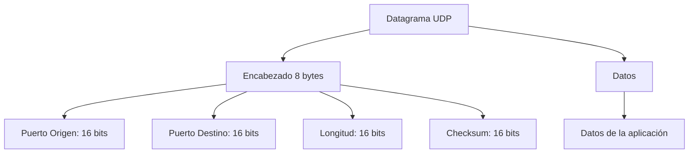
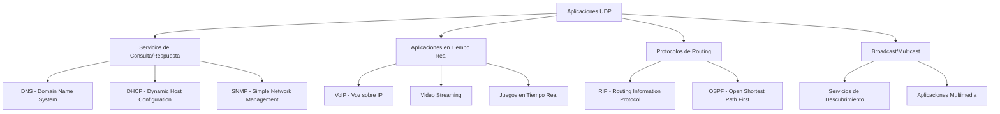

# Redes de Computadoras - Transporte

## 5.3 Protocolo UDP.

---

El Protocolo de Datagramas de Usuario (UDP) es un protocolo de la capa de transporte no orientado a conexión que proporciona un servicio mínimo de entrega de datos. Según Tanenbaum y Wetherall (2010), UDP ofrece un servicio **simple** y **sin conexión** que no garantiza la entrega, preserva los límites de los mensajes ni proporciona control de congestión.

#### Características Fundamentales

- **No orientado a conexión**: No requiere establecimiento de conexión previo
- **No confiable**: No garantiza entrega ni orden de los paquetes
- **Sin control de flujo**: El emisor puede saturar al receptor
- **Sin control de congestión**: No se adapta a la congestión de la red
- **Overhead mínimo**: Encabezado pequeño de solo 8 bytes
- **Preservación de mensajes**: Mantiene los límites de los datagramas

### Estructura del Segmento UDP

#### Formato del Encabezado UDP



#### Campos del Encabezado UDP

**Puerto Origen (16 bits):**

- Identifica la aplicación emisora
- Opcional (puede ser cero en algunos casos)
- Rango: 0-65535

**Puerto Destino (16 bits):**

- Identifica la aplicación receptora
- Esencial para la demultiplexación

**Longitud (16 bits):**

- Longitud total del datagrama en bytes
- Incluye encabezado (8 bytes) + datos
- $ \text{Longitud mínima} = 8 $ bytes, $ \text{Longitud máxima} = 65,535 $ bytes

**Checksum (16 bits):**

- Verificación de errores opcional
- Si es cero, indica que no se calculó checksum
- Cubre encabezado, datos y pseudo-encabezado IP

### Cálculo del Checksum UDP

#### Algoritmo de Checksum

El checksum UDP se calcula usando complemento a uno:

```python
def calcular_checksum_udp(datos, ip_origen, ip_destino, protocolo, longitud):
    """
    Calcula el checksum UDP según RFC 768
    """
    # Construir pseudo-encabezado
    pseudo_header = construir_pseudo_header(ip_origen, ip_destino, protocolo, longitud)

    # Combinar pseudo-encabezado + encabezado UDP + datos
    paquete_completo = pseudo_header + datos

    # Inicializar suma
    suma = 0

    # Sumar palabras de 16 bits
    for i in range(0, len(paquete_completo), 2):
        if i + 1 < len(paquete_completo):
            palabra = (paquete_completo[i] << 8) + paquete_completo[i + 1]
        else:
            palabra = paquete_completo[i] << 8  # Padding con cero si es necesario
        suma += palabra

    # Acarreo excesivo
    while suma >> 16:
        suma = (suma & 0xFFFF) + (suma >> 16)

    # Complemento a uno
    checksum = ~suma & 0xFFFF
    return checksum

def construir_pseudo_header(ip_origen, ip_destino, protocolo, longitud):
    """
    Construye el pseudo-encabezado para cálculo de checksum
    """
    pseudo_header = bytearray()

    # Dirección IP origen (4 bytes)
    pseudo_header.extend(ip_origen)

    # Dirección IP destino (4 bytes)
    pseudo_header.extend(ip_destino)

    # Cero (1 byte) + Protocolo (1 byte)
    pseudo_header.append(0)
    pseudo_header.append(protocolo)  # 17 para UDP

    # Longitud UDP (2 bytes)
    pseudo_header.append(longitud >> 8)
    pseudo_header.append(longitud & 0xFF)

    return pseudo_header

# Ejemplo de cálculo
ip_src = [192, 168, 1, 100]
ip_dst = [8, 8, 8, 8]
protocolo_udp = 17
longitud_udp = 20  # 8 bytes header + 12 bytes datos
datos_ejemplo = b'Hola Mundo UDP'

checksum = calcular_checksum_udp(datos_ejemplo, ip_src, ip_dst, protocolo_udp, longitud_udp)
print(f"Checksum calculado: 0x{checksum:04x}")
```

### Multiplexación y Demultiplexación

#### Proceso de Demultiplexación

```python
class UDPSocketManager:
    def __init__(self):
        self.sockets_activos = {}

    def registrar_socket(self, puerto, aplicacion):
        """Registra una aplicación en un puerto específico"""
        if puerto in self.sockets_activos:
            raise ValueError(f"Puerto {puerto} ya en uso")

        self.sockets_activos[puerto] = aplicacion
        print(f"Aplicación '{aplicacion}' registrada en puerto {puerto}")

    def entregar_datagrama(self, datagrama, puerto_destino, ip_origen, puerto_origen):
        """Entrega un datagrama a la aplicación correspondiente"""
        if puerto_destino not in self.sockets_activos:
            print(f"Puerto {puerto_destino} no registrado - Datagrama descartado")
            return

        aplicacion = self.sockets_activos[puerto_destino]
        print(f"Datagrama entregado a '{aplicacion}' desde {ip_origen}:{puerto_origen}")
        print(f"Datos: {datagrama[:50]}...")  # Mostrar primeros 50 caracteres

# Ejemplo de uso
manager = UDPSocketManager()

# Registrar aplicaciones en puertos conocidos
manager.registrar_socket(53, "Servidor DNS")
manager.registrar_socket(123, "Servidor NTP")
manager.registrar_socket(161, "Servidor SNMP")
manager.registrar_socket(514, "Servidor Syslog")

# Simular llegada de datagramas
manager.entregar_datagrama(b"Consulta DNS ejemplo", 53, "192.168.1.50", 54321)
manager.entregar_datagrama(b"Hora del sistema", 123, "10.0.0.100", 45678)
manager.entregar_datagrama(b"Datos SNMP", 161, "172.16.1.200", 32109)
manager.entregar_datagrama(b"Mensaje de log", 514, "192.168.2.150", 65432)
```

### Aplicaciones Típicas de UDP

#### Casos de Uso Comunes



#### Ejemplo: Cliente DNS Simple

```python
import socket
import struct

class DNSClientUDP:
    def __init__(self, dns_server="8.8.8.8"):
        self.dns_server = dns_server
        self.dns_port = 53

    def construir_consulta_dns(self, dominio, tipo=1):  # Tipo A = 1
        """Construye una consulta DNS simple"""
        # ID de transacción (16 bits)
        transaccion_id = 0x1234

        # Flags: Consulta estándar recursiva
        flags = 0x0100

        # Preguntas: 1
        qdcount = 1

        # Construir encabezado DNS
        header = struct.pack('!HHHHHH', transaccion_id, flags, qdcount, 0, 0, 0)

        # Construir pregunta
        partes_dominio = dominio.split('.')
        pregunta = b''
        for parte in partes_dominio:
            pregunta += bytes([len(parte)]) + parte.encode()
        pregunta += b'\x00'  # Terminador

        # Tipo y clase
        pregunta += struct.pack('!HH', tipo, 1)  # Clase IN = 1

        return header + pregunta

    def enviar_consulta(self, dominio):
        """Envía consulta DNS via UDP"""
        try:
            # Crear socket UDP
            sock = socket.socket(socket.AF_INET, socket.SOCK_DGRAM)
            sock.settimeout(5)  # Timeout de 5 segundos

            # Construir y enviar consulta
            consulta = self.construir_consulta_dns(dominio)
            sock.sendto(consulta, (self.dns_server, self.dns_port))

            print(f"Consulta DNS enviada para: {dominio}")

            # Recibir respuesta
            respuesta, servidor = sock.recvfrom(512)
            print(f"Respuesta recibida desde {servidor}")

            return respuesta

        except socket.timeout:
            print("Timeout: No se recibió respuesta")
            return None
        finally:
            sock.close()

# Ejemplo de uso
dns_client = DNSClientUDP()
respuesta = dns_client.enviar_consulta("google.com")
```

### Ventajas y Desventajas de UDP

#### Comparativa UDP vs TCP

```python
class ComparativaTransporte:
    def __init__(self):
        self.caracteristicas = {
            'TCP': {
                'orientacion': 'Orientado a conexión',
                'fiabilidad': 'Alta (con retransmisiones)',
                'control_flujo': 'Sí (ventana deslizante)',
                'control_congestion': 'Sí (algoritmos complejos)',
                'overhead': 'Alto (20-60 bytes)',
                'orden': 'Garantizado',
                'velocidad': 'Más lento',
                'aplicaciones_tipicas': ['Web (HTTP)', 'Email', 'Transferencia archivos']
            },
            'UDP': {
                'orientacion': 'Sin conexión',
                'fiabilidad': 'Baja (sin garantías)',
                'control_flujo': 'No',
                'control_congestion': 'No',
                'overhead': 'Bajo (8 bytes)',
                'orden': 'No garantizado',
                'velocidad': 'Más rápido',
                'aplicaciones_tipicas': ['DNS', 'VoIP', 'Video streaming', 'Juegos online']
            }
        }

    def mostrar_comparativa(self):
        print("COMPARATIVA: UDP vs TCP")
        print("=" * 60)

        for proto, caracteristicas in self.caracteristicas.items():
            print(f"\n{proto}:")
            print("-" * 30)
            for key, value in caracteristicas.items():
                if key != 'aplicaciones_tipicas':
                    print(f"  {key.replace('_', ' ').title()}: {value}")
                else:
                    print(f"  Aplicaciones Típicas: {', '.join(value)}")

# Mostrar comparativa
comparativa = ComparativaTransporte()
comparativa.mostrar_comparativa()
```

### Implementación de Aplicaciones UDP

#### Servidor UDP Básico

```python
import socket
import threading
from datetime import datetime

class UDPServer:
    def __init__(self, host='localhost', port=12345):
        self.host = host
        self.port = port
        self.running = False
        self.socket = None

    def start_server(self):
        """Inicia el servidor UDP"""
        try:
            self.socket = socket.socket(socket.AF_INET, socket.SOCK_DGRAM)
            self.socket.bind((self.host, self.port))
            self.running = True

            print(f"Servidor UDP iniciado en {self.host}:{self.port}")
            print("Esperando datagramas...")

            while self.running:
                try:
                    # Recibir datagrama
                    datos, direccion = self.socket.recvfrom(1024)

                    # Procesar en hilo separado
                    cliente_thread = threading.Thread(
                        target=self.procesar_cliente,
                        args=(datos, direccion)
                    )
                    cliente_thread.start()

                except Exception as e:
                    if self.running:
                        print(f"Error recibiendo datos: {e}")

        except Exception as e:
            print(f"Error iniciando servidor: {e}")

    def procesar_cliente(self, datos, direccion):
        """Procesa un datagrama recibido"""
        try:
            mensaje = datos.decode('utf-8')
            ip_cliente, puerto_cliente = direccion

            print(f"\n[{datetime.now()}] Datagrama desde {ip_cliente}:{puerto_cliente}")
            print(f"Mensaje: {mensaje}")

            # Preparar respuesta
            respuesta = f"ECHO: {mensaje} [{datetime.now()}]"

            # Enviar respuesta
            self.socket.sendto(respuesta.encode('utf-8'), direccion)
            print(f"Respuesta enviada a {ip_cliente}:{puerto_cliente}")

        except Exception as e:
            print(f"Error procesando cliente {direccion}: {e}")

    def stop_server(self):
        """Detiene el servidor"""
        self.running = False
        if self.socket:
            self.socket.close()
        print("Servidor UDP detenido")

# Cliente UDP para pruebas
class UDPClient:
    def __init__(self, server_host='localhost', server_port=12345):
        self.server_host = server_host
        self.server_port = server_port

    def enviar_mensaje(self, mensaje):
        """Envía un mensaje al servidor UDP"""
        try:
            sock = socket.socket(socket.AF_INET, socket.SOCK_DGRAM)

            # Enviar mensaje
            sock.sendto(mensaje.encode('utf-8'), (self.server_host, self.server_port))
            print(f"Mensaje enviado: {mensaje}")

            # Esperar respuesta (con timeout)
            sock.settimeout(5)
            respuesta, servidor = sock.recvfrom(1024)

            print(f"Respuesta recibida: {respuesta.decode('utf-8')}")
            sock.close()

        except socket.timeout:
            print("Timeout: No se recibió respuesta")
        except Exception as e:
            print(f"Error: {e}")

# Ejemplo de uso
if __name__ == "__main__":
    # Iniciar servidor en hilo separado
    server = UDPServer()
    server_thread = threading.Thread(target=server.start_server)
    server_thread.daemon = True
    server_thread.start()

    # Esperar un momento y enviar mensaje de prueba
    import time
    time.sleep(1)

    client = UDPClient()
    client.enviar_mensaje("Hola servidor UDP!")
```

### Ejercicios Propuestos

#### Ejercicio 1: Cálculo de Overhead

Calcule el porcentaje de overhead para los siguientes datagramas UDP:
a) Datos: 100 bytes
b) Datos: 512 bytes  
c) Datos: 1472 bytes (tamaño máximo típico para evitar fragmentación)

**Fórmula:**
$$ Overhead\% = \frac{ \text{Tamaño encabezado} }{ \text{Tamaño total} } \times 100 $$

**Solución:**

a) $ \frac{8}{108} \times 100 = 7.41 \% $
b) $ \frac{8}{520} \times 100 = 1.54 \% $
c) $ \frac{8}{1480} \times 100 = 0.54 \% $

#### Ejercicio 2: Análisis de Checksum

Dado el siguiente datagrama UDP:

- Puerto origen: 3000
- Puerto destino: 53
- Datos: "DNS Query" (9 bytes)
- IP origen: 192.168.1.100
- IP destino: 8.8.8.8

Calcule el checksum UDP manualmente.

#### Ejercicio 3: Diseño de Protocolo

Diseñe un protocolo simple sobre UDP que agregue:

- Números de secuencia para reordenamiento
- Confirmaciones de recepción
- Retransmisiones opcionales

Implemente las funciones básicas en Python.

### Consideraciones de Rendimiento

#### Ventajas de Rendimiento de UDP

```python
class AnalisisRendimiento:
    @staticmethod
    def calcular_latencia_teorica(protocolo, rtt, tamano_datos):
        """
        Calcula la latencia teórica para TCP vs UDP
        """
        if protocolo == "TCP":
            # TCP: 3-way handshake + transmisión + ACKs
            latencia = rtt * 1.5  # Handshake + primer segmento
            latencia += (tamano_datos / 1460) * rtt  # Segmentos adicionales
        else:  # UDP
            # UDP: Solo transmisión
            latencia = rtt * 0.5  # Solo ida para primer datagrama
            latencia += (tamano_datos / 1472) * rtt * 0.5  # Datagramas adicionales

        return latencia

    @staticmethod
    def comparar_rendimiento(tamano_datos_mb, rtt_ms=50):
        """
        Compara rendimiento teórico TCP vs UDP
        """
        tamano_datos_bytes = tamano_datos_mb * 1024 * 1024

        latencia_tcp = AnalisisRendimiento.calcular_latencia_teorica(
            "TCP", rtt_ms/1000, tamano_datos_bytes
        )

        latencia_udp = AnalisisRendimiento.calcular_latencia_teorica(
            "UDP", rtt_ms/1000, tamano_datos_bytes
        )

        print(f"Análisis para {tamano_datos_mb} MB, RTT={rtt_ms}ms:")
        print(f"TCP - Latencia teórica: {latencia_tcp:.3f} segundos")
        print(f"UDP - Latencia teórica: {latencia_udp:.3f} segundos")
        print(f"Mejora UDP: {((latencia_tcp - latencia_udp) / latencia_tcp * 100):.1f}%")

# Ejecutar análisis
AnalisisRendimiento.comparar_rendimiento(1)  # 1 MB de datos
AnalisisRendimiento.comparar_rendimiento(10) # 10 MB de datos
```

### Aplicaciones Avanzadas con UDP

#### Protocolo RTP sobre UDP

```python
class RTPOverUDP:
    """
    Implementación simplificada de RTP (Real-time Transport Protocol) sobre UDP
    """
    def __init__(self, puerto_local, destino_ip, destino_puerto):
        self.destino = (destino_ip, destino_puerto)
        self.sequence_number = 0
        self.timestamp = 0
        self.ssrc = 0x12345678  # Identificador de fuente

    def crear_paquete_rtp(self, payload, marcador=0, tipo_payload=96):
        """
        Crea un paquete RTP según RFC 3550
        """
        # Encabezado RTP (12 bytes)
        version = 2
        padding = 0
        extension = 0
        cc = 0  # Contributing sources count

        # Construir primer byte
        byte1 = (version << 6) | (padding << 5) | (extension << 4) | cc

        # Construir segundo byte
        byte2 = (marcador << 7) | (tipo_payload & 0x7F)

        # Empaquetar encabezado
        header = bytearray()
        header.append(byte1)
        header.append(byte2)
        header.extend(struct.pack('!H', self.sequence_number))
        header.extend(struct.pack('!I', self.timestamp))
        header.extend(struct.pack('!I', self.ssrc))

        # Incrementar contadores
        self.sequence_number = (self.sequence_number + 1) % 65536
        self.timestamp += 160  # 20ms a 8kHz

        return bytes(header) + payload

    def enviar_audio(self, datos_audio):
        """Envía datos de audio via RTP/UDP"""
        try:
            sock = socket.socket(socket.AF_INET, socket.SOCK_DGRAM)
            paquete_rtp = self.crear_paquete_rtp(datos_audio)
            sock.sendto(paquete_rtp, self.destino)
            sock.close()
            return True
        except Exception as e:
            print(f"Error enviando audio RTP: {e}")
            return False
```

### Referencias Bibliográficas

#### Bibliografía Básica

1. **Kurose y Ross (2010) - Capítulo 3**: "Transport Layer" - Explica principios de UDP y comparación con TCP
2. **Tanenbaum y Wetherall (2010) - Capítulo 6**: "The Transport Layer" - Análisis detallado de UDP
3. **Peterson y Davie (2011) - Capítulo 5**: "End-to-End Protocols" - Implementación de UDP
4. **Stallings (2010) - Capítulo 20**: "Transport Protocols" - Mecanismos de UDP

#### Bibliografía Complementaria

1. **RFC 768**: Especificación original de UDP
2. **RFC 3550**: RTP: A Transport Protocol for Real-Time Applications
3. **Stevens (1994)**: "TCP/IP Illustrated, Volume 1" - Ejemplos prácticos de UDP

### Resumen de Fórmulas Importantes

#### UDP Básico

- **Longitud máxima**: $ 65535 - 20_{IP} - 8_{UDP} = 65507 $ bytes de datos
- **Overhead**: $ Overhead = \frac{8}{Longitud_{total}} \times 100\% $
- **Checksum**: Complemento a uno de la suma de palabras de 16 bits

#### Rendimiento

- **Latencia UDP**: $Latencia \approx \frac{RTT}{2} + \frac{Datos}{MSS} \times \frac{RTT}{2}$
- **Throughput máximo**: $ \text{Throughput teórico} = \frac{65507\ bytes}{RTT}$
